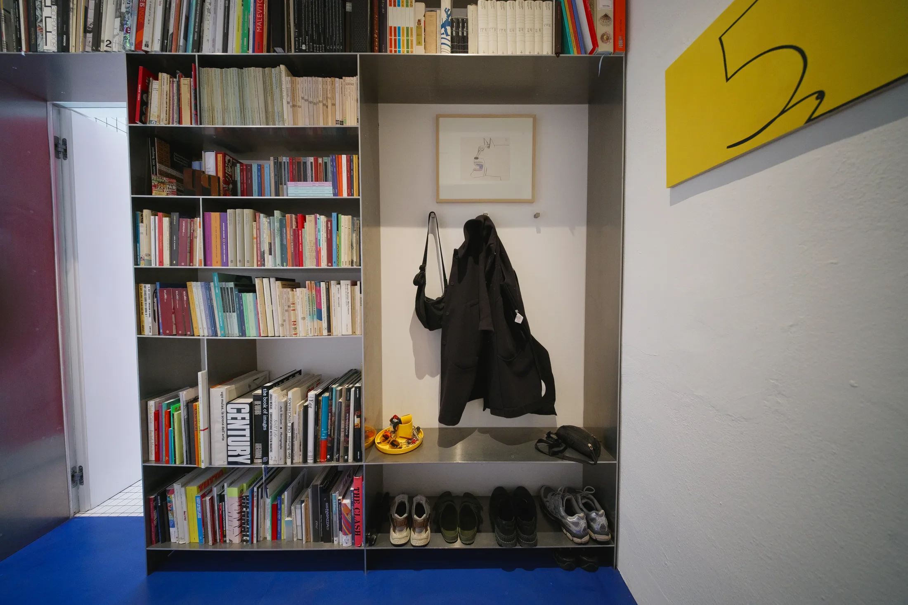
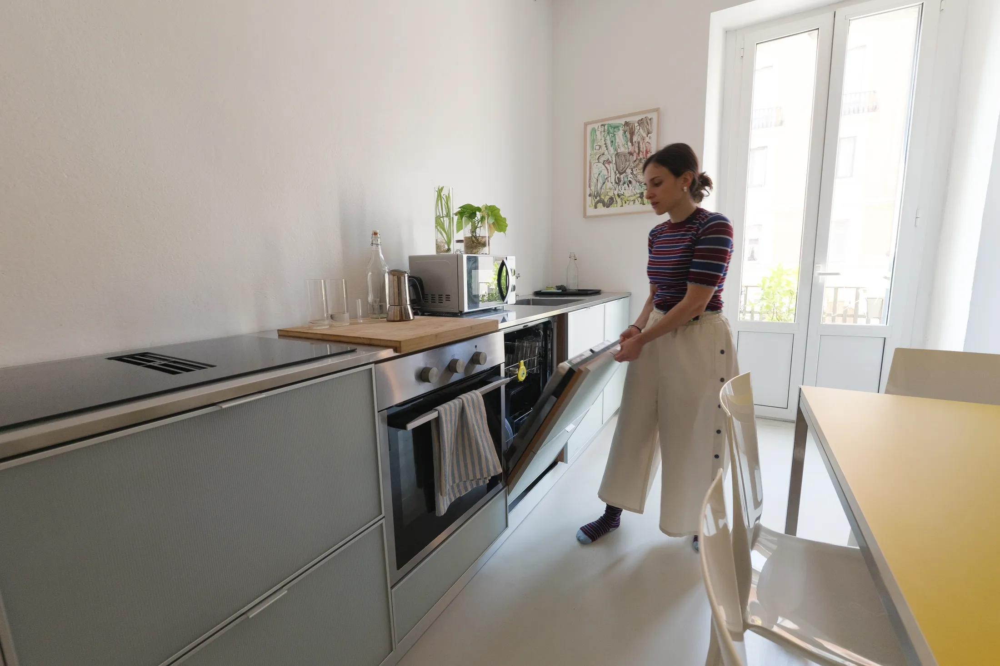
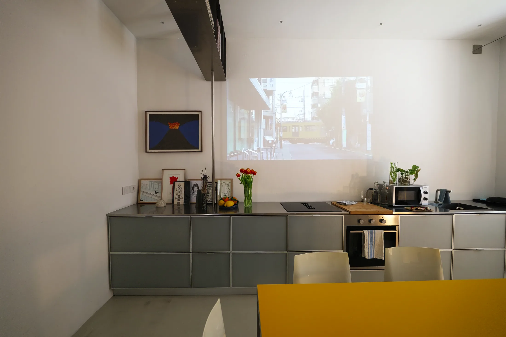
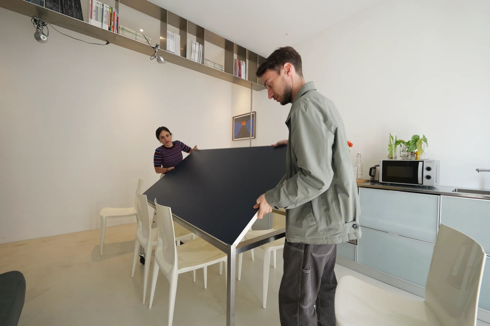
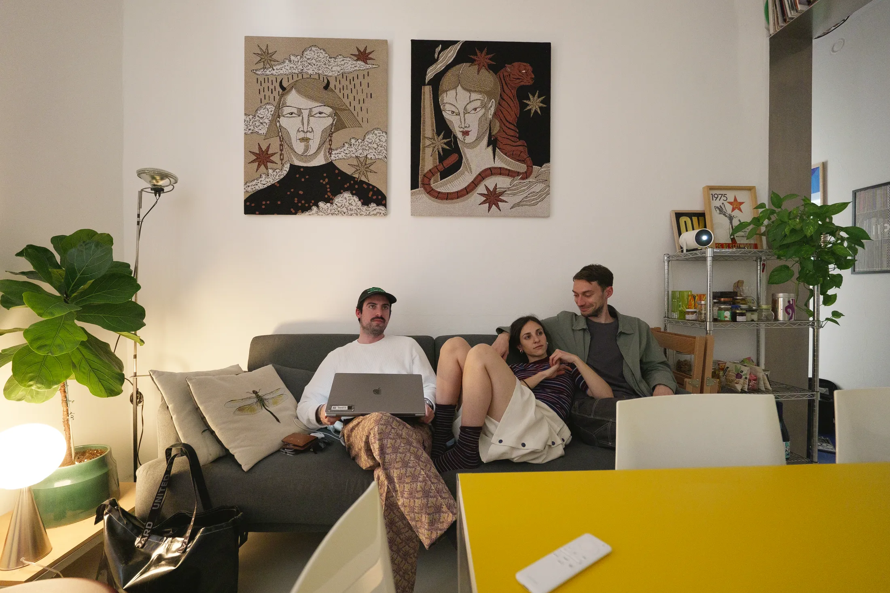
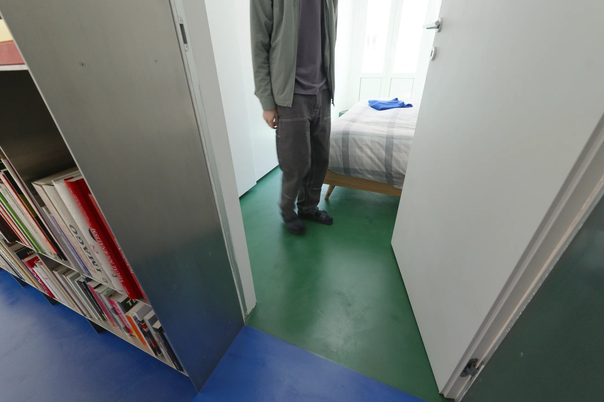
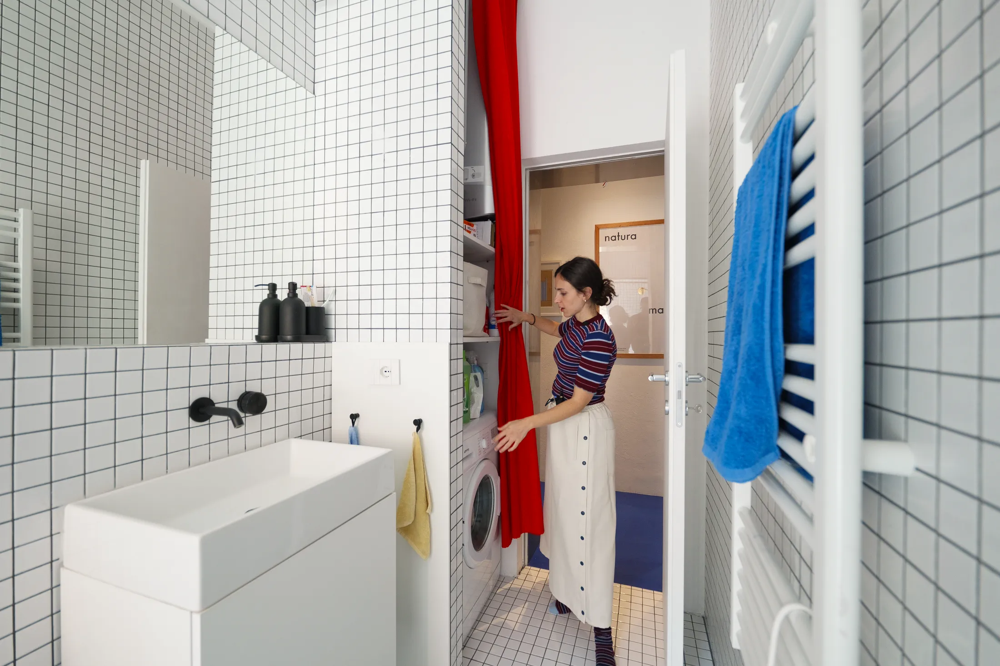

# Коридор-библиотека и кино на кухонной стене: дома у двух дизайнеров, 45 м²

Джованни Кавалери (Giovanni Cavalleri) и Чечилия Бьянкини (Cecilia Bianchini) — графические дизайнеры, основатели миланской студии Paper Paper. Свою однокомнатную квартиру площадью 45 м² они купили, чтобы замедлиться и отдохнуть от города, а получилось место, куда приятно звать друзей: в нём живут книги, плакаты, проектор и стол на колёсах. Хозяева сами говорят, что очень любят принимать гостей.

Для москвича эта история знакома. Работа дома, коллекции, которые некуда деть, друзья, которых хочется накормить, — а площади 40–45 м², как у типовой евродвушки в новостройке. Разберём, какие приёмы можно примерить.

## Коротко

- Коридор — не проходная зона, а библиотека: стеллаж подвешен к потолку и подогнан под самые большие книги.
- Пустая стена над кухонной столешницей служит экраном для проектора, поэтому телевизор не нужен.
- Стол на колёсах и диван-кровать превращают комнату из столовой в спальню для гостей за пару минут.
- Дверь в ванную заменила красная штора: распашная дверь упёрлась бы во входную.
- Яркие цвета — синий коридор, зелёный пол в спальне, красная штора — разделяют зоны без стен.

## Приём 1: коридор как библиотека и галерея

Самое заметное в квартире — алюминиевый стеллаж вдоль всего коридора. Его подвесили к потолку, а не поставили на пол, и сделали по размеру самых больших книг дизайнеров. Заказывали у специалистов по металлу. Полки держат не только книги, но и ключи, обувь, куртки. На противоположной стене висят постеры и работы друзей и коллег — получилась домашняя галерея.

*Квартира Paper Paper, Милан, 45 м²: стеллаж в коридоре. Джованни Кавалери (Giovanni Cavalleri) и Чечилия Бьянкини (Cecilia Bianchini). Фото: Never Too Small*

**Как повторить.** В московских домах от хрущёвки до сталинки коридор почти всегда лишнее место: двери, вешалка, тумба. Если ширина позволяет держать полку глубиной около 25–30 см, получится «библиотека» без потери проходимости. Подвесной вариант оставляет пол свободным — робот-пылесос проедет, а в слякотную московскую зиму на полу под полкой удобно поставить мокрую обувь. Тяжёлую конструкцию крепите по проекту, а не на глаз: нагрузку на стену и перекрытие считает мастер.

## Приём 2: кухонная стена — кинотеатр

Кухня здесь линейная: длинный ряд шкафов из нержавеющей стали, внутри духовка, компактный холодильник и скрытое хранение. Столешница из нержавейки идёт во всю длину. Вытяжку встроили в варочную панель, поэтому стена над столешницей осталась абсолютно чистой — на неё и проецируют фильмы. Проектор стоит на отдельной металлической открытой полке-кладовой.

*Кухня: столешница из нержавеющей стали на всю длину, вытяжка встроена в плиту. Фото: Never Too Small*

*Свободная стена над столешницей работает как экран для проектора. Фото: Never Too Small*

**Для Москвы.** Проектор — один из самых простых способов освободить стену от телевизора, а в Москве с её короткими зимними днями и долгими вечерами кино дома нужно часто. Но два нюанса. Во-первых, встроенная в варочную панель вытяжка — это про удобство, а не про отказ от вентиляции: вентиляционные каналы нельзя ликвидировать или уменьшать (постановление 508-ПП). Во-вторых, студия с кухней, соединённой с комнатой, возможна не везде: если на кухне стоит газовая плита, делать проём без плотной двери нельзя. В домах с электроплитами свободы больше, но перепланировку нужно согласовывать.

## Приём 3: стол на колёсах и диван-кровать

Гостиная в этой квартире постоянно меняется: тихий вечер вдвоём, длинный ужин с друзьями, ночёвка. Поэтому мебель подвижная. Обеденный стол дизайнеры придумали вместе с архитекторами: он на колёсах, а его столешница переворачивается — с одной стороны жёлтая, с другой синяя. Диван раскладывается просто: спинка опускается, и получается кровать для гостей.

*Стол на колёсах: столешница переворачивается из жёлтой в синюю. Фото: Never Too Small*

*Диван-кровать для ночёвок: спинка откидывается. Фото: Never Too Small*

Окно гостиной закрывает белая штора до пола, которую Джованни привёз из дома матери. Она висит на тонком металлическом тросе, а потолки здесь ниже, чем в других комнатах, поэтому штору складывают и подвязывают лентой.

**Как повторить.** Для московской однушки или евродвушки подвижная мебель — способ получить столовую на шестерых там, где в обычные дни живут двое. Колёса на столе нужны, чтобы за минуту освободить центр комнаты, а раскладной диван избавляет от необходимости отдавать гостевую комнату. Штору на тросе можно повесить и в хрущёвке: она не требует карниза на всю стену, а складывается так, чтобы не занимать место.

## Приём 4: цвет вместо стен

Квартира делится на зоны цветом. Коридор синий, пол в спальне — глубокий зелёный, а ванная закрыта красной шторой. В спальне стоит шкаф IKEA вдоль одной стены, на окнах — тяжёлые ставни, которые держат свет снаружи. Хозяева признаются, что пространство над шкафом пока не решено.

*Спальня с глубоким зелёным полом контрастирует с синим коридором. Фото: Never Too Small*

В ванной — белая плитка небольшого формата с чёрной затиркой: этот приём авторы взяли у итальянской группы Superstudio. Распашную дверь заменили красной шторой, ведь она бы билась о входную. За шторой прячутся стиральная машина и бытовая химия; всё хранение приподнято над полом.

*Красная штора вместо двери прячет стиральную машину. Фото: Never Too Small*

**Для Москвы.** Штора вместо двери — выход, когда санузел открывается в крошечную прихожую, как во многих типовых панельных домах. Но помните, что в ванной влага, а у штор есть срок службы — берите плотную водоотталкивающую ткань. А вот зелёный пол или синий коридор — готовый приём для тех, кто сдаёт или меняет квартиру: цвет можно перекрасить, а стены остаются целыми.

## Работа дома: что важно в такой квартире

Дизайнерам нужны книги, компьютер и хорошее освещение, но отдельного кабинета у них нет: работа растворена в пространстве, как и всё остальное. В Москве это тоже актуально. По данным hh.ru, в июне 2025 года 23% россиян хотели работать полностью удалённо, ещё 26% — в гибридном режиме. То есть каждому второму кабинет нужен хотя бы несколько дней в неделю, а выделить комнату получается не у всех. Выход, подсказанный этим проектом, — мебель, которая позволяет «включить» рабочую зону и убрать её с глаз: стол на колёсах, полка-кладовая, закрытое хранение техники.

## Чек-лист

1. Измерьте коридор: сколько сантиметров глубины можно отдать под полки без ущерба для прохода.
2. Освободите одну стену от всего — под экран проектора.
3. Выберите стол на колёсах и диван с откидной спинкой, если гости остаются на ночь.
4. Покрасьте пол или стену в контрастный цвет, чтобы отделить зону сна.
5. Для ванной с тесным входом подберите плотную штору вместо двери.
6. Проверьте, что вытяжка и вентиляция остаются на своих местах, а проём на кухню не нарушает требований к газу.

Больше идей — в разделе [«Интерьер»](/temy/interer/). А если вы ищете квартиру под такую планировку, откройте [каталог новостроек Москвы](/novostroyki/moskva/).

## Вопросы и ответы

**Можно ли в московской квартире убрать дверь на кухню и смотреть кино на стене?**
Если кухня с газовой плитой, проём между ней и комнатой без плотной двери делать нельзя — это запрещает постановление 508-ПП. В домах с электроплитами ограничений меньше, но перепланировку всё равно согласуют. Проектор на стене кухни работает и без изменения проёма.

**Как удобно работать из дома в квартире 45 м²?**
Опыт показывает, что отдельный кабинет не обязателен: нужны место для техники, хорошее освещение и мебель, которая уходит с глаз. По данным hh.ru на июнь 2025 года, полностью удалённо хотят работать 23% россиян, ещё 26% — гибридно.

**Как повесить тяжёлый стеллаж в коридоре?**
В проекте стеллаж подвесили к потолку, а не поставили на пол, и сделали на заказ металлисты. В новостройке с монолитными перекрытиями такой вариант возможен, но крепёж и нагрузку нужно рассчитать с мастером.

## Источники

1. Never Too Small. How two graphic designers live and work in 45sqm/484sqft home — https://www.nevertoosmall.com/post/how-two-graphic-designers-live-and-work-in-45sqm-484sqft-home
2. Мосжилинспекция: какие перепланировки запрещены (постановление 508-ПП) — https://www.mos.ru/news/item/76897073/
3. Коммерсантъ: исследование hh.ru об удалённой работе, июнь 2025 — https://www.kommersant.ru/doc/8336320

*Материал подготовлен по мотивам публикаций Never Too Small и использует их фото с разрешения правообладателя.*
