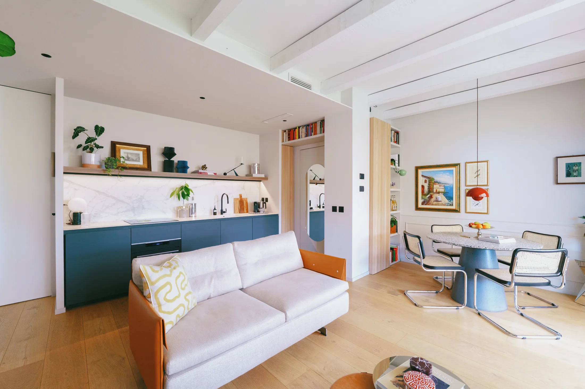
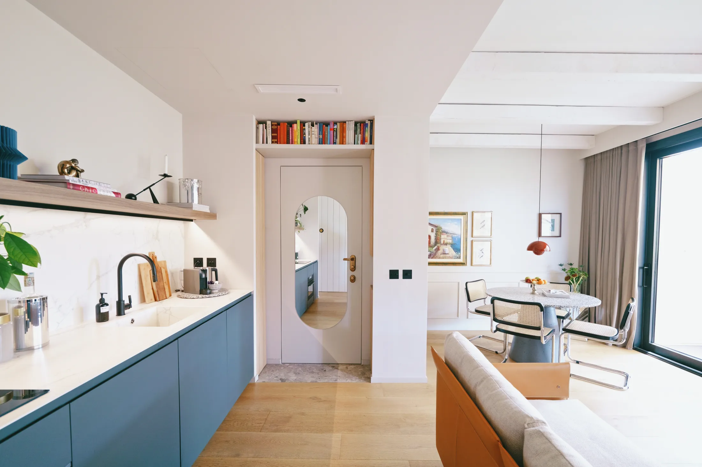
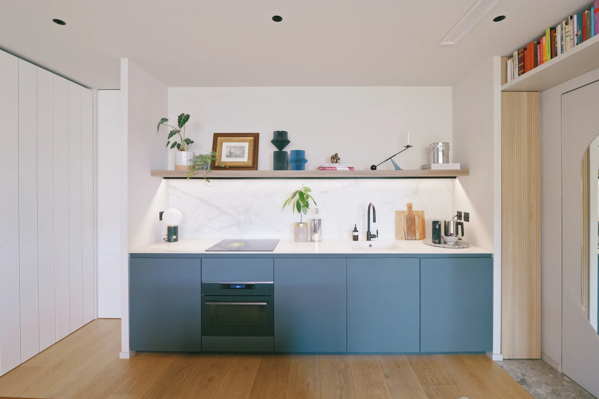
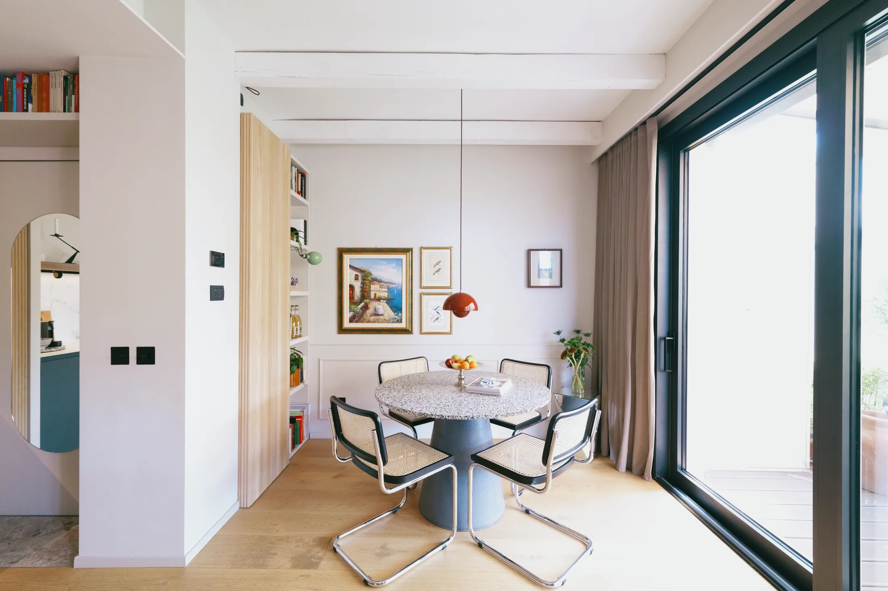
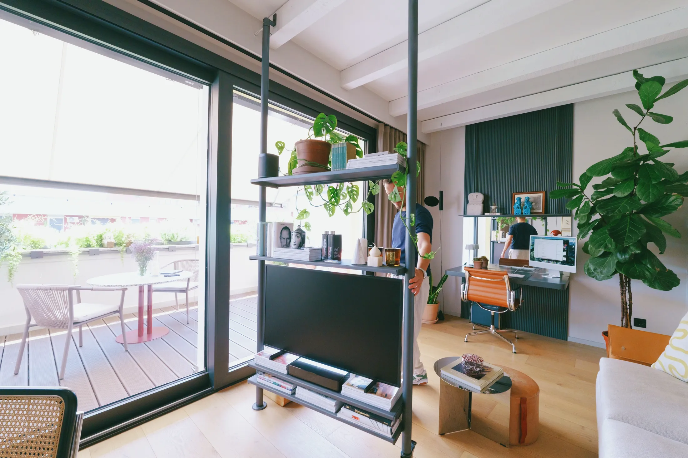
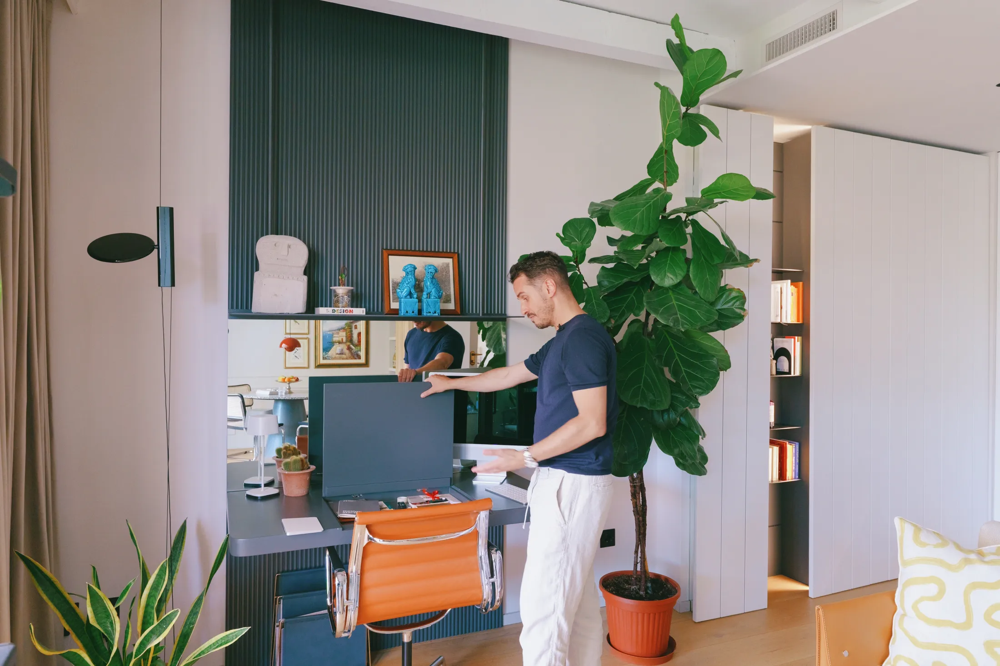
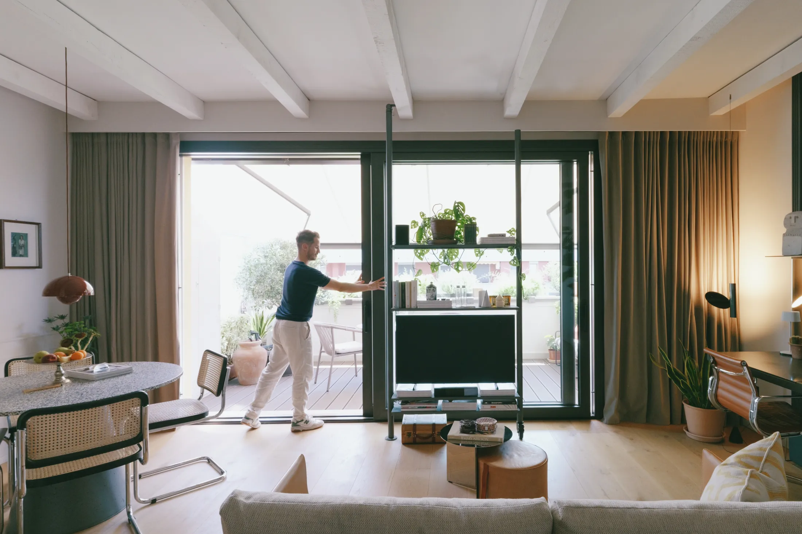
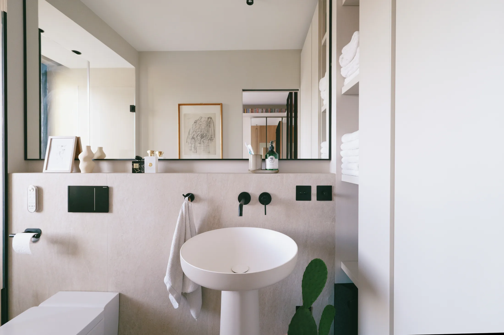

# 45 м² как отель: приёмы дизайнера из Милана для московской евродвушки

44 м² — нижняя граница для двухкомнатной квартиры в новых московских проектах: с 1 августа 2024 года меньше проектировать нельзя (постановление Правительства Москвы № 1672-ПП). То есть типичная «евродвушка» сегодня — это примерно 45 м², в которые нужно уложить спальню, гостиную с кухней, гардероб и место для работы.

Ровно 45 м² у миланской квартиры The Navigli Suite. Её для себя переделал Симоне Монджини (Simone Mongini) — дизайнер, который восемь лет проектировал люксовые отели в Лондоне. Привычка гостиничного дизайнера видна во всём: каждая вещь работает на два-три сценария, а лишнее спрятано за ровными фасадами. Посмотрим, что из этого пригодится в московской квартире.

## Коротко

- Вход — это шкафы: узкие рифлёные створки по бокам двери прячут одежду, обувь и полки, а над дверью поднят потолочный стеллаж.
- Кухня без верхних шкафов: одна полка, холодильник в линии фасадов, вытяжка внутри варочной панели.
- Вместо стены между гостиной и столовой — вращающийся металлический стеллаж.
- Спальню уменьшили, чтобы отдать площадь гостиной; рабочий стол живёт в гостиной и закрывается.
- Терраса 15 м² продолжает комнату и работает как вторая гостиная.

*The Navigli Suite, Милан, 45 м². Дизайнер Симоне Монджини. Фото: Never Too Small*

## Приём 1: вход, который хранит всё

Первое, что видит гость, — тонкий мраморный порог и две узкие стенки из рифлёного дерева с лаковой отделкой. За ними скрыты крючки для верхней одежды, обувь и полки. Шкаф с одной стороны разделён на две части: так ручка входной двери не упирается в фасад, а между частями остаётся узкая ниша для ключей. Над входом, под потолком, Симоне поставил книжный стеллаж, а на обратной стороне двери повесил овальное зеркало.

*Вход: узкие шкафы по бокам двери, тонкий мраморный порог. Фото: Never Too Small*

**Для Москвы.** В хрущёвках и многих панельных домах прихожая — это коридор шириной около метра, где шкаф-купе съедает проход. Здесь работает другой принцип: не один большой шкаф, а несколько узких «колонн» по бокам двери и использование пространства над ней. Если у вас в новостройке есть ниша у входа, глубину в 30–35 см под обувь и вешалки стоит закладывать в проект ещё до отделки — после неё отвоевать эти сантиметры почти невозможно. Зеркало на двери — самая дешёвая часть решения и пригодится в любой квартире.

## Приём 2: кухня без верхних шкафов

Вдоль стены тянется длинная линия тёмных фасадов, в которую встроены холодильник и морозилка. Верхние шкафы заменены одной деревянной полкой. Столешница — тонкая керамика, которая переходит в фартук без стыка. Варочная панель Bora со встроенной вытяжкой избавила кухню от привычного «зонтика» над плитой. Рядом, в белой рифлёной стене, спрятана кладовая с техникой.

*Кухня: тёмная линия фасадов с холодильником и одна деревянная полка вместо верхних шкафов. Фото: Never Too Small*

Обеденный стол Симоне сделал сам: плита из местного миланского мрамора в стиле терраццо на бетонном основании. Рядом — открытые полки для книг и вина и шкафчик для бокалов. Кухня получается не «рабочей зоной», а частью гостиной, и это ровно то, что нужно студийной планировке.

*Обеденный стол Симоне сделал сам: мраморная плита и бетонное основание. Фото: Never Too Small*

**Как повторить.** Отказаться от верхних шкафов в Москве проще всего, если кухня открытая и совмещена с гостиной: вместо них достаточно одной длинной полки и высокого пенала. С вытяжкой, встроенной в панель, есть нюанс: она требует отдельного канала или рециркуляции, а вентиляционные каналы в многоквартирном доме нельзя уменьшать или ликвидировать (постановление 508-ПП). Поэтому тип вытяжки лучше выбрать до того, как кухню нарисует мебельщик, и свериться с планом вентиляции вашего дома.

## Приём 3: вращающийся стеллаж вместо стены

В центре гостиной стоит металлический стеллаж на оси. Он одновременно подставка под телевизор, книжная полка и условная перегородка: поворачиваешь — и экран смотрит либо на диван, либо в столовую. Провода уходят внутрь вращающейся колонны. Под телевизором стоит чемодан — в нём лежат лекарства; аптечного шкафчика в квартире нет.

Диван из кожи Poltrona Frau поставлен так, что с него не видно кухню. Это важная деталь: открытая планировка не должна превращаться в зрелище немытой посуды.

*Вращающийся стеллаж: подставка под телевизор, книжная полка и условная стена. Фото: Never Too Small*

**Для Москвы.** В евродвушке в монолитном доме перегородки между кухней и гостиной часто несущими не бывают, но в любом случае снос или перенос стен — это согласование. Стеллаж-перегородка не требует ни проекта, ни разрешения: он мебель. Если у вас кухня-гостиная 18–20 м², стеллаж высотой по пояс-грудь разделит её не хуже стены и оставит свет сквозным.

## Приём 4: рабочее место, которое закрывается

В гостиной стоит заказной рабочий стол из тёмного дерева с закрытым отсеком для проводов, бумаг и техники. Напротив него, на стене, висит зеркало в обрамлении рифлёных панелей: оно отражает свет и виды из окна и визуально расширяет комнату.

*Рабочий стол на заказ с закрытым отсеком для проводов и техники. Фото: Never Too Small*

**Как повторить.** Для Москвы эта тема актуальнее, чем кажется: по данным hh.ru за июнь 2025 года, 23% россиян хотят работать полностью удалённо, ещё 26% — в гибридном режиме. Значит, в сорока с небольшим метрах рабочий стол нужен почти половине жильцов. Лучшее место для него — не в спальне, а в гостиной, у окна, с крышкой или ящиком, который в конце дня превращает стол в обычную консоль. Хорошо, если розетки и разводка уже учтены в проекте.

## Приём 5: терраса как вторая гостиная

Терраса в этой квартире — 15 м², на ней помещается до десяти человек. Пол гостиной поднят вровень с настилом, а раздвижное остекление идёт от пола до потолка. Растения — оливковые деревья, вьющиеся, кашпо по индивидуальному заказу. Их закрепили к балюстраде железными накладками на заказ, а по краю поставили тонкую зеркальную панель, которая отражает зелень. Жалюзи и маркиза управляются кнопкой.

*Терраса 15 м² на одном уровне с полом гостиной. Фото: Never Too Small*

**Для Москвы.** Террас в новостройках почти нет, зато есть лоджия или балкон. Объединить их с комнатой нельзя: постановление 508-ПП запрещает присоединять лоджии и балконы к жилым комнатам и переносить на них общедомовые радиаторы. Остаются законные приёмы: остеклить лоджию, положить на пол тот же материал, что и в комнате (это визуально продолжит пространство), поставить растения и узкую скамью-сундук. С октября по апрель она всё равно будет холодной — но летом станет настоящей комнатой, а зимой защитит окно от лишнего сквозняка.

## Спальня и санузел: меньше площади — больше жизни

Спальню Симоне уменьшил сознательно, чтобы отдать площадь гостиной. В ней встроенный стеклянный шкаф с открытыми штангами, неглубокий зеркальный шкафчик глубиной 13 см, куда убираются принадлежности для уборки, и существующие ниши в стене, превращённые в полки. Над изголовьем смонтирован проектор.

Санузел при спальне — с дверью-пеналом, которая уходит в стену, поэтому не занимает место при открывании. Стиральная машина спрятана за встроенными фасадами, лейка душа замаскирована под потолочный светильник, пока не пойдёт вода. Раковина — скульптурная, от Antonio Lupi. Вместо биде — японский унитаз.

*Санузел: раковина Antonio Lupi и скрытая лейка душа. Фото: Never Too Small*

**Как повторить.** Дверь-пенал и скрытая стиральная машина экономят самые дорогие в квартире сантиметры. В московских домах стояк и вентканал определяют, где вообще может стоять ванная, поэтому такие решения лучше планировать в рамках существующей мокрой зоны.

## Чек-лист для квартиры 40–50 м²

1. Вход: узкие шкафы по бокам двери, полки над дверью, зеркало на её полотне.
2. Кухня: одна полка вместо верхних шкафов, холодильник в линии фасадов, вытяжку согласовать с вентиляцией заранее.
3. Мебель-перегородка вместо стены: вращающийся или сквозной стеллаж.
4. Рабочий стол в гостиной с закрытым отсеком для проводов.
5. Спальня минимальная, гостиная — максимальная.
6. Дверь-пенал и скрытая стиральная машина в санузле.
7. Лоджия — как отдельная зона, не как расширение комнаты.

Больше идей для небольших квартир — в разделе [«Интерьер»](/temy/interer/). Если вы выбираете квартиру в новостройке, посмотрите [каталог объектов](/obekty/) и [новостройки Москвы](/novostroyki/moskva/).

## Вопросы и ответы

**Какой должна быть минимальная площадь двухкомнатной квартиры в новой московской застройке?**
С 1 августа 2024 года в новых московских проектах двухкомнатная квартира не может быть меньше 44 м², однокомнатная — меньше 28 м² (постановление Правительства Москвы № 1672-ПП от 23 июля 2024 года). Квартира в Милане, о которой идёт речь, чуть больше этого порога — 45 м².

**Как обойтись на маленькой кухне без верхних шкафов?**
В миланской квартире верхние шкафы заменили одной деревянной полкой, холодильник и морозилку встроили в линию тёмных фасадов, а вытяжку совместили с варочной панелью. В Москве схему с вытяжкой, встроенной в панель, нужно заранее согласовать с планом вентиляции: уменьшать и ликвидировать вентканалы запрещено.

**Можно ли в Москве присоединить лоджию к комнате, чтобы получилась терраса?**
Нет. Постановление 508-ПП запрещает объединять лоджии и балконы с комнатами и переносить на них общедомовые радиаторы. Законный вариант — оформить лоджию как отдельное остеклённое пространство со своей мебелью и растениями.

## Источники

1. Never Too Small. Luxury hotel designer transforms his 45sqm/484sqft Milan apartment — https://www.nevertoosmall.com/post/luxury-hotel-designer-transforms-his-45sqm-484sqft-milan-apartment
2. ppt.ru: постановление Правительства Москвы от 23.07.2024 № 1672-ПП — https://ppt.ru/obzory/vstupaet-v-silu/postanovlenie-pravitelstva-moskvy-23-07-2024-1672-pp
3. Мосжилинспекция: какие перепланировки запрещены (постановление 508-ПП) — https://www.mos.ru/news/item/76897073/
4. «Коммерсантъ»: опрос hh.ru о формате работы, июнь 2025 — https://www.kommersant.ru/doc/8336320

*Материал подготовлен по мотивам публикаций Never Too Small и использует их фото с разрешения правообладателя.*
