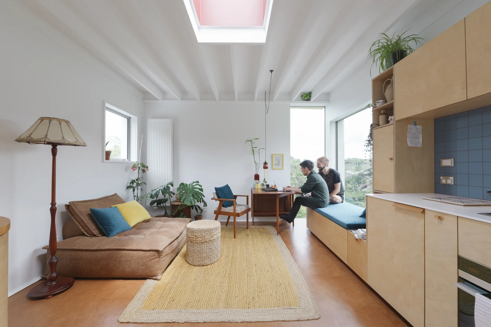
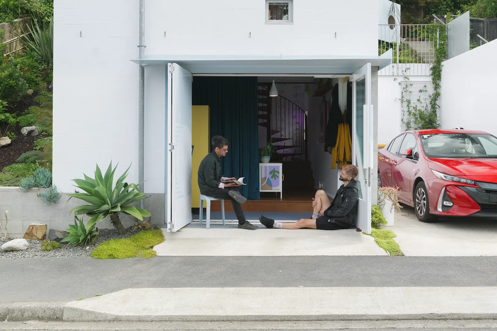
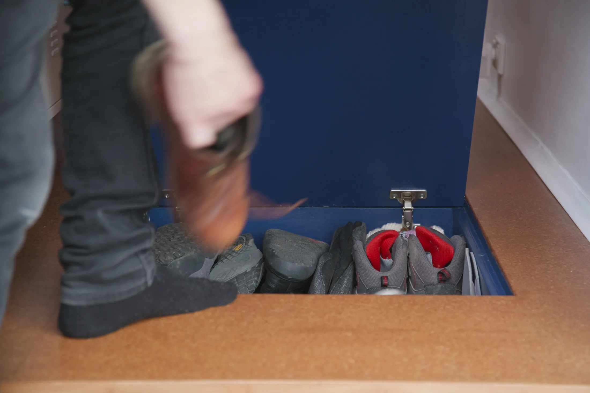
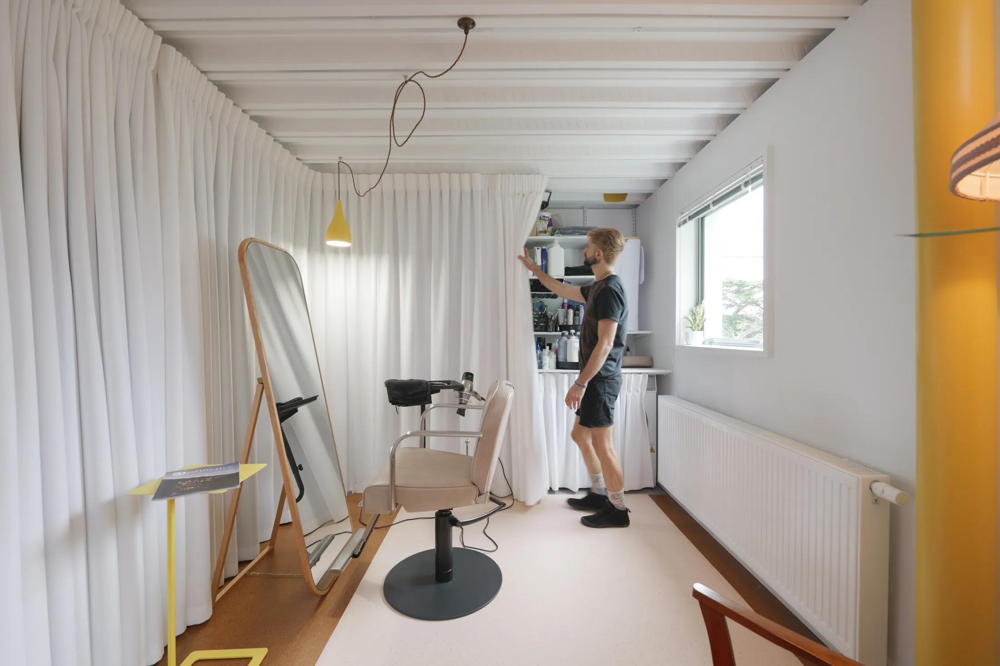
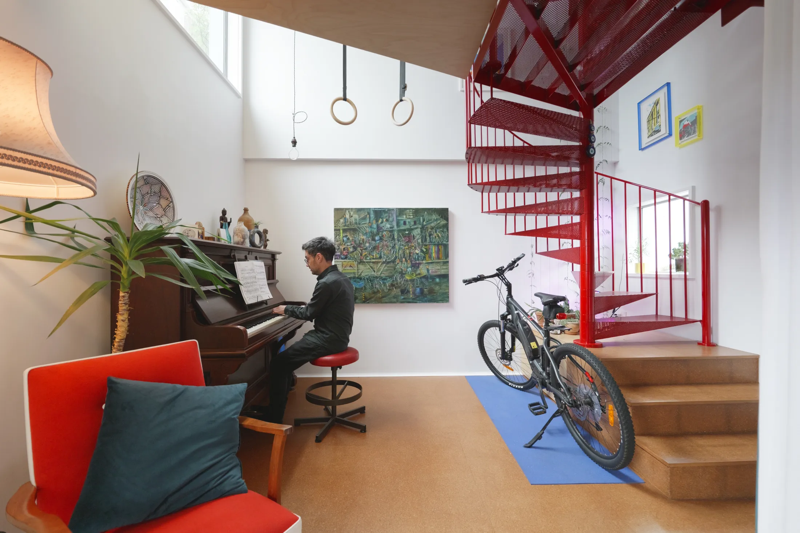
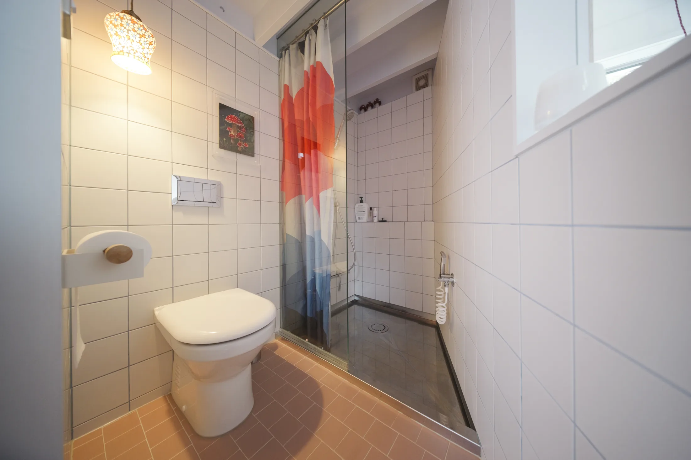
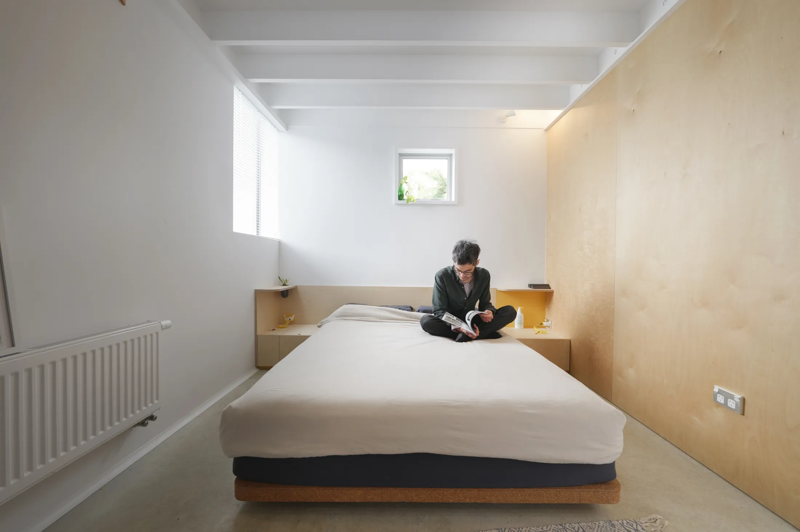
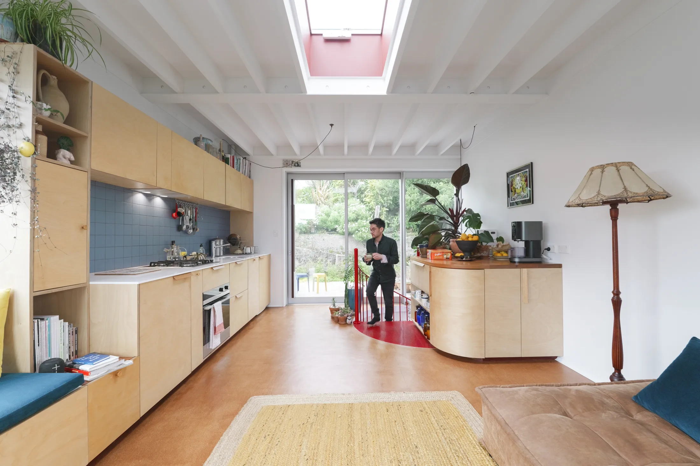

# Дом на 22 м² в три уровня на месте гаража: что взять из Walker Box в квартиру

Когда площадь застройки — 22 м², единственный путь — вверх. Архитектор Мика Рикардс (Micah Rickards, Micah Architecture) построил в Веллингтоне, столице Новой Зеландии, трёхэтажную башню из блоков на месте старого гаража. Это дом для него самого и его партнёра Ивана, у которого на первом этаже ещё и парикмахерская. Назвали проект Walker Box.

В Москве с гаражами другая история: «ракушки» во дворах и гаражные кооперативы редко превращают в жильё. Зато идей, которые переносятся в квартиру, здесь хватит: как устроить вход зимой, чем заменить двери, куда спрятать работу и как использовать высоту. Если вы мечтаете о втором уровне в обычной квартире, мы покажем, где реальный предел.

## Коротко

- Три уровня из блоков: гараж и входная зона — внизу, спальня и ванная — посередине, кухня и гостиная — наверху.
- Вход выполнен по японскому принципу: съёмный пробковый пол для обуви.
- Вместо дверей на первом этаже — шторы: за одной парикмахерская, за другой прачечная.
- Ванная — отдельная капсула с поддоном из нержавеющей стали.
- Спальня высотой чуть больше 2 м и без двери — вся мебель встроена.

*Walker Box, Веллингтон, Новая Зеландия. Площадь застройки 22 м². Архитектор Мика Рикардс. Фото: Never Too Small*

## Зачем оставили ворота гаража

Первый этаж выглядит как гараж: большие складные ворота-гармошка выходят на улицу. Это не декорация, а требование городских властей — по местным нормам участок обязан иметь два парковочных места. Рикардс подчинился правилам и сделал из этого ограничения достоинство: ворота распахиваются на всю ширину, и в тёплую погоду нижний этаж становится частью улицы. Машины же там никогда не ставят.

*Ворота гаража сохранены: этого требовали городские нормы о двух парковочных местах. Фото: Never Too Small*

**Для Москвы.** Параллель здесь не с гаражом, а с бывшей промышленной постройкой. Лофты во «Флаконе», «Арме» или на Даниловской мануфактуре тоже достаются с ограничениями — окна, высота, инженерия, — и лучшие проекты строятся не вопреки им, а вместе с ними. Если в квартире с высокими потолками, как в дореволюционном доходном доме в Басманном районе или Замоскворечье, есть что-то «неудобное» — арка, колонна, глубокий оконный проём, — подумайте, не стоит ли оно того, чтобы стать центром комнаты.

## Вход в стиле гэнкан

Прямо у входа лежит съёмный «плавающий» пол из пробки. Под ним хранится обувь, а сама пробка утепляет пол. Это вариация японского гэнкана — нижней зоны у порога, где снимают уличную обувь: уровень пола у двери отделён от жилого.

*Вход в японском духе: съёмный пробковый пол для обуви. Фото: Never Too Small*

**Как повторить.** В московской квартире это один из самых полезных приёмов. Зимой с улицы приносят воду, соль и реагенты, а в хрущёвке прихожая часто площадью в пару квадратных метров. Съёмная решётка над лотком, скамья над ящиками для обуви и непромокаемое покрытие перед дверью позволяют «обнулить» грязь на входе. Пробка тёплая и мягкая для ног, но на проходной зоне нужна влагостойкая пропитка. Важное ограничение: тёплый пол от общих систем отопления в Москве делать нельзя (постановление 508-ПП), поэтому утепление пола должно быть пассивным — как здесь, пробкой или ковром.

## Шторы вместо дверей

На нижнем уровне двери почти нет: синяя занавеска у входа скрывает парикмахерскую, вторая закрывает прачечную. В спальне двери тоже нет. Шторы дешевле и быстрее полотна, не отнимают место при открывании и легко меняют настроение.

*Синяя занавеска скрывает парикмахерскую, вторая — прачечную. Фото: Never Too Small*

**Для Москвы.** Домашний кабинет, мастерская, студия — всё это в маленьких квартирах нередко размещается в углу гостиной. По опросу hh.ru за июнь 2025 года, 23% россиян хотели бы работать полностью удалённо, ещё 26% — в гибридном формате, и 35% работают в офисе, но перешли бы на удалёнку. Рабочий угол за плотной шторой от пола до потолка — самый быстрый способ получить «закрытое» место без перегородок. Только не используйте штору вместо двери там, где этого требуют правила: проём между комнатой и газифицированной кухней должен закрываться плотной дверью (508-ПП).

## Двусветный объём и цоколь под лестницей

Ядро дома — двойная высота над нижним уровнем. Она впускает свет, а заодно даёт место для пианино и гимнастических колец. Под красной лестницей — цоколь для кемпингового снаряжения и чемоданов. Красная лестница и красные перила стали главным акцентом, а в перилах вырезано отверстие, чтобы повесить полотенце.

*Двусветный объём приносит свет на нижний уровень, где стоят пианино и гимнастические кольца. Фото: Never Too Small*

**Как повторить.** Двусветное пространство — привилегия лофтов и домов с высокими потолками, как в бывших цехах на «Красном Октябре» или в сталинках с высокими потолками. В обычной квартире главный урок — другой: лестница и её основание тоже являются мебелью. Ступени-ящики, полки в нише под маршем, крючки на перилах — это метры хранения, которых не надо искать.

## Ванная-капсула и розовая плитка

Ванная устроена как закрытый блок между спальней и лестничной площадкой. Свет в неё приходит через внутреннее окно из соседних помещений. Поддон — из нержавеющей стали, он же служит хозяйственной раковиной. Пол отделан розовой плиткой, а швы затёрты фиолетовой затиркой — смело, но в масштабе санузла безопасно.

*Поддон из нержавеющей стали, розовая плитка и фиолетовая затирка. Фото: Never Too Small*

**Для Москвы.** Небольшой санузел — самое подходящее место для цветового эксперимента: мало стен, мало плитки, мало риска. А вот идея с внутренним окном в Москве упирается в вентиляцию: ликвидировать и уменьшать вентиляционные каналы запрещено, поэтому любое окно между помещениями делайте только вместе с проектом.

## Спальня высотой чуть больше двух метров

Из-за ограничений на высоту здания спальня получилась чуть выше 2 м. Дизайн подстроен: низкая кровать встроена в столярную нишу, прикроватные полки и ящики вмонтированы в стену, балки оставлены открытыми, двери нет. Рядом с батареей вырезано нарочито крошечное «шуточное» окно у самого пола. Во всю ширину стоит гардероб с синей шторой, а с прикроватной стороны есть желоб, по которому грязное бельё летит прямо в прачечную этажом ниже. Бетонный пол оставлен открытым — это конструктивное решение.

*Спальня высотой чуть больше 2 м: низкая кровать в нише, открытые балки. Фото: Never Too Small*

**Для Москвы.** Низкая кровать в нише — рабочий приём для любой комнаты с потолком ниже среднего: хрущёвка с высотой 2,5 м уже не кажется тесной, когда мебель не вырастает выше пояса. С 1 августа 2024 года минимальная однокомнатная в новых московских проектах — 28 м² (1672-ПП), и в такой квартире спальный альков со встроенными полками освобождает место под гостиную.

## Верхний этаж: кухня, остров-кладовая и мостик в сад

На верхнем уровне вся жизнь собрана в одном пространстве: кухня, столовая и гостиная. Над ними — мансардное окно. Основная кухонная линия со встроенной техникой дополнена изогнутым островом-кладовой, сделанным из переработанной местной древесины, с глубокими выдвижными ящиками. Рядом — банкетка, которая служит и сиденьем, и ящиком для хранения, и столик середины века. Низкий диван без спинки с подвижной подушкой напоминает торт брауни с арахисовой пастой. Тройные раздвижные двери выводят на палубу и мостик в сад друзей.

*Верхний этаж: кухня, столовая и гостиная в одном пространстве. Фото: Never Too Small*

**Как повторить.** Остров с глубокими ящиками вместо верхних шкафов — вариант для евродвушки с кухней-гостиной. А мостик в сад друзей — прекрасный образ городской общины: у дома мало собственной земли, поэтому сад «одолжили». В Москве аналоги — совместные дворы, летние веранды и парки: Музеон, Парк Горького, набережные Москвы-реки работают как продолжение небольшой квартиры.

## Чек-лист: что взять в московскую квартиру

1. Ступенька или съёмная решётка на входе для зимней обуви.
2. Шторы вместо дверей там, где нет требований безопасности.
3. Основание лестницы или подиума — как хранение.
4. Низкая встроенная кровать, если потолок невысокий.
5. Яркая плитка и затирка в санузле: маленькая площадь — маленький риск.
6. Рабочий угол за плотной шторой — для удалёнки.
7. Не объединять лоджию с комнатой и не трогать вентиляцию.

Больше идей для небольших квартир — в разделе [«Интерьер»](/temy/interer/). Если вы выбираете новостройку, [список жилых комплексов Москвы](/novostroyki/moskva/) поможет сравнить планировки.

## Вопросы и ответы

**Как организовать вход, чтобы грязь не проходила дальше прихожей?**
В Walker Box вход сделан по японскому принципу гэнкан: перед порогом уровень пола отделён, обувь остаётся на съёмном пробковом полу. В московской квартире аналог — ступенька или съёмная решётка на входе с лотком и скамьёй: зимой реагенты и вода остаются на «входной ступени».

**Сколько россиян хотят работать из дома?**
По опросу hh.ru, июнь 2025: 23% хотят работать полностью удалённо, 26% — в гибридном формате, 35% работают в офисе, но перешли бы на удалёнку, и лишь 16% хотят в офис. Поэтому место под рабочую или клиентскую зону в квартире — не прихоть.

**Можно ли в московской квартире сделать мезонин?**
Это зависит от высоты потолка и конструкции дома, и любая перепланировка с устройством второго уровня требует проекта и согласования. В Walker Box спальня имеет высоту чуть больше 2 м из-за ограничений на высоту здания; в квартире с потолком 2,7–3 м полноценный второй уровень обычно невозможен, а облегчённый «спальный подиум» или антресоль — возможны.

## Источники

1. Never Too Small. Architect turned an old garage into a small three-level home — https://www.nevertoosmall.com/post/architect-turned-an-old-garage-into-small-three-level-home
2. Коммерсантъ: опрос hh.ru о формате работы, июнь 2025 — https://www.kommersant.ru/doc/8336320
3. ppt.ru: постановление Правительства Москвы от 23.07.2024 № 1672-ПП — https://ppt.ru/obzory/vstupaet-v-silu/postanovlenie-pravitelstva-moskvy-23-07-2024-1672-pp
4. Мосжилинспекция: какие перепланировки запрещены (постановление 508-ПП) — https://www.mos.ru/news/item/76897073/

*Материал подготовлен по мотивам публикаций Never Too Small и использует их фото с разрешения правообладателя.*
