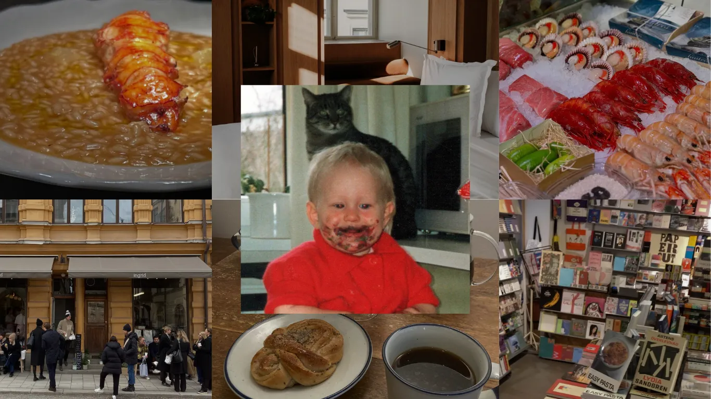
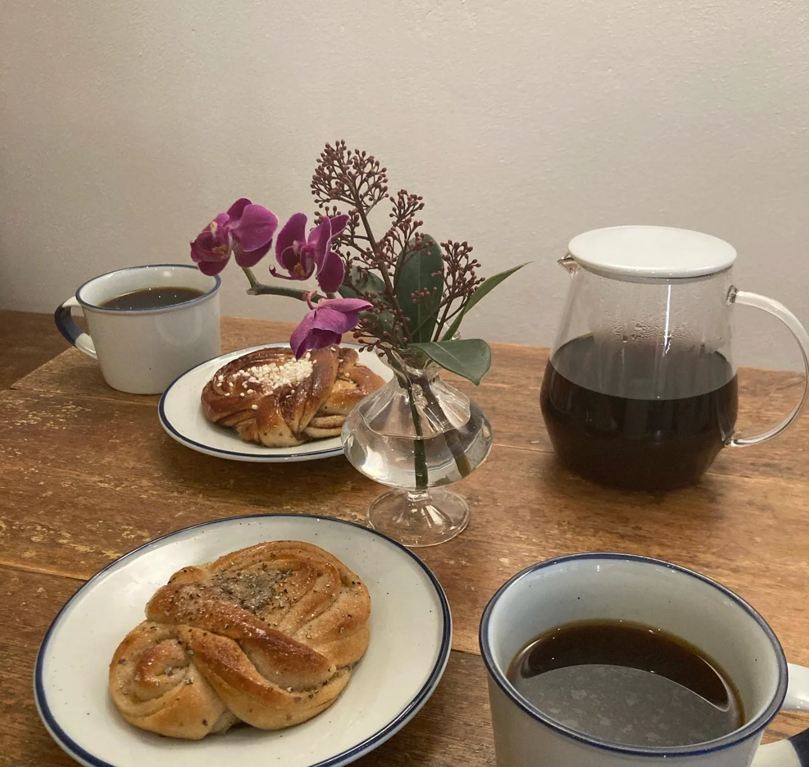
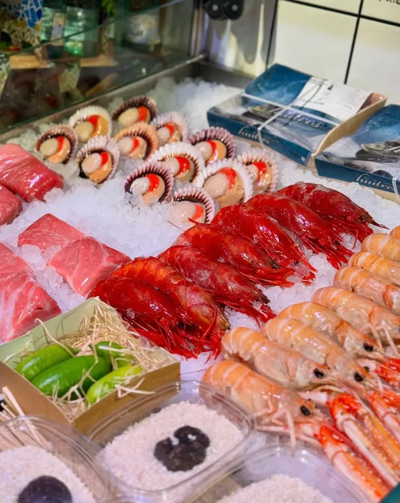
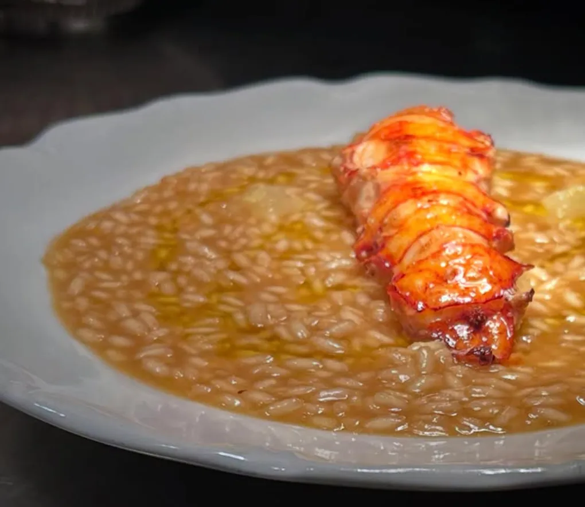
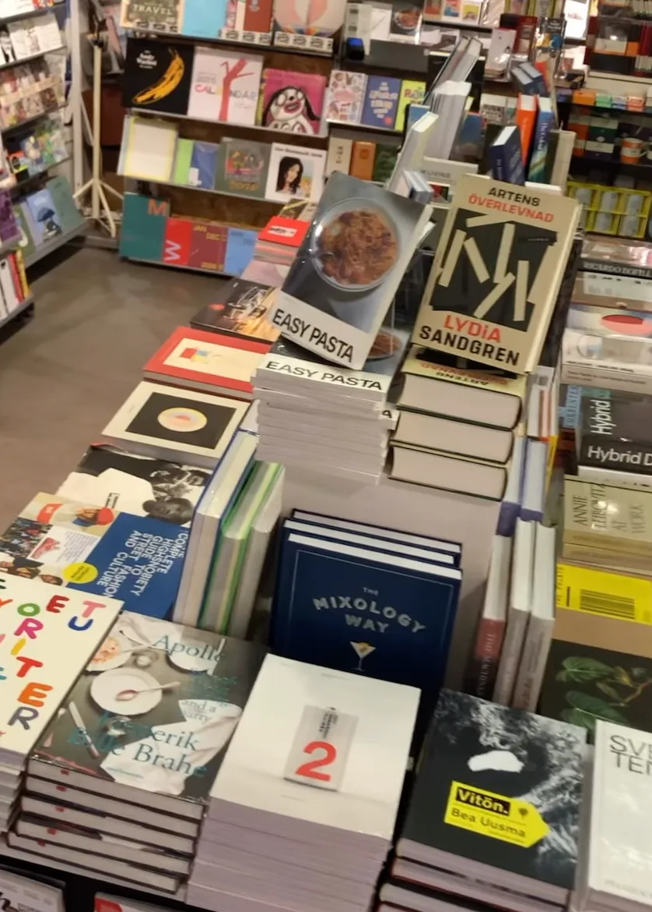
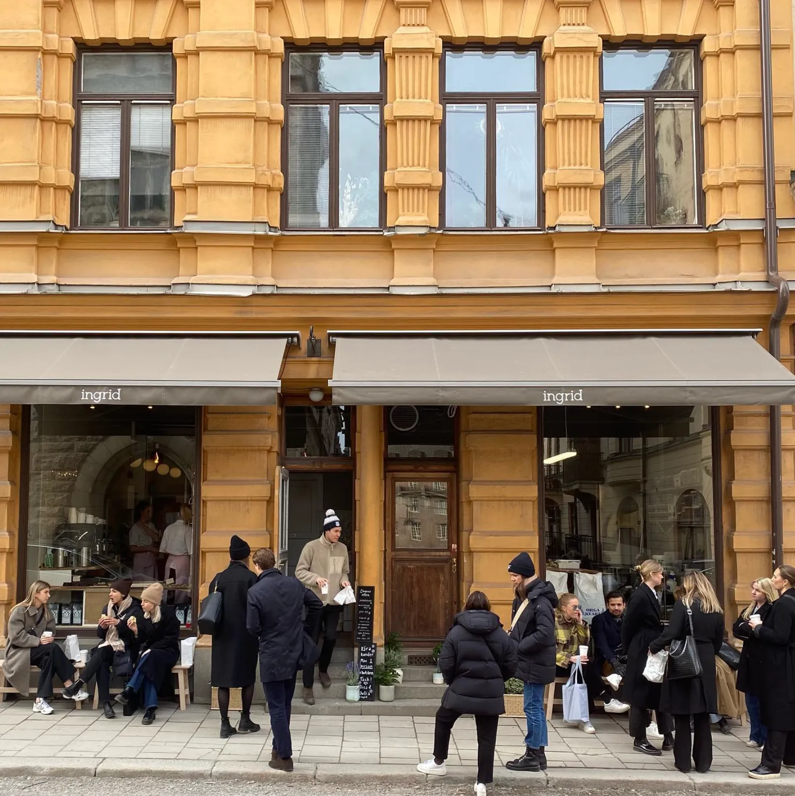

# Город как продолжение квартиры: чему Москва может научиться у Стокгольма

В студии 27–28 м² (по данным bnMAP.pro, средняя студия в новостройках Москвы в июле 2026 года — 27 м²) невозможно держать всё сразу: большой стол для гостей, библиотеку, место для работы и тренажёр. Поэтому те, кто живёт в маленьких квартирах, обычно выигрывают за счёт района. Кафе становится столовой, парк — гостиной, книжный магазин — домашней библиотекой.

Серия Never Too Small «My City, My Backyard» («Мой город — мой задний двор») строится именно на этом: героев спрашивают, как выглядит идеальный день в их городе. Мы взяли интервью с арт-директором Кристиной Пёльк (Cristina Poelk), которая работает в шведской мебельной марке Hem и живёт в яркой квартире на стокгольмском Седермальме, и сопоставили её маршрут с московским.

## Коротко

- Хороший район для маленькой квартиры — это набор мест в пешей доступности: пекарня, книжный, бар, кафе при музее.
- Природа должна быть достижима без машины: у Кристины архипелаг в получасе на автобусе, у москвичей — парки и набережные.
- Третьи места работают как комнаты, которых не хватает дома: читальня, гостиная, столовая.
- Перед покупкой студии район стоит «примерить» пешком — так же, как мебель примеряют к метражу.

*Кристина Пёльк, арт-директор Hem, о том, как устроен её Стокгольм. Фото: Never Too Small*

## Утро: завтрак не дома

Кристина начинает день в пекарне Svedjan Bageriet: простой кофе и очень хорошая выпечка. Рядом — испанская лавка Supermercado с большим выбором деликатесов, куда она заходит за вкусностями и подарками. Обед — отдельное событие: в ресторане Gazza подают основательную еду, интерьер там тоже часть удовольствия, а тирамису она хвалит особо.

*Svedjan Bageriet: простой кофе и выпечка на завтрак. Фото: Never Too Small*

*Supermercado: испанская лавка, куда заходят за гостинцами. Фото: Never Too Small*

*Gazza: обед, который хочется растянуть. Фото: Never Too Small*

**Для Москвы.** В маленькой кухне нет места для длинного завтрака, и многие москвичи давно переехали с него в кофейни и пекарни. Если рядом с домом есть пекарня и продуктовая лавка с хорошим выбором, готовить дома нужно меньше: кухня превращается в место, где варится кофе и греется ужин. При выборе новостройки смотрите не на витрины на первом этаже в проекте, а на то, что уже работает на соседних улицах. Это честнее: ритейл в новом квартале появляется не сразу.

## Днём: книжный и кафе при музее

Рядом с домом у Кристины маленький книжный Papercut. Там есть и новые романы, и книги об искусстве, и журналы о моде; по её словам, выйти оттуда с пустыми руками почти невозможно. Любимое место для «людей-смотрения» — кафе Moderna Museet: она может просто сидеть и наблюдать за посетителями. Если хочется искусства, она едет в Millesgården — дом и мастерскую скульптора Карла Миллеса, где есть сад со скульптурами, фонтаны, коллекция древностей, галерея и кафе.

**Как повторить.** Дом в 28 м² не вместит большой стеллаж, но город вместит. Библиотеки в Москве давно перестали быть местом «только для выдачи книг»: в них есть читальные залы, лекции и места для работы. Кафе при музее, парк с выставками и книжный магазин у метро вполне заменяют гостиную и кабинет. Это особенно актуально, когда работа гибридная: по данным hh.ru за июнь 2025 года, 26% опрошенных хотят работать в гибридном формате, а 23% — полностью удалённо. Те, кто сидит дома по два-три дня в неделю, ценят третье место с розеткой и тишиной.

*Papercut: маленький книжный рядом с домом. Фото: Never Too Small*

## Природа: архипелаг на автобусе

Главное, что Кристина любит в Стокгольме, — как легко отсюда добраться до природы. До архипелага — порядка тридцати минут на автобусе. Летом она ездит туда на машине или берёт лодку до небольших островов, где можно провести целый день. Её совет: посидеть на прибрежных камнях и послушать море, это самое успокаивающее, что она знает. Зимней части в материале нет — рассказ целиком летний, и мы не будем её додумывать.

**Для Москвы.** Москва — тоже город воды и зелени, просто природа здесь устроена иначе. Набережные Москвы-реки, Парк Горького с Музеоном, Зарядье, Нескучный сад, Сокольники и ВДНХ — это большие общественные «дворы», в которые можно выйти из дома пешком или на метро. Для жителя студии у Хамовников, в Замоскворечье или в Басманном районе река — как та же стокгольмская вода: утром пробежка, вечером прогулка, летом пикник. Если у дома есть парк, дом получает дополнительную «комнату» бесплатно; если нет — это стоит учесть в цене и в выборе этажа.

## Вечер: бар на пять столов

На вечер у Кристины Bar Ingrid — новый маленький уютный бар с вином и закусками. Столик там приходится ждать, но, по её словам, оно того стоит, а рядом пекарня с яблочным пирогом, которым можно закончить вечер. Отдельно она упоминает Stockholm Stadshotell — недавно открывшийся отель в историческом мини-замке 1873 года, отреставрированный с местными дизайнерами и мастерами; сама она там пока не останавливалась.

**Как повторить.** Если гости не помещаются в студию, вечер можно провести вне дома — и это нормально. Московские «маленькие бары» и кофейни в переулках Китай-города, на Патриарших, в Замоскворечье и в лофтах бывших фабрик заменяют большой обеденный стол. А дома тогда достаточно небольшого стола на двоих: кухня-студия не обязана быть банкетным залом.

*Bar Ingrid: крошечный бар, где за столом приходится подождать. Фото: Never Too Small*

## Как «примерить» район: чек-лист

Прежде чем покупать студию или однушку (напомним, с 1 августа 2024 года в новых московских проектах однокомнатная квартира не меньше 28 м² — постановление № 1672-ПП), пройдите по району с этим списком:

1. Есть ли парк или набережная в десяти–пятнадцати минутах пешком.
2. Где утренний кофе и хлеб — без машины и очередей.
3. Есть ли книжный или библиотека, где можно посидеть с ноутбуком.
4. Есть ли кафе при музее или площадка, где можно «просто посидеть».
5. Как выглядит вечерний район: освещение, люди, бары, безопасность.
6. Как доехать до реки, леса или большого парка на метро или автобусе.
7. Работают ли магазины и пекарни, которые вы видите на карте, — а не только обещаны застройщиком.

Больше идей для маленьких квартир — в разделе [«Интерьер»](/temy/interer/), а подобрать район можно через [каталог новостроек Москвы](/novostroyki/moskva/).

## Вопросы и ответы

**Что такое «третье место» и зачем оно жителю студии?**
Это место, которое не дом и не работа: кафе, книжный, библиотека, парк. В маленькой квартире оно берёт на себя часть функций — встречи с друзьями, чтение, работу за ноутбуком, — так что дом не приходится перегружать мебелью.

**Как оценить район перед покупкой студии?**
Пройдите по нему пешком утром и вечером в будни и в выходной: найдите парк или набережную, кофейню, книжный или библиотеку, продуктовую лавку и транспорт. Если всё это в пределах получаса пешком, вам не придётся «держать» всё это дома.

**Можно ли добраться до природы без машины, живя в центре?**
В Стокгольме героиня материала едет к архипелагу на автобусе. В Москве похожую роль играют парки и набережные: Парк Горького, Зарядье, Сокольники, ВДНХ и набережные Москвы-реки доступны на метро и пешком.

## Источники

1. Never Too Small. My City, My Backyard with Cristina Poelk in Stockholm — https://www.nevertoosmall.com/post/my-city-my-backyard-with-cristina-poelk-in-stockholm
2. ppt.ru: постановление Правительства Москвы от 23.07.2024 № 1672-ПП — https://ppt.ru/obzory/vstupaet-v-silu/postanovlenie-pravitelstva-moskvy-23-07-2024-1672-pp
3. РБК Недвижимость: цены и площадь студий в новостройках Москвы, июль 2026 — https://realty.rbc.ru/news/6a688a1e9a7947e0d847331e
4. Коммерсантъ: опрос hh.ru об удалённой работе, июнь 2025 — https://www.kommersant.ru/doc/8336320
