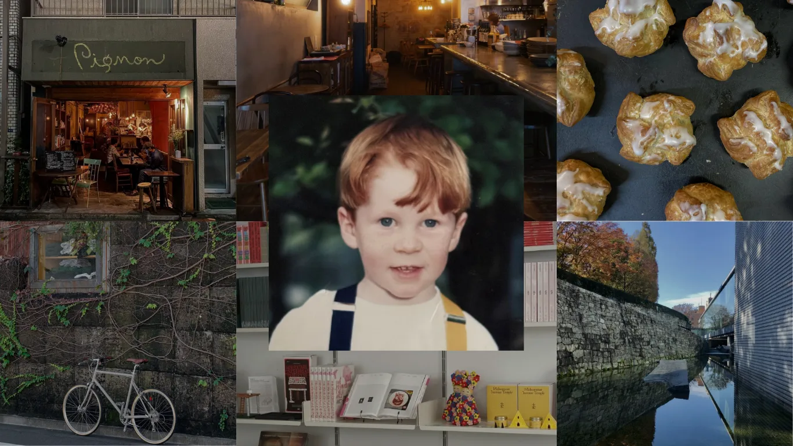
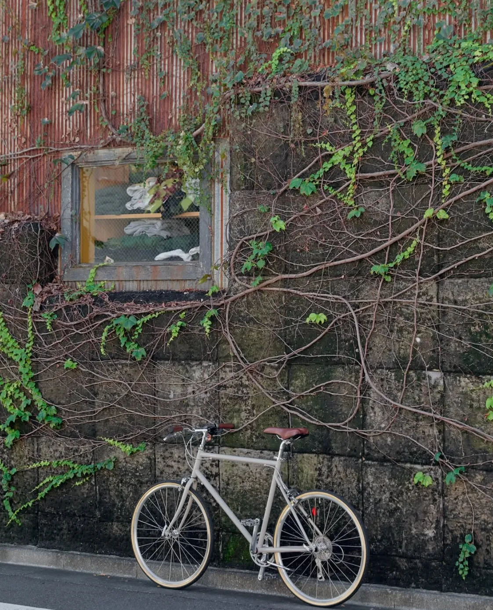
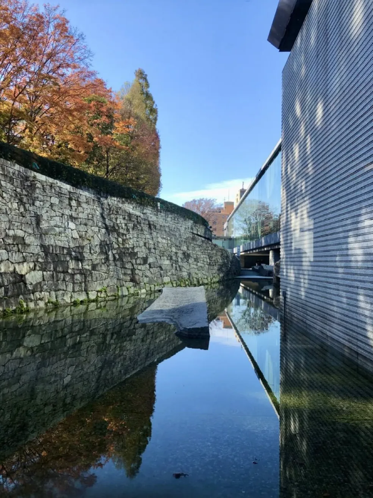
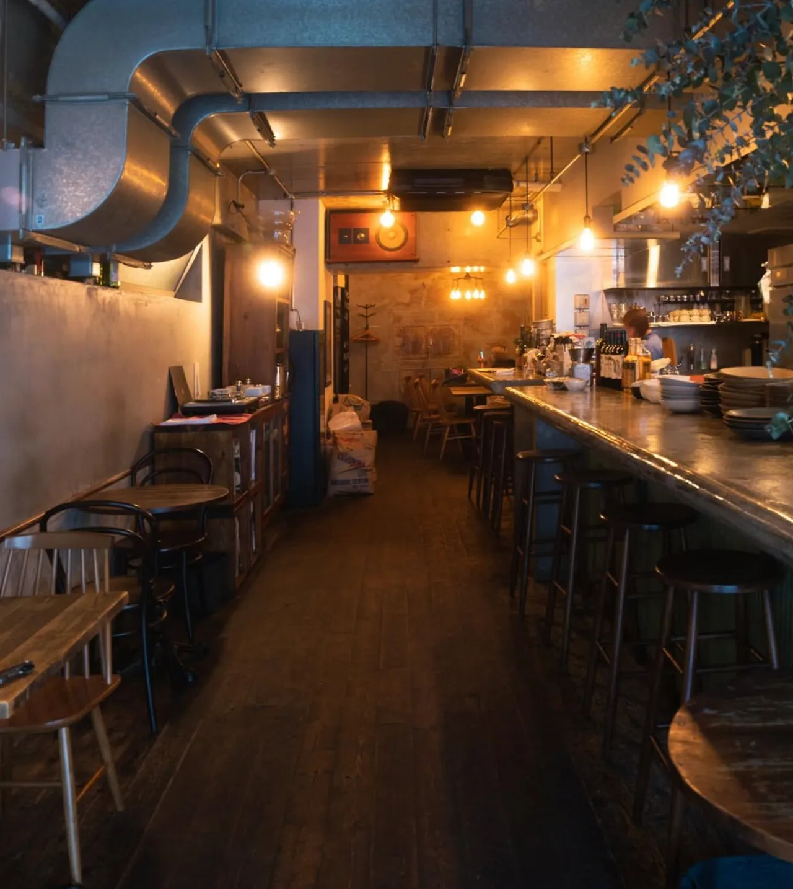
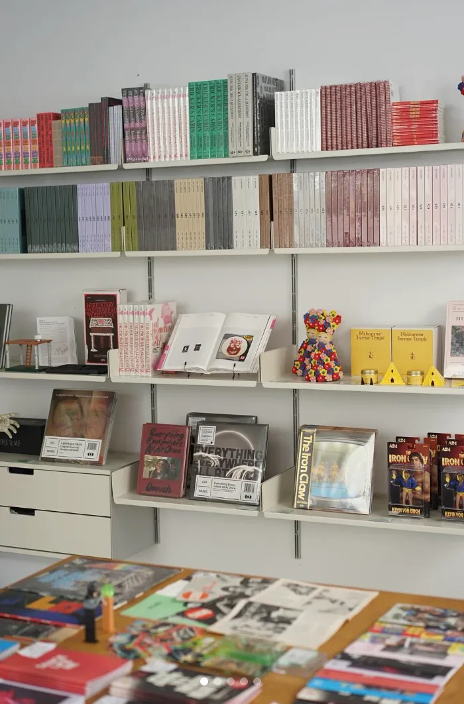

# Токийский рецепт маленького дома: пекарня, баня, парк и велосипед вместо метров

Токио в представлении многих — город микроквартир. Но токийцы живут в них не так, как мы привыкли представлять: дом нужен для сна и тишины, а всё остальное находится за дверью. Москва в этом смысле движется к похожей модели. Студии занимают сегодня около одной десятой предложения новостроек (по данным РБК Недвижимости, их доля за год упала на 6 процентных пунктов до 11%), а однокомнатная в новых проектах с 1 августа 2024 года не может быть меньше 28 м². Значит, жить в 28–30 метрах придётся многим, и вопрос «чем наполнить район» становится вопросом интерьера.

В серии Never Too Small «My City, My Backyard» («Мой город — мой задний двор») токийский маршрут рассказывает Джереми Смарт (Jeremy Smart). Он родом из Мельбурна, сооснователь, главный редактор и креативный директор печатного журнала Design Anthology о дизайне, архитектуре и культуре Азиатско-Тихоокеанского региона. Сейчас живёт в тихом районе у парка Йойоги (Yoyogi). Площадь и тип его жилья в материале не названы, зато подробно описан район.

## Коротко

- Завтрак можно собрать дома из хороших продуктов (кофе, круассаны, хлеб, мёд), а не готовить.
- Продукты — у уличных торговцев и в лавках, а не в больших супермаркетах.
- Обед в будни — это набор дня в кафе с коллегами; дома кухня разгружена.
- Большой парк, храмовый лес и кампус университета — это «гостиная» района.
- Районная баня, бар и велопрокат заменяют ванну, диван и гараж.

*Джереми Смарт, сооснователь и креативный директор журнала Design Anthology, о своём Токио. Фото: Never Too Small*

## Утро: хороший завтрак без кухни

Джереми предпочитает завтракать дома, но по-своему: кофе в зёрнах из кофейни Onibus, круассаны и шокупан (мягкий японский хлеб) из пекарни Katane Bakery, мёд. Когда хочется чего-то основательного, он идёт в Bills — за австралийским завтраком с флэт-уайтом и рикотта-хотейками. Продукты он советует не покупать в супермаркетах, если можно избежать, а брать фрукты у уличных торговцев, которые продают с фургонов.

*Katane Bakery: круассаны и шокупан к домашнему завтраку. Фото: Never Too Small*

**Для Москвы.** В студии с кухонной нишей завтрак из готового хлеба, сыра и фруктов — не уступка, а рациональный выбор: меньше посуды, меньше запаха, меньше нагрузки на вытяжку. Московские рынки, фермерские лавки и пекарни у метро позволяют собрать такой же завтрак по-токийски. Если рядом с домом есть настоящая пекарня или рынок, кухне действительно не нужна ни большая плита, ни десять шкафов: двух конфорок, чайника и кофеварки хватит.

## День: набор дня и «сухая» кухня

Обеду Джереми отводит простое правило. В будни он идёт на набор дня (тэйсёку) с кем-нибудь за компанию; если компании нет, можно и пропустить. Для любителей карри он называет Spice Post, где очередь собирается уже с утра.

**Как повторить.** Бизнес-ланч в московском кафе — прямой аналог тэйсёку. Если вы работаете в офисе или гибридно (по данным hh.ru за июнь 2025 года, 26% опрошенных хотят работать в гибридном формате), будний обед вне дома почти всегда занимает меньше времени, чем приготовить и убрать. Дома остаётся ужин, и для него достаточно небольшой рабочей поверхности. Только не забывайте про вентиляцию: по постановлению 508-ПП вентиляционные каналы нельзя ликвидировать или уменьшать, так что вытяжка на кухне — не место для экспериментов.

## Район: парк, храмовый лес и кампус

Для спокойствия Джереми идёт в леса при храме Мэйдзи-дзингу (Meiji Jingu), в святилище Ёёги-Хатиман (Yoyogi-Hachiman) или на территорию кампуса Токийского университета в районе Комаба. А вечером он просто ходит кругами по парку Йойоги — это часть его ночного маршрута.

**Для Москвы.** Роль таких «зелёных гостиных» в Москве играют Парк Горького с набережной Москвы-реки, Сокольники, ВДНХ, Нескучный сад и Зарядье. Для жителя квартиры 28 м² это не картинка из рекламы, а реальная дополнительная площадь: можно позвать друга «на прогулку» вместо «в гости». Хорошо, если парк находится в получасе ходьбы или одной-двух остановках метро. Отдельная московская деталь — кампус: университетские территории и дворы старых районов (Хамовники, Замоскворечье) тоже работают как тихие зоны.

## Велосипед вместо парковки

Для маршрута по району Кото (Koto) Джереми советует взять напрокат велосипед Tokyobike. Маршрут такой: кофе в Allpress, музей современного искусства MOT, шоурум Haluta и ужин в The Blind Donkey.

*Tokyobike: велосипед напрокат для прогулки по району Кото. Фото: Never Too Small*

*Музей современного искусства Токио (MOT) на веломаршруте. Фото: Never Too Small*

**Как повторить.** Городской велопрокат в Москве работает давно, а набережные Москвы-реки и парки удобны для спокойной езды. Для жителя студии это отличная замена машине и гаражу: в доме без парковки и с узкой кладовой собственный велосипед занимает бесценное место на лоджии или в прихожей, а прокат решает проблему. Если велосипед всё же нужен, вешайте его на стену или на потолок лоджии — но не рассчитывайте на «утепление» лоджии под велосипедную комнату: объединять лоджию с комнатой по 508-ПП запрещено.

## Вечер: баня, бар и магазин

Ночной маршрут Джереми выглядит так: прогулка по Йойоги, районная баня-сэнто, вино в одном из баров, ужин в Pignon и последний бокал в баре No в районе Ёёги-Уэхара. Среди местных любимцев он называет бар Path.

*Path: любимое место жителей района. Фото: Never Too Small*

За покупками он ходит по небольшим магазинам. В Style Department в Камиямачо продают вещи марки Still by Hand, в Aoyama Book Centre и Shibuya Publishing & Bookseller — книги. Для хорошей канцелярии и предметов для дома есть Postalco, Arts & Science и Cibone.

*Style Department: магазин, где продают вещи местных марок. Фото: Never Too Small*

**Для Москвы.** Сэнто — баня, куда ходят «по-соседски», — и есть то, чего не хватает многим маленьким квартирам: полноценной ванны. В Москве баня тоже часть городской культуры, и жителю студии с душевой кабиной она заменяет ванну. Тёплый пол от общих систем по 508-ПП делать нельзя, так что для зимнего тепла баня или хорошее кафе рядом — вполне разумное дополнение к дому. Добавьте сюда магазин у дома и небольшой книжный — и получится район, в котором квартира нужна именно для сна и тишины.

## Чек-лист: как жить в квартире поменьше

1. Определите «большой двор»: парк, набережная, кампус или бульвар в пешей доступности.
2. Закройте базовые функции рядом с домом: пекарня, лавка, книжный, баня или бассейн.
3. Решите, что вы не будете делать дома: например, большие обеды и приём гостей.
4. Откажитесь от «функций на всякий случай»: гаража, склада и второй мебели.
5. Проверьте, как район выглядит вечером и зимой, а не только в солнечный выходной.
6. Подумайте о прокате вместо хранения: велосипед, самокат, инструменты.

Больше идей для небольших квартир — в разделе [«Интерьер»](/temy/interer/), а искать район под такую жизнь удобно в [каталоге новостроек Москвы](/novostroyki/moskva/).

## Вопросы и ответы

**Почему в Токио можно жить в крошечной квартире?**
Дом в Токио берёт на себя только сон и часть быта, а остальное отдано городу: завтраки, обеды, бани, парки, магазины и бары рядом. Герой материала вообще советует не ходить в большие супермаркеты и покупать фрукты у уличных торговцев.

**Какие места в Москве заменяют токийский парк Йойоги?**
По размаху и роли ближе всего большие парки: Парк Горького, Сокольники, ВДНХ, Нескучный сад, Зарядье, а также набережные Москвы-реки. Это общественные «дворы» для прогулок, спорта и встреч.

**Как заменить большой обед дома в маленькой кухне?**
Токийцы заказывают набор дня (тэйсёку) в будни и не готовят обед дома. В Москве такую же роль играют бизнес-ланчи в кафе рядом с домом или работой: меньше посуды и продуктов дома — меньше нагрузка на кухню.

## Источники

1. Never Too Small. My City, My Backyard with Jeremy Smart in Tokyo — https://www.nevertoosmall.com/post/my-city-my-backyard-with-jeremy-smart-in-tokyo
2. ppt.ru: постановление Правительства Москвы от 23.07.2024 № 1672-ПП — https://ppt.ru/obzory/vstupaet-v-silu/postanovlenie-pravitelstva-moskvy-23-07-2024-1672-pp
3. РБК Недвижимость: доля студий в предложении Москвы, I полугодие 2026 — https://realty.rbc.ru/news/6a6094b09a7947481c9c3ec4
4. Коммерсантъ: опрос hh.ru об удалённой работе, июнь 2025 — https://www.kommersant.ru/doc/8336320
5. Мосжилинспекция: какие перепланировки запрещены (постановление 508-ПП) — https://www.mos.ru/news/item/76897073/
