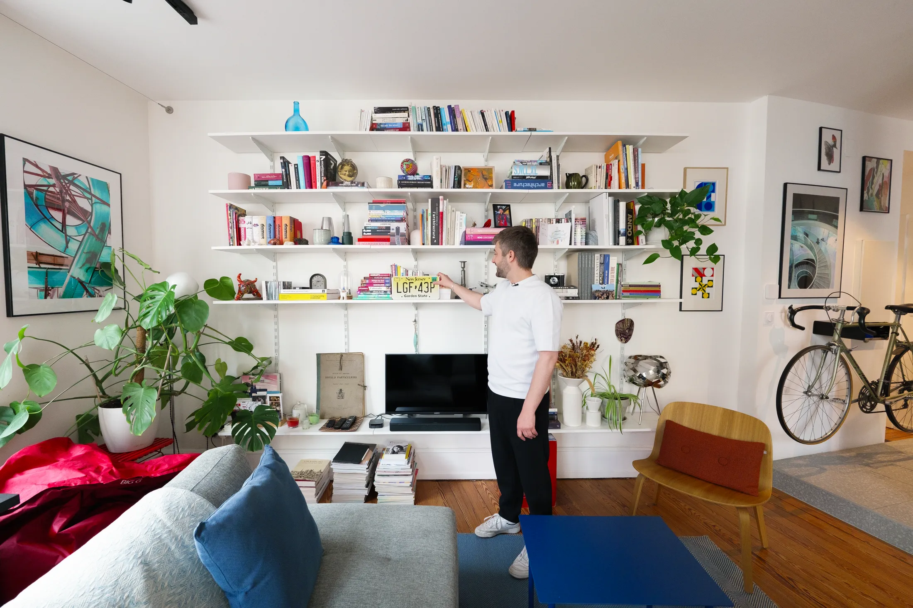
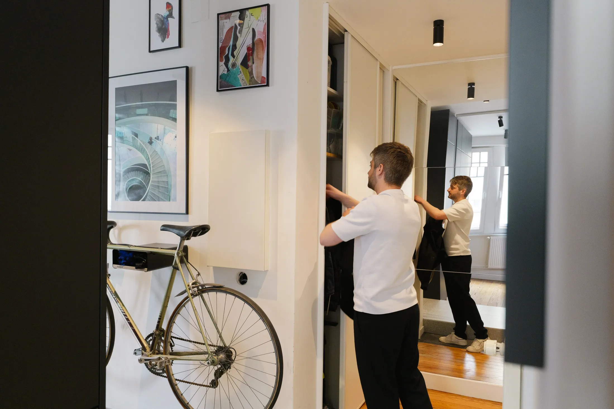
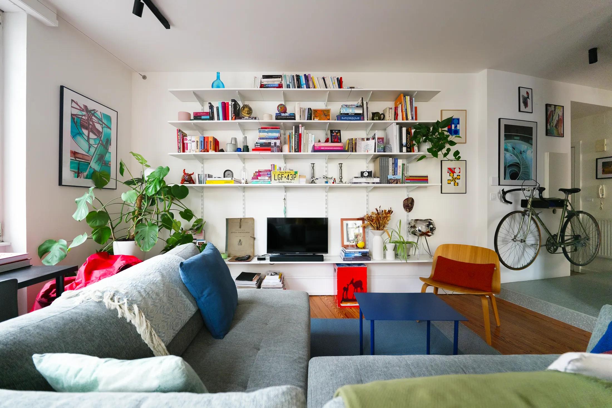
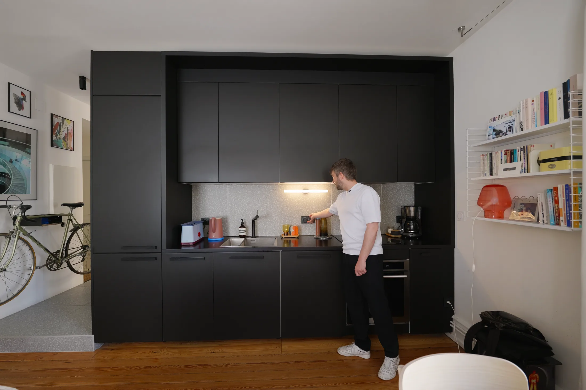
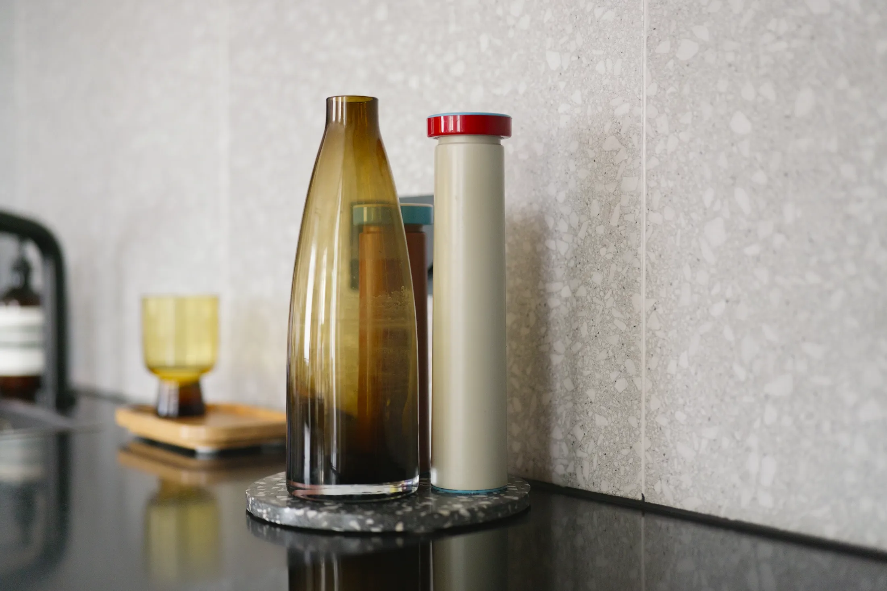
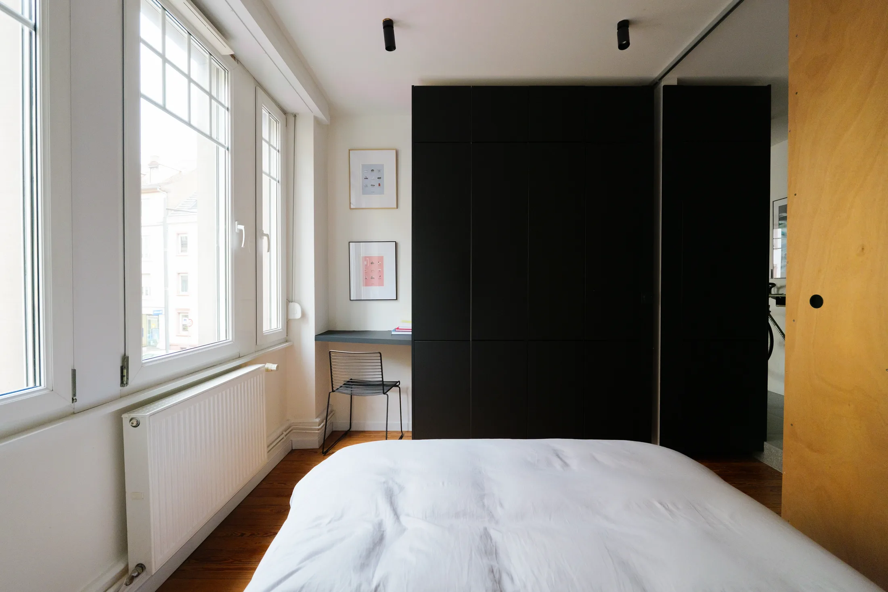
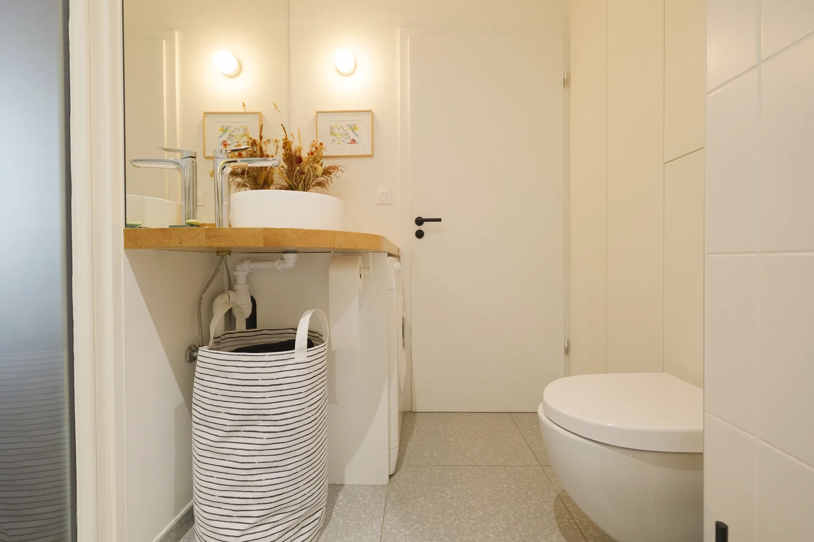

# Серийные шкафы как встроенная мебель: система хранения в квартире 48 м²

Самое дорогое в маленькой квартире — не квадратные метры, а столярка на заказ. Архитектор Люк Пфистер (Luc Pfister, бюро LP-A) из Страсбурга нашёл способ её обойти: большую часть хранения в своей квартире на 48 м² он собрал из серийных шкафов, а плотник довёл фасады и стыки до вида встроенной мебели. Ремонт обошёлся в 35 тысяч евро: ему помогали друзья и строитель.

Для Москвы это хороший сюжет. 48 м² — размер типичной евродвушки, а с 1 августа 2024 года в новых проектах двухкомнатная квартира не может быть меньше 44 м² (постановление Правительства Москвы № 1672-ПП). Это значит, что именно такие метры станут массовыми. А ещё дом, в котором живёт Люк, построен в 1933 году, как московский конструктивизм и ранние сталинки. Посмотрим, как архитектор организовал хранение, рабочее место и ванную без окна.

## Коротко

- Хранение начинается у двери: зеркало во всю высоту, шкаф для курток и обуви, ниша для перчаток и шарфа, над ней — велосипед.
- Центральный чёрный блок — кухня и гардероб в одном объёме, собранный из серийных корпусов и доработанный столяром.
- Терраццо в прихожей продолжается в фартуке кухни: один материал связывает две зоны.
- В гостиной стоят регулируемые стеллажи из строительного магазина, а не мебель по эскизам.
- Ванная без окна получает свет через матовое окно из спальни; стиральная машина скрыта под изогнутой деревянной столешницей.

*Квартира архитектора Люка Пфистера, Страсбург, 48 м². Бюро LP-A. Фото: Never Too Small*

## Исходные данные: ничего не мешает

Квартира находится на первом этаже дома 1933 года. Люк начал ремонт в 2019 году: до него в квартире уже делали ремонт для сдачи в аренду. Несущих перегородок внутри не оказалось, потолки высокие, света достаточно. Для архитектора это идеальное условие: можно переставить функции так, как удобно двум людям с разными графиками, ему самому и его партнёру Валентину (Valentin), бортпроводнику.

Квартира была переосмыслена вокруг хранения и гибких зон, которые подходят двум разным ритмам жизни.

## Приём 1: прихожая как склад

Первое, что видишь, войдя: зеркало от пола до потолка, которое увеличивает пространство и добавляет света. Напротив двери — встроенное хранение для обуви и курток. Небольшая ячейка рядом отдана перчаткам и шарфу, а над ней висит велосипед Люка. Электрощит не прячут, а вписывают в стену-галерею с картинами. Невысокая платформа с терраццо скрывает коммуникации.

*Прихожая: зеркало до потолка и встроенное хранение напротив двери. Фото: Never Too Small*

**Для Москвы.** В московской квартире с холодной зимой прихожая — это ещё и место для пуховиков, зимней обуви и шапок, которых на семью набирается больше, чем в Страсбурге. Поэтому хранение у двери, в отличие от «красивого» шкафа в спальне, должно быть вместительным в первую очередь. В новостройках с нишей у входа её можно целиком отдать под шкаф, а зеркало повесить на соседнюю стену. Электрощит в любом случае должен оставаться доступным, так что приём Люка — вписать его в оформление стены, а не замуровать — годится и для Москвы.

## Приём 2: гостиная без мебели «по эскизу»

В центре гостиной стоят регулируемые стеллажи из строительного магазина. На них хранится всё, что архитектор привёз из поездок. Телевизор скромный, окна двойные, с тонкими занавесками, а рабочий стол стоит у окна.

*Регулируемые стеллажи из строительного магазина в гостиной. Фото: Never Too Small*

**Как повторить.** Рабочее место у окна — не просто приятная мелочь. По данным hh.ru на июнь 2025 года, 23% опрошенных хотят работать полностью удалённо, ещё 26% выбирают гибридный график, а 35% трудятся в офисе, но перешли бы на удалёнку. Для евродвушки это значит, что стол у окна нужен почти каждому. Если квартира выходит на север, а световой день зимой короткий, окно — единственное место, где можно обойтись без лампы днём.

## Приём 3: чёрный блок вместо кухни и шкафа

Центральная структура — большая чёрная кухня. Её собрали почти целиком из серийных корпусов, а за отделку отвечал плотник. С обратной стороны тот же блок продолжается гардеробом в спальне: наверху лежат вещи для долгого хранения, ниже — всё, что нужно каждый день. Фартук выложен терраццо, как в прихожей. Обеденный стол — модель IKEA 1990-х, над ним — полка на тросах и розовая лампа Habitat.

*Чёрная кухонная структура собрана почти целиком из серийных корпусов. Фото: Never Too Small*

*Терраццо в фартуке продолжает отделку прихожей. Фото: Never Too Small*

**Для Москвы.** Серийные корпуса делают из бюджета архитектуру: чтобы они выглядели «встроенными», нужны точный замер, цоколь, доборы до потолка и единый фасад. После ухода привычных зарубежных брендов с российского рынка ту же логику можно применить к любым модульным шкафам: берёте корпуса, а фасады, ручки и доборы заказываете у столяра. Если у вас ниша, в которую «не лезет» стандартный шкаф, добор шириной в несколько сантиметров решит проблему лучше, чем нестандартная мебель.

## Приём 4: спальня работает на хранение

Гардероб в спальне — продолжение чёрного блока. Раздвижная дверь ведёт в шкаф Валентина рядом с прихожей и ванной. Кровать — модель Fritz Hansen. Над ней висит самодельная полка в стиле «микадо» — её Люк сделал сам. Бельё и полотенца лежат ниже, а в встроенном изголовье хранятся рюкзаки и стоят памятные вещи.

*Гардероб в спальне — продолжение чёрного кухонного блока. Фото: Never Too Small*

**Как повторить.** Изголовье с отделением для вещей — компактное решение для московской спальни, где шкаф обычно стоит напротив кровати и сужает проход. Верхние полки до потолка в хрущёвках и панелях недоиспользуются: туда можно отправить сезонные вещи, а ежедневное оставить на уровне глаз и рук.

## Приём 5: узкая ванная со светом из спальни

Ванная узкая и без естественного света. Часть света приходит из спальни через матовое внутреннее окно, для приватности есть штора. Изогнутая столешница из натурального дерева скрывает стиральную машину и корзину для белья. Остаток плитки терраццо служит декоративным подносом. Ванну Люк сохранил: она нужна Валентину.

*Ванная: изогнутая столешница из дерева скрывает стиральную машину и корзину для белья. Фото: Never Too Small*

**Для Москвы.** Матовое окно между ванной и комнатой — частое решение и у нас, но вентиляцию трогать нельзя: постановление 508-ПП запрещает ликвидировать или уменьшать вентиляционные каналы. Если вы вырезаете окно в стене ванной, следите, чтобы вентиляционный канал остался на месте, а в комнату не попадал влажный воздух. Столешница над стиральной машиной хороша ещё и тем, что убирает бытовую технику с глаз.

## Чек-лист: хранение в евродвушке 45–50 м²

1. Начните с прихожей: зеркало, вместительный шкаф, место для велосипеда или самоката.
2. Кухню и гардероб можно сделать одним блоком из серийных корпусов, а фасады заказать у столяра.
3. Один материал в двух зонах, например терраццо в прихожей и на фартуке, делает квартиру цельной.
4. Рабочий стол — у окна, особенно если световой день в Москве зимой короткий.
5. Стиральную машину и корзину для белья прячьте под столешницей.
6. Не трогайте вентканалы и несущие стены без проекта.

Больше идей для небольших квартир — в разделе [«Интерьер»](/temy/interer/). Средняя площадь квартиры в новостройках Москвы выросла с 56,3 до 62 м² (I квартал 2025 — I квартал 2026, данные bnMAP), поэтому 48 м² сегодня — это уже компактный формат: подобрать подходящий можно в [каталоге новостроек Москвы](/novostroyki/moskva/).

## Вопросы и ответы

**Можно ли собрать встроенную мебель из серийных шкафов?**
Да, это основа проекта в Страсбурге: чёрный кухонный блок почти целиком собран из серийных корпусов, а плотник довёл фасады и стыки до вида встроенной мебели. Экономия бюджета при этом не отменяет замеров и точной подгонки.

**Как осветить ванную без окна?**
В квартире Люка Пфистера в стене между ванной и спальней сделано матовое внутреннее окно: свет проходит из комнаты, а штора обеспечивает приватность. Вентиляционные каналы при этом трогать нельзя: в Москве это прямо запрещено постановлением 508-ПП.

**Сколько стоила перепланировка квартиры архитектора в Страсбурге?**
По данным Never Too Small, бюджет ремонта квартиры 48 м² составил 35 тысяч евро; в работе участвовали друзья и строитель. Цифра относится к французским ценам 2019 года и не пересчитывается на московские.

## Источники

1. Never Too Small. How an architect turned IKEA into bespoke storage in his 48sqm/517sqft Strasbourg apartment — https://www.nevertoosmall.com/post/how-an-architect-turned-ikea-into-storage-in-48sqm-517sqft-apartment
2. ppt.ru: постановление Правительства Москвы от 23.07.2024 № 1672-ПП — https://ppt.ru/obzory/vstupaet-v-silu/postanovlenie-pravitelstva-moskvy-23-07-2024-1672-pp
3. РБК Недвижимость: «Метриум», средняя площадь квартиры в новостройках, май 2026 — https://realty.rbc.ru/news/6a2688819a7947c4911d7fd8
4. Мосжилинспекция: какие перепланировки запрещены (постановление 508-ПП) — https://www.mos.ru/news/item/76897073/
5. «Коммерсантъ»: опрос hh.ru о формате работы, июнь 2025 — https://www.kommersant.ru/doc/8336320
