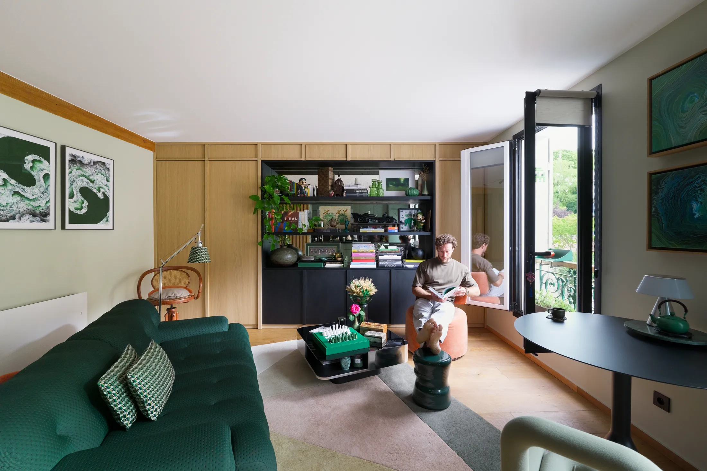
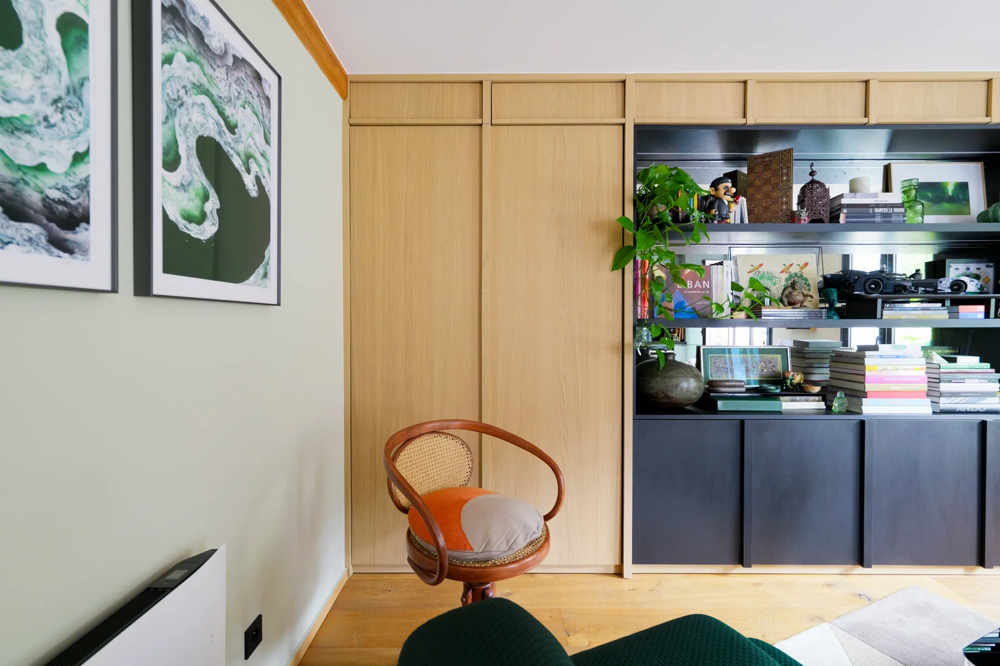
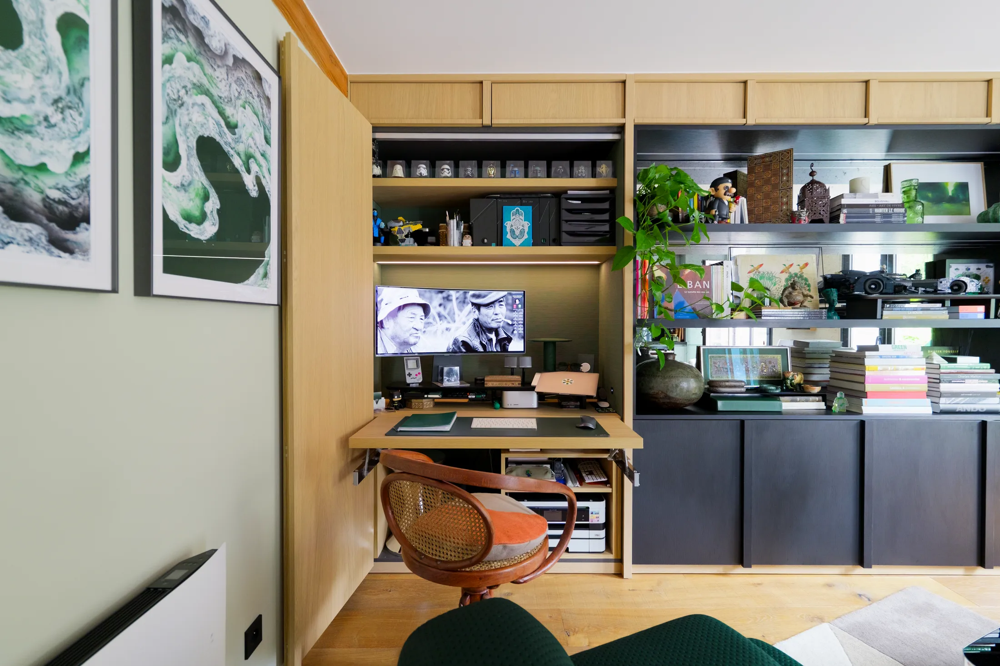
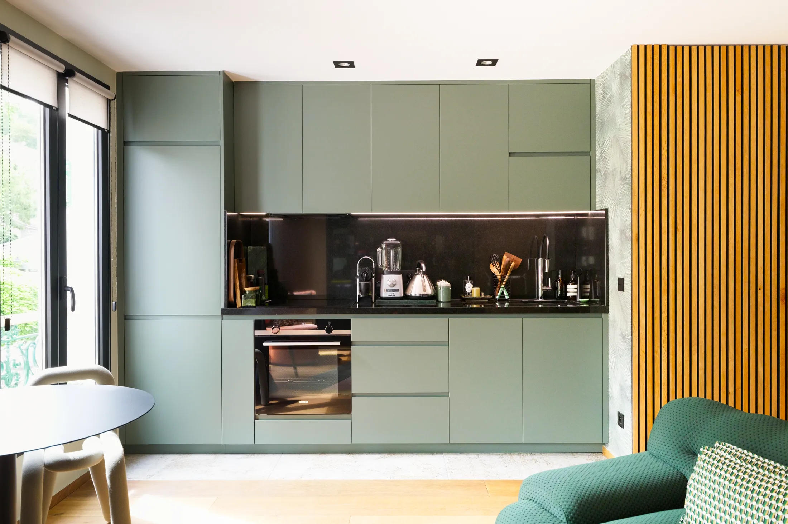
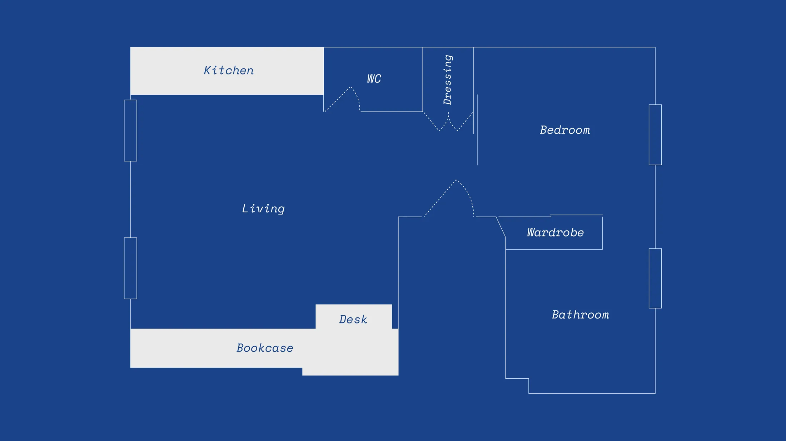
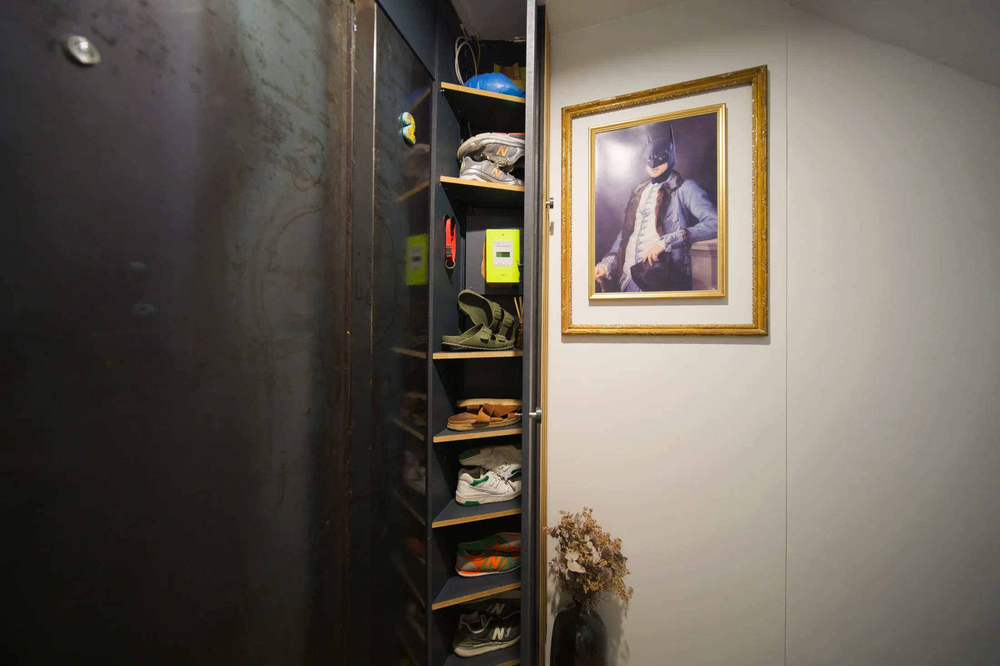
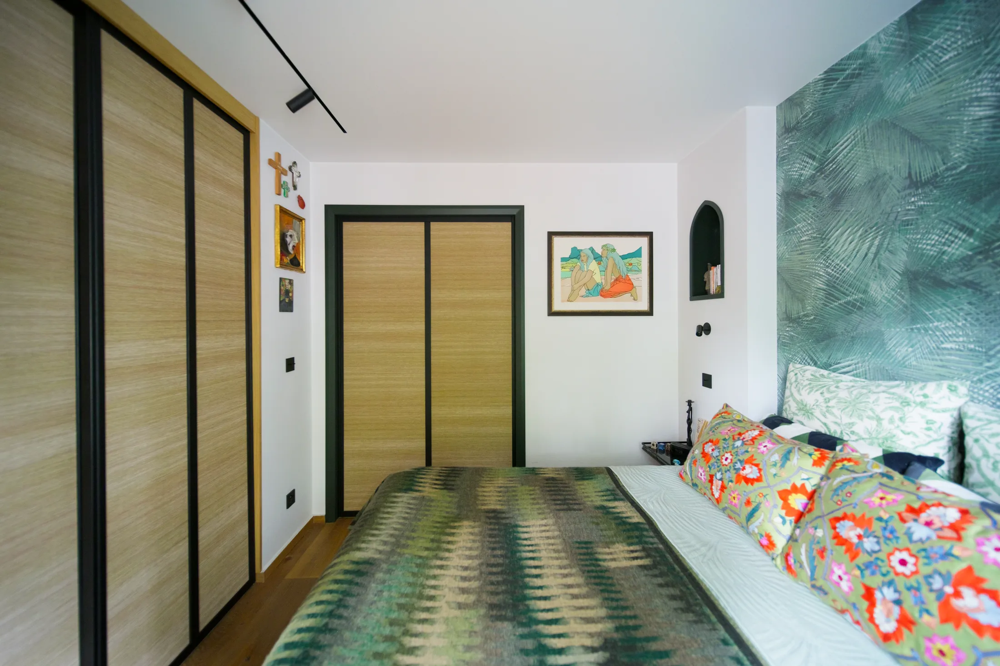

# Кабинет, который уходит в стену: как работать из дома в 43 м² без отдельной комнаты

Если вы работаете из дома хотя бы пару дней в неделю, вопрос «где поставить стол» в московской квартире рано или поздно встаёт ребром. Отдельной комнаты под кабинет в однушке или евродвушке нет, кухонный стол мешает готовить, а стол в углу гостиной превращает отдых в продолжение рабочего дня. Парижский архитектор Энтони Аун (Anthony Aoun, бюро AOUN INTERIEURS) решил эту задачу в квартире LECLERC площадью 43 м²: кабинет там спрятан в книжный шкаф и выезжает оттуда только на время работы.

Мы разобрали проект и отдельно подумали, что из него переносится на московскую планировку, а что упрётся в нормы и в конструкцию дома. Фотографии квартиры сделал Алексис Лесаж (Alexis Lesage).

## Коротко

- Почти все внутренние стены сняты, кухня перенесена в общее пространство, а приватность обеспечивает одна раздвижная дверь.
- Кабинет живёт внутри книжного шкафа во всю стену: стол выдвигается на механизме, похожем на кухонные системы, и вмещает лист А3, а принтер и канцелярия остаются рядом.
- Вход собран из мебели и деревянных панелей: за ними спрятаны обувь, одежда, электрощиток и гостевой туалет.
- Утепление стен дало глубину, и её превратили в нишу вокруг кровати; даже снаружи окна «работают»: глубокие откосы стали полками для растений.
- Материалов мало, и они повторяются: зелёный и ботанические обои, дерево, светлая плитка, гранит.

*LECLERC, Париж, 43 м². Интерьерный архитектор Энтони Аун, AOUN INTERIEURS. Фото: Never Too Small*

## Почему рабочее место надо планировать заранее

Удалённая работа в России давно перестала быть временной мерой. По опросу hh.ru, который «Коммерсантъ» пересказал в июне 2025 года, 23% опрошенных хотят работать полностью удалённо, ещё 26% — в гибридном режиме, а 35% предпочли бы офис, но перешли бы на удалёнку при возможности. Только 16% уверены, что хотят ходить в офис. То есть у большинства покупателей квартиры рабочее место дома — не прихоть, а ежедневная необходимость.

При этом московские новостройки массово продают как студии и небольшие однушки. С 1 августа 2024 года в новых проектах однокомнатная квартира не может быть меньше 28 м², двухкомнатная — меньше 44 м² (постановление Правительства Москвы № 1672-ПП). На этих метрах приходится выбирать: либо кабинет, либо вторая комната, либо мебель, которая умеет менять роль в течение дня. Парижская квартира — именно про третий вариант.

## Приём 1. Стол внутри шкафа

Во всю стену общей комнаты Аун построил библиотеку на заказ: открытые полки соседствуют с закрытыми секциями. За одной из секций прячется рабочее место. Стол выезжает на механизме, который архитектор позаимствовал у раздвижных кухонных систем, и по размеру рассчитан на чертёж формата А3. Рядом, в самом шкафу, стоят принтер и всё, что нужно для работы. Когда день кончился, стол задвигается, и перед вами снова просто стеллаж с книгами.

*Днём стол выдвигается из шкафа, вечером уходит обратно. Фото: Never Too Small*

*Рабочая поверхность вмещает лист А3; принтер и расходники лежат рядом. Фото: Never Too Small*

Дополнительный ход: перед частью полок поставлены зеркала с «античным» эффектом. Они добавляют глубины и ловят свет, поэтому массивный стеллаж не давит на комнату.

**Для Москвы.** В московской однушке под такой шкаф нужна одна свободная стена гостиной. Типичная хрущёвка здесь в проигрыше: комнаты узкие, и глубокий стеллаж съедает ширину. Зато в сталинках, дореволюционных доходных домах и монолитных новостройках со свободной планировкой такая мебель встаёт без проблем. Совет столярам: заранее разведите электричество и интернет внутри шкафа, иначе «спрятанный кабинет» превратится в клубок удлинителей.

## Приём 2. Кухня в общей комнате и одна раздвижная дверь

В Париже квартиру почти полностью освободили от перегородок. Кухня стала частью гостиной, а от пространства для сна отделена полноростовой раздвижной дверью. С одной стороны на ней зеркало, которое смотрит в прихожую и удваивает вход; с другой — обои с растительным рисунком, продолжающиеся на дверцах гардероба. Границу между кухней и гостиной проводят не стеной, а полом: белая плитка большого формата на кухонной части, остальной пол — другой.

*Кухня в общем пространстве: гранит из Зимбабве и белая плитка большого формата. Фото: Never Too Small*

**Для Москвы.** Здесь начинаются ограничения. Если в доме газовая плита, проём между комнатой и кухней без плотной двери делать нельзя — это прямо указано в разъяснениях Мосжилинспекции по постановлению 508-ПП. Объединять лоджию или балкон с комнатой тоже запрещено, поэтому «расширить кухню за счёт лоджии» не получится. Альтернатива — стеклянная раздвижная дверь: в закрытом положении она соответствует требованию, в открытом — оставляет ощущение единого пространства. В новостройках с электроплитой гибкости больше, но любой снос стены нужно согласовывать до ремонта.

*План после перепланировки: стены почти убраны, кухня перенесена в общую комнату. Чертёж: AOUN INTERIEURS / Never Too Small*

## Приём 3. Вход, в котором спрятано всё лишнее

Входную группу архитектор сделал из мебели. Дверь на заказ — из состаренного металла. Рядом деревянные панели во всю стену скрывают гардероб для обуви и верхней одежды, электрощиток и дверь в гостевой туалет. К панелям прикреплены узкие полки для ключей и мелочей, а на открытой части стоят вещи из путешествий — вход встречает гостя как небольшая выставка.

*Вход: дверь из состаренного металла и деревянные панели, за которыми спрятаны обувь, верхняя одежда и гостевой туалет. Фото: Never Too Small*

**Как повторить.** Прихожая в московской студии — это ниша шириной метр–полтора, и в ней нужно уместить всё. Закрытые фасады под одну плоскость со стеной дают ощущение порядка: щиток, роутер, пылесос и сезонная обувь не попадают в кадр. Деревянные панели, как в Париже, можно заменить шпоном или окрашенным МДФ — суть в том, чтобы фасады не выглядели как шкаф, а читались как стена.

## Приём 4. Спальня с нишей и стенами, которые стали глубже

Спальню отгораживает та самая раздвижная дверь. Утепление внешней стены сделало её толще, и из этой глубины архитектор получил нишу вокруг кровати. По бокам от изголовья — маленькие выемки под арки, вдохновлённые готической архитектурой церкви напротив. Растительные обои продолжаются на дверцах гардероба, поэтому тот не выглядит отдельным предметом.

*Спальня: ниша вокруг кровати появилась благодаря утеплению стен. Фото: Never Too Small*

**Для Москвы.** Аналог — внутреннее утепление наружных стен в панельных домах и хрущёвках с холодными торцами. Московская зима и отопительный сезон делают утепление не декоративной, а практической задачей. Если оно уже закладывается, толщину стены можно сразу использовать под нишу для кровати или встроенные полки, вместо того чтобы закрывать её штукатуркой заподлицо. Только согласуйте тип утепления со специалистом: внутренняя изоляция требует расчёта влажностного режима.

## Окна как продолжение квартиры

Балкона в парижской квартире нет. Зато при замене и утеплении окон архитекторы сделали глубокие откосы — на них стоят растения. А за окном к перилам крепится маленький столик, на который помещается чашка кофе. Из ограничения получилась возможность: пусть не балкон, но свой кусочек воздуха.

**Для Москвы.** В московском климате оконный подоконник-«ферма» — рабочая история: короткий зимний день, мало света, растения в нём действительно помогают. Столик на перила в многоэтажке стоит сначала обсудить с управляющей компанией: крепёж и нагрузка на ограждение не должны создавать риска. Лоджию вместо него можно оформить как отдельное «третье место» — без объединения с комнатой и переноса радиаторов, которые 508-ПП тоже запрещает.

## Материалы: мало, но с характером

Единая логика проекта — несколько повторяющихся материалов. Зелёный цвет и обои с ботаническим рисунком появляются в разных комнатах. Столешница и фартук кухни — гранит из Зимбабве. Пол кухни — белая плитка большого формата. Над всем этим — отреставрированная деревянная балка XIX века, оставленная открытой; дерево в других местах связывает старое с новым.

Для московской квартиры вывод простой: лучше выбрать три–четыре материала и повторить их, чем собрать десять «красивых» решений в одной студии. Особенно это важно, если комната одна, а функций много — повторение материалов собирает пространство в целое.

## Чек-лист для тех, кто работает дома

1. Определите, сколько часов в неделю вы реально работаете дома. Если больше трёх дней — рабочее место должно быть полноценным, а не «уголком».
2. Выберите стену под шкаф-кабинет, проверьте, что выдвинутый стол не заблокирует проход.
3. Проведите розетки и интернет внутри мебели до сборки шкафа.
4. Для принтера и документов предусмотрите закрытое хранение рядом со столом.
5. Продумайте свет: настольная лампа на гибком кронштейне, подсветка внутри ниши.
6. Если хотите объединить кухню и комнату, сначала узнайте тип плиты и проект дома, а потом рисуйте планировку.
7. Согласуйте перепланировку до начала ремонта.

Больше идей для небольших квартир — в разделе [«Интерьер»](/temy/interer/). Если вы ещё выбираете квартиру, загляните в [каталог новостроек Москвы](/novostroyki/moskva/) и посмотрите, какие планировки подойдут под удалённую работу.

## Вопросы и ответы

**Как организовать рабочее место в небольшой квартире без отдельной комнаты?**
Встроить его в мебель: выдвижной или откидной стол в книжном шкафу, нише или гардеробе. Днём это полноценная рабочая поверхность, вечером стол задвигается, и комната снова гостиная. Важно заранее продумать розетки и место под принтер и документы.

**Много ли россиян работает из дома и почему это важно при выборе планировки?**
По данным hh.ru за июнь 2025 года, 23% опрошенных хотят работать полностью удалённо, 26% — в гибридном формате, ещё 35% предпочли бы офис, но перешли бы на удалёнку. Поэтому рабочее место стоит закладывать в планировку заранее, а не искать для него угол.

**Можно ли в Москве объединить кухню с комнатой и убрать стену?**
Не всегда. По требованиям Мосжилинспекции (постановление 508-ПП), нельзя делать проём между комнатой и газифицированной кухней без плотной двери. В доме с электроплитами ограничений меньше, но любую перепланировку нужно согласовывать до начала работ.

## Источники

1. Never Too Small. How hidden spaces make this 43sqm/425sqft Paris apartment feel bigger — https://www.nevertoosmall.com/post/how-hidden-spaces-make-this-43sqm-425sqft-paris-apartment-feel-bigger
2. «Коммерсантъ»: опрос hh.ru о форматах работы, июнь 2025 — https://www.kommersant.ru/doc/8336320
3. Мосжилинспекция: какие перепланировки запрещены (постановление 508-ПП) — https://www.mos.ru/news/item/76897073/
4. ppt.ru: постановление Правительства Москвы от 23.07.2024 № 1672-ПП — https://ppt.ru/obzory/vstupaet-v-silu/postanovlenie-pravitelstva-moskvy-23-07-2024-1672-pp

*Материал подготовлен по мотивам публикаций Never Too Small и использует их фото с разрешения правообладателя.*
