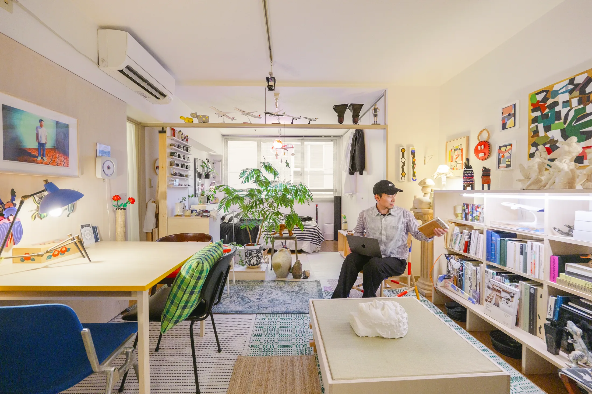
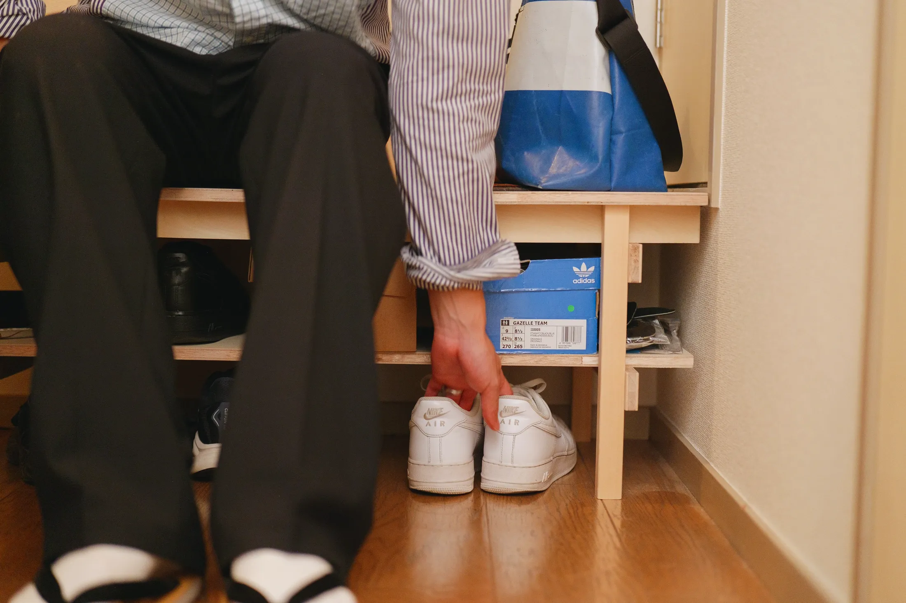
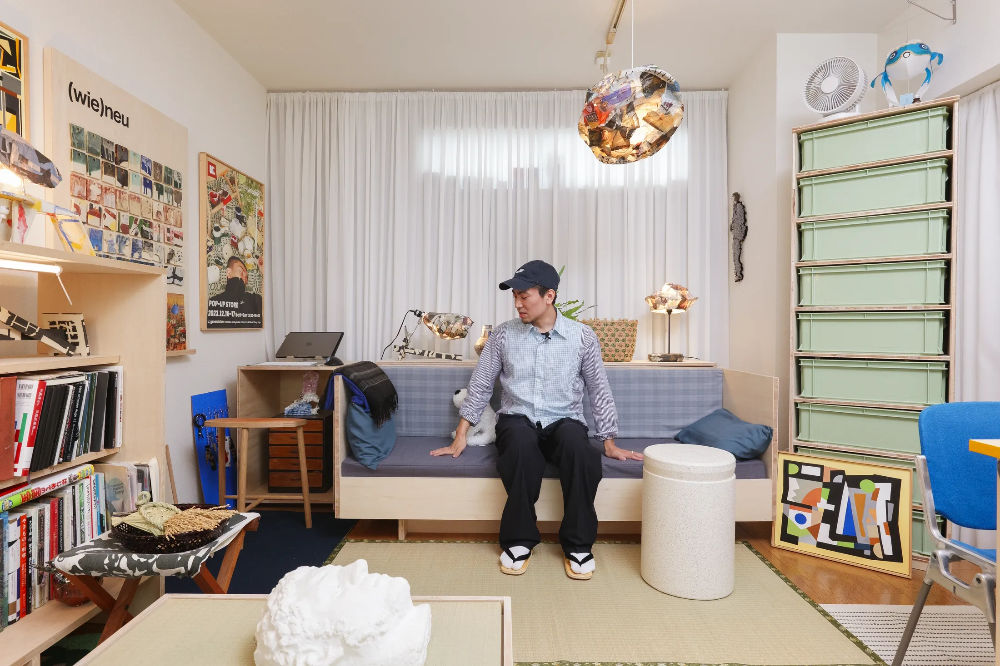
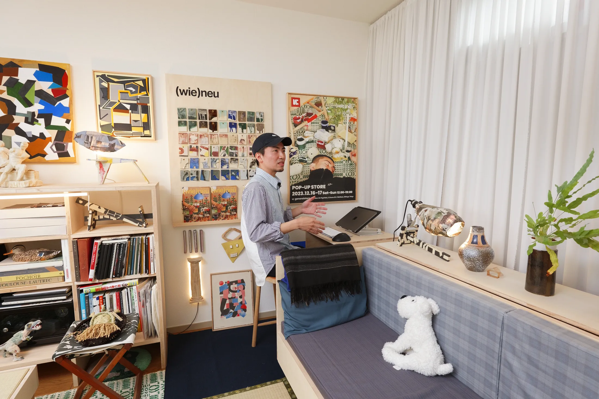
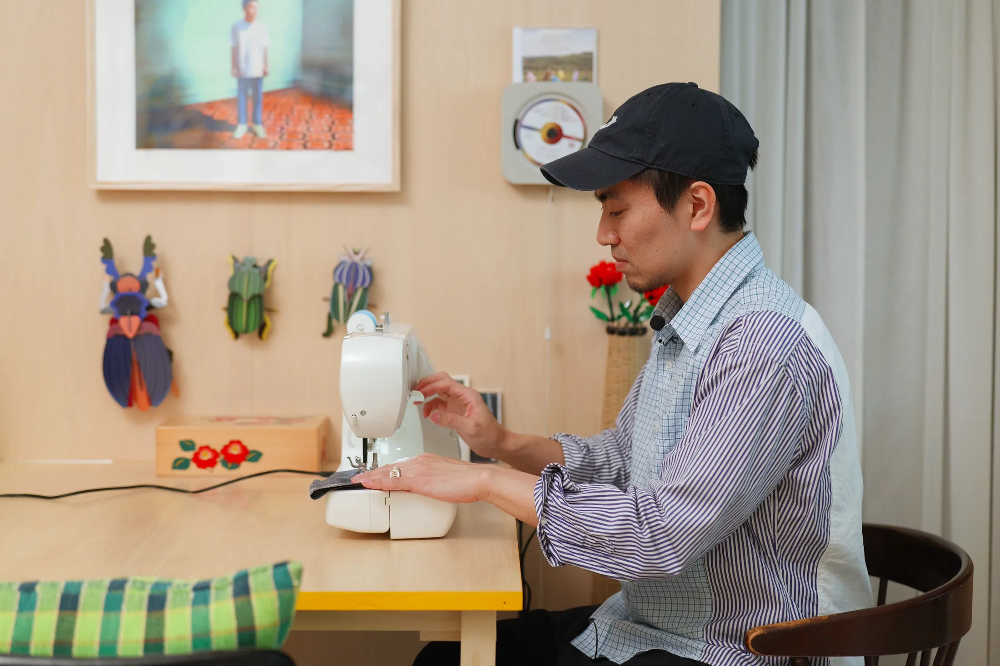
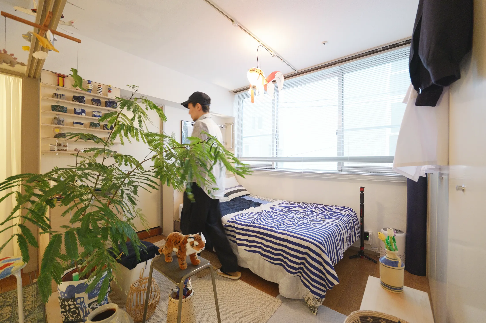

# Мебель своими руками: как керамист из Токио живёт и работает в съёмной квартире

По опросу hh.ru в июне 2025 года, только 16% респондентов хотят работать в офисе: 23% предпочитают полную удалёнку, 26% — гибрид, ещё 35% сидят в офисе, но перешли бы на удалёнку. Значит, у огромного числа москвичей рабочее место теперь живёт в той же квартире, что и спальня. Токийский керамист Рё Канеко (Ryo Kaneko) решает эту задачу давно: у него в съёмной квартире с низкими потолками есть и дом, и мастерская, и мини-галерея. Всю мебель он за три года сделал сам.

Площадь квартиры в публикации не называется, и это, пожалуй, честно: история не про метры, а про привычку подгонять вещи под себя. Для московской аренды, где сверлить стены не разрешают, а потолок бывает 2,5 м, его приёмы пригодятся.

## Коротко

- Мебель, которая не подошла, Канеко не выбрасывает: распиливает, перестраивает, переделывает во что-то другое.
- Каждый угол работает: в прихожей скамья с обувью, под столом полка для блокнота, на стене крючки для инструментов.
- Низкий потолок «поднимают» длинные прозрачные шторы, а стены остаются пустыми: на них вешают керамику.
- Мобильные вещи (тележка на колёсах, скамья из книжной полки) заменяют стационарные шкафы.

*Квартира Рё Канеко, Токио: дом и мастерская в одном пространстве. Фото: Never Too Small*

## Приём 1: прихожая, которая работает вдвое больше

Вход в токийской квартире маленький, и Канеко использует каждый его сантиметр. Он сделал компактную скамью: на ней сидят, надевая обувь, а под сиденьем хранится сама обувь. Над ней висят образцы глазури, оставшиеся от керамических опытов: получилась выставка, которая не занимает места на полу. В шкафах по бокам хранится его любимый электроинструмент Makita: удобно, когда нужный предмет под рукой в самом начале дня.

*Скамья в прихожей: сидеть и хранить обувь под сиденьем. Фото: Never Too Small*

**Для Москвы.** В типовой хрущёвке или панельной девятиэтажке прихожая — это коридор в два-три шага, где стоит только вешалка. Если ширина позволяет, банкетка глубиной 30–35 см с отсеком для обуви под сиденьем обычно решает проблему лучше, чем тумба. А образцы тканей, плитки или краски из ремонта, оставленные на стене, дают готовое оформление без картин.

## Приём 2: гостиная, собранная слоями

Чтобы справиться с низким потолком, Канеко повесил до пола лёгкие прозрачные шторы. Волнистые складки удлиняют комнату по вертикали, а ткань рассеивает дневной свет и оставляет немного приватности. Диван он сделал сам из бывшего стеллажа. Для хранения построил полку специально под стопку зелёных контейнеров, то есть сначала купил ящики, потом сделал под них мебель, а не наоборот. Светильник собрал сам: керамическое основание и абажур из немецкой газеты. На полу разные коврики: из игуса, старой ткани для кимоно, из IKEA и MUJI, стол накрыт татами. Объединяет всё не стиль, а цвет: если оттенки сочетаются, комната кажется цельной.

*Длинные прозрачные шторы «поднимают» низкий потолок съёмной квартиры. Фото: Never Too Small*

**Как повторить.** Московская аренда часто означает «чужой» ремонт, который не переделать. Карниз под самым потолком, ткань на всю высоту и один-два цвета, которые повторяются в вещах, — это то, что можно сделать за выходные и увезти с собой при переезде. Зимой, когда световой день в Москве в декабре короткий, прозрачные шторы особенно кстати: они не крадут и без того скудный свет.

## Приём 3: рабочий угол, который можно уменьшить

Стол Канеко стоит в углу рядом с диваном. Когда стандартный размер не влез, он просто разрезал столешницу пополам и использовал обрезки в других вещах. Рядом полка по мотивам стеллажей Дональда Джадда (Donald Judd) из заранее нарезанной фанеры шина: самое приятное, по его словам, собрать готовое, без возни с распилом.

*Стол, распиленный пополам, чтобы встать рядом с диваном. Фото: Never Too Small*

**Для Москвы.** Рабочий угол в студии или однушке — вопрос не метров, а глубины. Стол 50–55 см вместо привычных 70–80 см помещается в простенок или у подоконника и всё равно вмещает ноутбук и монитор. Если вы работаете из дома полный день, как те самые 23% из опроса hh.ru, лучше поставить его так, чтобы за спиной не было кровати: тогда вечером можно «выйти» из работы хотя бы взглядом.

## Приём 4: обеденный стол как мастерская и фотостудия

Обеденный стол у Канеко — самая многофункциональная вещь в доме. За ним шьют, на нём же снимают изделия для продажи. Под столешницей есть узкая полка для дневника и блокнота: такие «карманы» он делает везде, где остаётся хоть несколько сантиметров. Кухонный уголок спрятан за шторой неподалёку; на мелких шкафчиках висят ножницы и чайник на крючках S-образной формы. Белые стены в гостиной он превратил в галерею: там вращается небольшая экспозиция керамики и стоит проигрыватель компакт-дисков.

*Обеденный стол: шьёт, снимает свои изделия и ест. Фото: Never Too Small*

**Как повторить.** Стол-трансформер — это не обязательно складной механизм. Достаточно одного устойчивого стола без выступающих царг, чтобы на нём можно было работать с ноутбуком, резать ткань и ужинать. В московской студии 25–28 м² такой стол заменяет и письменный, и обеденный, и экономит 1,5–2 м² пола.

## Приём 5: спальня без двери

В спальне Канеко снял раздвижную дверь: комната стала частью общего пространства, свет проходит дальше, а приватность он сознательно променял на ощущение большой комнаты. Здесь же стоит стеллаж для керамики, которую он вырезал сам, на полке из-под двери лежат игрушечные самолёты, а вместо ящиков служит тележка бортпроводника из шкафа. Из небольшой книжной полки он сделал скамью на колёсах.

*Дверь в спальню снята, и свет идёт дальше в квартиру. Фото: Never Too Small*

**Для Москвы.** В евродвушке и «распашонке» снять дверь между комнатой и коридором — быстрый способ добавить света. Но есть жёсткое ограничение: постановление 508-ПП запрещает делать проём между комнатой и газифицированной кухней без плотной двери. Не трогайте и вентиляционные каналы: ликвидировать или уменьшать их нельзя. Если кухня электрическая, а перепланировки вы не затеваете, решение остаётся на вашей совести и на слышимости соседей по квартире.

## Чек-лист: как «ввести в дом» мастерскую

1. Измерьте, что именно хранится, и делайте мебель под вещи, а не вещи под мебель.
2. Любую щель шириной 10–15 см превращайте в полку: под столом, над дверью, за диваном.
3. Низкий потолок: карниз вплотную к потолку и ткань до пола.
4. Один стол вместо двух: обеденный, рабочий и мастерская в одном.
5. На колёсах — всё, что нужно двигать (скамья, тележка, ящики).
6. Стены оставьте пустыми и вешайте то, чем гордитесь: керамику, ткани, образцы.

Больше идей для небольших квартир — в разделе [«Интерьер»](/temy/interer/). Если вы выбираете квартиру, где можно жить и работать, загляните в [каталог новостроек Москвы](/novostroyki/moskva/).

## Вопросы и ответы

**Как визуально поднять низкий потолок в съёмной квартире?**
Рё Канеко повесил длинные прозрачные шторы: волнистые складки тянут взгляд вверх, смягчают дневной свет и сохраняют часть приватности. Карниз лучше крепить как можно выше, а ткань брать до пола.

**Можно ли в Москве снять межкомнатную дверь, чтобы стало светлее?**
Между комнатой и кухней с газовой плитой нельзя оставлять голый проём — по постановлению 508-ПП нужна плотная дверь. Между двумя комнатами, где газа нет, снять полотно можно, но звук и запахи пойдут свободно.

**Как поместить рабочее место в маленькую комнату?**
Не покупать стандартный стол, а подгонять размер. Канеко уменьшил свой письменный стол вдвое, поставил в угол у дивана, а обеденный стол использует и как швейный, и как фотостудию.

## Источники

1. Never Too Small. «I made all the furniture»: How a Tokyo Ceramicist Lives Small in his DIY Apartment — https://www.nevertoosmall.com/post/how-a-tokyo-ceramicist-lives-small-in-his-diy-apartment
2. Мосжилинспекция: какие перепланировки запрещены (постановление 508-ПП) — https://www.mos.ru/news/item/76897073/
3. «Коммерсантъ»: опрос hh.ru о формате работы, июнь 2025 — https://www.kommersant.ru/doc/8336320
