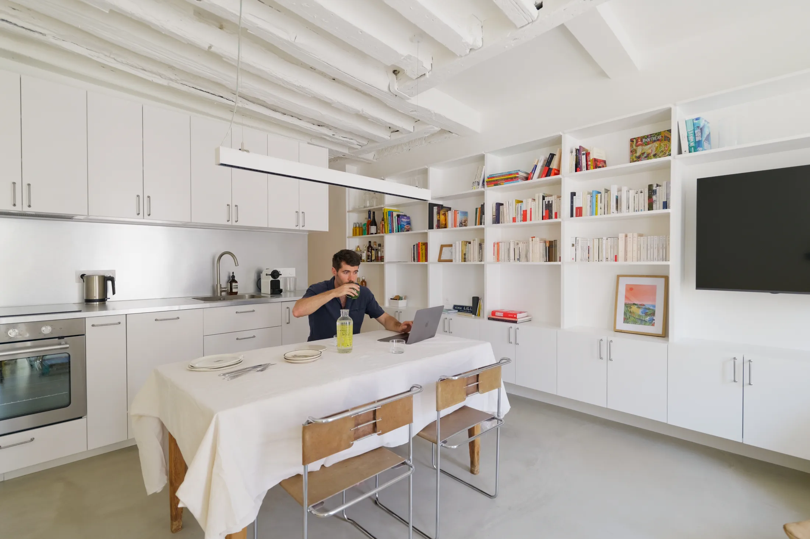
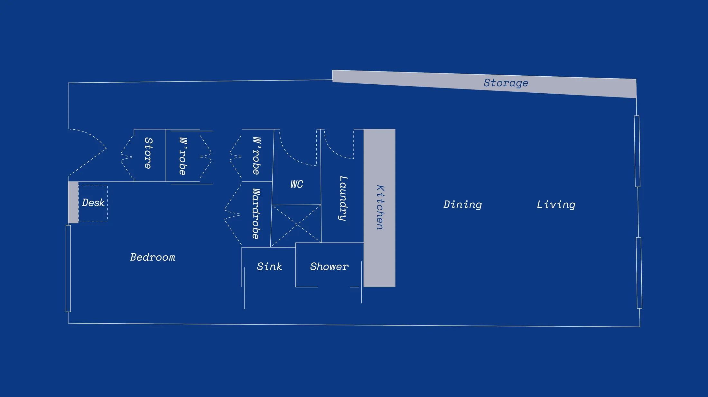
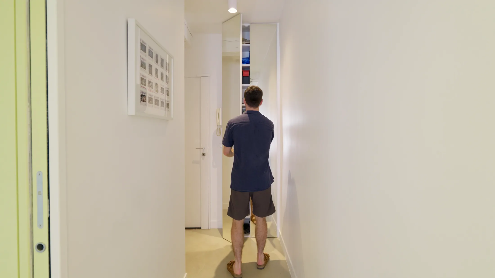
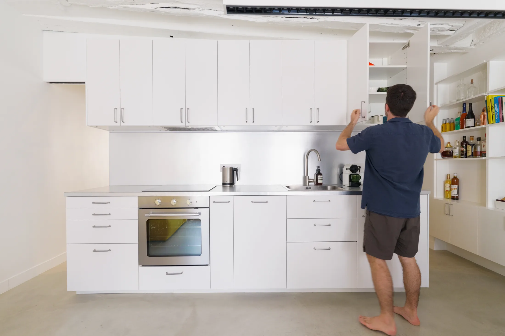
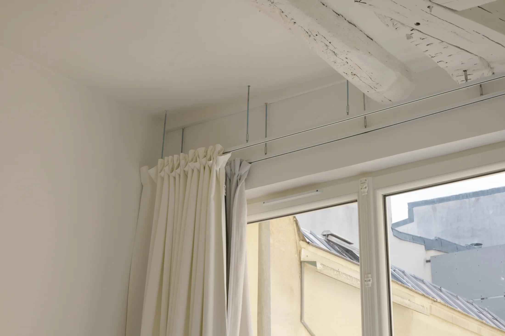
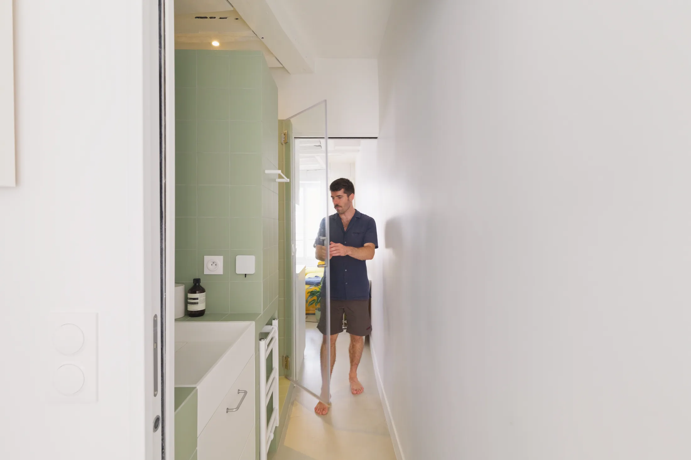
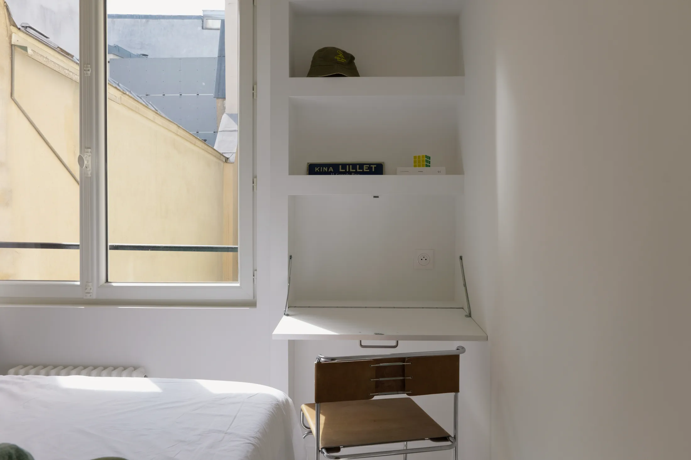
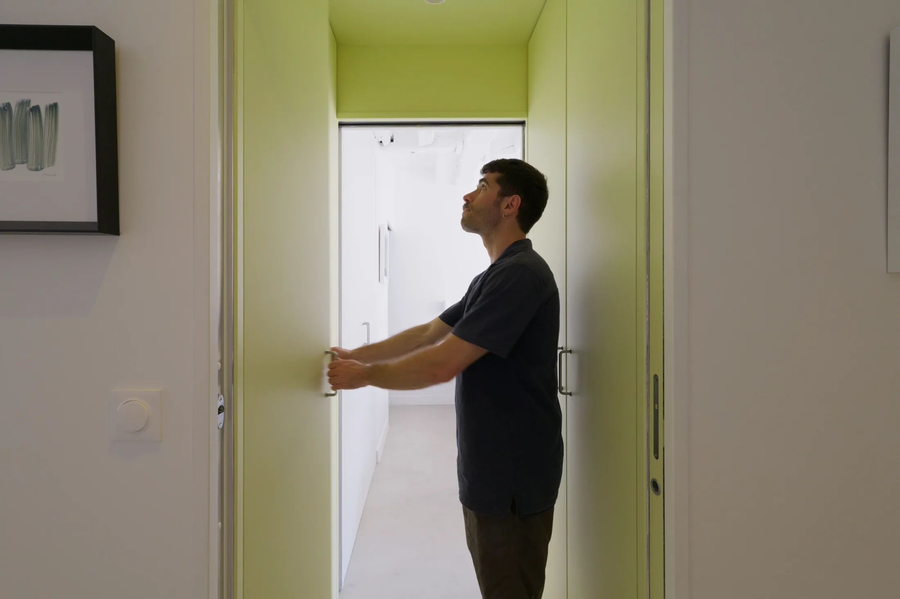

# Кольцевая планировка: как в 45 м² обойтись без коридора и тупиков

В большинстве небольших квартир коридор — это потерянные метры: он ведёт из точки А в точку Б и больше ничего не делает. Парижский архитектор Пьер Саважоль (Pierre Savajol, студия PS Studio) в квартире Apartment Chatelet площадью 45 м² превратил этот недостаток в достоинство. Он замкнул помещения в кольцо: из прихожей можно пройти в спальню через гардеробную, а из спальни вернуться в общую комнату через ванную. Фотографии сделал Жан-Батист Тирье (Jean-Baptiste Thiriet).

Для московского читателя тема знакомая: «коридор» в хрущёвке или в «распашонке» отнимает заметную долю площади, а в сталинках и старых доходных домах планировки нередко запутанные. Посмотрим, что можно взять от парижского кольца.

## Коротко

- Квартира в доме, которому около 200 лет, устроена как замкнутый маршрут: прихожая — гардеробная — спальня — ванная — общая комната.
- Гардеробная и ванная одновременно служат проходами: у каждой раздвижные двери с обоих концов.
- В прихожей — зеркальный шкаф во всю длину, в гостиной — встроенный стеллаж с телевизором, закрытым и открытым хранением.
- Кухня, столовая и гостиная — одно пространство, а границей служат стол, свет и шторы на тонком карнизе.
- Палитра сдержанная, сырые материалы; клиенты любят брутализм и художественные галереи, и в этом строгом фоне есть один кислотно-жёлтый акцент.

*Apartment Chatelet, Париж, 45 м². Архитектор Пьер Саважоль, PS Studio. Фото: Жан-Батист Тирье / Never Too Small*

## Что такое «петля» и почему она экономит метры

В обычной квартире есть центр (коридор), от которого расходятся двери. Каждая комната становится тупиком, а коридор — чистой «транспортной» площадью. В кольцевой схеме коридор растворён: роль пути берут на себя помещения, у которых и без того есть функция. Гардеробная служит переходом, ванная может быть проходом, спальня связана с гостиной двумя маршрутами.

Результат — не больше места по документам, а больше места на практике. То, что в типовой планировке уходит под проход, здесь превращается в шкафы, умывальник и рабочий угол. Подобные схемы хорошо работают в квартирах, где площадь жёстко ограничена: напомним, что в новых московских проектах с 1 августа 2024 года двухкомнатная квартира не может быть меньше 44 м², однокомнатная — меньше 28 м² (постановление № 1672-ПП). 45 м² — это как раз нижняя граница евродвушки, и каждый метр здесь на счету.

*План после перепланировки: помещения образуют замкнутый маршрут. Чертёж: PS Studio / Never Too Small*

## Приём 1. Вход: зеркальный шкаф во всю длину

Прихожую открывает шкаф-стена с зеркальными фасадами. За ними лежат обувь и зонты, спрятаны электрощиток и домофон. Зеркало увеличивает узкий проход и отражает свет из общей комнаты, а на входе не остаётся ни одной выступающей коробки.

*Зеркальный шкаф у входа: обувь, зонты, электрощиток и домофон. Фото: Жан-Батист Тирье / Never Too Small*

**Как повторить.** В московских домах щиток и слаботочка — это боль каждой прихожей, особенно в панельных домах и новостройках с щитком в самой нише. Фасад из зеркала или крашеного МДФ на петлях можно сделать так, чтобы он закрывал щиток, оставляя доступ для электрика. Для узкой прихожей хрущёвки вариант с зеркалом надёжнее светлых глухих фасадов: прихожая выглядит шире, а сам шкаф не воспринимается как стена.

## Приём 2. Общая комната: кухня, столовая и гостиная без стен

Кухня, столовая и гостиная делят одно пространство. Кухня собрана из белых фасадов и столешницы со шпоном из нержавеющей стали. Обеденный стол стоит перпендикулярно кухне, а над ним висит снятый с прежней жизни и восстановленный промышленный подвесной светильник. В гостиной — винтажный журнальный столик со стеклянной столешницей и встроенный стеллаж, объединивший открытые полки, место под телевизор и закрытое хранение; у него глухие торцы и приподнятое основание.

*Кухня: белые фасады и столешница с шпоном из нержавеющей стали. Фото: Жан-Батист Тирье / Never Too Small*

Зонирование здесь строится на мелочах. Шторы подвешены на тонком карнизе, который крепится на металлических тягах между старыми деревянными балками. Лёгкая тюлевая ткань делит пространство днём и закрывает его вечером.

*Карниз на тонких тягах между старыми балками подвешивает лёгкие шторы. Фото: Жан-Батист Тирье / Never Too Small*

**Для Москвы.** Объединить кухню и комнату — один из самых частых запросов, но здесь работает ограничение 508-ПП: в доме с газовой плитой проём между комнатой и кухней без плотной двери делать нельзя. Поэтому в газифицированных домах (а в московском жилом фонде такие дома не редкость) кухня остаётся отдельным помещением, и вместо «сноса стены» придётся выбирать раздвижную стеклянную дверь. Подвесной светильник над столом и тонкий карниз — приёмы, которые не требуют согласований и подходят любой квартире.

## Приём 3. Ванная, которая становится коридором

Самое неожиданное решение — ванная с раздвижными дверями с двух концов. Когда ею никто не пользуется, обе двери открыты, и она служит частью коридора между спальней и общей комнатой. Закрыл двери — получил обычную ванную. Внутри — готовая раковина в плиточной «обойме», глубокий шкаф с зеркальными дверцами в центральном ядре, ниши для флаконов в душевой и полотенцесушитель, поставленный в узкий зазор.

*Ванная-коридор: раздвижные двери с обоих концов. Фото: Жан-Батист Тирье / Never Too Small*

**Для Москвы.** Это самый сложный для повторения приём. Ванная в московской квартире часто — внутренняя комната с вентиляционным каналом, и его нельзя ликвидировать или уменьшать (постановление 508-ПП). Любое изменение «мокрых» зон требует проекта и согласования. Зато идею можно использовать мягче: раздвижные двери вместо распашных в ванной и в туалете экономят площадь, которая нужна для открывания полотна, а зеркальный шкаф над раковиной даёт то самое хранение, которое в «ядре» квартиры взять негде.

## Приём 4. Спальня: подвесные тумбы и стол, который прячется

В спальне прикроватные тумбочки из нержавеющей стали прикреплены к стене по обе стороны кровати: пол остаётся свободным. Стол раскладывается из встроенного шкафа и по совместительству служит туалетным столиком; над ним полки, внутри — розетки. Небольшой шкаф в «ядре» покрашен в цвет стен, и у него нет видимой дверной коробки, так что он не заметен.

*Стол прячется во встроенном шкафу и работает ещё и как туалетный столик. Фото: Жан-Батист Тирье / Never Too Small*

**Как повторить.** Покраска фасада в цвет стены — самый дешёвый способ «стереть» шкаф. Тумбы на стене подходят для кровати с высоким изголовьем; под ними можно убирать пылесос-робот. Откидной стол с розетками удобен для удалённой работы пару раз в неделю, но при ежедневной работе лучше выделять постоянное место.

## Приём 5. Гардеробная как проход

Между спальней и коридором находится гардеробная: раздвижные двери на каждом конце, хранение по обеим сторонам, цвет — кислотно-жёлтый. Она не требует отдельной комнаты и работает как шлюз, из которого можно выйти к входной двери или вернуться в спальню. Внутри нет дверей-«тупиков» — мебель стоит вдоль стен, а центр оставлен для прохода.

*Гардеробная-проход кислотно-жёлтого цвета соединяет спальню и прихожую. Фото: Жан-Батист Тирье / Never Too Small*

**Для Москвы.** В московской евродвушке гардеробную-проход можно устроить там, где между спальней и прихожей можно выкроить полосу под шкафы с проходом посередине. Идея особенно хороша для зимнего хранения: шубы и куртки живут не в прихожей, а ближе к спальне. Яркий цвет внутри (в Париже — кислотно-жёлтый) оправдан: гардеробная закрыта дверями, и не надо волноваться, что цвет «победит» остальной интерьер.

## Что взять в московскую квартиру

Кольцо в чистом виде в Москве реализовать сложно, но три ингредиента работают почти везде. Первый — убрать лишние тупики: коридор лучше превращать в «галерею хранения», чем оставлять голым. Второй — двери: раздвижные и «карманные» двери освобождают площадь поворота. Третий — материалы: у парижской квартиры сдержанная палитра, сырые фактуры и один яркий акцент, и поэтому небольшие помещения не кажутся шумными.

В старых домах Москвы — в районе Китай-города, в Замоскворечье, на Покровке — перепланировка проще, если дом не подпадает под ограничения по охране; в панельных сериях и хрущёвках пространство меняется меньше, чем кажется, из-за несущих стен. Всегда начинайте с обследования: узнайте, какие стены несущие, а какие можно сносить.

## Чек-лист

1. Нарисуйте на плане маршруты: какие комнаты тупиковые, какие можно соединить.
2. Замените распашные двери на раздвижные там, где проход узкий.
3. Закройте щиток и домофон в шкафу с доступом для электрика.
4. Для зонирования используйте свет, шторы на тонком карнизе и стол, повёрнутый поперёк кухни.
5. Покрасьте встроенные шкафы в цвет стен — их станет «не видно».
6. Не трогайте вентиляцию и согласуйте любую перепланировку заранее.

Больше идей для небольших квартир — в разделе [«Интерьер»](/temy/interer/). Если вы выбираете квартиру, посмотрите [каталог новостроек Москвы](/novostroyki/moskva/) и сравните планировки.

## Вопросы и ответы

**Что такое кольцевая планировка квартиры?**
Это схема, в которой помещения соединены в замкнутый маршрут: из любой комнаты можно пройти в другую двумя путями и не возвращаться по тому же коридору. Так исчезают тупики, а метры, которые обычно уходят на коридор, работают на хранение или комнаты.

**Можно ли в Москве сделать ванную проходной?**
Теоретически да, но только в рамках согласованной перепланировки: нельзя ликвидировать или уменьшать вентиляционные каналы, а ванную нельзя перепроектировать без проекта и согласования. Перед покупкой материалов обязательно проконсультируйтесь с проектировщиком и в Мосжилинспекции.

**Какая минимальная площадь двухкомнатной квартиры в новостройках Москвы?**
С 1 августа 2024 года в новых московских проектах двухкомнатная квартира не может быть меньше 44 м², однокомнатная — меньше 28 м² (постановление Правительства Москвы № 1672-ПП от 23 июля 2024 года).

## Источники

1. Never Too Small. How a clever loop plan transformed this 45sqm/484sqft Paris apartment — https://www.nevertoosmall.com/post/how-a-clever-loop-plan-transformed-this-45sqm-484sqft-paris-apartment
2. ppt.ru: постановление Правительства Москвы от 23.07.2024 № 1672-ПП — https://ppt.ru/obzory/vstupaet-v-silu/postanovlenie-pravitelstva-moskvy-23-07-2024-1672-pp
3. Мосжилинспекция: какие перепланировки запрещены (постановление 508-ПП) — https://www.mos.ru/news/item/76897073/
