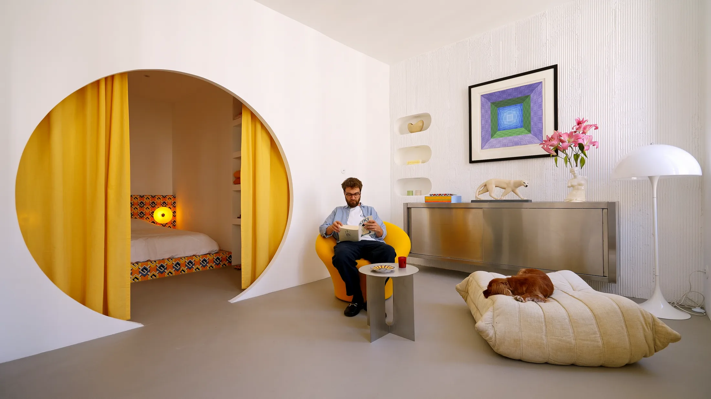
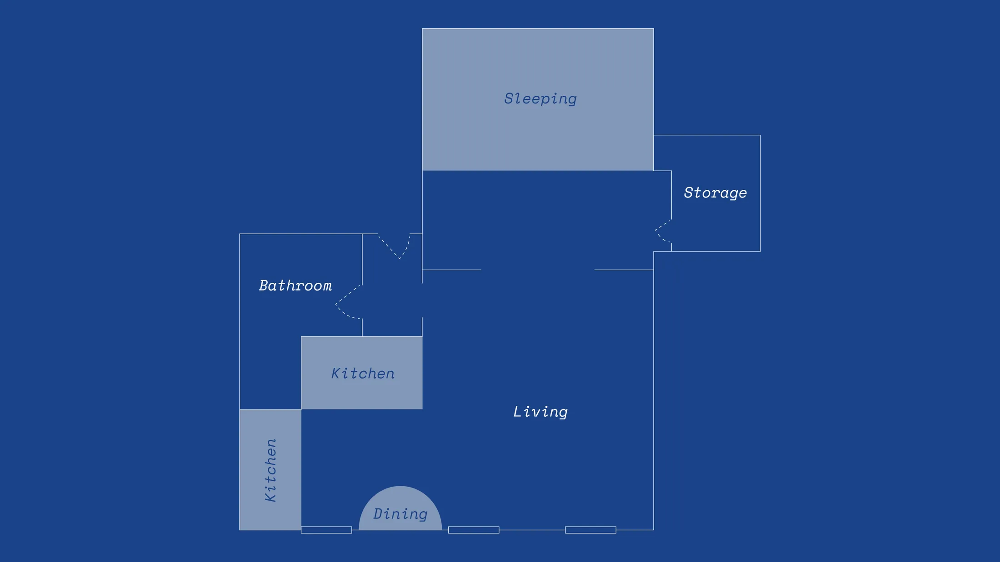
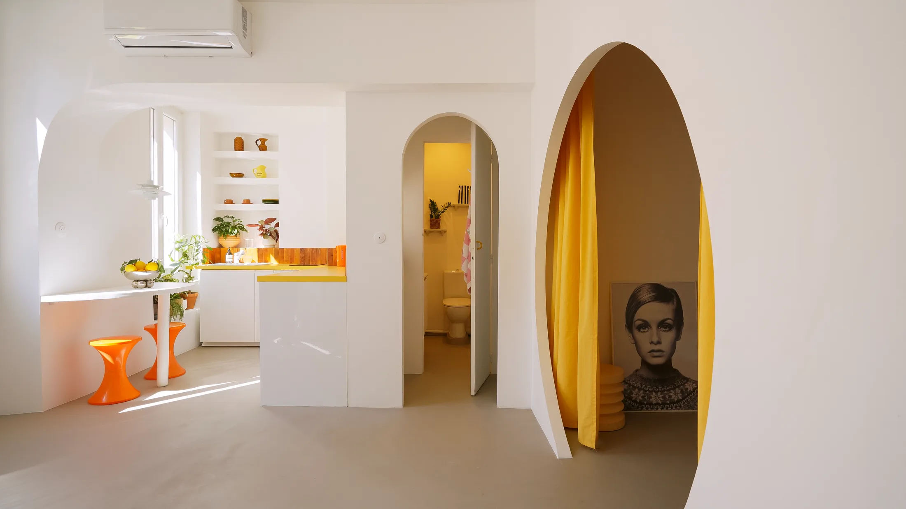
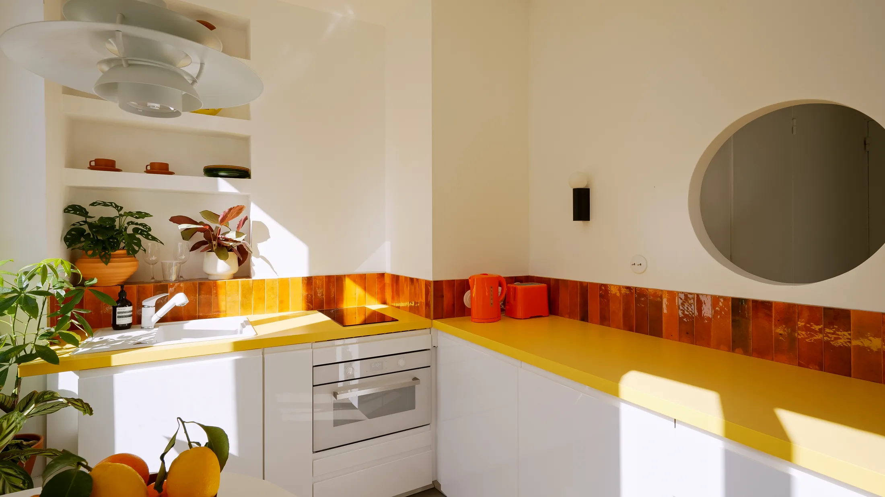
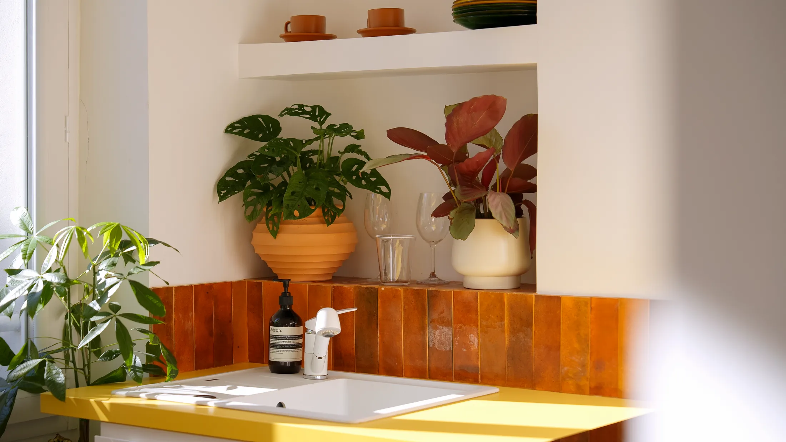
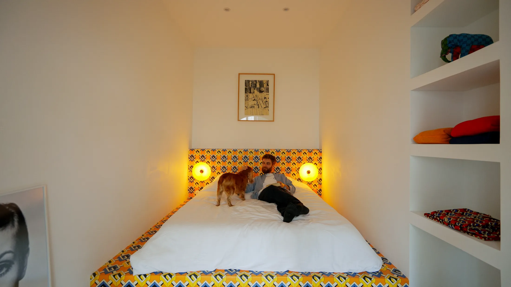
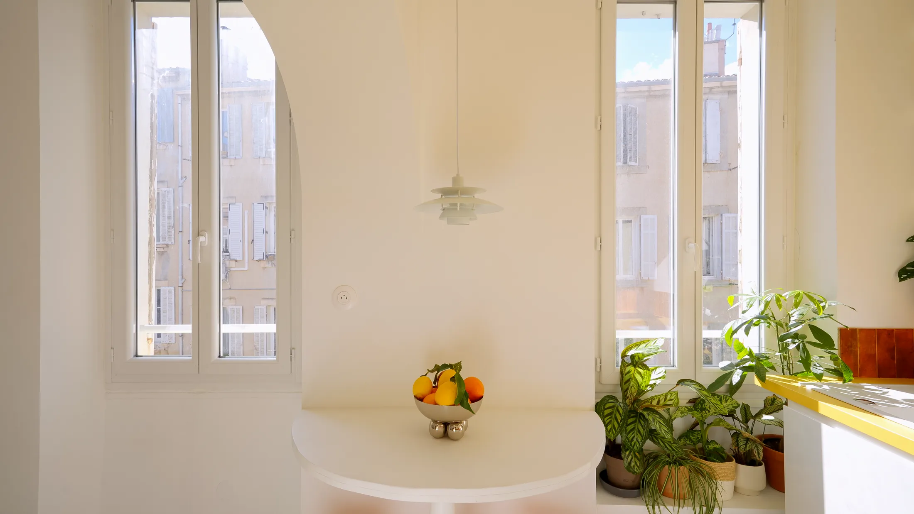

# Арки и круглые проёмы вместо дверей: как играть формой в квартире 32 м²

В 32 метрах дверь — это роскошь. Створка забирает полметра воздуха, коридор превращается в тоннель, а каждая комната выглядит коробкой. Марсельский дизайнер Бенуа Пала (Benoit Palas, бюро Maison Palas) пошёл другим путём: вырезал в стенах арки и круглые порталы, а кухню собрал из самых простых материалов и покрасил в цвета сигнального знака. Получилась квартира Chez Joe, в которой нет ни одной скучной стены.

Для московского читателя это не только картинка. Метраж такой квартиры — обычная евро-однушка или большая студия, а дом, в котором она находится, построен в начале XX века, как наши доходные дома в Замоскворечье и на Арбате. Посмотрим, какие приёмы переносятся в Москву, а какие упрутся в нормы.

## Коротко

- Двери между зонами заменены арками и круглыми проёмами: свет идёт дальше, а проход не занят створкой.
- Кухня сделана из простого: белые корпуса, оранжевая плитка в фартуке, жёлтая пластиковая столешница.
- На стене вместо плитки — фактурная цементная штукатурка, которую нанесли прямо на поверхность.
- Хранение разделено на «показать» (ниши с посудой) и «спрятать» (гардеробная, закрытая посудомойка).
- Обеденный стол прикреплён к стене между двумя окнами, под ним прячутся два табурета.

*Chez Joe, Марсель, 32 м². Интерьер: Benoit Palas, Maison Palas. Фото: Lisa Martens Carillo / Never Too Small*

## Откуда идея: курорт будущего 1960-х

Бенуа Пала вдохновлялся Ла-Гранд-Мот (La Grande Motte) — футуристическим курортным городком на французском Средиземноморье, построенным в духе экспериментального дизайна 1960-х. Там много округлых, «лепных» форм, а модернизм не боится быть весёлым. Отсюда и характер квартиры: она шутит с формой, но не загромождена вещами.

Дом, в котором она находится, старше курортного города: он построен в начале XX века недалеко от моря. Это важная деталь. Современная «игра» в старой оболочке работает именно потому, что оболочка спокойная: высокие окна, толстые стены, понятная геометрия комнат.

*План Chez Joe после перепланировки. Чертёж: Maison Palas / Never Too Small*

## Приём 1: проёмы вместо дверей

В прихожей — маленькое круглое отверстие, через которое проходит свет. Над входной зоной висит светильник PH5 от Louis Poulsen: дизайнер сознательно оставил его «в раме» проёма, и вечером он работает как точка притяжения. Из прихожей в гостиную ведёт арка, а в спальню — большой круглый портал, который по желанию закрывается ярко-жёлтой шторой.

Что здесь по-настоящему умно: форма проёма сама решает задачу двери. Взгляд проходит дальше, воздух циркулирует, а приватность там, где она нужна, обеспечивает штора, а не створка с петлями и ручкой.

*Вместо дверей — вырезанные в стенах арки и круглые порталы. Chez Joe, 32 м². Фото: Lisa Martens Carillo / Never Too Small*

**Для Москвы.** Арка вместо двери между прихожей и комнатой — одна из самых популярных идей в хрущёвках и панельных домах. Особенно хорошо она работает в сталинках и конструктивизме Хамовников и Замоскворечья, где перегородки обычно кирпичные и толстые: в них уже есть готовая «глубина» для ниши или портала. Но есть два ограничения. Во-первых, несущие стены трогать нельзя без проекта и согласования. Во-вторых, постановление 508-ПП прямо запрещает делать проём между комнатой и газифицированной кухней без плотной двери. Если в доме газ, арка на кухню отпадает: оставляйте дверь или хотя бы стеклянную раздвижную перегородку.

## Приём 2: простые материалы, сильный цвет

На кухне Chez Joe нет дорогих материалов. Нижние шкафы — белые корпуса из масс-маркета. Фартук выложен оранжевой плиткой, столешница — ярко-жёлтый ламинат Formica, тот самый, что знаком каждому по советским и постсоветским кухням. В гостиной дизайнер отказался от плитки на стене и нанёс фактурную цементную штукатурку прямо на поверхность.

Идея в том, что цвет и фактура дешевле формы. Хорошо подобранный фартук или столешница делают кухню «дизайнерской», даже если шкафы куплены в обычном магазине.

*Простые материалы работают на цвет: плитка, пластик, белые корпуса. Chez Joe, 32 м². Фото: Lisa Martens Carillo / Never Too Small*

**Как повторить.** В московской новостройке кухня-ниша обычно рассчитана на одну стену, и для яркого акцента хватает полутора метров фартука. Выбирайте один сильный цвет, а остальное оставляйте белым. Фактурная штукатурка по бетону или кирпичу особенно уместна в лофтах бывших фабрик вроде «Флакона» или «Армы», где голые стены уже есть и их не нужно прятать.

## Приём 3: показать и спрятать

В квартире чётко разведены две роли хранения. Над раковиной — средиземноморские ниши, в которых стоит цветная посуда: она работает как декор. Посудомоечная машина, наоборот, спрятана. В гостиной в стену встроен старый кухонный шкаф из нержавеющей стали, превращённый в навесное хранение, а рядом вырезаны округлые ниши. Основной запас вещей лежит в гардеробной у спальни.

Такая арифметика экономит место: ниша в стене не выходит в комнату ни на сантиметр. В 32 м² это ощутимо.

*Ниши и встроенные полки: что показать, а что спрятать. Chez Joe, 32 м². Фото: Lisa Martens Carillo / Never Too Small*

**Для Москвы.** Ниши лучше всего делать во внутренних перегородках, а не в наружных стенах: зимой в наружной стене тонкая ниша промерзает, а на ней оседает конденсат. Вентиляционные каналы нельзя ни ликвидировать, ни уменьшать — это тоже записано в 508-ПП. Если рядом с кухней или ванной проходит вентшахта, не вырезайте ничего в её стенке.

## Приём 4: кровать как арт-объект

В спальне изголовье и каркас кровати сделаны на заказ и обтянуты обоями Gucci, которые покрыты несколькими слоями прозрачного лака. Читать в постели помогают оранжевые стеклянные настенные лампы IKEA VARMBLIXT: полка не нужна, прикроватная тумба тоже.

*Спальня: кровать на заказ и круглый вход со шторой. Chez Joe, 32 м². Фото: Lisa Martens Carillo / Never Too Small*

**Как повторить.** Обои под лаком — смелый, но недорогой приём: нужны рулон и мастер по лаку. Только учтите, что стена за изголовьем в крайней секции панельного дома зимой бывает холодной и сырой, и перед оклейкой её стоит проверить.

## Приём 5: стол на стене

Столовая устроена в простенке между двумя окнами: стол с закруглёнными краями прикреплён к стене и висит под декоративным светильником. Два оранжевых скульптурных табурета задвигаются под столешницу, и проход остаётся свободным.

*Обеденный стол крепится к стене между окон. Chez Joe, 32 м². Фото: Lisa Martens Carillo / Never Too Small*

**Для Москвы.** В доходных домах и сталинках между окнами часто остаётся узкий простенок, который не знаешь, чем занять. Зимой, когда светает поздно, а темнеет рано, такой столик у окна — единственное место с дневным светом, где удобно завтракать или работать. Его можно закрепить на кронштейнах или на анкерах в плотную кирпичную стену; в гипсокартон без усиления вешать нельзя.

## Чек-лист: что взять с собой

1. Проверьте, какие стены несущие, и нарисуйте, где арка не нарушит их.
2. Если в доме газ, дверь на кухню оставляйте плотной (508-ПП).
3. Замените одну дверь на арку или шторный портал и оцените, насколько светлее стало.
4. Выберите один яркий цвет для кухни и повторите его два раза: фартук и текстиль.
5. Часть хранения вынесите в ниши во внутренних перегородках, часть спрячьте.
6. Простенок между окнами — под стол или рабочее место.

Больше идей для небольших квартир — в разделе [«Интерьер»](/temy/interer/). Если вы выбираете квартиру в новостройке, посмотрите [каталог объектов](/obekty/).

## Вопросы и ответы

**Можно ли в московской квартире заменить дверь аркой?**
Между комнатами и коридором — как правило, можно, если не затрагиваются несущие конструкции. Но проём между комнатой и кухней с газовой плитой без плотной двери запрещён: это прямо перечислено среди запрещённых перепланировок по постановлению 508-ПП. Несущую стену трогать без проекта и согласования нельзя.

**Как сделать маленькую кухню яркой и недорогой?**
Взять простые материалы и сыграть на цвете: в Марселе это белые корпуса, оранжевая плитка в фартуке и жёлтая пластиковая столешница. Один-два сильных цвета в зоне, где нет мелких предметов, смотрятся дороже, чем десяток нейтральных поверхностей.

**Зачем стол, закреплённый на стене?**
Он не загораживает проход и не требует ножек и стульев вокруг: два табурета убираются под столешницу. Это вариант для узкой комнаты или простенка между окон, когда обычный обеденный стол съел бы всю ширину.

## Источники

1. Never Too Small. Playful design details inside a 32sqm/344sqft Marseille apartment — https://www.nevertoosmall.com/post/playful-design-details-inside-32sqm-344sqft-marseille-apartment
2. Мосжилинспекция: какие перепланировки запрещены (постановление 508-ПП) — https://www.mos.ru/news/item/76897073/

*Материал подготовлен по мотивам публикаций Never Too Small и использует их фото с разрешения правообладателя.*
