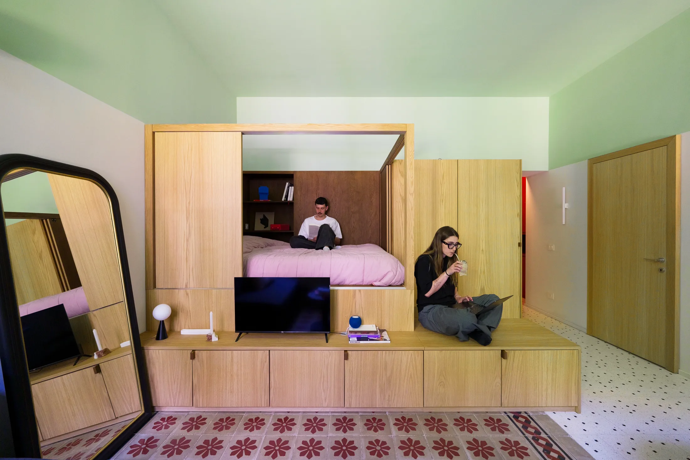
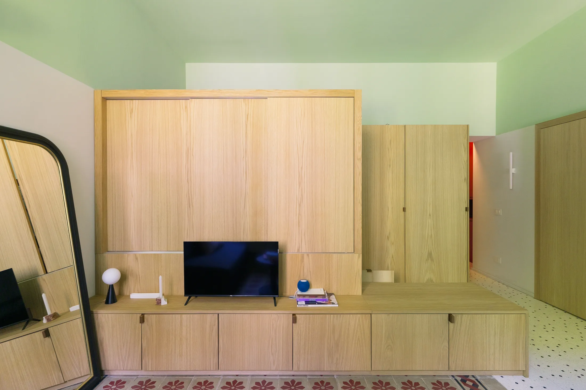
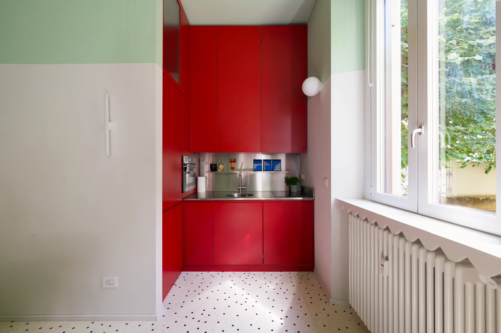
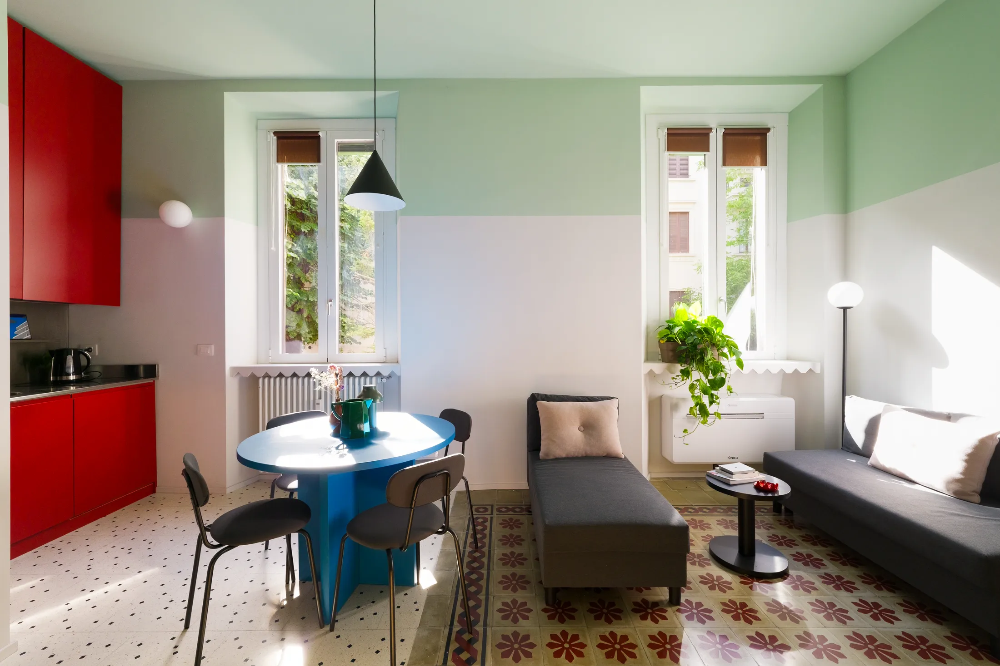
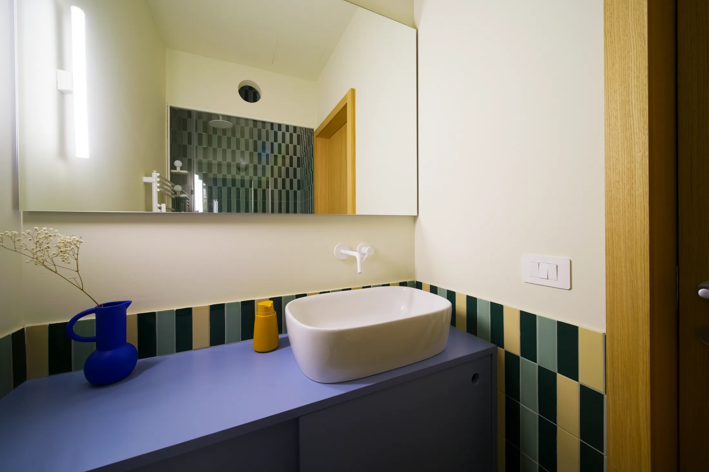
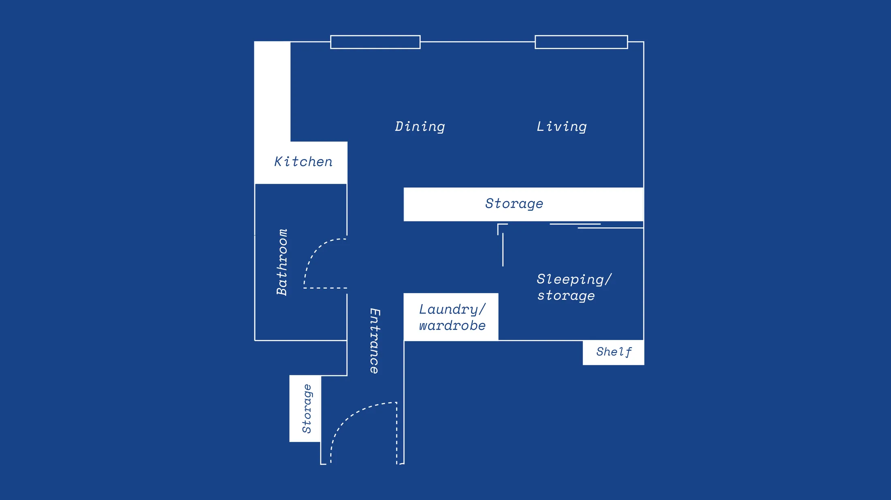

# 28 м², где поместилось всё: квартира в Милане как шпаргалка для московской студии

28 м² для Москвы — не случайная цифра. С 1 августа 2024 года в новых московских проектах нельзя проектировать однокомнатную квартиру меньше 28 м², а двухкомнатную — меньше 44 м² (постановление Правительства Москвы № 1672-ПП). Средняя студия в новостройках, по данным bnMAP.pro, в июле 2026 года — 27 м², в старой Москве — ровно 28.

Ровно столько у квартиры A Quilted House («Стёганый дом») в Милане. Её спроектировало местное бюро ATOMAA, и в этих 28 метрах есть то, чего обычно нет в московской студии: полноразмерный холодильник, посудомойка, духовка и микроволновка, просторный душ, гардеробная и спальня, которую можно закрыть от гостиной. Посмотрим, как это сделано.

## Коротко

- Спальня, гардероб, ванная и хранение собраны у входа, а все окна отданы гостиной и кухне.
- Вместо стен — мебель: альков с кроватью на пневмолифте, под ней гардеробная, сбоку — шкаф со стиральной машиной.
- Кухонные тумбы глубиной 80 см вместо стандартных 60 и шкафы до потолка.
- Зонирование цветом и полом вместо перегородок: красный вход, зелёный потолок, старая плитка в гостиной.

*A Quilted House, Милан, 28 м². Бюро ATOMAA. Фото: Never Too Small*

## История: квартиру выкроили из большой

Квартира находится в Маджолине — районе на севере Милана. Изначально это была большая квартира с высокими потолками, хорошим светом и длинным бесполезным коридором. Владелец разделил её на две независимые, и меньшая досталась архитекторам — 28 м².

Для Москвы это знакомый сюжет: большие квартиры в старых домах внутри Садового кольца тоже бывают с высокими потолками и длинными коридорами. А в новостройках 28 м² — это уже не исключение, а стандарт однушки.

## Спальня как предмет мебели

Главный приём — спальная зона, сделанная как один дубовый модуль: кровать, шкаф, тумбочка и хранение. Кровать поднимается на газовых амортизаторах, а под ней — гардеробная, куда можно войти: одежда, обувь, постельное бельё. Роль прикроватной тумбы играет старая ниша в стене, а настенные лампы для чтения освобождают её поверхность.

Две колонны рядом прячут стиральную машину и дополнительную штангу для одежды. Альков закрывается раздвижными панелями с двух сторон, но сверху остаётся открытым — свет и воздух проходят в спальню. Со стороны гостиной модуль превращается в низкую тумбу под телевизор, а выдвижной ящик служит ступенькой к кровати и лишним сиденьем.

*Спальня закрывается раздвижными панелями и выглядит как дубовая стена. Фото: Never Too Small*

**Что взять в московскую студию.** Если у вас потолок от 2,8–3 м, кровать на подиуме или на подъёмном механизме с хранением под ней выигрывает больше, чем любой шкаф-купе: место под двуспальной кроватью — это около 3 м² хранения, которые в обычной расстановке пропадают. Похожий приём ATOMAA применило и в другой своей миланской микроквартире.

## Кухня: глубже, а не длиннее

Г-образная кухня вмещает посудомоечную машину, духовку, микроволновку, холодильник с морозилкой в полный рост, кладовую и много хранения. Секрет — глубина: нижние тумбы по 80 см вместо привычных 60. Хранения больше, а столешница шире. Верхние шкафы доходят до потолка — туда уходит то, что нужно раз в год.

Отделка — тёмно-красные фасады без ручек, столешница, фартук и полка из нержавеющей стали. Часть шкафов со вставками из рифлёного стекла — через них свет попадает в ванную.

*Кухня с тумбами глубиной 80 см вместо стандартных 60. Фото: Never Too Small*

**Что взять.** В московских студиях кухня часто — это ряд модулей вдоль одной стены длиной 2–2,5 м. Если проход позволяет, увеличенная глубина тумб и шкафы до потолка дают больше, чем попытка втиснуть ещё один модуль.

## Цвет вместо стен

Вход выкрашен в глубокий красный — тёмный «тамбур» перед светлой гостиной. Тот же красный продолжается в кухонных фасадах и связывает две зоны. В гостиной стены внизу белые, а верх стен и потолок — бледно-зелёные: взгляд уходит вверх, и высокий потолок становится главным достоинством комнаты. Границы цвета совпадают с архитектурными деталями, поэтому двухцветная схема не выглядит случайной.

## Старая плитка как ковёр

В гостиной сохранили исторические миланские плитки cementine — они сами выделяют зону отдыха, и ковёр не нужен. Плохой пол рядом заменили новой плиткой ручной работы с вкраплениями чёрного мрамора, сделанной в Апулии; рисунок взяли не со старых плиток, а с пола парадной этого дома. Тот же рисунок повторили на подоконниках — они стали полками для растений.

*Исторические плитки cementine оставили — они заменяют ковёр в гостиной. Фото: Never Too Small*

**Московская параллель.** В дореволюционных доходных домах Москвы встречается своя историческая плитка — метлахская, с геометрическим рисунком. Если она сохранилась в квартире, её стоит реставрировать, а не закрывать ламинатом: это готовый акцент, который не повторит ни одна новостройка.

## Ванная без окна, но со светом

Ванная стоит у центральной стены и окна не имеет — как и в большинстве московских студий. Свет приходит из кухни через рифлёное стекло, а в душевой есть круглое окно-иллюминатор для проветривания, чтобы не скапливался конденсат. В ванной большой душ, широкая раковина с тумбой, хранение и огромное зеркало. Сантехника подвесная — видно больше пола. Пастельная плитка — голубая, зелёная, жёлтая — и белые детали делают комнату светлой.

*Ванная без окна получает свет из кухни через рифлёное стекло. Фото: Never Too Small*

**Что учесть в Москве.** Внутреннее окно или стеклянная вставка между ванной и кухней — частый приём и у нас. Но вентиляцию трогать нельзя: ликвидировать или уменьшать вентиляционные каналы запрещено постановлением 508-ПП. Подвесная сантехника и большое зеркало — самый дешёвый способ «расширить» ванную на 3–4 м².

*План после перепланировки: мокрая зона и спальня у входа, окна — гостиной и кухне. Чертёж: ATOMAA / Never Too Small*

## Чек-лист для студии 25–30 м²

1. Всё «закрытое» — у входа: ванная, гардероб, спальня. Окна — для жизни.
2. Мебель вместо перегородок: альков, шкаф-стена, подиум.
3. Место под кроватью — хранение.
4. Кухня глубже, шкафы до потолка.
5. Зонирование цветом и полом, а не стенами.
6. Подвесная сантехника и большое зеркало в ванной.

Больше идей для небольших квартир — в разделе [«Интерьер»](/temy/interer/). Если вы только выбираете студию, посмотрите [каталог объектов](/obekty/) с историей каждого участка.

## Вопросы и ответы

**Почему в Москве больше не строят квартиры меньше 28 м²?**
Постановление Правительства Москвы № 1672-ПП от 23 июля 2024 года установило минимальную общую площадь новых квартир: 28 м² для однокомнатных и 44 м² для двухкомнатных. Требование действует с 1 августа 2024 года.

**Какая средняя площадь студии в новостройках Москвы?**
По данным bnMAP.pro, в июле 2026 года — 27 м²; в старой Москве — 28 м², в Новой Москве — 25 м². Студии меньше в основном в проектах, согласованных до вступления в силу запрета.

**Зачем делать кухонные тумбы глубиной 80 см?**
Глубокие тумбы вмещают больше и дают широкую рабочую поверхность. В маленькой кухне это компенсирует нехватку длины столешницы; цена — чуть меньше прохода, поэтому решение подходит для Г-образной кухни у стены.

## Источники

1. Never Too Small. How a 28sqm/301sqft Milan apartment makes room for everything — https://www.nevertoosmall.com/post/how-a-28sqm-301sqft-milan-apartment-makes-room-for-everything
2. ppt.ru: постановление Правительства Москвы от 23.07.2024 № 1672-ПП — https://ppt.ru/obzory/vstupaet-v-silu/postanovlenie-pravitelstva-moskvy-23-07-2024-1672-pp
3. РБК Недвижимость: цены и площадь студий в новостройках Москвы, июль 2026 — https://realty.rbc.ru/news/6a688a1e9a7947e0d847331e
4. РБК Недвижимость: студии в предложении, данные «Метриума», июнь 2026 — https://realty.rbc.ru/news/6a2688819a7947c4911d7fd8
5. Мосжилинспекция: какие перепланировки запрещены (постановление 508-ПП) — https://www.mos.ru/news/item/76897073/

*Материал подготовлен по мотивам публикаций Never Too Small и использует их фото с разрешения правообладателя.*
