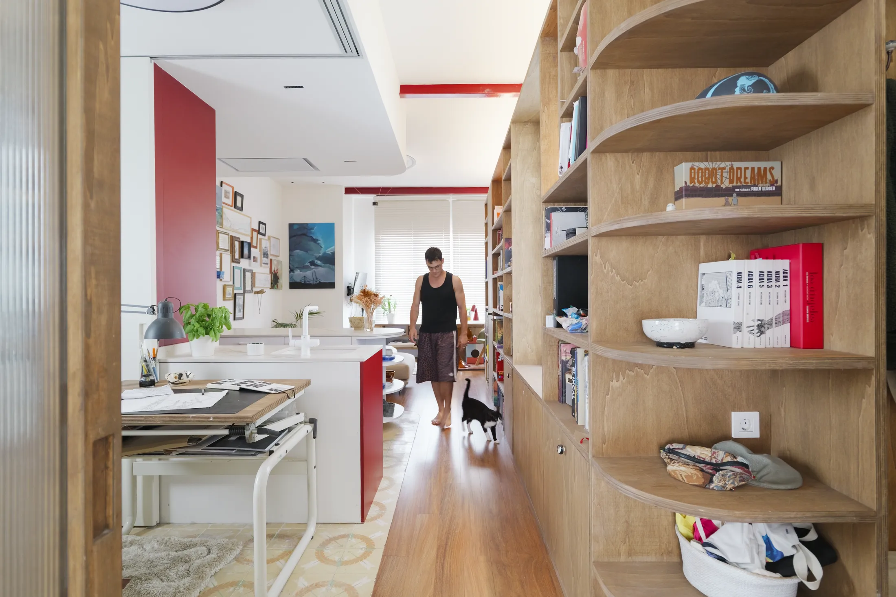
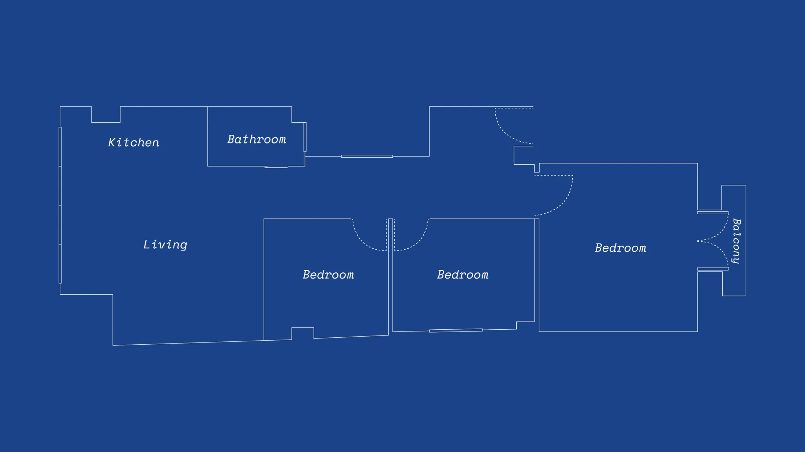
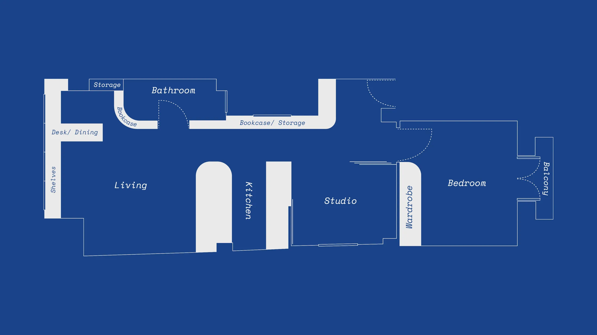
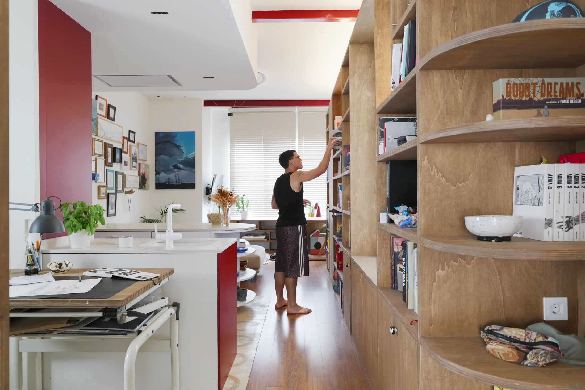
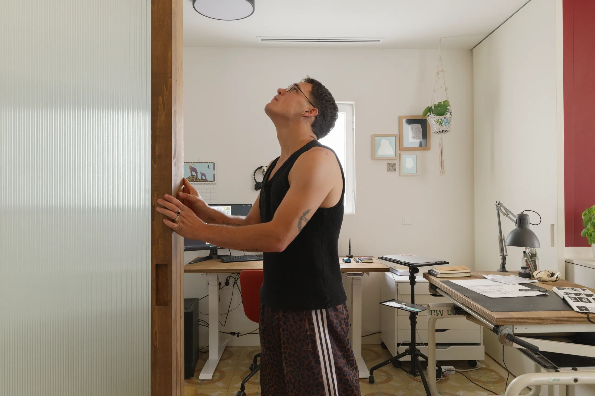
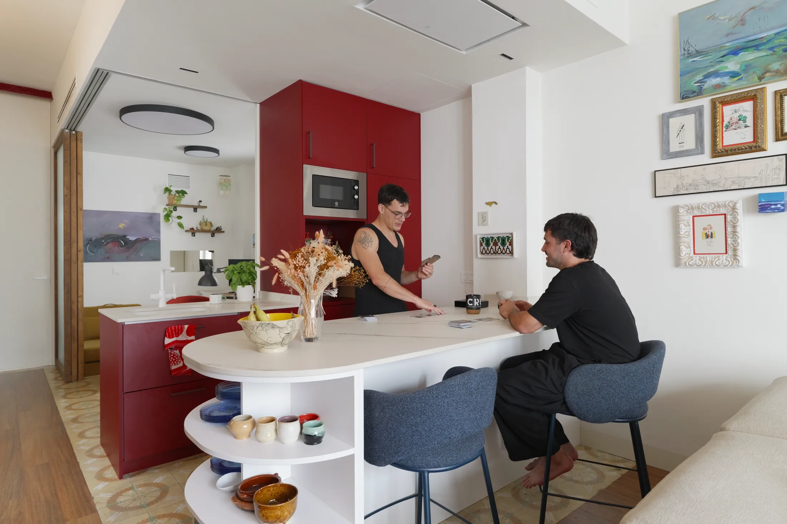
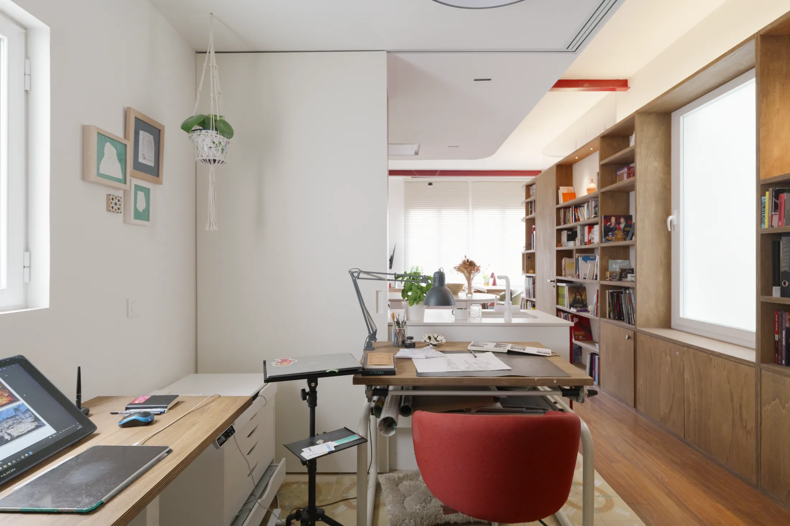
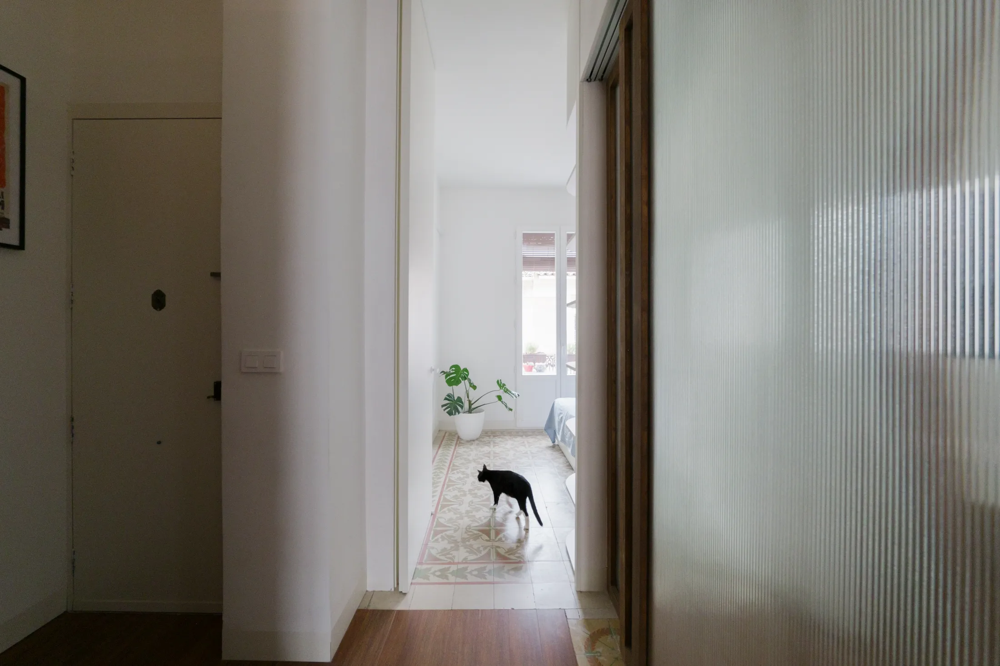

# Свет сквозь шкаф: 5 приёмов из квартиры художника для тёмной московской планировки

Три тесные комнаты, а кухня и ванная — в тёмном внутреннем углу. Если вы жили или смотрели квартиры в дореволюционном доходном доме в районе Арбата или в сталинке в Хамовниках, эта картина знакома: окна смотрят в одну сторону, а «мокрые» помещения прячутся в глубине. Такой была квартира в столетнем доме в Валенсии, которую архитектор Гильермо Сауккильо (Guillermo Sahuquillo) из бюро SahuquillodeArriba перестраивал для своего брата, иллюстратора Пабло (Pablo Sahuquillo). Площадь — 55 м², с Пабло живёт кот по имени Ломо.

Средняя квартира в московской новостройке сегодня больше: по данным bnMAP, площадь выросла с 56,3 до 62 м² (I квартал 2025 — I квартал 2026). Так что 55 м² — совсем не экзотика, и приёмы из Casa Artista можно примерять на себя.

## Коротко

- Одна длинная стеллажная стена из недорогой фанеры заменила коридор, прихожую и перегородки.
- Свет делят между комнатами: рифлёное стекло, полупрозрачный акрил и матовое окно во двор.
- Кухня — это остров с индукционной панелью и сниженный изогнутый потолок над ним.
- Дом художника — это не «рабочий уголок», а студия с двумя столами и дверью к раковине.
- Старый плиточный пол нашли при демонтаже и сохранили.

*Casa Artista, Валенсия, 55 м². SahuquillodeArriba. Фото: Oleh Kardash / Never Too Small*

## Что было и что стало

Раньше в квартире были три небольшие спальни, а кухня с ванной находились в тёмном внутреннем углу. Пространство разделили не глухими перегородками, а мебелью и стеклом.

*План до перепланировки. Чертёж: SahuquillodeArriba / Never Too Small*

*План после перепланировки. Чертёж: SahuquillodeArriba / Never Too Small*

**Для Москвы.** Любая перепланировка в многоквартирном доме требует согласования, а если дом старый, то и проверки перекрытий и несущих стен. Поэтому логика проекта в Валенсии полезна как принцип: сначала решите, что можно сделать мебелью (она не требует разрешений), и только потом решайте, какие стены придётся трогать.

## Приём 1: стеллаж на всю квартиру

Основа проекта — индивидуальная конструкция из тонированной тополевой фанеры. Материал выбрали за доступную цену при большом объёме. Стеллаж идёт почти через всю квартиру: от входа мимо раздвижной студии до обеденной зоны. У двери он превращается в прихожую со скамьёй для обуви, ящиками под ней и крючками над ней. Затем скрывает ванную, меняя глубину, чтобы вместить и библиотеку, и санузел. На конце — стол из остатков фанеры: он раздвигается, и за ним умещаются до восьми человек, а если сложить — один.

*Стеллаж из тонированной тополевой фанеры идёт почти через всю квартиру. Фото: Oleh Kardash / Never Too Small*

**Как повторить.** Для московской хрущёвки или узкой евродвушки идея масштабируется: один непрерывный фасад из недорогих листовых материалов выглядит спокойнее, чем набор разных шкафов. Фанера хороша ещё и тем, что её легко подогнать под неровные стены старого дома, а погрешности скрыть фасадом.

## Приём 2: свет делится между комнатами

Самая сильная часть проекта — работа со светом. Три раздвижные двери студии сделаны из рифлёного стекла: они дают приватность, но пропускают дневной свет. В стеллаж встроены полупрозрачные акриловые панели, и дневной свет доходит до ванной — самой глубокой комнаты в плане. Вечером ванная, наоборот, светится сама и подсвечивает гостиную. Рядом в полке есть окно из матового стекла во двор. Спальню от гостиной отделяет не стена, а поворотная дверь во всю высоту. Над душем висят растения, которым хватает влаги и рассеянного света.

*Раздвижные двери из рифлёного стекла отделяют студию, но пропускают свет. Фото: Oleh Kardash / Never Too Small*

**Для Москвы.** Короткий световой день с ноября по февраль делает любой источник естественного света ценным, а в глубоких планировках, например в старых домах с окнами во двор-колодец, особенно. Рифлёное стекло, матовые вставки в дверях и стеклянные створки — рабочие решения. Но есть ограничение: вентиляцию ванной нельзя ни закрыть, ни уменьшить — это запрещает постановление 508-ПП. Светопроницаемую перегородку делайте, не затрагивая вентканал.

## Приём 3: кухня-остров

Красные фасады кухни перекликаются с цветом старых потолочных балок, а столешница белая. Трёхконфорочная индукционная панель встроена в изогнутый остров, который, когда не готовят, служит для работы, настольных игр и еды. Над ним потолок сделан ниже и с тем же изгибом: за ним спрятаны вытяжка и кондиционер.

*Кухонный остров: на нём и готовят, и работают, и играют. Фото: Oleh Kardash / Never Too Small*

**Как повторить.** В московской студии или евродвушке остров можно заменить полуостровом или обеденным столом на колёсиках. Электрическая индукционная панель вообще упрощает задачу: газа нет — нет и требований к двери между кухней и комнатой. Если же в доме газовая плита, открыть кухню в комнату без плотной двери нельзя (постановление 508-ПП). Узнайте тип плиты в вашем доме до покупки и до разговора с дизайнером.

## Приём 4: студия, а не рабочий уголок

Пабло рисует и от руки, и на компьютере, поэтому в студии два стола: один для традиционного рисунка, другой для цифровой работы. Раздвижная дверь связывает студию с кухонной раковиной, куда удобно носить кисти. Когда нужно сосредоточиться, закрываются рифлёные стеклянные двери.

*Студия с двумя столами — для рисунка от руки и для работы на компьютере. Фото: Oleh Kardash / Never Too Small*

**Для Москвы.** Рабочая зона дома нужна не только художникам. Рабочее место стоит проектировать там, где вы реально им пользуетесь, и рядом с тем, что нужно для работы: у кого-то это раковина, у кого-то розетки, а у кого-то принтер. Подробнее о том, как поместить рабочее место в небольшую квартиру, — в разделе [«Интерьер»](/temy/interer/).

## Приём 5: оставить найденное

Во время демонтажа под покрытием нашли геометрический керамический пол. Его сохранили в спальне. Рядом в спальне встроены светильники для чтения по обе стороны от кровати и скрытая светодиодная подсветка, которая даёт мягкое свечение на потолке. В углу поставлен прожектор: он готов стать подсветкой будущей картины.

*Старый керамический пол, найденный при демонтаже, оставили в спальне. Фото: Oleh Kardash / Never Too Small*

**Для Москвы.** В старых домах Москвы под линолеумом и ламинатом тоже встречаются метлахская плитка и паркет-ёлочка. Перед демонтажем стоит посмотреть, что лежит под верхним слоем: на старый пол обычно уходит меньше денег, чем на новый, а результат ни с чем не спутать. Правда, в новостройке такого сюрприза не бывает, зато есть возможность сразу заложить в проект материал, который будет красиво стареть.

## Что взять с собой: чек-лист

1. Один непрерывный стеллаж-фасад вместо набора шкафов и перегородок.
2. Свет делится: рифлёное стекло, матовые вставки, полупрозрачные панели вместо глухих стен.
3. Вентканал не трогать и не перекрывать.
4. Остров, полуостров или передвижной стол вместо стандартного обеденного стола.
5. Рабочее место с учётом ежедневных привычек, а не «в углу».
6. Перед демонтажем проверьте, что лежит под покрытием.

Подборку проверенных объектов смотрите в [каталоге](/obekty/) и в разделе [новостроек Москвы](/novostroyki/moskva/).

## Вопросы и ответы

**Как осветить ванную без окна в квартире с глубокой планировкой?**
В валенсийской квартире в стеллаж вставили полупрозрачные акриловые панели и окно из матового стекла во двор — так дневной свет доходит до самой глубокой комнаты. В Москве такой же приём возможен, но вентиляцию ванной трогать нельзя: постановление 508-ПП запрещает ликвидировать и уменьшать вентканалы.

**Можно ли в Москве открыть кухню в комнату?**
Если кухня газифицирована, проём между ней и комнатой без плотной двери делать запрещено (постановление 508-ПП). Раздвижная стеклянная перегородка со сплошным полотном и хорошим уплотнением — компромисс, но решение нужно согласовывать с газовой службой и проектировщиком.

**Подходят ли такие приёмы для площади 55 м²?**
Да, это близко к реальным московским метражам: средняя площадь квартиры в новостройках Москвы выросла с 56,3 до 62 м² (I квартал 2025 — I квартал 2026, bnMAP). Приёмы со стеллажом, стеклянными дверями и островом подходят и для меньших квартир.

## Источники

1. Never Too Small. 5 design ideas from a home built around an artist's life — https://www.nevertoosmall.com/post/5-design-ideas-from-a-home-built-around-an-artists-life
2. РБК Недвижимость: площадь квартир в новостройках Москвы, данные bnMAP и «Метриума», май 2026 — https://realty.rbc.ru/news/6a2688819a7947c4911d7fd8
3. Мосжилинспекция: какие перепланировки запрещены (постановление 508-ПП) — https://www.mos.ru/news/item/76897073/
