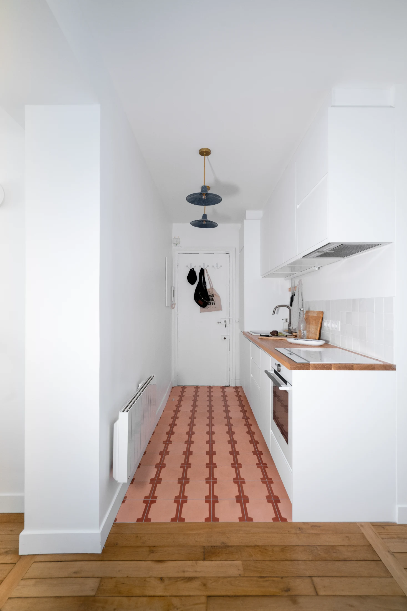
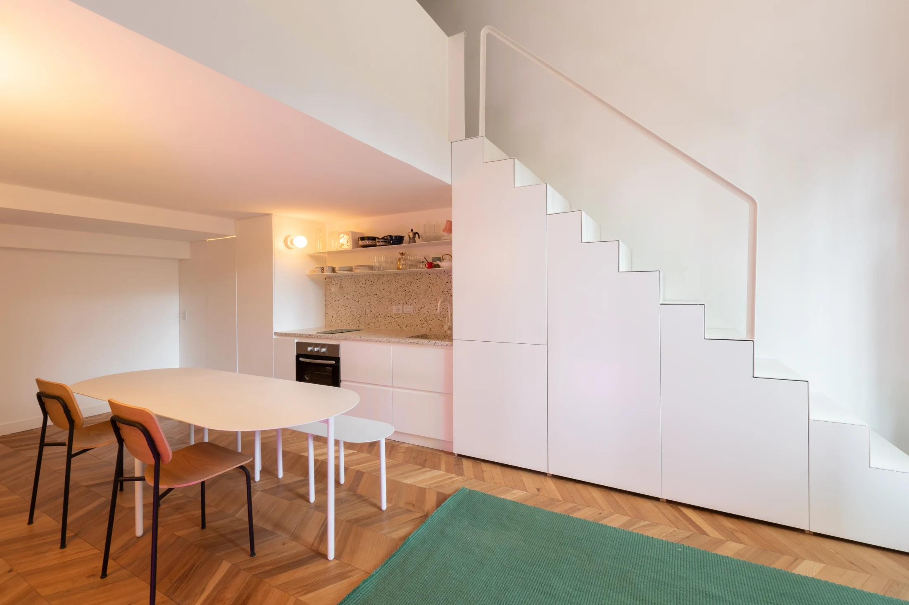
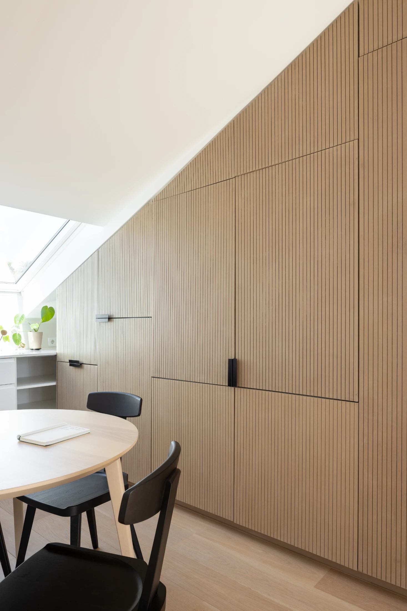
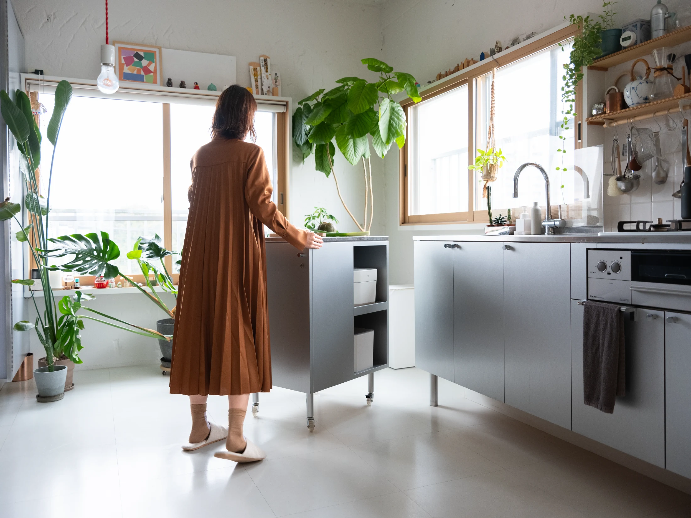
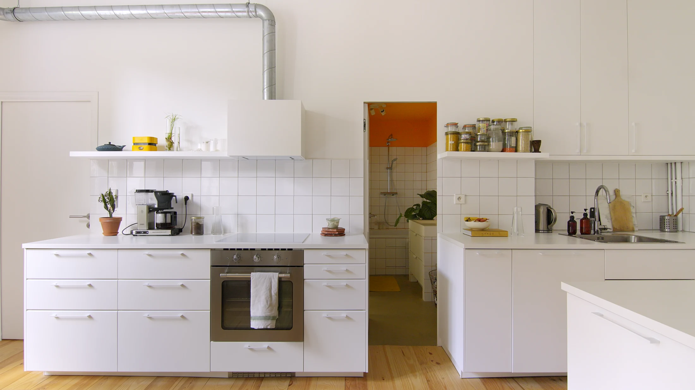
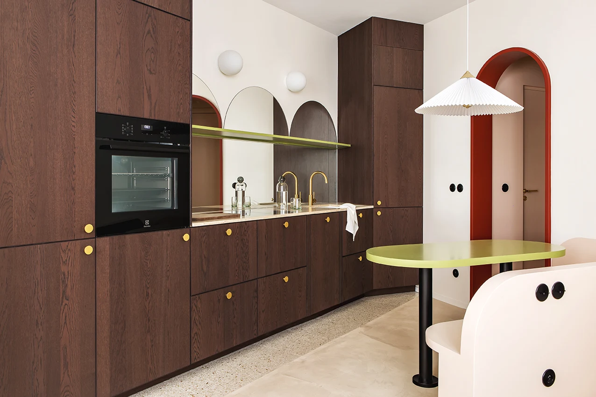

# Маленькая кухня: шпаргалка из пяти стратегий — спрятать, выдвинуть, осветить

По данным bnMAP.pro, средняя студия в новостройках Москвы в июле 2026 года — 27 м² (в старой Москве 28, в Новой Москве 25). Кухня в такой студии — это, как правило, линия модулей у стены, а не отдельное помещение. Поэтому вопрос звучит не «как поставить кухню», а «куда её деть, чтобы она не съела всю комнату».

Never Too Small в подборке «Kitchen Cheat Sheet» (текст Элоизы Лашикоре — Eloïse Lachicorée) собрал 27 проектов в пять разделов: где разместить кухню, как её спрятать, как сделать своей, где найти место и как добавить света. Площади проектов в подборке не указаны, зато решения конкретны. Мы разобрали по одному-два приёма из каждого раздела и сразу примерили их на московские планировки.

*Renovation D'un Apartment A Jourdain: кухня в прихожей, бюро Meraki Architecture. Фото: Matthieu Torres / Never Too Small*

## Коротко

- Кухню можно поставить там, где обычно хранят вещи: в прихожей, в нише у лестницы, вдоль стены коридора.
- «Анти-кухня»: фасады-двери, раздвижные панели и ножки делают кухню похожей на мебель.
- Подвижный модуль на колёсиках превращается в остров, а в сложенном виде не мешает проходу.
- Свет и зеркала — такая же часть кухни, как мойка: арочные зеркала, подвесные полки с подсветкой.
- В Москве любое решение сверяется с правилами: вентиляцию и газовую кухню трогать нельзя.

## Стратегия 1: выбрать другое место

В разделе «Location, Location, Location» авторы собрали кухни, которые стоят не там, где их ждёшь. В квартире Jourdain (Renovation D'un Apartment A Jourdain, бюро Meraki Architecture) кухня занимает одну сторону прихожей — там, где обычно сваливают вещи. Её очерчивают контрастный пол из узорной терракотовой плитки и пара подвесных светильников над рабочей зоной.

В Studio Seguí архитектор Кэрол Бёртон (Carol Burton) встроила кухню в лестничную столярку: внутри маленький холодильник, кладовая и хранение, терраццо на столешнице и фартуке, электрическая плитка на две конфорки и две металлические полки. В Kloedenstraße кухню дополняет подвесной буфет, окрашенный в цвет стен.

*Studio Seguí: кухня встроена в лестницу, архитектор Carol Burton. Фото: Gonzalo Viramonte / Never Too Small*

**Для Москвы.** Прихожая в хрущёвке или панели чаще всего крошечная, но в современных евродвушках встречается широкая «входная ниша» или коридор в общую зону. Именно там можно поставить линейную кухню на 2–2,5 м и отделить её полом: плитка вместо ламината. Перенос мойки и плиты — это перепланировка, и её надо согласовывать. Если кухня газифицирована, проём между ней и комнатой по 508-ПП нельзя делать без плотной двери, так что «кухню в прихожую» разумнее планировать в квартирах с электроплитой.

## Стратегия 2: анти-кухня

Идея раздела — сделать так, чтобы кухня не выглядела кухней. В Basement Apartment архитектора Брэда Свартца (Brad Swartz) шкафы и рабочая поверхность подняты на тонкие ножки: под кухней виден пол, и она читается как мебельный предмет.

В Marvila Attic (бюро KEMA Studio) кухню закрывают раздвижные двери — внутри посудомойка, холодильник, индукционная панель и вытяжка. В Luini Apartment (Davide Minervini) складные двери прячут кухню в линию мебели гостиной; в Small Grand Apartment (Tsai Design) белая индукционная панель и белая духовка встроены в белую тумбу, так что их не видно. А в квартире Alex (William Chan) навесные петли скрыты, а смесители и интерьер шкафов — тёмно-синего цвета, который появляется только при открытых дверцах.

*Marvila Attic: раздвижные двери открывают кухню, бюро KEMA Studio. Фото: Alexander Bogorodskiy / Never Too Small*

**Как повторить.** Для московской студии 27 м² это, пожалуй, самый полезный раздел: из гостиной кухня видна всегда, а вместе с ней — посуда и следы готовки. Закрытая кухня за складными фасадами решает сразу два вопроса. Но важно: открытая кухня в студии работает на вытяжку, и если вы закрываете её фасадами, вытяжка должна быть выведена так, чтобы вентканал не был закрыт или уменьшен. Включайте вытяжку и открывайте створки, пока готовите.

## Стратегия 3: сделать кухню своей

Раздел «Make It Your Own» — про детали, которые делают типовую кухню личной. Кэтерина Гончар (Kateryna Gonchar) покрасила шкаф-основание от IKEA в красный и положила на него столешницу из мрамора Calacatta Viola, снятую с подержанного кофейного столика. В Cartoon Space Антони Ожье (Antony Authié) поставил на нержавеющие шкафы синие ручки, напечатанные на 3D-принтере. Casavells Estudio (Jacobo Valentí) собрал шкафы IKEA с тёмными деревянными фасадами и повесил поверх винтажный шкаф Шарлотты Перриан. В Paris Duplex Extension (Archibien) нижние шкафы под окном сделаны ниже и стали скамьёй для детей. В Darley Studio (mono studio) в зелёную и белую японскую плитку вставили керамические плитки на заказ.

**Для Москвы.** Кухни из IKEA в Москве по-прежнему можно собрать из корпусов масс-маркетов, поменяв фасады и ручки. Столешницу из камня стоит искать на разборках и у мастерских, изготавливающих мебель: остатки и сколы стоят дешевле. А скамья под окном — отличное решение для московской квартиры с широким подоконником: она заменяет стулья.

## Стратегия 4: найти место

Самый практичный для малых квартир раздел. В Somosomo House (ToASt Inc, Такеши Окада и Такато Маё) подвижная тумба-«вагончик» в тон кухонных фасадов стоит у стены как часть линии, а при готовке выдвигается и становится островом с двусторонним хранением.

*Somosomo House: подвижная тумба превращается в остров, бюро ToASt Inc. Фото: Nam Tran / Never Too Small*

В Appartement Rue de Nantes (PS Studio) весь одностенный кухонный блок стоит на небольших колёсах: его отодвигают — и за ним открывается скрытая дверь в санузел, а холодильник спрятан за книжным стеллажом. В квартире 5S Николас Гурни (Nicholas Gurney) сделал глубокие узкие верхние шкафы и выдвижной обеденный стол, который лежит на шкафах. В Billinghurst к одностенной кухне добавлена узкая барная стойка со спрятанными за ней специями.

*Appartement Rue de Nantes: кухонный модуль на колёсах скрывает дверь, бюро PS Studio. Фото: Jean Baptiste Thiriet / Never Too Small*

**Как повторить.** В московских «хрущёвках» и тесных евродвушках проблема — не в нехватке мебели, а в проходе. Подвижная тумба на колёсах, которая заводится под рабочую поверхность, а при готовке выезжает, помогает, когда стоит выбор «остров или нет». Стационарные подводы воды и газа так не перенести, поэтому колёса — только для мебели без коммуникаций.

## Стратегия 5: добавить света

В разделе про свет много простых вещей. В Ryokan Project (Dforn Projects) использованы естественный свет и зеркала. В Projekt Własny подвесная полка над островом одновременно несёт подсветку. В Project Jordaan (MI Studio) золотые бра дают рабочий и фоновый свет, а подсветка снизу «подвешивает» шкафы. В La Dolce Vita Suite (Space Factory) вдоль одностенной кухни расположены арочные зеркала, которые отражают свет и расширяют пространство.

*La Dolce Vita Suite: арочные зеркала вдоль одностенной кухни, Space Factory. Фото: Never Too Small*

**Для Москвы.** С октября по март световой день короткий, а кухонные окна нередко выходят во двор-колодец. Поэтому подсветка под верхними шкафами и точечные бра — не декор, а необходимость. Зеркало или стеклянный фартук рядом с окном возвращают в комнату дневной свет.

## Чек-лист: какую стратегию выбрать

1. Есть широкая прихожая — поставьте кухню туда и отделите зону полом (стратегия 1).
2. Кухню видно с дивана — спрячьте её за складными или раздвижными фасадами (стратегия 2).
3. Есть кухонный гарнитур, но он безлик — смените фасады и ручки, сделайте один яркий элемент (стратегия 3).
4. Не хватает рабочей поверхности — добавьте подвижный модуль на колёсах (стратегия 4).
5. Окно маленькое или во двор — добавьте подсветку и зеркала (стратегия 5).
6. Любые переносы воды, газа и вентиляции согласуйте, проверив 508-ПП.

Больше идей — в разделе [«Интерьер»](/temy/interer/). Подбирая квартиру, смотрите планировки в [каталоге новостроек Москвы](/novostroyki/moskva/).

## Вопросы и ответы

**Как спрятать кухню в студии, чтобы комната не выглядела кухней-гостиной?**
Закройте рабочую зону раздвижными или складными фасадами из того же материала, что и остальная мебель. Внутри размещают варочную панель, мойку и технику, а снаружи остаётся ровная стена. Важно оставить доступ к вентиляции и убедиться, что вытяжка работает при закрытых створках.

**Можно ли переносить кухню в прихожую в московской квартире?**
Перенос мойки и плиты — это перепланировка, которую согласуют в установленном порядке. Отдельно запрещено ликвидировать или уменьшать вентиляционные каналы и делать проём между комнатой и газифицированной кухней без плотной двери (постановление 508-ПП).

**Какой остров подойдёт для маленькой кухни?**
Передвижной: тумба на колёсиках в тон основных фасадов у стены выглядит частью линии, а во время готовки выдвигается и даёт вторую рабочую поверхность. Такая мебель не требует отдельной подводки коммуникаций.

## Источники

1. Never Too Small. Kitchen Cheat Sheet — https://www.nevertoosmall.com/post/kitchen-cheat-sheet-420b1
2. РБК Недвижимость: цены и площадь студий в новостройках Москвы, июль 2026 — https://realty.rbc.ru/news/6a688a1e9a7947e0d847331e
3. Мосжилинспекция: какие перепланировки запрещены (постановление 508-ПП) — https://www.mos.ru/news/item/76897073/
