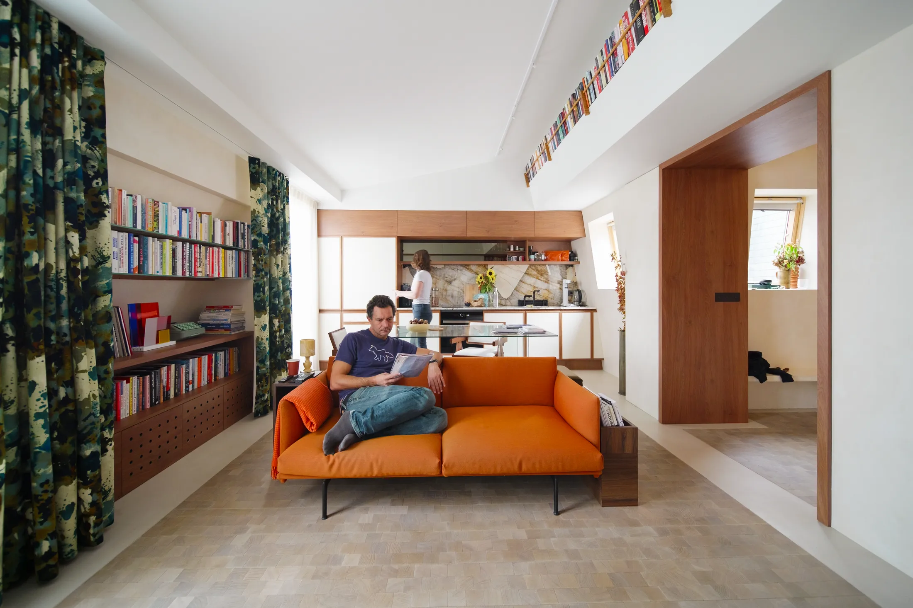
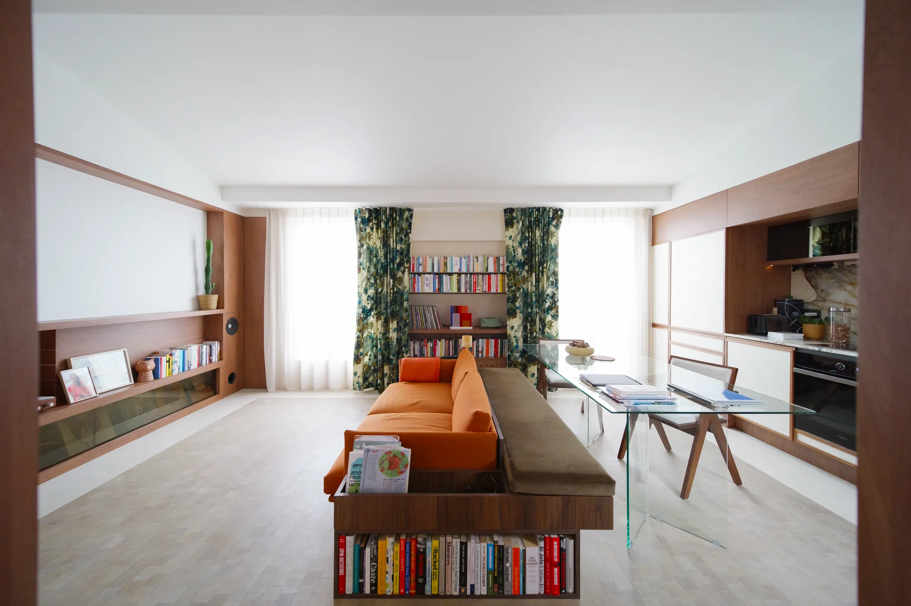
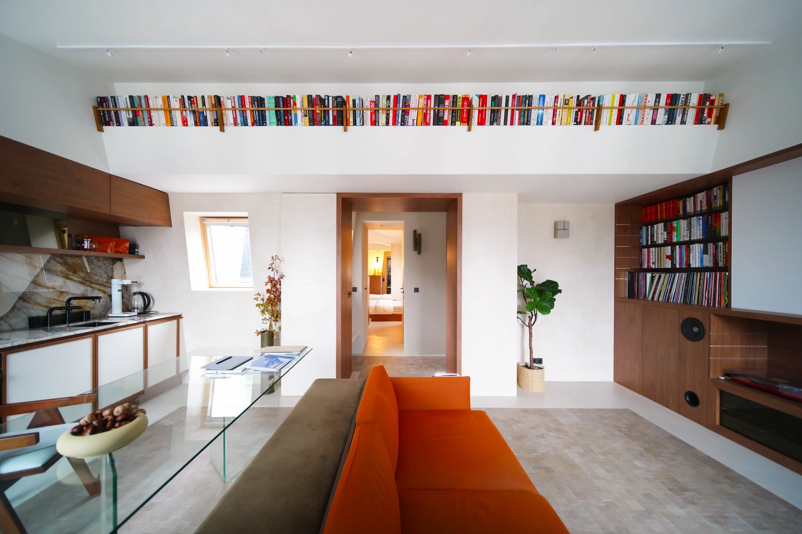
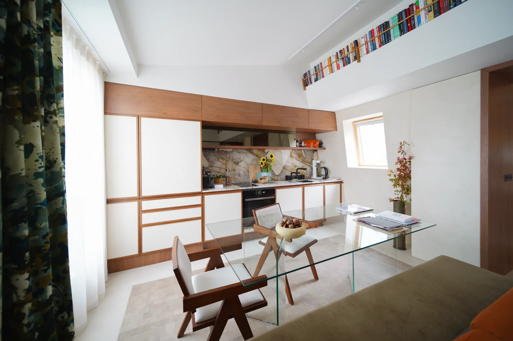
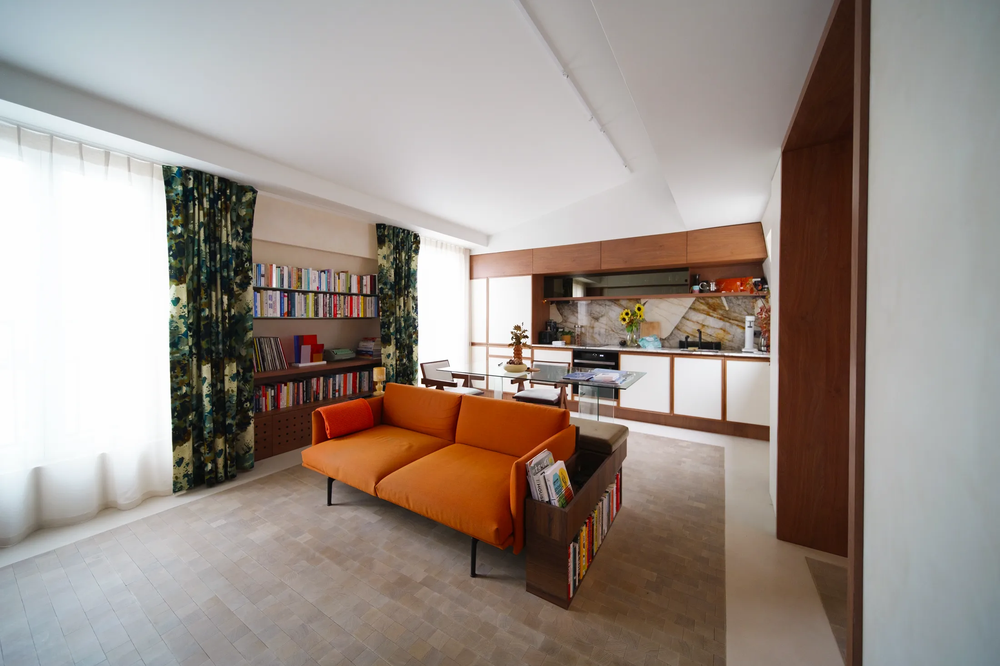
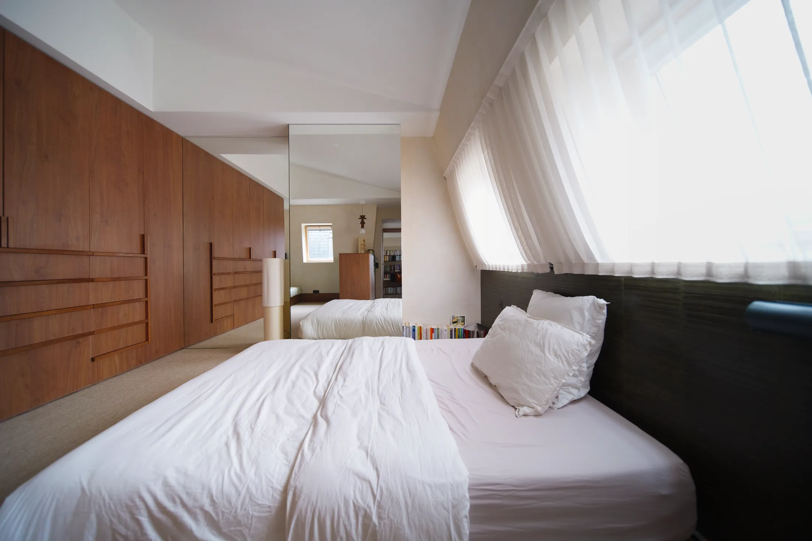
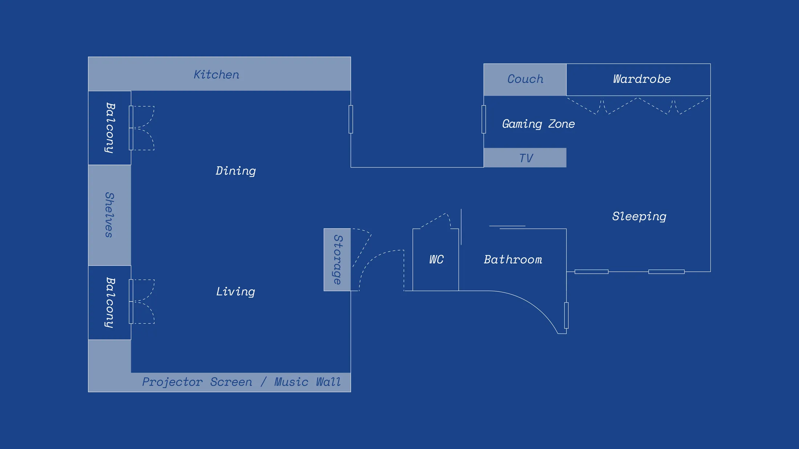

# Мебель вместо перегородок: как книжный диван зонирует квартиру 47 м²

Пока в Москве спорят, где в евродвушке поставить перегородку, парижский дизайнер решила задачу иначе: вообще без новых стен. Квартира Mars площадью 47 м² раньше состояла из однокомнатной квартиры, студии и узкого коридора. Вивиан Шиль-Агопиан (Viviane Chil-Hagopian) присоединила коридор, убрала внутренние барьеры и получила единое пространство гостиной, столовой и кухни, а спальню разместила в бывшей студии. Границы между зонами теперь чертит мебель.

Для московского читателя это очень практичный пример. Минимальная двушка в новых проектах с августа 2024 года — 44 м² ([постановление № 1672-ПП](https://ppt.ru/obzory/vstupaet-v-silu/postanovlenie-pravitelstva-moskvy-23-07-2024-1672-pp)), так что 47 м² — типичная евродвушка. А владельцам «двушек» в сталинках и панельных домах знакома та же проблема: коридор и узкие комнаты съедают площадь, а снести стену нельзя или слишком хлопотно.

## Коротко

- Квартира расположена в Париже у канала Сен-Мартен, площадь 47 м², хозяин любит читать и слушать музыку, поэтому главная тема — книги.
- Диван, стеллаж и обеденная скамья сделаны как один заказной предмет мебели.
- Книжные полки спрятаны в опущенном потолке над несущей балкой — стена остаётся свободной.
- Плитка на полу заменяет ковёр и показывает, где кончается гостиная и начинается кухня.
- Спальня сделана «низкой»: кровать почти на уровне пола, тумбочка встроена.

*Mars, Париж, 47 м². Дизайнер Вивиан Шиль-Агопиан. Фото: Never Too Small*

## Приём 1: диван, который сам себе стеллаж

Центральная вещь проекта — заказной диван-библиотека. Это одновременно книжный стеллаж, приставной столик и скамья для сидения. С одной стороны в нём живут книги и мелкие предметы, с другой он тянется в сторону столовой и превращается во встроенную скамью. Отдельная мебель для сидения у обеденного стола почти не нужна: с одной стороны сидят на скамье, с другой — на тонких стульях.

Главный выигрыш не в экономии метров, а в том, что такой модуль сам становится границей. Диван стоит боком к столовой — и зона отдыха отделена без единой перегородки, а взгляд свободно проходит поверх стеллажа.

*Диван, стеллаж и скамья — один заказной предмет мебели. Фото: Never Too Small*

**Как повторить.** Такой модуль делают на заказ в столярной мастерской, и для него нужен точный замер. Если бюджет ограничен, редакторы Never Too Small предлагают обойтись готовой мебелью: расставить низкие стеллажи, банкетку и диван в одну непрерывную линию. Для московской «двушки» в панельном доме это хороший способ «разгородить» комнату там, где от стены нельзя отказаться, — например, между гостиной и зоной обеда.

## Приём 2: книги над головой

Над несущей балкой в квартире есть опущенный потолок. Вместо того чтобы прятать этот «короб», дизайнер превратила его в длинную встроенную библиотеку. Полки слегка наклонены назад — идея отсылает к Фрэнку Ллойду Райту: корешки так читаются легче. Книги ушли вверх и освободили стены для светильников и картин.

*Книги над головой: полки спрятаны в опущенном потолке над несущей балкой. Фото: Never Too Small*

**Для Москвы.** В хрущёвках и панельных домах серий, где потолки 2,5 м, высоких полок над головой не сделать. Зато в сталинках, дореволюционных доходных домах и лофтах в бывших фабриках («Флакон», «Арма», Даниловская мануфактура) высота позволяет. А вот идея использовать любой «короб» — над вводом, над балкой, над дверью — как место для полок работает и в низких комнатах: достаточно одной полки по ширине проёма над входной дверью.

## Приём 3: стеклянный стол вместо массивного

В небольшой столовой любой тяжёлый стол подавляет. В Mars стоит большой прозрачный стол и тонкие стулья, а часть мест занимает всё та же встроенная скамья. В кадре стол почти не виден, хотя за ним спокойно рассаживаются гости.

*Стеклянный стол почти не занимает места в кадре. Фото: Never Too Small*

**Как повторить.** В квартире-студии, где обеденный стол стоит прямо посреди комнаты, стеклянная столешница или тонкие ножки визуально облегчают пространство. Практическое замечание: стекло в проходной зоне хуже переносит детей и домашних животных, поэтому в семейной квартире лучше закалённое стекло и закруглённые углы.

## Приём 4: плитка вместо ковра и перегородок

Пол в зоне гостиной, столовой и кухни выложен плиткой Greenwood — рисунок вдохновлён плиткой на улицах района. Она заменила ковры (образ жизни владельца их не предполагает) и стала главным способом зонирования: рисунок и цвет подсказывают, где заканчивается одна функция и начинается другая.

*Плитка вместо ковра: она же обозначает границы зон. Фото: Never Too Small*

**Для Москвы.** В московском климате с долгой зимой плитка на полу — вопрос не только дизайна, но и комфорта. Тёплый пол от общих систем в многоквартирном доме делать нельзя (это прямо перечислено в [списке запрещённых перепланировок](https://www.mos.ru/news/item/76897073/) по постановлению 508-ПП), поэтому если хочется тёплого пола, нужен автономный электрический, и его стоит заранее обсудить с управляющей компанией. Альтернатива — крупноформатный керамогранит только в кухонной и входной зоне, а в гостиной оставить паркет или инженерную доску: так зоны разделены материалом, а ноги не мёрзнут.

## Приём 5: низкая кровать

В спальне, которая заняла бывшую студию, стоит низкая кровать с встроенной прикроватной тумбой. Её высота почти не создаёт «массы» в комнате, поэтому помещение кажется просторнее. Общая палитра — тёмное дерево, известковые стены, фактурные поверхности — делает спальню спокойной и уютной.

*Спальня в бывшей студии: низкая кровать со встроенной тумбой. Фото: Never Too Small*

**Как повторить.** Если в вашей евродвушке спальня маленькая, замените рамную кровать на низкий подиум-основание, а тумбочку «вмонтируйте» в тот же модуль. Выдвижные ящики под матрасом дадут хранение, а вот полностью гасить подоконник или радиатор подиумом не стоит: перенос радиаторов и закрытие вентиляции в Москве ограничены, а мебель не должна мешать теплу.

## Что в этой квартире нельзя копировать в лоб

Парижская перепланировка включала присоединение коридора и снос перегородок. В Москве всё, что касается несущих стен, вентиляции и мокрых зон, требует согласования, а [постановление 508-ПП](https://www.mos.ru/news/item/76897073/) прямо запрещает ликвидировать или уменьшать вентканалы и объединять лоджии и балконы с комнатами. Поэтому лучше разделить два шага. Сначала посмотрите, какие перегородки в вашей квартире ненесущие (это определяет проект дома, а не ощущение «на глаз»), и только потом решайте, нужна ли вам перепланировка, или хватит мебели.

*План после перепланировки: коридор присоединён, гостиная, столовая и кухня в одном пространстве. Чертёж: Never Too Small*

## Чек-лист для квартиры 40–50 м²

1. Найдите «потерянные» метры: коридор, ниша у входа, подоконник, пространство над дверью.
2. Сделайте мебель границей зоны: диван боком к столовой, стеллаж вместо стены.
3. Скамья вместо части стульев у обеденного стола освобождает проход.
4. Используйте верхнюю часть комнаты: полки под потолком, шкафы до плиты перекрытия.
5. Заменяйте ковры материалом пола: плитка, разный оттенок паркета, коврик только в зоне отдыха.
6. Кровать — низкая, тумбочка встроена; хранение уходит в ящики.
7. Перед любым демонтажем проверьте, что стена ненесущая, и получите согласование.

Больше идей для небольших квартир — в разделе [«Интерьер»](/temy/interer/). Выбираете квартиру, где такие приёмы будут работать? Посмотрите [новостройки Москвы](/novostroyki/moskva/): средняя площадь квартиры в новых домах за год выросла с 56,3 до 62 м² ([bnMAP, I квартал 2026](https://realty.rbc.ru/news/6a2688819a7947c4911d7fd8)), и 47 м² — уже скорее нижняя середина рынка.

## Вопросы и ответы

**Можно ли в московской квартире объединить коридор с комнатой, как в Париже?**
Сносить несущие стены и менять вентиляцию нельзя, а любая перепланировка требует согласования. Постановление 508-ПП прямо запрещает ликвидировать или уменьшать вентиляционные каналы и объединять лоджии с комнатами. Безопаснее начинать с мебели, а не со стен.

**Чем диван-библиотека лучше обычного дивана и стеллажа?**
Один заказной модуль занимает меньше места, чем диван плюс стеллаж плюс столик, и сам становится границей между зонами. Если бюджет ограничен, повторить эффект можно из готовых модулей, поставленных в одну непрерывную линию.

**Какие квартиры в новостройках Москвы близки по площади к парижской?**
Минимальная двухкомнатная в новых московских проектах — 44 м² (постановление № 1672-ПП, действует с 1 августа 2024 года), так что 47 м² — типичная евродвушка. Средняя площадь квартиры в новостройках за год выросла с 56,3 до 62 м² (bnMAP, I квартал 2026).

## Источники

1. Never Too Small. How furniture defines space in a 47sqm/506sqft Paris apartment — https://www.nevertoosmall.com/post/how-furniture-defines-space-in-47sqm-506sqft-paris-apartment
2. ppt.ru: постановление Правительства Москвы от 23.07.2024 № 1672-ПП — https://ppt.ru/obzory/vstupaet-v-silu/postanovlenie-pravitelstva-moskvy-23-07-2024-1672-pp
3. РБК Недвижимость: данные «Метриума» и bnMAP о площади квартир в новостройках, май 2026 — https://realty.rbc.ru/news/6a2688819a7947c4911d7fd8
4. Мосжилинспекция: какие перепланировки запрещены (постановление 508-ПП) — https://www.mos.ru/news/item/76897073/

*Материал подготовлен по мотивам публикаций Never Too Small и использует их фото с разрешения правообладателя.*
