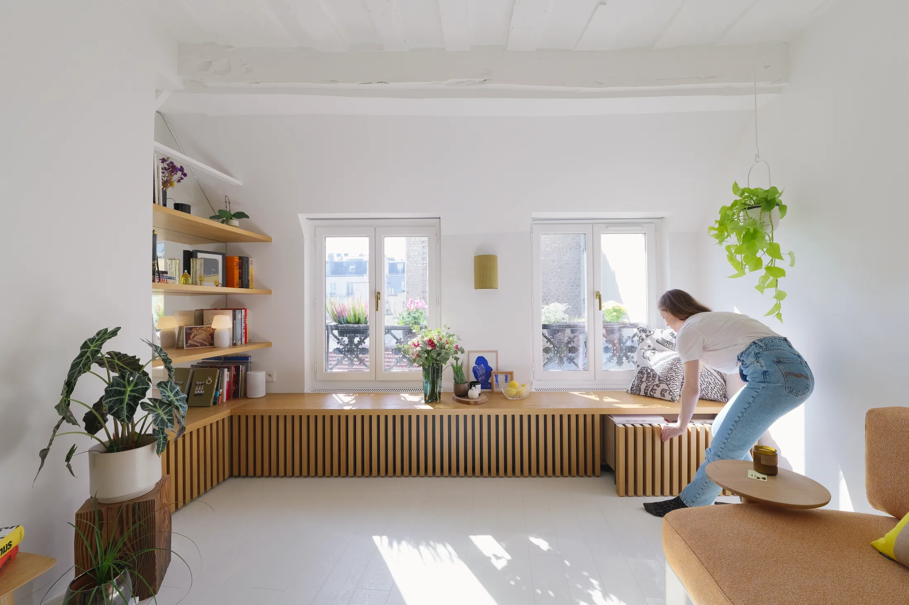
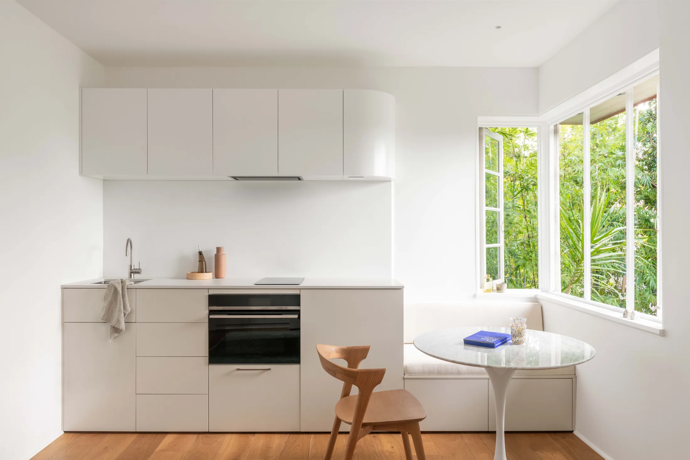
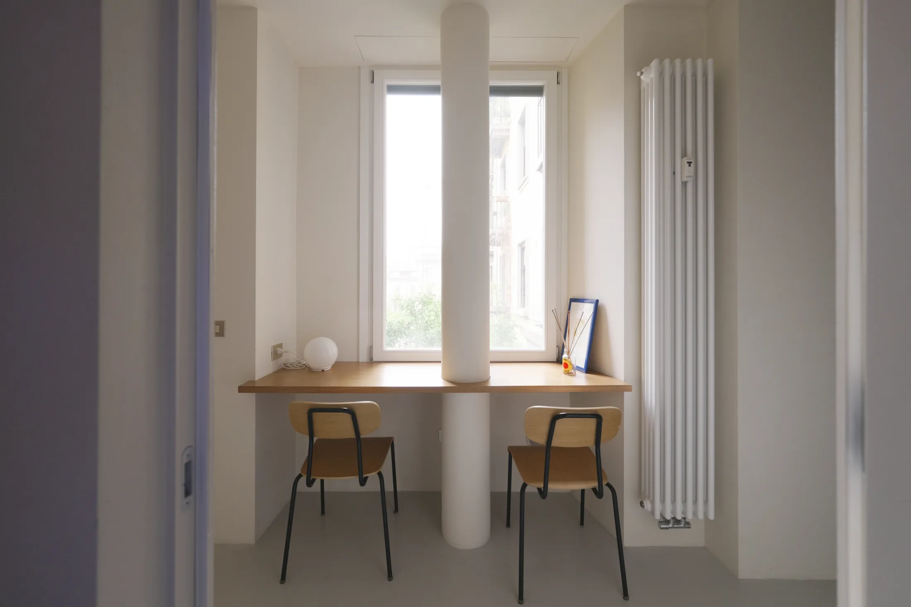
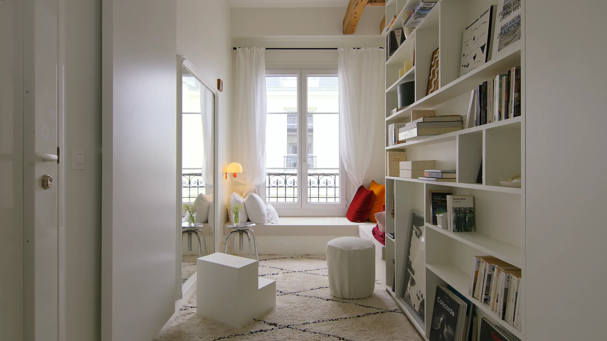
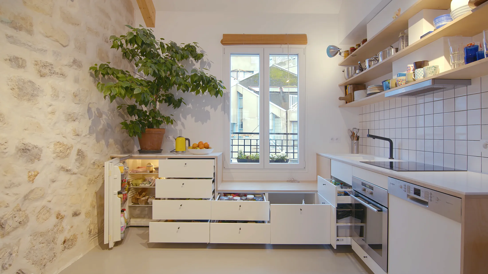

# Место у окна: 6 идей для маленькой квартиры — от скамьи с ящиками до барной стойки

В московской студии окно — главный источник света и почти всегда самое бесполезное место. Под ним радиатор, подоконник занят цветами, а мебель жмётся к противоположной стене. При том что средняя студия в новостройках Москвы в июле 2026 года — 27 м², по данным bnMAP.pro, а в старой Москве — 28 м²: каждый метр у окна на счету.

Мы собрали шесть квартир из архива Never Too Small — австралийского проекта о маленьких пространствах — и посмотрели на них глазами покупателя московской студии или однушки. Ниже — что придумали архитекторы, сколько это занимает и как повторить у нас.

## Коротко

- Зону у окна можно сделать хранением, столовой, кабинетом или местом для чтения — главное, чтобы мебель была встроенной и на всю ширину проёма.
- Лучше всего работают низкие модули: скамья с ящиками, продолжение кухонной столешницы, узкая стойка на двоих.
- В Москве под окном почти всегда радиатор: его нельзя закрывать глухо, а перенести общедомовую батарею на лоджию запрещает постановление 508-ПП.
- В сталинках и доходных домах с толстыми стенами оконная ниша сама по себе почти готовая скамья.

*Arts et Métiers, Париж, 42 м²: ящики под окнами обшиты деревянными рейками — они же ручки. Дизайн: Mariana Casagrande. Фото: Never Too Small*

## 1. Скамья с ящиками вместо комода — Arts et Métiers, Париж, 42 м²

Архитектор Мариана Казагранде (Mariana Casagrande) поставила под окнами длинный ряд ящиков и обшила их вертикальными деревянными рейками. Рейки работают сразу как декор и как ручки — фасады остаются гладкими, без фурнитуры. Сверху — подушки, и хранение превращается в сиденье у окна. То же дерево продолжается в наклонные полки для книг: получается один предмет вместо комода, дивана и стеллажа. По описанию проекта, источник вдохновения — мебель Алвара Аалто.

**Как повторить в Москве.** Это идеальная история для квартиры в кирпичной сталинке или дореволюционном доходном доме — в Хамовниках, Замоскворечье, на Таганке, — где подоконник широкий, а под окном нет громоздкой батареи. В панельной новостройке с радиатором под окном делайте скамью по бокам от него, а над батареей — решётку в сиденье, чтобы тёплый воздух шёл к стеклу и окно не запотевало.

## 2. Окно как часть галереи — Charenton, Париж, 34 м²

В квартире Charenton зона у окна не выделена отдельной мебелью — она продолжает стеллажи с книгами и картинами. Свет из окна подсвечивает коллекцию, и маленькая квартира выглядит как частная галерея, а не как склад вещей.

**Как повторить.** В студии на 25–30 м² вместо шкафа во всю стену попробуйте открытые полки, которые доходят до оконного откоса. Это дешевле встроенной мебели и визуально расширяет окно.

*Slow Down Apartment, Брисбен, 35 м²: столешница уходит к окну и становится обеденным местом. Архитектор: Brad Swartz. Фото: Catherine Schusler / Never Too Small*

## 3. Кухня, которая заканчивается столом — Slow Down Apartment, Брисбен, 35 м²

Архитектор Брэд Шварц (Brad Swartz) продлил кухонную столешницу до окна: там, где кончается рабочая зона, начинается обеденный уголок. Под сиденьем — встроенная скамья с хранением, всё остальное спрятано за белыми фасадами.

**Как повторить в Москве.** Это прямой ответ на типичную планировку евродвушки и студии в новостройке, где кухня-ниша стоит вдоль стены, а окно — сбоку. Если окно рядом, не ставьте отдельный обеденный стол: продолжите столешницу и сэкономьте на этом метр-полтора прохода.

*Urban Nook, Милан, 60 м²: узкая дубовая стойка под окном на две персоны. Бюро ATOMAA. Фото: Never Too Small*

## 4. Узкая стойка на двоих — Urban Nook, Милан, 60 м²

Миланское бюро ATOMAA поставило под уличным окном в нише тонкую дубовую стойку и два стула — получилось место для завтрака и для работы с ноутбуком. Пол в этой зоне поднят на подиум: под ним проходят трубы ванной. Архитекторы не стали это скрывать, а сделали ступень границей между зонами. Бетонную колонну, которую раньше прятали, тоже оставили на виду.

**Как повторить.** Стойка глубиной 30–40 см помещается даже там, где стол уже не встаёт. Для однушек и студий в новостройках с панорамным остеклением — один из самых простых способов получить рабочее место у света, не жертвуя проходом.

*CAPSULE, Париж, 25 м²: Г-образная банкетка и асимметричная полка у западного окна. Дизайн: Frères Voirin. Фото: Never Too Small*

## 5. Уголок для чтения в 25 метрах — CAPSULE, Париж, 25 м²

Братья Пьер и Франсуа Вуарен (Frères Voirin) собрали эту квартиру из двух крошечных парижских мансард. Окна смотрят в три стороны, и у западного архитекторы устроили уголок для чтения: Г-образная банкетка и асимметричная полка. Площадь — как у типичной московской студии.

**Как повторить.** Г-образная банкетка в углу у окна заменяет диван и даёт место гостям. Если банкетку сделать с подъёмными сиденьями, под ними поместятся сезонные вещи — то, что в московской квартире обычно занимает антресоли.

*Paris Duplex Extension: кухонный модуль опускается у окна и превращается в скамью из берёзовой фанеры. Архитектор: Olivier Menard, Archibien. Фото: Never Too Small*

## 6. Кухонный модуль, который становится скамьёй — Paris Duplex Extension, Париж

Архитектор Оливье Менар (Olivier Menard, бюро Archibien) сделал низкую Г-образную кухню со встроенной техникой — визуально в ней почти нечего замечать. Перед длинными поворотно-откидными окнами мебель опускается ещё ниже и превращается в скамью из берёзовой фанеры: можно выпить кофе или посадить ребёнка смотреть, как готовят ужин.

**Как повторить.** Низкая мебель вдоль окна не перекрывает свет и не «съедает» высоту комнаты. Для московских квартир с поворотно-откидными окнами важно оставить зазор, чтобы створка открывалась свободно.

## Что учесть в московской квартире

- **Радиатор.** Закрытая батарея хуже греет и даёт конденсат на стекле. Делайте решётку в сиденье или фасаде и зазор до стены. Переносить общедомовой радиатор на лоджию или балкон, объединять лоджию с комнатой и делать тёплый пол от общей системы отопления в Москве запрещено постановлением 508-ПП — это напоминает Мосжилинспекция.
- **Глубина.** Удобное сиденье — 40–50 см глубиной, рабочая стойка — от 30 см.
- **Створки.** Поворотно-откидное окно должно открываться поверх мебели — проверьте до заказа.
- **Тип дома.** В сталинке и доходном доме ниша глубже, и скамья почти не съедает пространство комнаты. В панельном и монолитном доме глубина подоконника меньше, поэтому скамья выходит в комнату.

Ещё идеи для маленьких квартир — в разделе [«Интерьер»](/temy/interer/).

## Вопросы и ответы

**Можно ли сделать скамью у окна, если под ним радиатор?**
Можно, если не закрывать радиатор глухо: в сиденье или фасаде нужна вентиляционная решётка, а между радиатором и скамьёй — зазор, чтобы тёплый воздух поднимался к стеклу. Переносить общедомовой радиатор на лоджию или балкон в Москве запрещено постановлением 508-ПП.

**Какая глубина нужна для сиденья у окна?**
Для удобного сиденья с подушкой обычно хватает 40–50 см глубины. Если в нише стоит радиатор, удобнее сделать сиденье рядом с ним, а под окном оставить полку или стол.

**Что выгоднее в студии: стол у окна или диван?**
Если вы работаете из дома, стол у окна даёт лучший свет и не занимает центр комнаты. Если нет — банкетка с ящиками заменяет сразу диван, гостевые места и комод.

## Источники

1. Never Too Small. How to make the most of the space around your windows — https://www.nevertoosmall.com/post/how-to-make-the-most-of-the-space-around-your-windows
2. РБК Недвижимость: цены и площадь студий в новостройках Москвы, июль 2026 — https://realty.rbc.ru/news/6a688a1e9a7947e0d847331e
3. Мосжилинспекция: какие перепланировки запрещены (постановление 508-ПП) — https://www.mos.ru/news/item/76897073/
