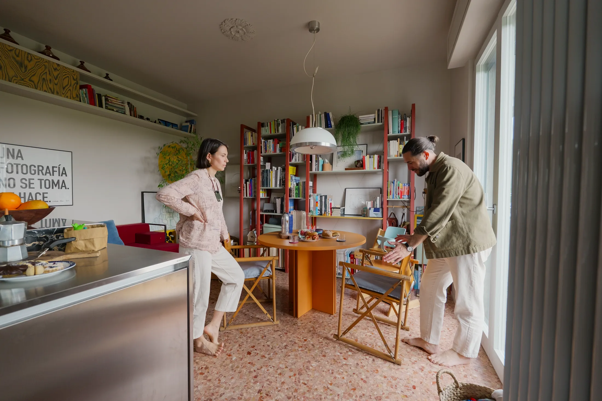
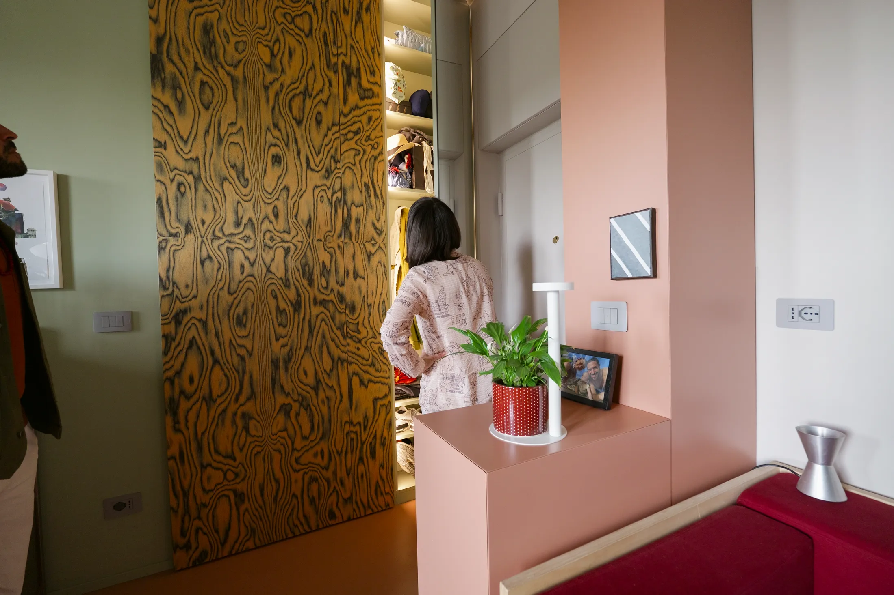
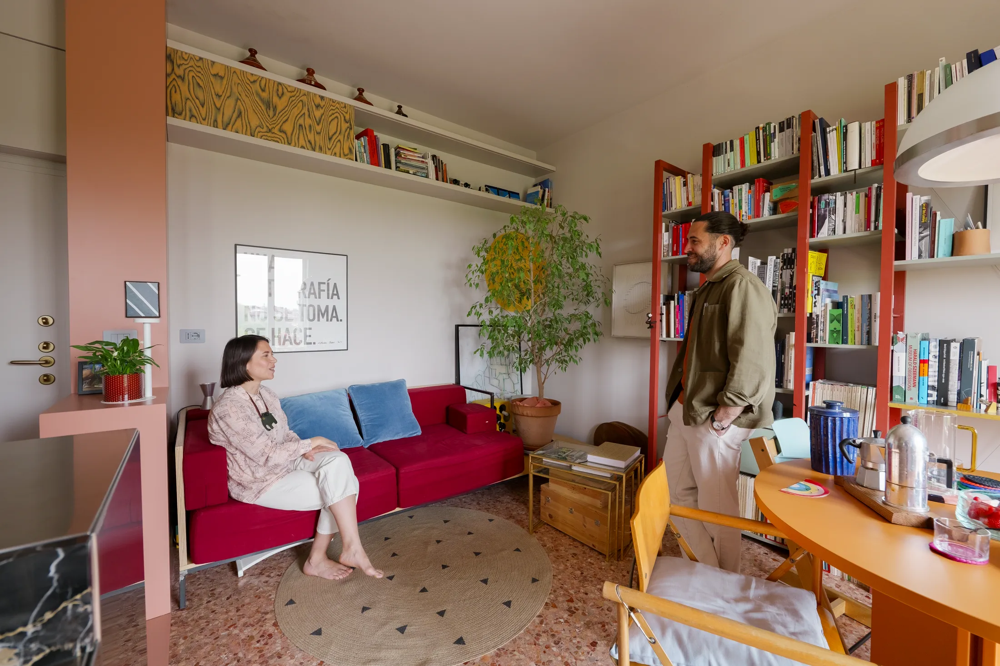
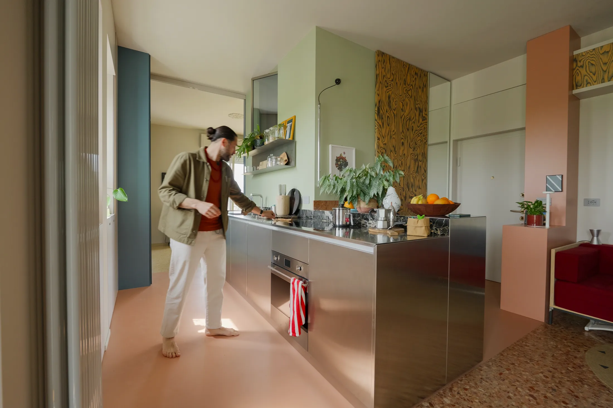
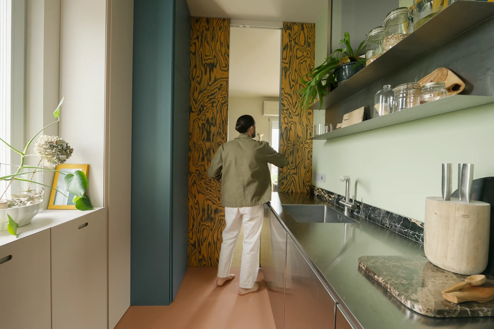
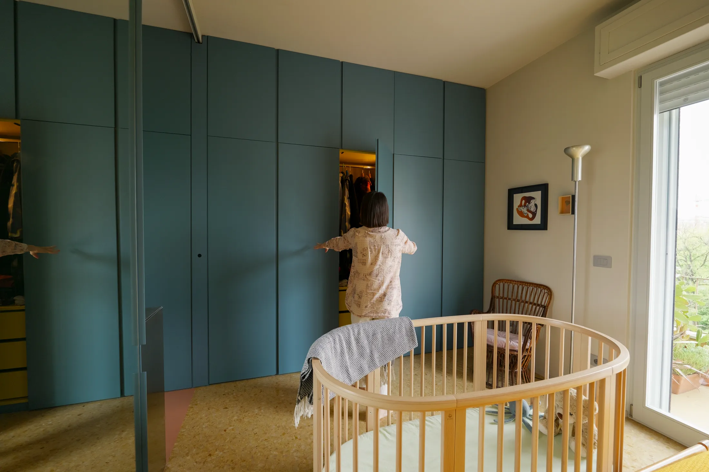
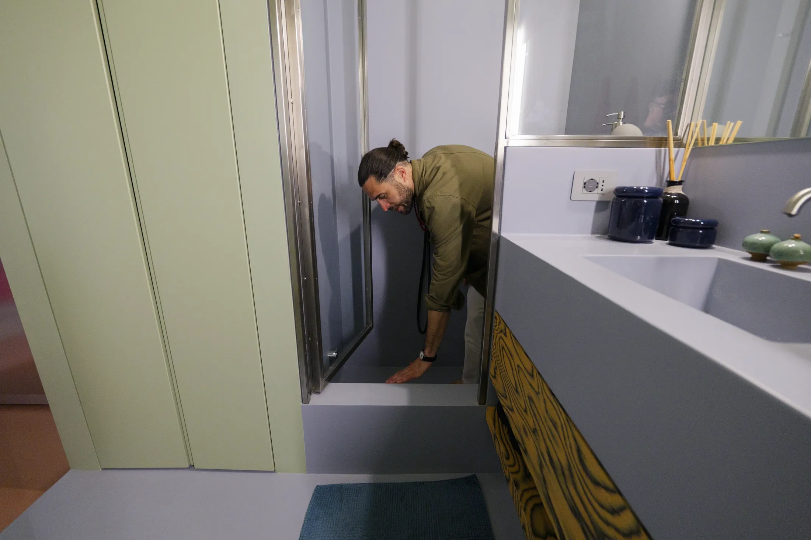
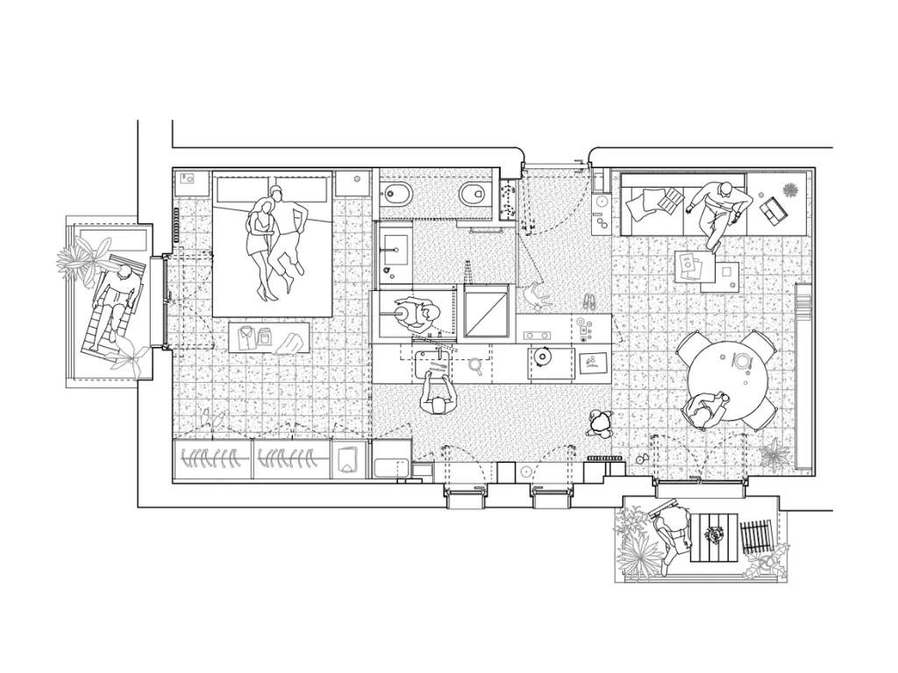

# Семья с ребёнком в 41 м²: как архитекторы переделали «однушку» 1960-х в Милане

41 м² и одна спальня — по московским меркам это просторная однокомнатная квартира или компактная евродвушка. Для сравнения: по данным bnMAP, средняя площадь квартиры в новостройках Москвы выросла с 56,3 до 62 м² за год (с I квартала 2025 по I квартал 2026 года), так что 41 м² — заметно ниже среднего, но выше минимума: с 1 августа 2024 года в новых московских проектах однокомнатная квартира не может быть меньше 28 м².

Именно такую квартиру выбрали для себя миланские архитекторы Иления Роуз Тесторе (Ylenia Rose Testore) и Андреа Дель Педро Пера (Andrea Del Pedro Pera), сооснователь бюро ATOMAA. Дом построен в 1960-х — ровно тогда же, когда возводили московские хрущёвки, — а квартира была тёмной и разбитой на тесные комнаты. Пока шла переделка, пара ждала сына Ариса. Разбираем «Каса Нуоро» (Casa Nuoro) по приёмам.

## Коротко

- Кухню и ванную перенесли, чтобы по квартире можно было ходить «по кругу», а не упираться в тупики.
- Старая стена у входа превратилась в розовый шкаф, а напротив стоит зеркальный шкаф до потолка.
- Диван раскладывается в гостевую кровать, а кондиционеры спрятаны за раздвижной панелью и в нише над кроватью.
- Между кухней и спальней — раздвижные панели в полный рост, которые заменяют двери.
- В ванной нет окна, поэтому прорубили два внутренних; душ задуман так, чтобы в нём можно было купать младенца.

*Casa Nuoro, Милан, 41 м². Архитекторы Иления Роуз Тесторе и Андреа Дель Педро Пера, бюро ATOMAA. Фото: Never Too Small*

## История: тёмная квартира на краю парка

Дом находится на северо-востоке Милана, окна выходят на большой парк и канал Мартезана (Naviglio Martesana). Исходная планировка — набор закрытых комнат, куда света почти не попадало. Архитекторы оставили лишь часть исходных элементов: одну стену, вентиляционное окно над входной дверью, яркий цветной пол 1960-х и мраморную плитку в стиле терраццо. Остальное сломали и собрали заново, переставив мокрые зоны.

**Для Москвы.** В московских хрущёвках и панельных домах 1960-х тоже бывают сохранившиеся полы и фурнитура, но чаще перед владельцем стоит другая задача: тесная кухня и совмещённый санузел. Прежде чем двигать трубы, помните: перенос мокрых зон и работа с вентиляцией согласуются отдельно, а по правилам 508-ПП ликвидировать или уменьшать вентканалы нельзя. Хороший ориентир — окна на парк или реку, как у домов в Хамовниках или на Фрунзенской набережной: такую квартиру стоит планировать «от окна», а не от старых стен.

## Приём 1: прихожая из двух шкафов

Одна из немногих сохранённых стен стала нежно-розовым шкафом. В нём спрятаны электрощиток, ключи, мелочи и обувь текущего сезона. Напротив стоит зеркальный шкаф до потолка с подсветкой для сезонной одежды — курток и пальто. Над входной дверью остался старый вентиляционный проём: через него воздух и свет проходят в прихожую, а приватность сохраняется.

*Прихожая: розовый шкаф на месте старой стены и зеркальный шкаф напротив. Фото: Never Too Small*

**Как повторить.** Московская зима делает прихожую зоной повышенной нагрузки: тяжёлые куртки, обувь на смену, мокрые зонты. Разделите хранение на два сезона, как в Casa Nuoro: актуальное — у входа, остальное — подальше, в спальне или на антресоли. Слаботочный щиток у входа, который в новостройках обычно торчит из стены, тоже можно спрятать за фасадом шкафа.

## Приём 2: диван, кровать и скрытые кондиционеры

В гостиной стоит розовый диван, у которого общая база с приставным столиком: он раскладывается в гостевую кровать. Есть открытые полки и раздвижная деревянная панель в духе Этторе Соттсасса (Ettore Sottsass) — за ней прячется кондиционер. Книжный стеллаж Иления сделала сама ещё в годы учёбы в университете и перекрасила под цвет пола. Обеденная зона — в южном свете балкона. На стене жёлтый круг, нарисованный за деревом, — как восходящее солнце.

*Розовый диван раскладывается в гостевую кровать, раздвижная панель закрывает кондиционер. Фото: Never Too Small*

**Как повторить.** Кондиционер в московской квартире — это уже не роскошь, а лето в панельной коробке на солнечной стороне. Внутренний блок можно оформить так же, как в Милане: закрыть реечной или раздвижной панелью, оставив воздушный зазор для потока воздуха. Выбирая диван, проверьте, как механизм открывается в вашей планировке: гостевое место на 41 м² должно разворачиваться без перестановки мебели.

## Приём 3: кухня из стали, которая стареет красиво

Длинная кухня из нержавеющей стали стоит напротив южных окон. Столешница рассчитана на следы использования — царапины здесь часть образа. Мраморные вставки на ней вырезаны из старого сломанного стола. Освободившееся от холодильника место стало дополнительной рабочей поверхностью, а когда-то служило пеленальным столиком. Старые наружные ставни заменили автоматическими жалюзи.

*Кухня из нержавеющей стали напротив окон на юг. Фото: Never Too Small*

**Для Москвы.** В студиях и евродвушках кухня чаще всего линейная вдоль одной стены. Сталь выдерживает горячее и влагу, хороша для плотной готовки, но шумнее и требует ухода, поэтому её чаще берут на рабочую зону, а не на все фасады. Вставка из «семейного» камня — приём бесплатный: если у вас остался кусок мрамора или кварцевого агломерата, он может стать местом для горячего.

## Приём 4: двери, которых нет

Спальня раньше была закрытой комнатой. Теперь она соединена с кухней раздвижными панелями во всю высоту: их можно сдвинуть и получить единое пространство или закрыть и изолировать спальню от запахов и света. Панели с обратной стороны служат зеркалами в полный рост. Рисунок панелей — того же стиля, что и в других зонах.

*Раздвижные панели в полную высоту регулируют свет и приватность. Фото: Never Too Small*

Шкафы продолжают линию кухонной мебели и занимают всю высоту комнаты, деля пространство на три секции — по одной на каждого члена семьи. Над кроватью — антресоль, в которой спрятан кондиционер. За изголовьем нарисовано заходящее солнце — оно как бы «закрывает» то, что начиналось восходом в гостиной; рядом с кроватью стоит кроватка Ариса, которую можно переставлять.

*Шкафы до потолка в спальне: по секции на каждого члена семьи. Фото: Never Too Small*

**Как повторить.** Раздвижная панель вместо распашной двери освобождает место, которое обычно уходит под радиус открывания, — на 41 м² это ощутимо. Но если кухня в Москве газифицирована, то проём между ней и жилой комнатой по 508-ПП допускается только с плотной дверью: лёгкая раздвижная панель тут не подойдёт. На электрической плите вариантов больше. Для детской зоны удобно, что шкаф уже поделён по людям: у ребёнка с самого начала есть своя секция.

## Приём 5: ванная без окна, но со светом

Ванную спрятали за панелью высотой до потолка. Внутри — мягкие сиреневые и зелёные оттенки, стеклянные перегородки в стальных рамах. Окон не было, поэтому архитекторы сделали два внутренних: поворотное, выходящее на южную сторону (для пара и света), и глухое, западное. В ванной стоит стиральная машина с сушкой, раковина из бетона с отделкой смолой и длинное горизонтальное зеркало. Душ спроектирован как мелкая ванна: после рождения сына кухонная раковина оказалась тесной для купания.

*Душ, работающий и как мелкая ванночка для младенца. Фото: Never Too Small*

**Для Москвы.** В типовых санузлах хрущёвок и панелей мало места под ванну, а душевая с неглубоким поддоном, в котором можно искупать малыша, — удачный компромисс для семьи с младенцем. Внутреннее окно или стеклянная вставка даёт свет и ускоряет проветривание, но вентиляционный канал остаётся неприкосновенным.

*План после перепланировки: кухня и ванная перенесены. Чертёж: ATOMAA / Never Too Small*

## Чек-лист: 41 м² для семьи

1. Закройте у входа два шкафа: один под ключи и сезонное, второй под одежду и верхнюю одежду.
2. Диван — с механизмом, раскладывающимся без передвижения мебели.
3. Кондиционер спрячьте за решёткой или панелью, оставив воздух.
4. Вместо дверей используйте раздвижные панели — но не между комнатой и газифицированной кухней.
5. Разделите гардероб на секции по людям.
6. Для малыша заложите душ с поддоном, пригодным и для купания.

Больше идей для небольших квартир — в разделе [«Интерьер»](/temy/interer/). Подобрать новостройку с планировкой под ваш сценарий можно в [каталоге объектов](/obekty/).

## Вопросы и ответы

**Подойдёт ли квартира 41 м² семье с ребёнком?**
Да, если мебель работает на несколько функций. В миланской Casa Nuoro на 41 м² живут двое взрослых и малыш: диван раскладывается в гостевую кровать, гардероб поделён на три секции, а душ служит ещё и детской ванночкой.

**Можно ли в Москве переносить кухню и ванную, как в Милане?**
Только с согласованием. Постановление 508-ПП запрещает, среди прочего, ликвидировать или уменьшать вентиляционные каналы и соединять газифицированную кухню с комнатой без плотной двери. Любую перепланировку, затрагивающую мокрые зоны, нужно проверять в Мосжилинспекции.

**Какая минимальная площадь однокомнатной квартиры в новой Москве?**
Для новых проектов Москвы с 1 августа 2024 года — 28 м² для однокомнатной и 44 м² для двухкомнатной квартиры (постановление Правительства Москвы № 1672-ПП от 23.07.2024). Квартира в 41 м² с одной спальней уже заметно больше минимума.

## Источники

1. Never Too Small. Architect couple lives small in 41sqm/441sqft family Milan apartment — https://www.nevertoosmall.com/post/architect-couple-lives-small-in-41sqm-441sqft-family-milan-apartment
2. ppt.ru: постановление Правительства Москвы от 23.07.2024 № 1672-ПП — https://ppt.ru/obzory/vstupaet-v-silu/postanovlenie-pravitelstva-moskvy-23-07-2024-1672-pp
3. РБК Недвижимость: средняя площадь квартиры в новостройках Москвы, данные bnMAP и «Метриума» — https://realty.rbc.ru/news/6a2688819a7947c4911d7fd8
4. Мосжилинспекция: какие перепланировки запрещены (постановление 508-ПП) — https://www.mos.ru/news/item/76897073/

*Материал подготовлен по мотивам публикаций Never Too Small и использует их фото с разрешения правообладателя.*
