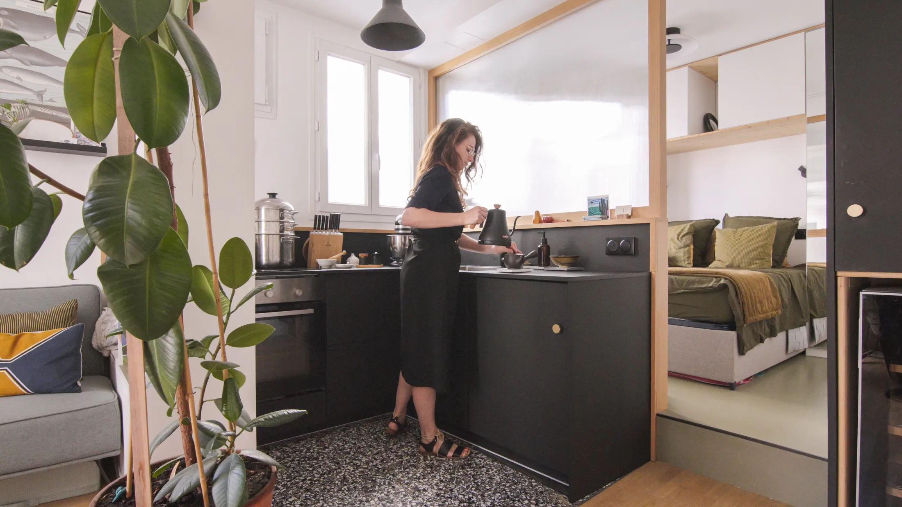
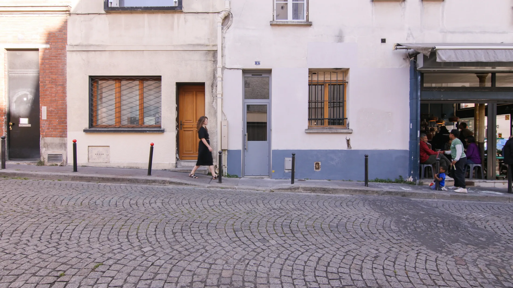
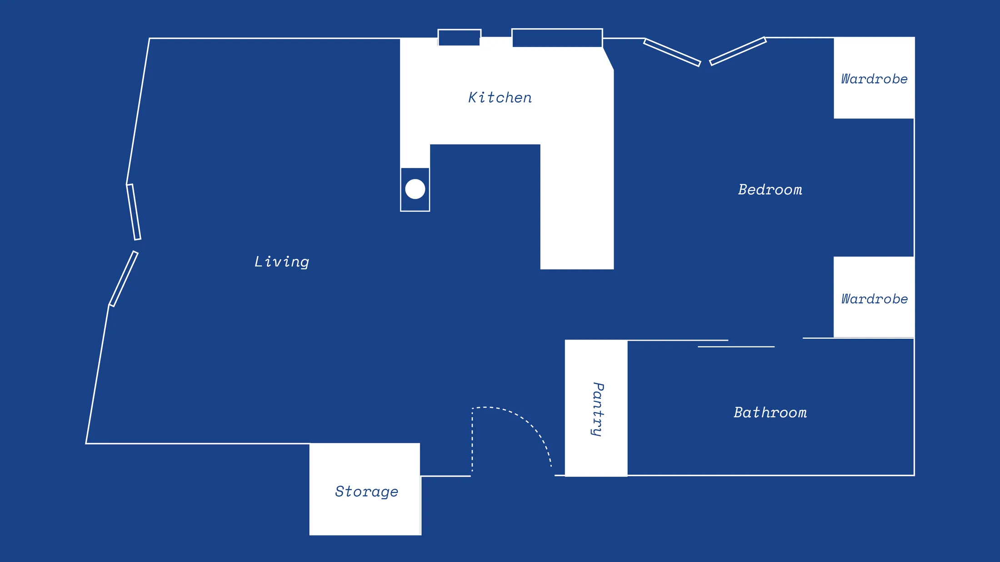
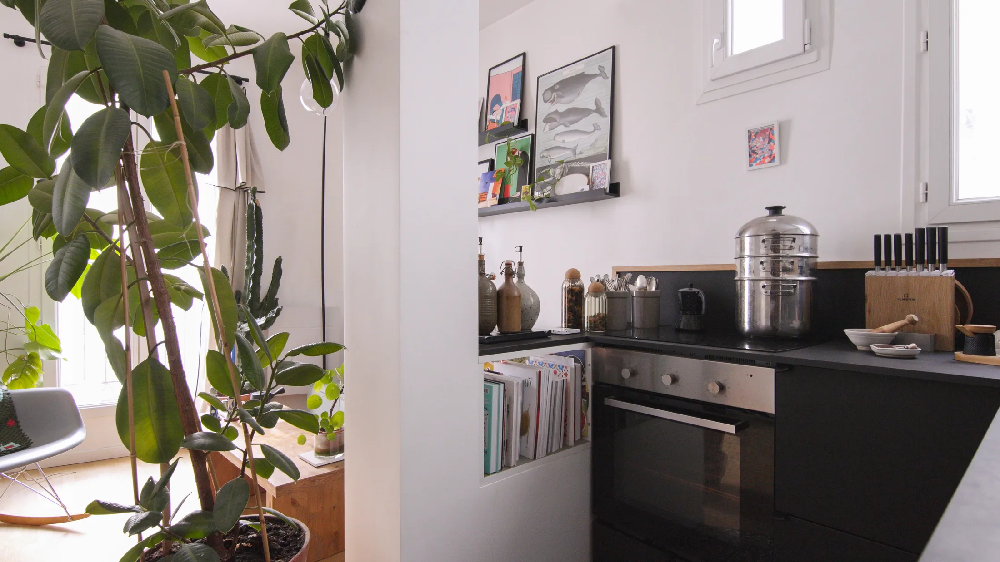
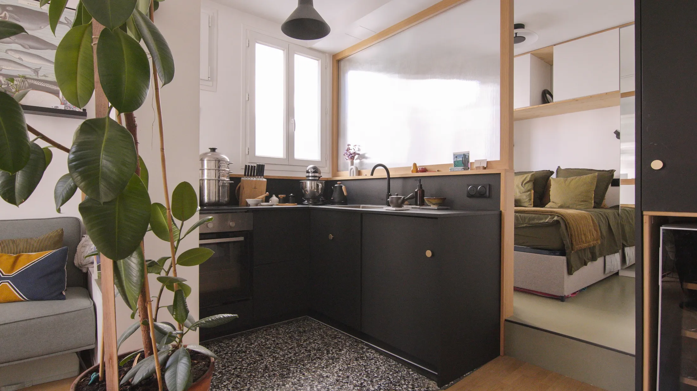
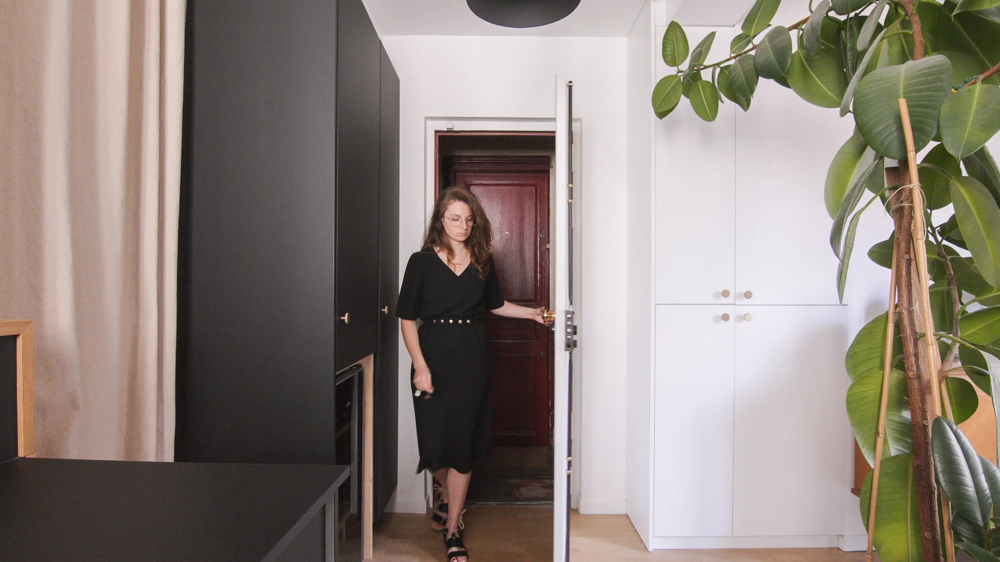
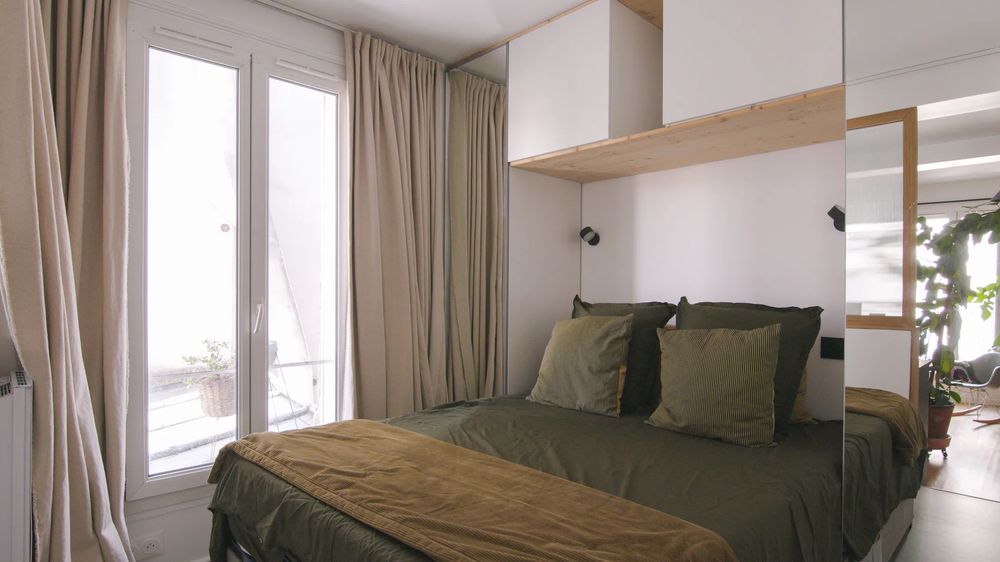
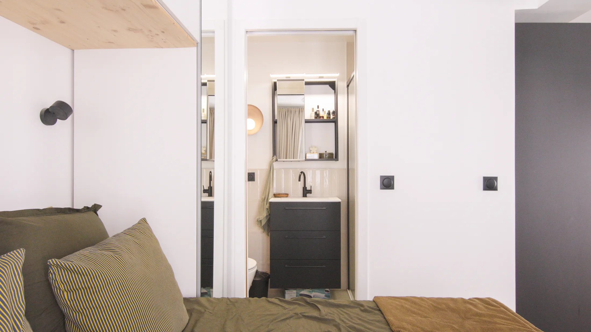

# 25 м² без межкомнатных дверей: как парижский минимализм работает в студии

25 м² — это не из учебника по микрожилью, а вполне московская цифра: по данным bnMAP.pro, именно столько в среднем занимает студия в новостройках Новой Москвы (в старой Москве — 28 м²). Парижский дизайнер Жюльен Гарсия (Juliane Garcia) из студии Maison Insula купила квартиру такого метража в 19-м округе, снесла всё лишнее и получила пространство, где нет ни одной межкомнатной двери. Что из этого стоит взять, а что в московских домах не получится, разбираем по порядку.

## Коротко

- Квартира была нарезана на три тесные комнаты; после сноса перегородок получилось одно пространство с тремя зонами.
- Кухня — главная героиня: матовый чёрный фасад, дубовый каркас и терраццо на полу.
- Спальню отделяют матовое стекло и штора до потолка, а не стена.
- Холодильник и кладовую спрятали в шкаф у входа, электрику и обувь — в соседний.
- Единственная дверь в квартире — раздвижная, в ванную.

*Passage Gauthier, Париж, 25 м². Дизайнер Жюльен Гарсия, Maison Insula. Фото: Never Too Small*

## Что за квартира и где она стоит

Дом 1966 года — типовой жилой корпус, по возрасту родственник московской панельной пятиэтажки того же десятилетия. До ремонта квартира была набором из трёх замкнутых каморок, через кухню проходила открытая сточная труба, а старые ремонты были сделаны кое-как. Дизайнер описывает свой подход как интуитивный: она проектирует по привычкам клиентов и здесь применила тот же метод к собственной жизни.

Дом стоит в конце мощёного проезда, который упирается в лестницу к парку Бют-Шомон. Для небольшой квартиры это важная деталь: парк работает как продолжение гостиной.

*Дом стоит в конце мощёного проезда, который выводит к парку Бют-Шомон. Фото: Never Too Small*

**Для Москвы.** Если ваша студия в районе, где у дома нет двора, зелёная зона в пешей доступности делает метраж менее важным. Сокольники, Таганский парк, Бабушкинский парк, набережные Москвы-реки — любой из них заменяет гостям «вторую комнату» хотя бы на тёплую половину года. Зимой, когда световой день короткий, вечер всё равно проходит дома, и тогда начинает работать то, что описано ниже.

## Приём 1. Снести перегородки и оставить одну стену света

Все внутренние стены убрали. Ванную перенесли в самую тёмную часть квартиры, рядом со спальней, а окна — три больших и одно поменьше — оставили гостиной и кухне. Принцип тот же, что и в других разборах нашей рубрики: «закрытое» тянется к глухой стене, «открытое» — к свету.

Подиум в спальне решает сразу две задачи. Под ним спрятана новая канализация, а его край показывает, где заканчивается общая часть квартиры и начинается личная — стена для этого не нужна.

*План после перепланировки: внутренних стен нет, ванная — за раздвижной дверью. Чертёж: Never Too Small*

**Как повторить.** В московской хрущёвке или панельной «однушке» сносить можно далеко не всё: несущие стены трогать нельзя, а любая перепланировка требует согласования. Но в новостройках со свободной планировкой и в монолитных домах, где внутренние перегородки не несут нагрузки, схема «окно — гостиная, глухая сторона — ванная и спальня» вполне реальна. Подиум тоже работает как разделитель, особенно если под ним нужно спрятать трубы.

## Приём 2. Колонна, которая прячет чужую трубу

Между кухней и гостиной стоит звукоизолирующая колонна. Она скрывает дренажный стояк соседей сверху и заодно очерчивает зону кухни, не заслоняя свет. Вместо того чтобы бороться с инженерным «уродом», дизайнер сделала из него архитектурный элемент.

*Колонна скрывает соседский стояк и задаёт границу кухни. Фото: Never Too Small*

**Для Москвы.** В домах старого фонда стояки и короба часто торчат посреди комнаты или кухни: в сталинках и конструктивистских домах Хамовников и Замоскворечья они бывают нестандартно расположены. Короб с шумоизоляцией, выведенный в планировку как колонна или пенал, лучше, чем неровная обшивка гипсокартоном вдоль стены. Но вентиляционные каналы закрывать и уменьшать нельзя — это прямо запрещено постановлением 508-ПП. Прежде чем что-то строить вокруг, найдите, где они проходят.

## Приём 3. Матовое стекло вместо стены

Между кухней и спальней стоит перегородка из матового стекла. Дизайнер вдохновлялась японскими сёдзи: стекло пропускает дневной свет вглубь квартиры, но не показывает, что происходит за ним. На стекле и окнах спальни — штора от пола до потолка, сшитая подругой. Если её задвинуть, получится затемнённая комната.

*Матовое стекло между кухней и спальней пропускает свет, но скрывает кровать. Фото: Never Too Small*

**Как повторить.** Штору до потолка стоит рассмотреть для Москвы отдельно: в июне ночи светлые, а зимой световой день короткий, так что затемнение пригодится в оба сезона. Стеклянную перегородку можно заказать с каркасом из тонкого чёрного профиля.

Однако есть юридическая оговорка. По постановлению 508-ПП нельзя делать проём между комнатой и газифицированной кухней без плотной двери. Если у вас газовая плита, стеклянная перегородка без двери не подойдёт: нужна дверь, которая закрывается плотно. С электроплитой это ограничение не возникает, но согласование проекта всё равно нужно.

## Приём 4. Шкаф у входа, который скрывает кухню

Рядом с входом стоит шкаф на заказ. За его фасадом спрятаны холодильник, винный шкаф и кладовая с продуктами, а в соседнем шкафу — электрощит, обувь и всё для уборки. Кухня при этом остаётся лёгкой: техника не торчит, а за чёрным фасадом и дубовой рамой видны только приготовление и еда.

*Шкаф на заказ у входа: холодильник, винный шкаф и кладовая. Фото: Never Too Small*

**Для Москвы.** Многие студии в новостройках получаются с узкой нишей при входе или с небольшим коридором — именно туда стоит поставить шкаф «от пола до потолка» с холодильником внутри. Холодильник в прихожей — привычный приём для евродвушек, но стоит продумать вентиляционный зазор и розетку заранее.

## Приём 5. Кровать в раме, диван с книгами и буфет на ножках

В спальной зоне — шкафы IKEA, оформленные деревянной рамой со встроенной подсветкой. Недорогая система смотрится как столярная работа. В гостиной стоит подержанный диван, раскладывающийся в кровать; под ним в сумках IKEA с молнией хранятся книги. Буфет достался дизайнеру от бабушки и дедушки: чтобы он не давил, его приподняли над полом на ножках.

*Шкафы IKEA в деревянной раме с подсветкой вокруг кровати. Фото: Never Too Small*

**Как повторить.** Рамка из шпонированной фанеры или массива вокруг стандартных шкафов — один из самых дешёвых способов «одеть» фабричную мебель. Старая вещь на ножках работает лучше, чем её отсутствие: так в маленькую квартиру попадает характер.

## Приём 6. Одна дверь на всю квартиру

Ванная закрывается раздвижной дверью, которая уходит в стену. Это единственная дверь во всей квартире. Внутри — подвесная тумба с раковиной, унитаз и душ открытого типа.

*Единственная дверь в квартире — раздвижная, в ванную. Фото: Never Too Small*

**Как повторить.** Дверь-пенал освобождает место, которое иначе занимало бы распашное полотно. Для этого нужна стена толщиной под короб — в панельных домах она не всегда есть, а гипсокартонная перегородка с кассетой подойдёт.

## Чек-лист: что взять в студию 25–28 м²

1. Окна — гостиной и кухне, глухая сторона — ванной и спальне.
2. Подиум или разница уровней вместо перегородки.
3. Стеклянная перегородка с плотной дверью, если на кухне газ.
4. Шкаф у входа под холодильник и кладовую.
5. Недорогие шкафы IKEA в деревянной раме.
6. Раздвижная дверь в ванную.
7. Штора до потолка для затемнения.

Больше идей для небольших квартир — в разделе [«Интерьер»](/temy/interer/). Если вы выбираете студию в новостройке, посмотрите [каталог объектов](/obekty/) — там видно, какие планировки сейчас в продаже.

## Вопросы и ответы

**Как отделить спальню в студии 25 м² без стены?**
Парижский пример — перегородка из матового стекла и плотная штора до потолка. Стекло пропускает свет, штора затемняет спальню ночью. В московской квартире с газовой плитой учтите правило 508-ПП: проём между комнатой и газифицированной кухней должен закрываться плотной дверью.

**Какая площадь у типичной студии в новостройках Москвы?**
По данным bnMAP.pro, в июле 2026 года средняя студия в новостройках Москвы — 27 м²: в старой Москве 28 м², в Новой Москве 25 м².

**Где в маленькой квартире спрятать холодильник и кладовую?**
В Париже их убрали в шкаф на заказ у входной двери: фасад общий, внутри — холодильник, винный шкаф и продукты. В Москве для этого подходит ниша в прихожей, особенно в домах, где она осталась от старой планировки.

## Источники

1. Never Too Small. Intuitive minimalism inhabits 25sqm/269sqft on a cobblestone street in Paris — https://www.nevertoosmall.com/post/minimalism-25sqm-269sqft-apartment-in-paris
2. РБК Недвижимость: цены и площадь студий в новостройках Москвы, июль 2026 — https://realty.rbc.ru/news/6a688a1e9a7947e0d847331e
3. ppt.ru: постановление Правительства Москвы от 23.07.2024 № 1672-ПП — https://ppt.ru/obzory/vstupaet-v-silu/postanovlenie-pravitelstva-moskvy-23-07-2024-1672-pp
4. Мосжилинспекция: какие перепланировки запрещены (постановление 508-ПП) — https://www.mos.ru/news/item/76897073/

*Материал подготовлен по мотивам публикаций Never Too Small и использует их фото с разрешения правообладателя.*
