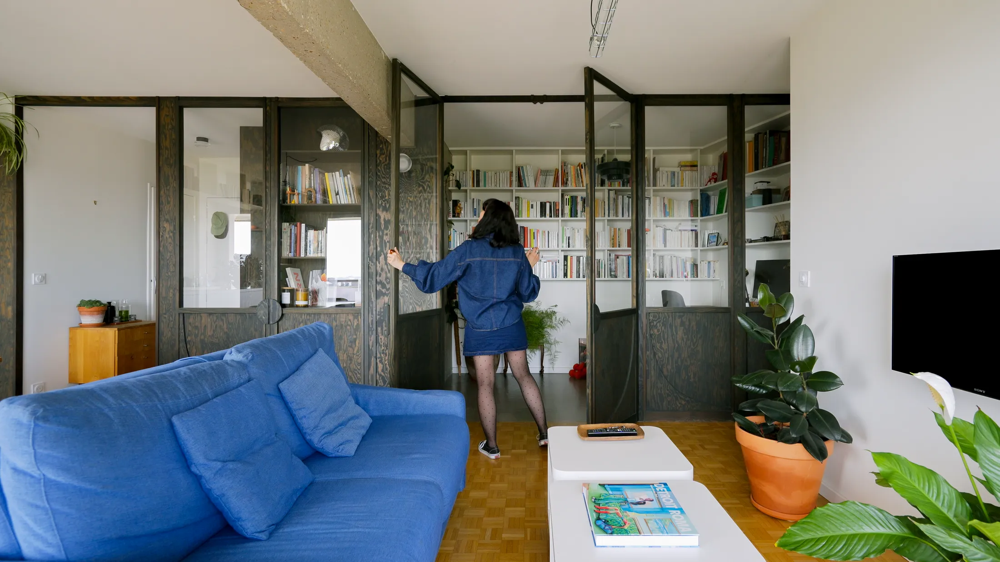
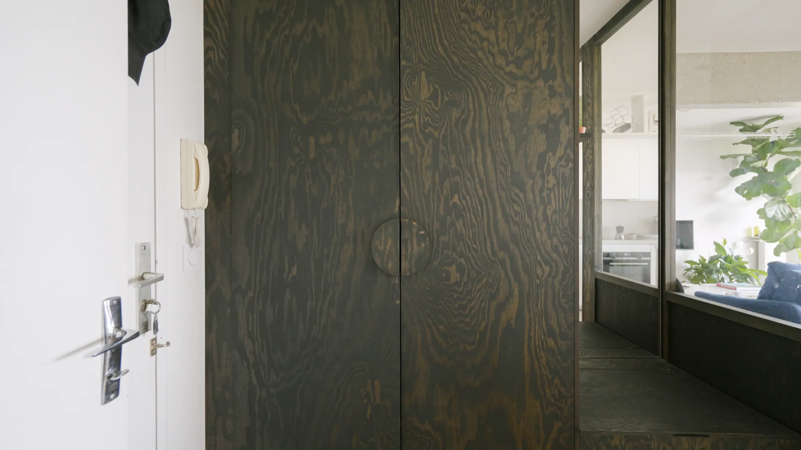
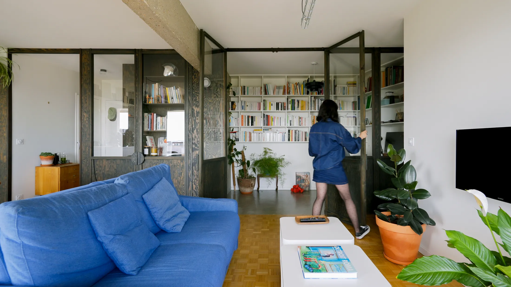
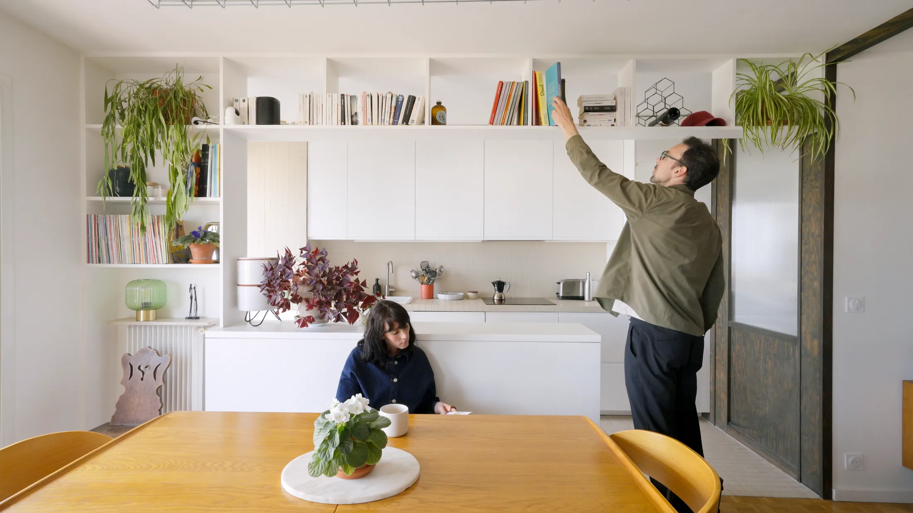
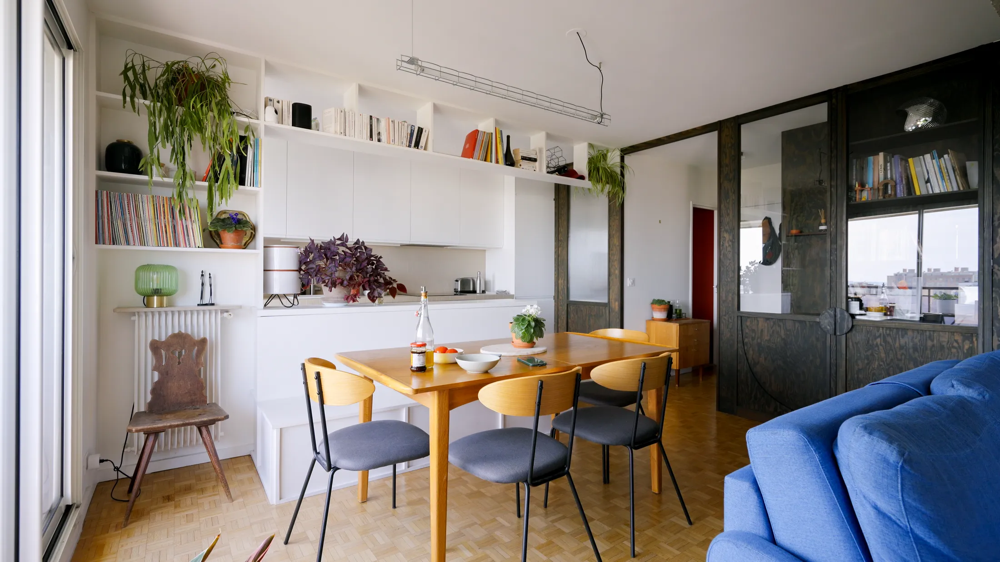
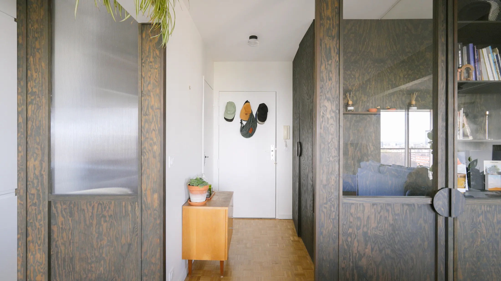
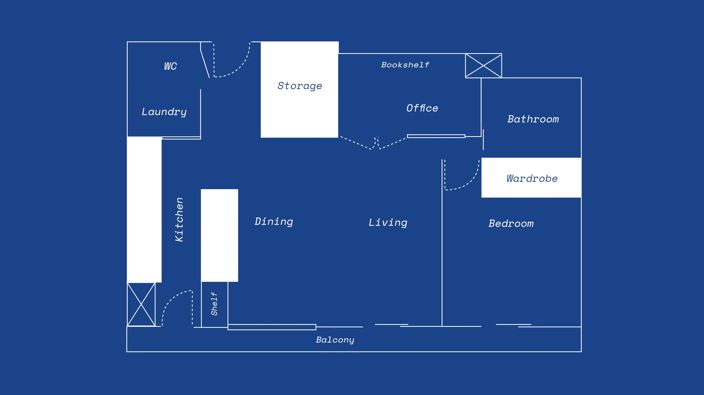

# Один чёрный объём вместо стен: как в 57 м² поместились кабинет, гостевая и бар

Когда в квартире нужен кабинет, первая мысль — отгородить угол. Парижские архитекторы пошли другим путём: собрали в 57 м² один крупный объём из тёмного дерева и стекла, и он взял на себя сразу несколько ролей — прихожая, рабочая комната с библиотекой, гостевое место и бар. По данным hh.ru за июнь 2025 года, 23% опрошенных хотят работать полностью удалённо и ещё 26% — в гибридном формате, так что вопрос «где поставить стол» для московских владельцев квартир давно не праздный.

Квартира находится в районе Бельвиль, на двенадцатом этаже башни 1970-х годов. Над проектом работали Матьё Дюрбек (Mathieu Durbec) из бюро MDA и Тайна Пишон (Taïna Pichon) из бюро Meraki architecture, фотографировал Matthieu Torres. Для москвича это узнаваемая среда: башня семидесятых — родной брат наших панельных и кирпичных девятиэтажек и высоток с бетонной несущей структурой. Разбираем, что оттуда можно перенести в евродвушку.

## Коротко

- Весь «закрытый» функционал собран в одном объёме из тёмного дерева: он начинается в прихожей и заканчивается баром в столовой.
- Кабинет отделён стеклянными дверями и глухими панелями: свет проходит, беспорядок не виден.
- Стену между кухней и столовой заменили островом со скамьёй и подвесной полкой.
- Бетонную балку не прятали, а сделали частью интерьера, подсветив неоном.
- Туалет превратили в постирочную, а вход в неё закрыли рифлёным стеклом и покрасили стену в красный.

*Квартира 57 м² в районе Бельвиль, Париж. Архитекторы Матьё Дюрбек (MDA) и Тайна Пишон (Meraki architecture). Фото: Matthieu Torres / Never Too Small*

## Приём 1: прихожая как «кокон»

Объём начинается сразу за входной дверью. Архитекторы называют это функциональным вестибюлем-коконом: шкаф из тёмной морской сосны для пальто и обуви, ниша со скамьёй и хранением для обуви, крючки и зеркало во всю высоту стены. Всё, что обычно оседает на полу и вешалках, убрано в одну вертикальную плоскость.

*Прихожая-«кокон»: скамья в нише, хранение для обуви и зеркало во всю высоту. Фото: Matthieu Torres / Never Too Small*

**Для Москвы.** В хрущёвке и в панельной «брежневке» прихожая — чаще всего коридор шириной метр с небольшим. Здесь работает именно вертикаль: шкаф до потолка вместо тумбы, скамья с ящиком под обувь вместо банкетки, зеркало в полный рост, которое визуально удваивает проход. В зимней Москве важно ещё одно: зону «мокрой» одежды и обуви хочется закрыть дверцей, а не оставлять на виду. Тёмное дерево, кстати, хорошо скрывает следы от реагентов на ботинках.

## Приём 2: кабинет, который не изолирует

Продолжение объёма — рабочая комната. Двери в ней со вставками из стекла, поэтому дневной свет из основной комнаты попадает и в кабинет. Письменный стол встроен в стену и сделан из того же дерева, что и обшивка, верх стен занимают полки для библиотеки, а под ними оставлено место для гостевой кровати. Рядом — большой встроенный шкаф у открытой бетонной несущей стены. Когда нужно, часть вставок остаётся глухой деревянной панелью: она прячет рабочий хаос от тех, кто сидит в гостиной.

*Стеклянные двери впускают свет в кабинет, а глухие панели прячут беспорядок. Фото: Matthieu Torres / Never Too Small*

**Как повторить.** Схема подходит для евродвушки: возьмите нишу или половину комнаты и сделайте глубину встроенного стола и полок 40–60 см, а дверь — со стеклянной вставкой. Если в плане нет второй комнаты, а нужна именно гостевая кровать, оставьте под столешницей и полками свободный проём для раскладного матраса. Только учтите: убирать стену между комнатой и газифицированной кухней в Москве нельзя без плотной двери — это прямо прописано в постановлении 508-ПП. А со стеклом внутри квартиры можно играть свободнее: оно не затрагивает ни газ, ни вентиляцию, но согласования требует любая перепланировка.

## Приём 3: остров вместо стены

Между кухней и столовой в Париже убрали перегородку, а на её месте выстроили остров. С одной стороны — рабочая зона, с другой — скамья, под сиденьем которой спрятано хранение. Над островом висит открытая полка, доступная с обеих сторон: поставил посуду с кухни — достал со стороны стола. Полка идёт параллельно бетонной балке, которую оставили открытой.

*Кухонный остров работает и как обеденная скамья, над ним — подвесная полка. Фото: Matthieu Torres / Never Too Small*

Столовая получила дополнительную линию света: полки рядом с обеденным столом подсвечены неоном, и вместе с серой бетонной балкой это создаёт вечерний «лофтовый» акцент.

*Полки в столовой с неоном и открытая бетонная балка. Фото: Matthieu Torres / Never Too Small*

**Для Москвы.** В большинстве типовых домов кухня и комната разделены либо несущей, либо газовой границей, и «убрать стену» просто так не получится. Зато остров или полуостров в нестандартной кухне-гостиной нового монолитного дома — вполне реальный путь, особенно если застройщик продаёт квартиру со свободной планировкой. Для хрущёвки и сталинки больше подходит другая версия идеи: барная стойка вместо стола и подвесная полка над ней. А открытую бетонную балку или стену в московской новостройке можно оставить и без дорогого лофта: достаточно шлифовки и защитного состава, а неон добавить точечно.

## Приём 4: спальня, постирочная и цвет

В спальне напротив окон стоит встроенный шкаф от пола до потолка с зеркальными фасадами IKEA: в комнате, где раньше не было хранения, теперь есть и гардероб, и ощущение второго окна — в зеркалах отражаются дневной свет и вид на балкон. Балкон при этом — полноценное продолжение гостиной, он впускает свет и расширяет вид.

А туалет, в котором раньше помещался только унитаз, архитекторы превратили в постирочную. Вход со стороны кухни закрыт рифлёным стеклом, внутри — яркая красная стена и полка. Рифлёное стекло скрывает технику, но пропускает свет, и вход в хозяйственную комнату стал декоративным элементом, а не дверью в «подсобку».

*Рифлёное стекло превратило вход в постирочную в акцент кухни. Фото: Matthieu Torres / Never Too Small*

**Как повторить.** Зеркальный шкаф напротив окна — самый дешёвый способ «добавить» окно в московскую квартиру, особенно зимой, когда световой день короткий. Идею с постирочной стоит соотносить с планировкой: в студиях и евродвушках стиральную машину обычно прячут в ванной или на кухне, а отдельное помещение появляется чаще в больших квартирах. Рифлёное стекло или плёнка на дверце шкафа с техникой — вариант попроще.

*План после перепланировки. Чертёж: MDA, Meraki architecture / Never Too Small*

## Чек-лист: кабинет в московской квартире

1. Решите, что собирается в «объём»: вход, рабочее место, хранение — и держите один материал и цвет.
2. Для двери или перегородки выбирайте стекло с рамой из того же материала: свет проходит, звук слегка приглушается.
3. Закладывайте под полки и стол место для гостевого матраса, если комнаты всего две.
4. Любое объединение кухни и комнаты проверьте на газ и несущие стены, согласуйте в Мосжилинспекции.
5. Зеркальные фасады — напротив окна, а не рядом с ним.
6. Рифлёное стекло — там, где нужно спрятать технику, но не терять свет.

Если вы выбираете квартиру под такой формат, посмотрите [каталог объектов](/obekty/): в планировках с квадратной комнатой и нишей у входа кабинет-объём собирается проще всего. А другие приёмы для небольших квартир — в разделе [«Интерьер»](/temy/interer/).

## Вопросы и ответы

**Как встроить кабинет в небольшую квартиру, не теряя свет?**
Выделите рабочую зону деревянным или мебельным объёмом, а в дверях и вставках используйте стекло: в парижской квартире 57 м² свет проходит в кабинет через стеклянные двери, а глухие панели прячут рабочий беспорядок. Всё, что связано с несущими стенами и вентиляцией, в Москве согласуется отдельно.

**Можно ли в Москве убрать стену между кухней и комнатой?**
Нет, если кухня газифицирована: по правилам Мосжилинспекции (постановление 508-ПП) проём между комнатой и газифицированной кухней допускается только с плотной дверью. На электрической плите вариантов больше, но любую перепланировку нужно согласовывать.

**Сколько москвичей работают из дома?**
По данным hh.ru за июнь 2025 года, 23% опрошенных хотят работать полностью удалённо, ещё 26% — в гибридном режиме. Поэтому в квартирах всё чаще нужно постоянное рабочее место, а не угол на кухне.

## Источники

1. Never Too Small. Inside a 57sqm/613sqft Paris apartment designed around one clever volume — https://www.nevertoosmall.com/post/inside-a-57sqm-613sqft-paris-apartment-designed-around-one-clever-volume
2. Мосжилинспекция: какие перепланировки запрещены (постановление 508-ПП) — https://www.mos.ru/news/item/76897073/
3. «Коммерсантъ»: опрос hh.ru о формате работы, июнь 2025 — https://www.kommersant.ru/doc/8336320
