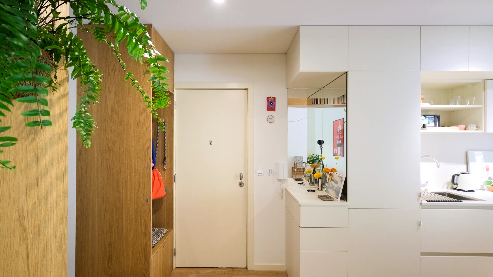
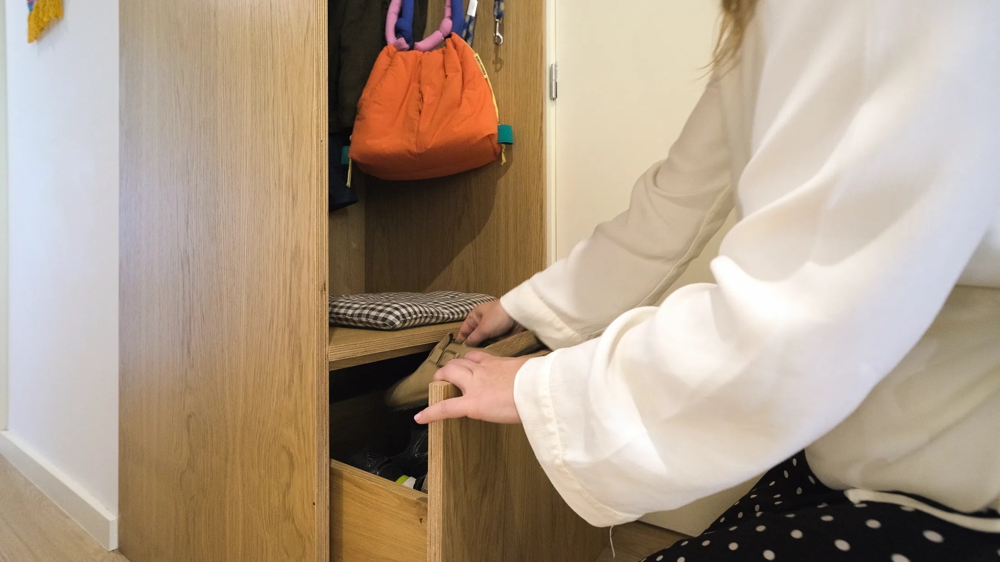
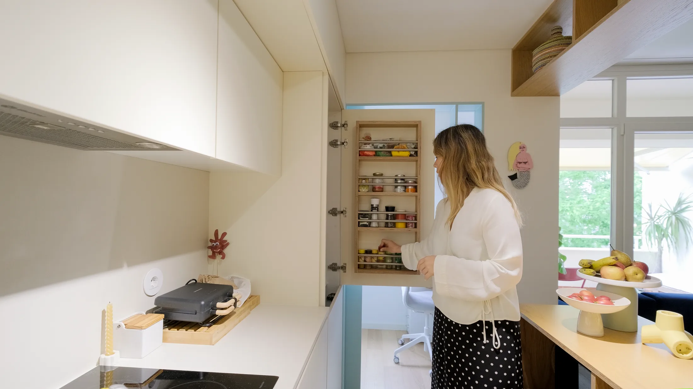
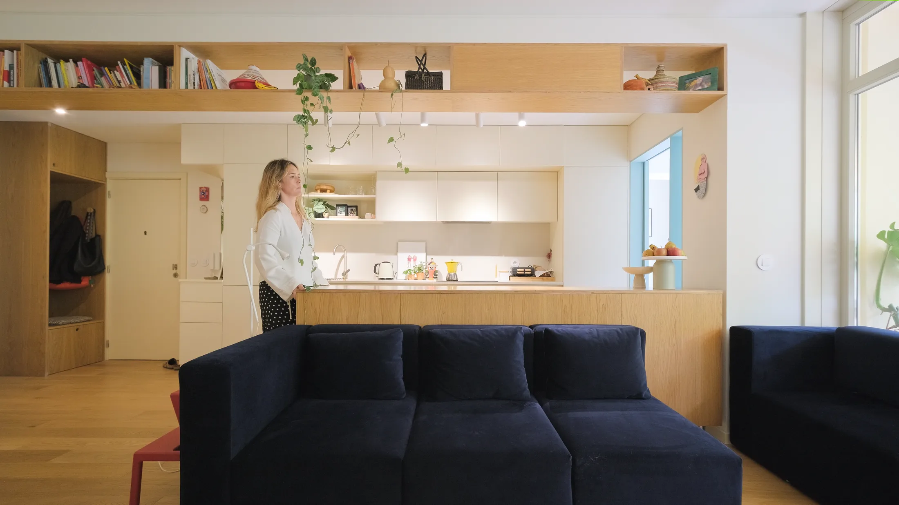
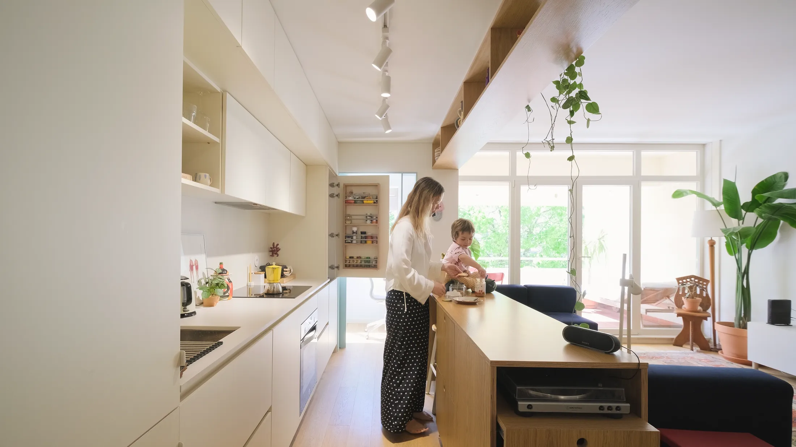
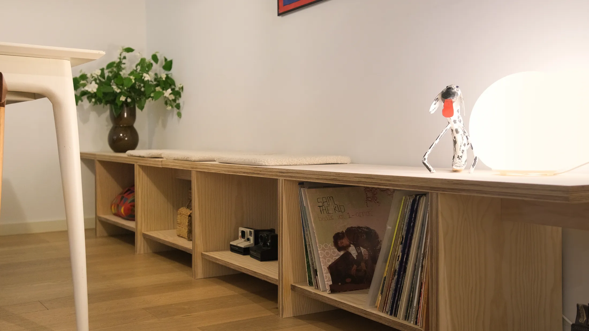
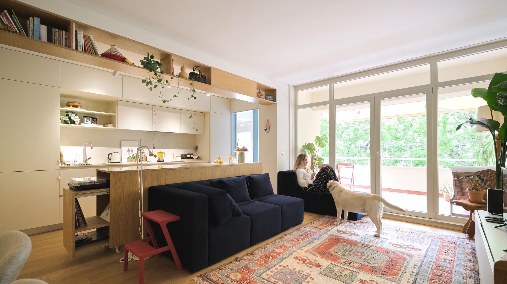
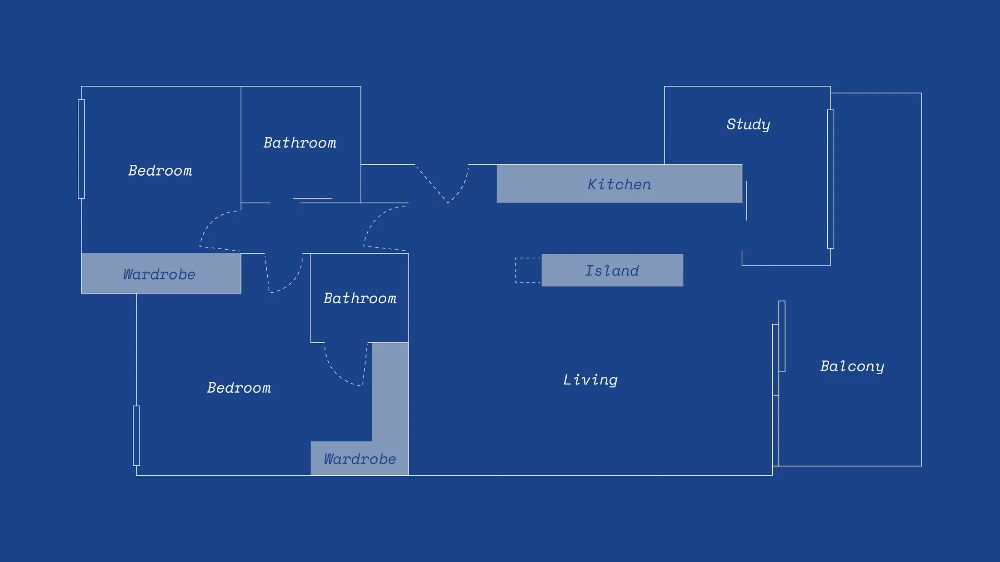

# Пять приёмов, которые заставили 60 м² работать вдвое больше: дом семьи в Португалии

Квартира на 60 м² сегодня — почти средняя по рынку: по данным bnMAP, средняя площадь квартиры в новостройках Москвы выросла с 56,3 м² в первом квартале 2025 года до 62 м² в первом квартале 2026-го. А вот требования к ней растут быстрее метража: нужна и прихожая, и рабочее место, и гостевая кровать, и кухня, где можно готовить вдвоём. Тем интереснее проект Pinhal da Foz I близ португальской Браги.

Здесь живёт сама автор — интерьер-дизайнер Ангела Кастро (Ângela Castro, студия Ângela - Interior Design), её партнёр Педро, сын Нико и собака Горила. Раньше квартира состояла из замкнутых комнат и узких коридоров, теперь это единое светлое пространство в тёплой гамме кремового и дуба. Снимал проект Luis Pedro. Ниже — пять приёмов, на которых он держится.

## Коротко

- Прихожая — одна дубовая линия: шкаф, скамья, «зона ключей» и зеркало, которая продолжается до кухни.
- Дверь кладовой работает как «сухой холодильник»: на ней полки для специй и масел.
- Кухонный остров на колёсиках — то барная стойка, то перегородка, то разделочный стол.
- Встроенная лавка длиннее стола: гостей сажают на неё, а под сиденьем лежат пластинки.
- Диван из независимых секций можно подвинуть под любой сценарий.

*Pinhal da Foz I, окрестности Браги, Португалия, 60 м². Дизайнер Ангела Кастро. Дубовое хранение у входа. Фото: Luis Pedro / Never Too Small*

## Приём 1: вход, который собирает вещи за вас

Первое, что видишь, войдя, — дубовый шкаф во всю высоту: отделение для верхней одежды, скрытые ящики и верхние антресоли. Часть полок открыта, без дверей, чтобы пальто и сумки были под рукой. На ящиках оставлена ровная поверхность — «зона ключей» для очков, ключей и мелочи, а над ней висит угловое двустороннее зеркало. Нижний ящик устроен как скамья: на ней удобно разуваться, а внутри лежит обувь. Деревянная линия не обрывается в прихожей, а идёт дальше между кухней и коридором, так что хранение читается как единая стена.

*Нижний ящик выполняет роль сиденья для обуви. Фото: Luis Pedro / Never Too Small*

**Для Москвы.** В хрущёвке и панельной девятиэтажке прихожая — самое тесное место, а именно здесь зимой скапливаются сапоги, пуховики и шапки. Поэтому идею «ничего не держать на полу» стоит принять буквально: скамья-ящик под обувь, открытые полки для ежедневного (шарф, шапка, ключи) и закрытые для сезонного.

## Приём 2: «сухой холодильник» на двери

В кухне есть кладовая, и Ангела использовала саму дверь: на ней смонтированы полки для специй, масел и мелочей. Чтобы дверь закрывалась, внутренние полки сделали немного мельче. Остальная кухня — это шкафы до потолка, часть из них скрыта фасадами, часть остаётся открытой.

*«Сухой холодильник»: полки на двери кладовой для специй и масел. Фото: Luis Pedro / Never Too Small*

**Как повторить.** Дверь кладовой или шкафа — это неиспользованная вертикальная плоскость. Любому, кто жил в хрущёвке, знаком «холодильник под окном» — ниша, куда зимой выставляли продукты; её роль теперь легко взять на себя полкам на двери. Только измеряйте глубину заранее: между полкой на двери и внутренними полками должен оставаться запас на самую крупную банку.

## Приём 3: остров на колёсах и общая полка

Центр квартиры — кухонный остров на колёсиках. Его можно подкатить как барную стойку для завтрака, использовать как перегородку между кухней и гостиной, как разделочный стол или как стол для вечеринки. Внутри — скрытое хранение, а бытовая техника подключена к розеткам, встроенным в пол. Выдвижные табуреты прячутся под столешницей, а боковой ящик выезжает вбок и раскрывает проигрыватель винила. Над островом висит двусторонняя полка, до которой дотягиваются и с кухни, и из гостиной.

*Остров на колёсиках и двусторонняя полка над ним. Фото: Luis Pedro / Never Too Small*

Есть у острова и семейная функция: чаще всего его ставят вплотную к дивану, и сын Нико наблюдает за готовкой.

*Остров как скамья: отсюда удобно наблюдать за готовкой. Фото: Luis Pedro / Never Too Small*

**Для Москвы.** Здесь нужна осторожность. Если кухня в доме газифицирована, то объединить её с комнатой без плотной двери нельзя: проём между комнатой и газифицированной кухней по постановлению 508-ПП допускается только с плотной дверью, а вентиляционные каналы нельзя убирать или сокращать. Поэтому «открытая» схема реальна в новостройках с электроплитами и в квартирах, где кухня и комната изначально составляют одно пространство. Переезжающий остров на колёсах в такой квартире — отличная альтернатива капитальной перегородке: он ничего не ломает и не требует согласований. Но помните, что техника у него должна быть подключена безопасно: розетки в полу и шнуры нужно проектировать с электриком, а не «как в журнале».

## Приём 4: лавка длиннее стола

Рядом с кухней стоит обеденный стол, а вдоль него — встроенная лавка. Она сделана длиннее самого стола, поэтому на «лишних» сантиметрах можно усадить гостей. Под сиденьем — открытые полки, там хранятся пластинки; на самой лавке удобно расставить декор. Стол при этом — многофункциональный центр семьи: за ним работают, собирают пазлы и обедают.

*Встроенная лавка с открытыми полками под сиденьем. Фото: Luis Pedro / Never Too Small*

**Как повторить.** Лавка вместо четырёх стульев занимает меньше места по ширине и сразу даёт хранение. В студии она может стоять вдоль окна или вдоль стены: учтите только, что радиаторы московских квартир нельзя переносить на лоджию, а закрывать их глухой мебелью без зазора не стоит — нужна решётка и воздух.

## Приём 5: диван из независимых блоков

Диван в гостиной — собственная разработка Ангелы: тёмно-синий, большой, но разбитый на секции, каждая из которых двигается независимо. Для кино его собирают в линию, для гостей — в угол, а обычно ставят вплотную к острову.

*Модульный диван, разработанный хозяйкой: секции двигаются независимо. Фото: Luis Pedro / Never Too Small*

**Для Москвы.** В студиях доля которых в предложении сейчас упала до 11% (первое полугодие 2026 года), гостиная — одновременно и спальня, и столовая. Модульный диван позволяет переставлять сценарий без переезда: для кино секции сдвигаются в линию, для гостей — в угол. Покупая готовый, проверьте, что секции не только соединяются, но и стоят самостоятельно.

*План после перепланировки: замкнутые комнаты и узкие коридоры превратились в единое пространство. Чертёж: Ângela - Interior Design / Never Too Small*

## Чек-лист для квартиры 45–60 м²

1. Прихожая: шкаф до потолка, скамья-ящик, открытые полки для ежедневного.
2. Дверь кладовой или шкафа — под полки.
3. Подвижная мебель (остров, модульный диван) вместо капитальных перегородок.
4. Лавка вдоль стены вместо стульев, под сиденьем — хранение.
5. Перед любой перепланировкой кухни проверьте газ и вентканалы.
6. Для розеток в полу и подвижной техники привлекайте электрика.

Больше идей — в разделе [«Интерьер»](/temy/interer/). Если вы выбираете квартиру под такую планировку, загляните в [каталог новостроек Москвы](/novostroyki/moskva/).

## Вопросы и ответы

**Как сделать кухню-гостиную в 60 м² многофункциональной?**
Опирайтесь на мебель, которая меняет роль: остров на колёсах служит и разделочным столом, и барной стойкой, и перегородкой, а модульный диван можно двигать под гостей. В проекте Pinhal da Foz I именно так обходятся без лишних комнат.

**Можно ли в Москве объединить кухню с гостиной, как в португальском проекте?**
Не всегда. По постановлению 508-ПП запрещено делать проём между комнатой и газифицированной кухней без плотной двери, а также ликвидировать или уменьшать вентканалы. В новостройках с электроплитами и свободной планировкой вариантов больше, но любую перепланировку нужно согласовывать.

**Какая средняя площадь квартиры в новостройках Москвы сегодня?**
По данным bnMAP, средняя площадь квартиры в новостройках Москвы выросла с 56,3 м² в I квартале 2025 года до 62 м² в I квартале 2026-го. Проект в 60 м² оказывается близок к среднему рынку.

## Источники

1. Never Too Small. 5 multifunctional design details inside a 60sqm/645sqft Portuguese home — https://www.nevertoosmall.com/post/5-multifunctional-design-details-inside-60sqm-645sqft-portuguese-home
2. Мосжилинспекция: какие перепланировки запрещены (постановление 508-ПП) — https://www.mos.ru/news/item/76897073/
3. РБК Недвижимость: средняя площадь квартиры и студии в новостройках Москвы, данные bnMAP и «Метриума» — https://realty.rbc.ru/news/6a2688819a7947c4911d7fd8
4. РБК Недвижимость: доля студий в предложении Москвы, I полугодие 2026 — https://realty.rbc.ru/news/6a6094b09a7947481c9c3ec4
