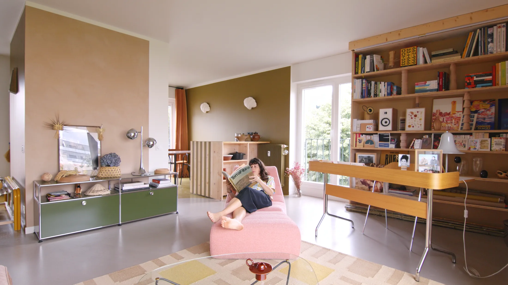
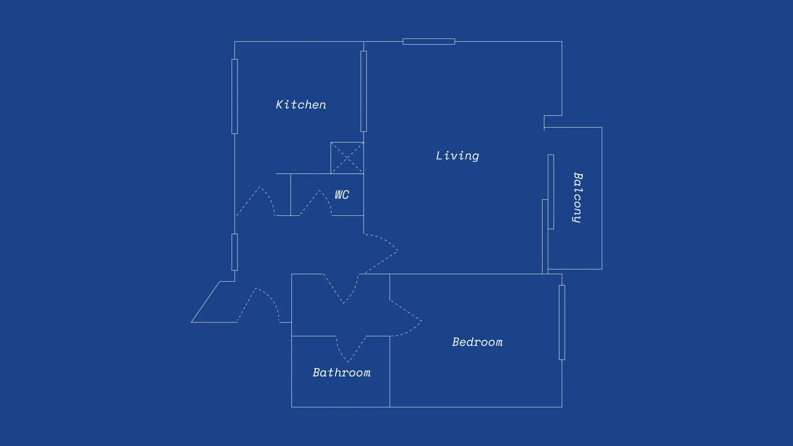
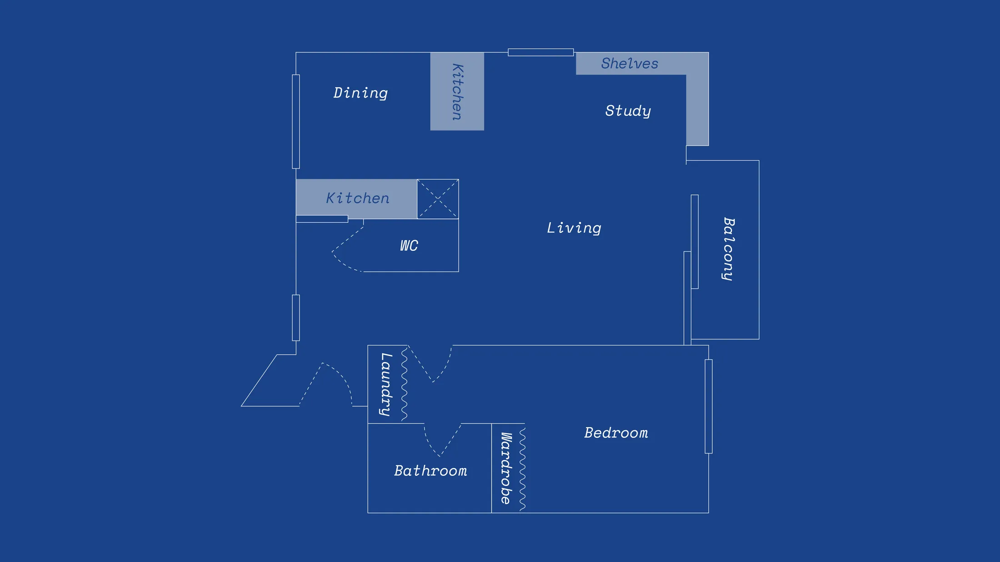
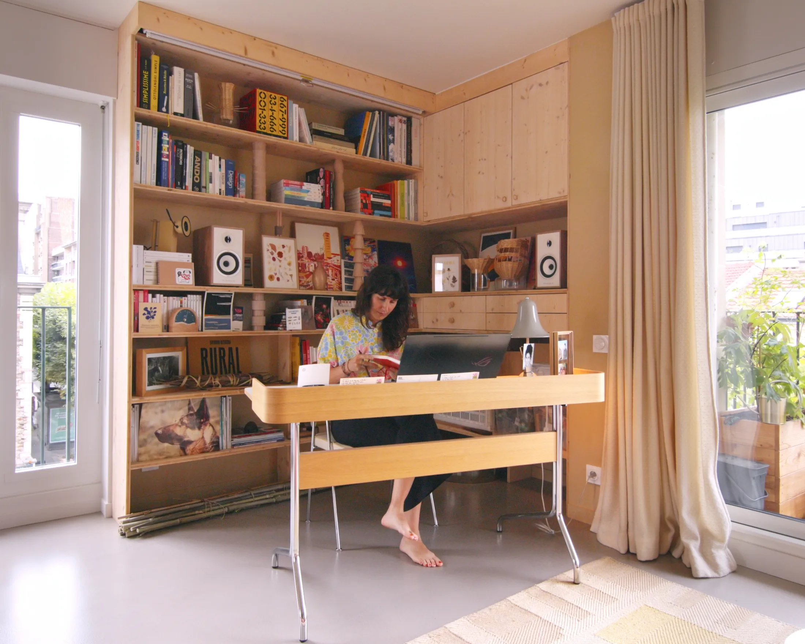
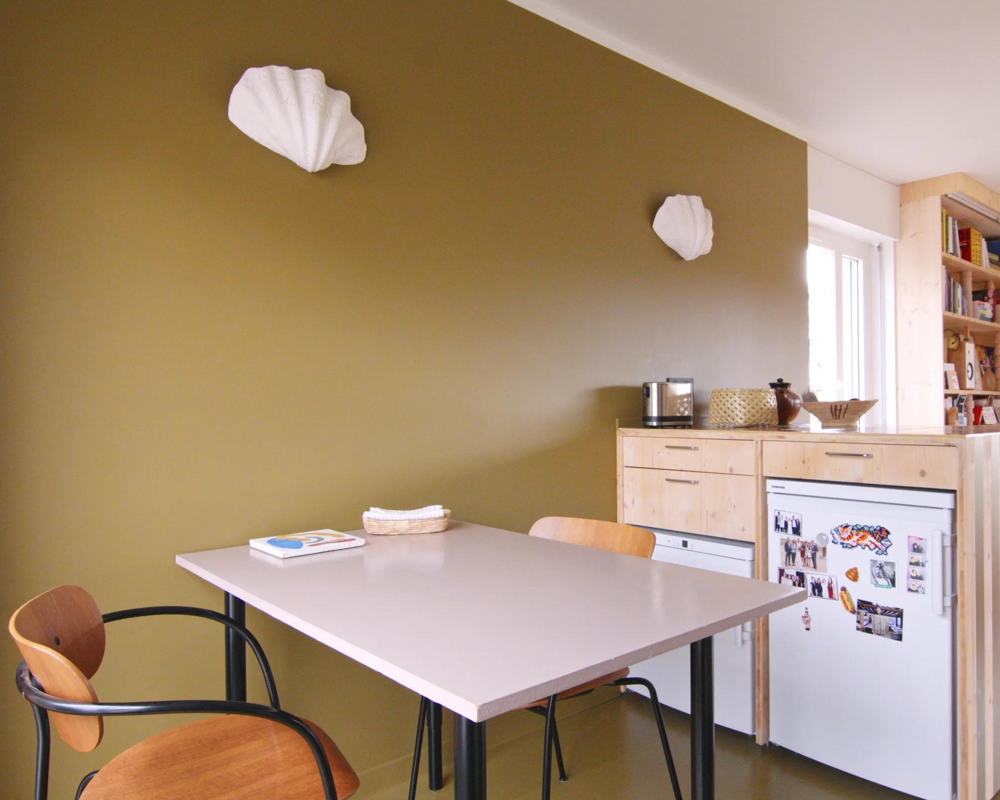
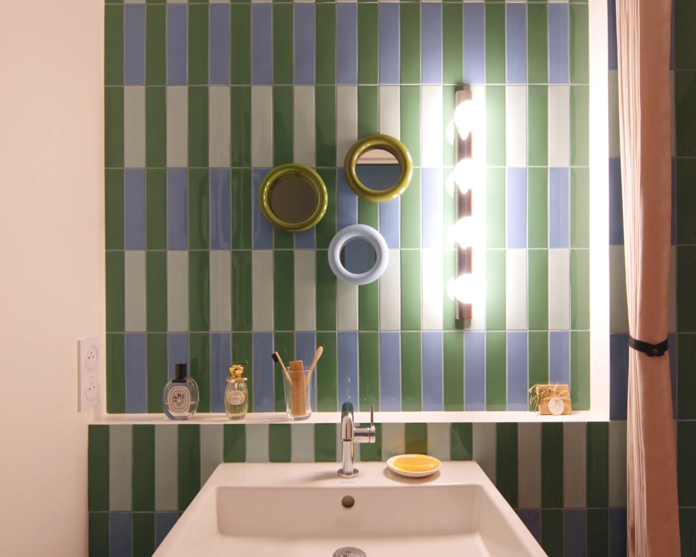
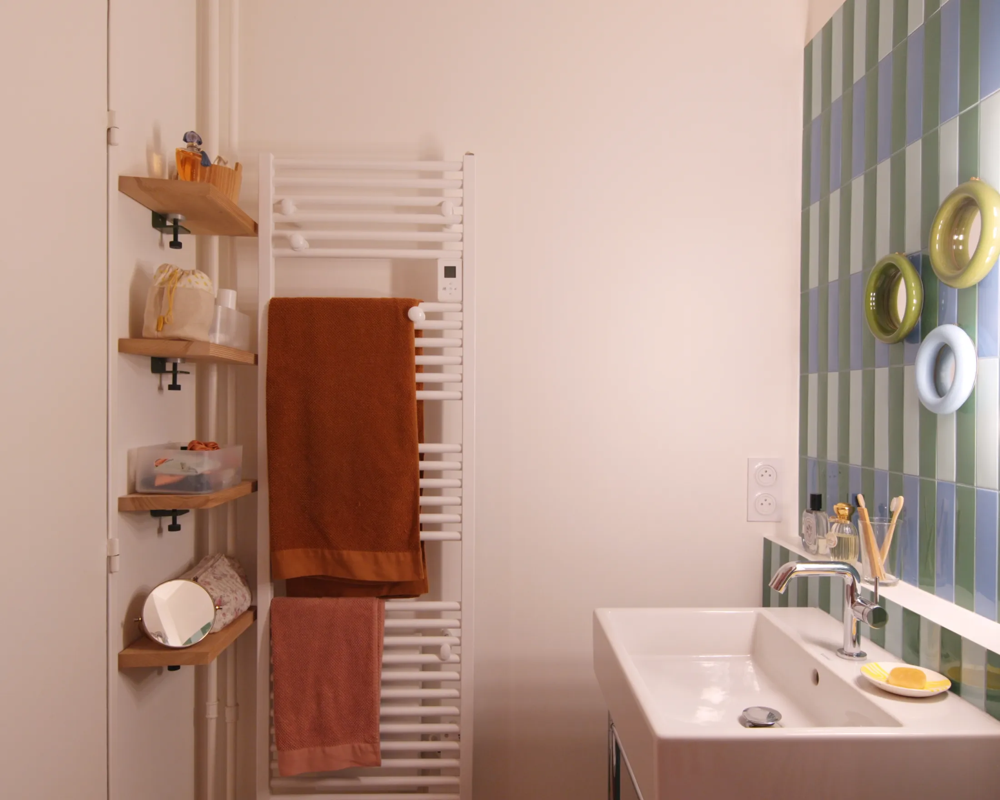
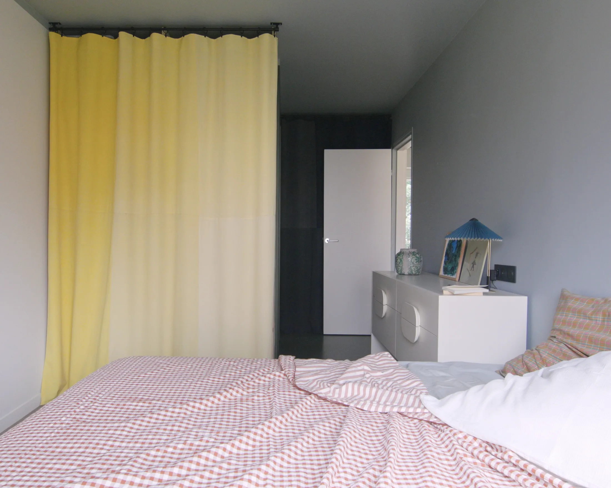

# Пять деталей, которые делают 51 м² просторнее: квартира дизайнера под Парижем

Потолок 2,5 м, шесть дверей на 51 м², дом 1975 года — звучит как описание московской панельки. Только квартира находится в Монтрей, пригороде Парижа, а переделала её интерьер-архитектор Софи Берк (Sophie Berck) из бюро Petit Jour. Она не ломала несущих стен и не искала лишних метров. Вместо этого она работала с мелочами: светом, плиткой, полками, тканью. Получилась квартира, где ничто не мешает взгляду и рукам, а каждая вещь делает больше одной работы.

Мы разобрали пять приёмов из этого проекта и прикинули, что из них пригодится в московской однушке, евродвушке или квартире в старом доме.

## Коротко

- Сначала дизайнер убрала шесть дверей и самодельную перегородку между кухней и гостиной: появилась сквозная перспектива и сквозное проветривание.
- Рабочий уголок спрятан в нише стеллажа, а над столом опускается экран проектора: днём кабинет, вечером кинозал.
- При потолке 2,5 м вместо люстры — бра и торшеры, свет бьёт вверх.
- В душевой плитка в вертикальную полоску от пола до потолка.
- Полки на съёмных кронштейнах и шторы вместо дверец: дёшево, переставляемо, без распашных створок.

*Pasteur, Монтрей (пригород Парижа), 51 м². Софи Берк, Petit Jour. Фото: Жан-Батист Тирье (Jean-Baptiste Thiriet) / Never Too Small*

## С чего начали: убрали двери, а не стены

Квартира угловая, 1975 года постройки. До ремонта комнаты отделяли друг от друга шесть дверей, а кухню от гостиной — самодельная перегородка. Берк убрала всё это, не трогая несущих стен: так взгляд стал проходить через всю квартиру насквозь, а воздух — свободно циркулировать. В отделке — сырой бетон, земляная штукатурка, ограниченное число смелых цветовых пятен, модульные стеллажи и несколько самодельных решений.

*Планировка до: много дверей и отдельная кухня. Чертёж: Petit Jour / Never Too Small*

*Планировка после: открытые взгляды сквозь всю квартиру. Чертёж: Petit Jour / Never Too Small*

**Для Москвы.** В московской хрущёвке или панельке многие стены несущие, и это ограничивает свободу сильнее, чем кажется. Но дверей снять можно очень много: межкомнатные в коридоре, дверь между кухней и прихожей, дверь в кладовку. С одной оговоркой: если на кухне газовая плита, проём между ней и комнатой без плотной двери делать нельзя. Так записано в постановлении 508-ПП (Мосжилинспекция). В квартирах с электроплитами (это, например, большинство современных новостроек) правила мягче, но любую перепланировку всё равно согласуют.

## Приём 1. Кабинет в стеллаже

В нише гостиной дизайнер встроила столярную систему: ящики, полки и небольшой стол. Главная находка в том, как стол стоит: он смотрит не в стену, а в комнату и к окнам. Работающий человек остаётся частью жизни квартиры, а не уходит в «пенал». Над столом на случай вечера спрятан опускающийся экран проектора. Утром здесь рабочее место, вечером кино.

*Рабочий угол в нише гостиной: стол развёрнут к комнате и окнам. Фото: Жан-Батист Тирье / Never Too Small*

**Как повторить.** Московские планировки полны ниш: у входа, рядом с лоджией, в «аппендиксе» евродвушки. Если глубина ниши позволяет, в неё помещается стол с полками над ним. По данным hh.ru за июнь 2025 года, полностью удалённо хотят работать 23% опрошенных, ещё 26% — в гибридном формате; ещё 35% сейчас сидят в офисе, но перешли бы на удалёнку. То есть для четверти-половины читателей рабочее место дома — не прихоть, а обязательная часть квартиры. Чем лучше оно встроено, тем меньше захламляет гостиную.

## Приём 2. Свет сбоку, а не сверху

Потолок в квартире 2,5 м. Для сравнения: примерно такая высота у многих типовых московских домов. Подвесная люстра при такой высоте «съедает» остаток воздуха, и дизайнер её не ставила. Вместо этого она собрала свет из ламп на стенах и на полу. Есть бра из гипса в форме морских раковин работы Акселя Шея (Axel Chay), настольная лампа Stilnovo — переиздание модели 1981 года Гае Ауленти (Gae Aulenti) и Пьеро Кастильони (Piero Castiglioni), торшер из японской бумаги васи у дивана. Из винтажа 1970-х — хромированные бра в прихожей и на кухне, оранжевый спот в туалете, настольная лампа на комоде USM.

*Бра и торшеры вместо подвесной люстры при потолке 2,5 м. Фото: Жан-Батист Тирье / Never Too Small*

**Для Москвы.** Зима в Москве оставляет мало естественного света, и вечерняя сцена с несколькими тёплыми источниками работает лучше одного яркого верхнего. Проще всего начать с бра по обе стороны дивана и торшера в углу. Розетки под них закладывают на стадии проводки, а в готовой квартире выручат лампы с выключателем на шнуре и накладные кабель-каналы. Винтаж не обязателен, смысл в самой схеме: свет направлен вверх и в стороны.

## Приём 3. Плитка в полоску: потолок «вырастает»

В ванной Берк положила глянцевую итальянскую плитку 41zero42 в узкую вертикальную полоску. Она идёт от пола до потолка в душевой и продолжается за раковиной. Полоса вытягивает взгляд вверх, и потолок кажется выше. Душ частично виден из коридора, поэтому плитка работает и как яркий акцент для всей квартиры.

*Плитка в вертикальную полоску от пола до потолка в душевой. Фото: Жан-Батист Тирье / Never Too Small*

**Как повторить.** Вертикальная раскладка — это, по сути, бесплатный приём: цена плитки не зависит от того, как её укладывать. Подойдёт и плитка длинного формата, и мелкая, если выложить её вертикальными рядами. Для московской панельки с высотой 2,5 м это особенно актуально. Единственное предупреждение: проверьте, что мастер работает аккуратно, ведь вертикальные швы выдают любую кривизну стены.

## Приём 4. Полки, которые можно передумать

За дверью ванной висят парящие полки из вишни. Держат их стальные кронштейны TipToe графитового цвета: это зажимы, которые прихватывают доску, а в стену крепятся почти без «тяжёлой» столярки. Полку можно снять, укоротить или перевесить в другое место, не оставив больших дыр в стене.

*Полки из вишни на зажимах TipToe: их можно переставить без шума и пыли. Фото: Жан-Батист Тирье / Never Too Small*

**Для Москвы.** Жильё в Москве часто меняет владельцев и жильцов: арендаторам, как и тем, кто купил квартиру «на пару лет», нужна мебель, которая уезжает вместе с ними. Полки на регулируемых кронштейнах или рейках подходят идеально: можно за выходные перестроить хранение под новую жизнь. Если у вас бетонные стены (монолит, панель), заранее купите правильное сверло и анкеры: вешать полки на дюбель в гипсокартоне нужно только с запасом по нагрузке.

## Приём 5. Шторы вместо дверей

В спальне хранение закрыто не дверцами, а светлой шерстяной шторой. Другая штора скрывает стиральную машину в зоне прачечной. Главный эффект: штора не требует зоны открывания, и мебель можно ставить вплотную к ней. В небольшой комнате это заметная экономия: перед шкафом не нужно оставлять место под распашные створки.

*Штора вместо распашных дверей закрывает хранение в спальне. Фото: Жан-Батист Тирье / Never Too Small*

**Как повторить.** В московских квартирах эта идея выручает в нише у входа и в лоджии: поставьте открытые стеллажи, повесьте штору на потолочный карниз и получите гардероб без дверей. Выбирайте плотную ткань, в стиле Берк это шерсть: она глушит звук и хорошо драпируется. Минус — пыль, поэтому внутри лучше хранить вещи в коробках и мешках. Отдельно напомним про лоджии: объединять их с комнатой и переносить на них радиаторы нельзя (508-ПП), а вот шкаф на утеплённой лоджии, закрытый шторой, вполне законен.

## Чек-лист: что взять из квартиры Берк

1. Пройдите по квартире и посчитайте двери, которые можно убрать или заменить на шторы.
2. Найдите нишу под рабочий уголок: стол лицом к комнате, а не к стене.
3. Сделайте основным боковой свет, а люстру оставьте запасным вариантом.
4. В ванной уложите плитку вертикально.
5. Выберите полки на съёмных кронштейнах вместо глухих.
6. Для хранения в спальне и на лоджии попробуйте плотную штору.
7. Перед любым демонтажем уточните, какие стены несущие, и согласуйте перепланировку.

Больше идей для небольших квартир — в разделе [«Интерьер»](/temy/interer/). Если вы выбираете квартиру, где такие приёмы будут к месту, загляните в [каталог новостроек Москвы](/novostroyki/moskva/).

## Вопросы и ответы

**Как визуально поднять низкий потолок в квартире?**
Дизайнер из этого проекта использовала три приёма при потолке 2,5 м: настенные светильники, направляющие свет вверх, вместо подвесных люстр; плитку в вертикальную полоску от пола до потолка в ванной; светлые гладкие поверхности. Все они работают и в типовой московской квартире.

**Можно ли заменить дверцы шкафа шторой?**
Да. Штора не требует зоны открывания, поэтому мебель можно ставить вплотную к хранению. Подойдёт плотная ткань, например шерсть, на потолочном карнизе. Минус — хуже защита от пыли, поэтому внутри лучше держать закрытые коробки.

**Можно ли в Москве снести стену между кухней и комнатой?**
Несущие стены трогать нельзя, а проём между комнатой и газифицированной кухней по правилам постановления 508-ПП допускается только с плотной дверью. В домах с электроплитами открытая кухня-гостиная возможна, но перепланировку нужно согласовывать.

## Источники

1. Never Too Small. 5 small space design details inside an interior designer's compact Paris home — https://www.nevertoosmall.com/post/5-small-space-design-details-inside-an-interior-designers-compact-paris-home
2. Мосжилинспекция: какие перепланировки запрещены (постановление 508-ПП) — https://www.mos.ru/news/item/76897073/
3. Коммерсантъ: данные hh.ru о предпочтениях в формате работы, июнь 2025 — https://www.kommersant.ru/doc/8336320
