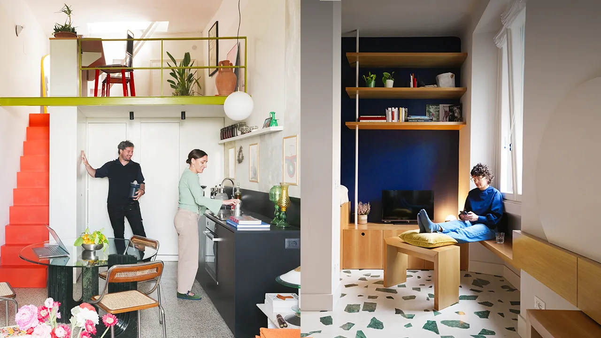
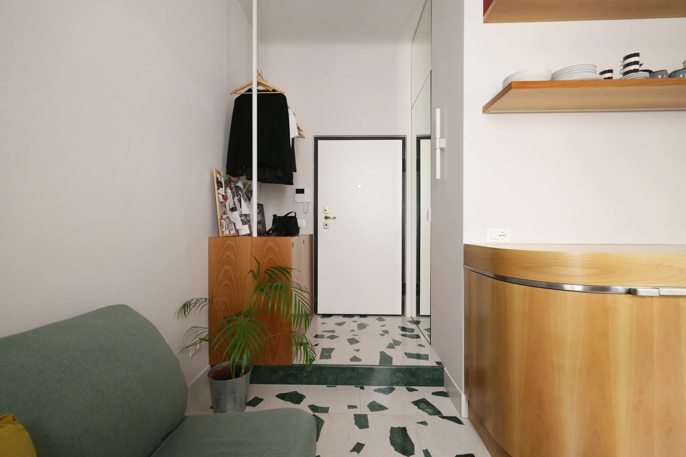
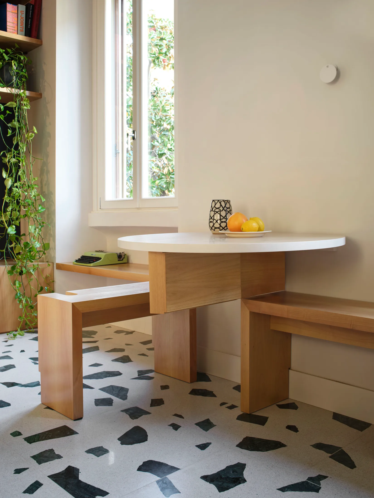
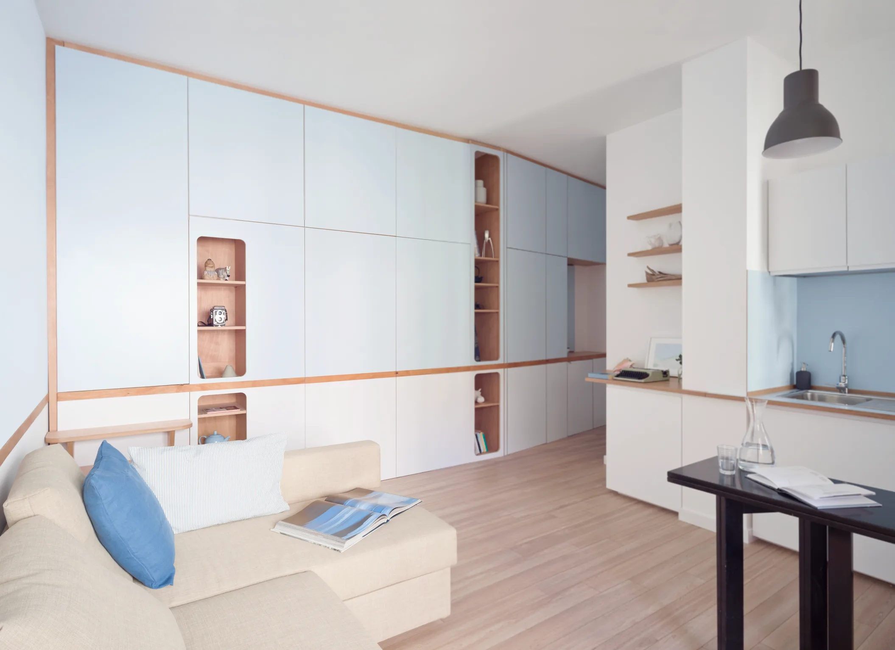
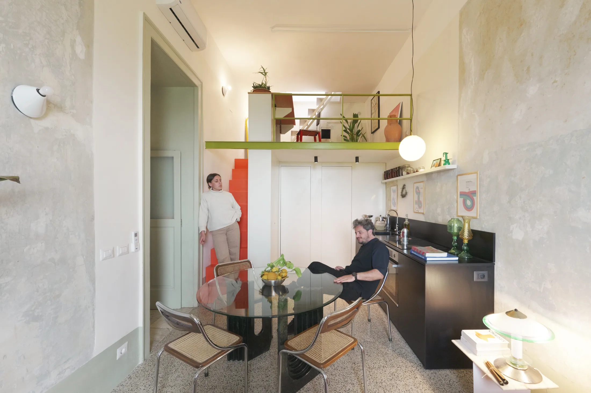
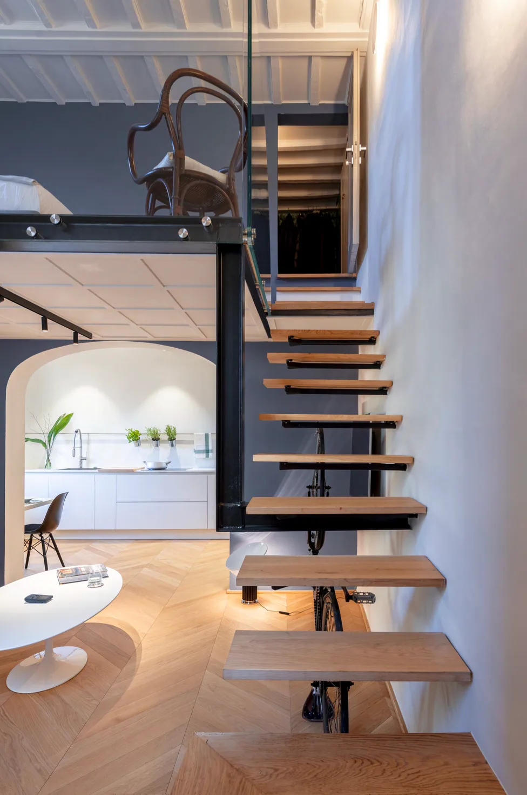
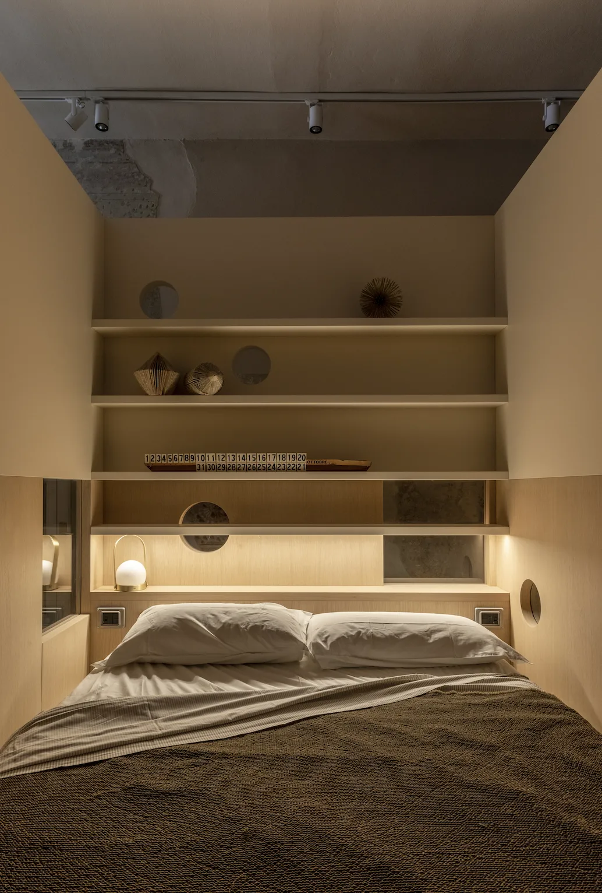

# Пять небольших квартир Италии до 60 м²: что из них взять в московскую

В Москве метры дорожают, а площадь типовой студии давно упёрлась в потолок: по данным bnMAP.pro, средняя студия в новостройках в июле 2026 года — 27 м². Поэтому вопрос «как жить в 25–35 м² без ощущения тесноты» актуален для любого, кто покупает компактное жильё. Итальянские дизайнеры решают его десятилетиями: старые дома с узкими лестницами, квартиры в историческом центре, нехватка места. Never Too Small собрал пять таких квартир площадью от 21 до 58 м². Мы выбрали из них то, что пригодится в Москве.

## Коротко

- Милан, 21 м²: спальню поставили на второй уровень, а под ней сделали гардеробную; стол складывается к стене.
- Дейва-Марина, 35 м²: одна общая стена-шкаф прячет две спальни, расположенные друг над другом.
- Неаполь, 58 м²: оранжевая лестница ведёт на антресоль, где кабинет и гостевая.
- Флоренция, 50 м²: часть большого дома стала самостоятельной квартирой, а лестницу и белые стены оставили чистыми.
- Мантуя, 36 м²: спальня-куб в центре комнаты, вокруг него кухня и столовая.

*Подборка: пять квартир Италии площадью от 21 до 58 м². Фото: Never Too Small*

## Милан, 21 м²: всё, что нужно, и ничего лишнего

Самая маленькая в подборке квартира в Милане. Архитектор Бьянка Маджи (Bianca Magi) из бюро ATOMAA убрала внутренние стены и перенесла ванную, а потом собрала жильё из нескольких «умных» элементов.

Кухня изогнутая, из ореха, с откидным фартуком: опустил — получил дополнительную рабочую поверхность. Обеденный стол складывается к стене, а лёгкие скамьи можно переставлять. Под поднятой кроватью устроена гардеробная, куда можно зайти. Из пространства квартиры «вырезана» прихожая с зеркалом в полный рост и стиральной машиной, скрытой за встроенными шкафами. Пол — мозаика ручной работы, спальная ниша выдержана в глубоком синем.

*Милан, 21 м², Бьянка Маджи (Bianca Magi), ATOMAA: новая прихожая с зеркалом и скрытой стиральной машиной. Фото: Never Too Small*

*Милан, 21 м²: стол складывается к стене, скамьи переставляются. Фото: Never Too Small*

**Для Москвы.** В новых проектах так мало метров уже не встретишь: с 1 августа 2024 года однокомнатная квартира не может быть меньше 28 м² (постановление 1672-ПП). Но в старом фонде — в хрущёвках и в квартирах, поделённых когда-то на части, — такие метры по-прежнему встречаются. Из миланского опыта в любую студию переносятся три вещи: стол, который складывается; гардероб под кроватью-подиумом; стиральная машина в нише с дверцей-фасадом, как остальные шкафы. Прихожая с зеркалом в рост — самый дешёвый способ добавить квартире глубины.

## Дейва-Марина, 35 м²: две спальни за одной дверцей

Здесь студию 1970-х годов превратили в квартиру с двумя спальнями, не увеличив её площадь. Бюро llabb Architecture использовало шкаф вдоль задней стены: он делит план и скрывает две спальни, расположенные одна над другой. Нижняя закрывается и вмещает хранение с полками, а вторая спальня расположена над ней. Кухня, ванная и столовая при этом полноценные. Длинная деревянная полоса идёт по стене как «ватерлиния» и направляет взгляд вглубь квартиры.

*Дейва-Марина, 35 м², llabb Architecture: шкаф делит план и прячет две спальни. Фото: Never Too Small*

**Как повторить.** Двухъярусные спальни в московской квартире возможны не везде: нужна высота потолка и согласование перепланировки, а при невысоком потолке, как во многих хрущёвках, второй ярус для взрослого может не поместиться. Зато идея подходит для детей и для гостевой кровати: ярус с хранением под ним, встроенный в общую стену-шкаф. И запомните правило площади: по требованиям 1672-ПП, в новом проекте квартира меньше 44 м² не может быть двухкомнатной, так что «европейская двушка» в 35 м² — это либо старый фонд, либо творческая переделка.

## Неаполь, 58 м²: оранжевая лестница как скульптура

Самая просторная квартира в подборке, и самая яркая. Джузеппе Пунцо и Жюли Небу (Giuseppe Punzo, Julie Nebout) из студии La Fotosintesi оставили старую узорную цементную плитку и фрагмент необработанной стены, а новое добавили в виде стальной столярки. Лестница из оранжевой стали одновременно служит конструкцией и скульптурой: она ведёт на антресоль над кухней, где устроены кабинет и гостевая. Спальня выложена терракотовым смоляным полом, подсвечена винтажными неаполитанскими светильниками. На солнечной террасе стоит переделанная ванна, а в гостиной — диван Edra и мраморный стол Карло Скарпа.

*Неаполь, 58 м², Джузеппе Пунцо и Жюли Небу (Giuseppe Punzo, Julie Nebout), La Fotosintesi: оранжевая лестница ведёт на антресоль. Фото: Never Too Small*

**Для Москвы.** Двухуровневые квартиры в Москве чаще всего встречаются в лофтах бывших фабрик: у проектов вроде «Флакона» или Даниловской мануфактуры высокие потолки и большие окна. Если вы выбираете такой лофт, антресоль — готовое решение под кабинет или гостевую. А вот идея «ванна на террасе» в московских условиях сложнее: объединять лоджию с комнатой и переносить на неё общедомовые радиаторы нельзя (508-ПП), да и зима делает уличную ванну проектом на три месяца в году.

## Флоренция, 50 м²: чистая коробка и лестница

Архитектор Клаудио Пьерателли (Claudio Pierattelli) выделил эту квартиру из большого семейного дома напротив палаццо Питти. Он сделал новый вход, кухню и открытую планировку, окрасил стены и мебель в белый, а на пол положил полуглянцевый паркет «французская ёлочка». Техника и вытяжка кухни скрыты, обеденный стол на двоих «парит» над полом. Отреставрированная консольная лестница ведёт в спальню-лофт со стеклянным ограждением: оно пропускает свет.

*Флоренция, 50 м², Клаудио Пьерателли (Claudio Pierattelli): восстановленная консольная лестница. Фото: Never Too Small*

**Как повторить.** Приём, который стоит запомнить, — стекло вместо глухого ограждения и белые фасады без ручек: они «растворяются», и комната выглядит больше. Для московской сталинки или дореволюционного дома в Замоскворечье или Хамовниках, где потолки высокие, это тот случай, когда второй уровень реально осуществим. В типовых домах с низким потолком лучше обойтись белыми фасадами и скрытой техникой.

## Мантуя, 36 м²: комната вокруг куба

Бюро Archiplanstudio нашло в мантуанской квартире под слоями краски старую фреску и сохранило её. Центр плана занял куб-спальня, а вокруг него по кругу расположились вход, ванная, кухня и столовая. В стену куба встроена парящая скамья, стол раздвигается. Кухня серая с латунью, индукционная панель висит на стене и при необходимости переезжает на столешницу. У окна проходит скамья на заказ: она служит хранением, низкой полкой и гостевым местом. Полки и вещи прячутся за шторами.

*Мантуя, 36 м², Archiplanstudio: спальня-куб в центре квартиры. Фото: Never Too Small*

**Для Москвы.** Планировка «куб посередине» подходит студиям с квадратной комнатой и окнами по двум сторонам: куб не загораживает свет, а вокруг него остаётся проход по кругу. Скамья у окна с хранением — пожалуй, самый переносимый приём из всей подборки: если окно широкое, под ним удобно разместить скамью с ящиками. Что касается фрески: в дореволюционных доходных домах Москвы под обоями и краской тоже находят лепнину и росписи, поэтому перед ремонтом стоит осторожно проверить стены.

## Чек-лист: как оценить квартиру до 60 м²

1. Посмотрите, что можно «убрать в стену»: стол, гладильную доску, стиральную машину.
2. Найдите вертикаль: высота потолка решает, возможны ли антресоль и второй ярус.
3. Проверьте, куда выходят окна: куб-спальня и перегородки не должны отбирать свет у гостиной.
4. Подсчитайте, сколько хранения даёт кровать-подиум, подоконник-скамья и шкаф до потолка.
5. Предусмотрите стекло, зеркала и белые фасады там, где нужна глубина.
6. Всё, что связано с перепланировкой — ванная, стены, лоджия, газовая кухня, — заранее сверьте с правилами 508-ПП.

Больше идей для небольших квартир — в разделе [«Интерьер»](/temy/interer/). Если вы ищете квартиру, где такие решения возможны, посмотрите [каталог объектов](/obekty/).

## Вопросы и ответы

**Можно ли сделать две спальни в квартире 35 м²?**
В итальянском проекте Дейва-Марина это сделано: две спальни расположены одна над другой за дверцами встроенного шкафа вдоль стены. В Москве такая квартира не считалась бы двухкомнатной в новом проекте: с 1 августа 2024 года минимум для двушки — 44 м² (1672-ПП).

**Как поместить гардероб и спальню на 21 м²?**
В миланской квартире кровать подняли на второй уровень, а под ней сделали гардеробную с проходом. Стиральную машину спрятали в прихожей за встроенными шкафами, а на кухне сделали откидной фартук, который продолжает рабочую поверхность.

**Почему при покупке небольшой квартиры нужно смотреть на планировку, а не только на метры?**
Метры одинаковы, а удобство разное. В Москве средняя студия в новостройках по данным bnMAP.pro в июле 2026 года — 27 м²; в итальянских примерах одна и та же площадь даёт кухню с рабочей зоной, гардероб и закрывающуюся спальню.

## Источники

1. Never Too Small. Five inspiring small Italian homes under 60sqm — https://www.nevertoosmall.com/post/five-inspiring-small-italian-homes-under-60sqm-645sqft
2. ppt.ru: постановление Правительства Москвы от 23.07.2024 № 1672-ПП — https://ppt.ru/obzory/vstupaet-v-silu/postanovlenie-pravitelstva-moskvy-23-07-2024-1672-pp
3. РБК Недвижимость: цены и площадь студий в новостройках Москвы, июль 2026 — https://realty.rbc.ru/news/6a688a1e9a7947e0d847331e
4. Мосжилинспекция: какие перепланировки запрещены (постановление 508-ПП) — https://www.mos.ru/news/item/76897073/
