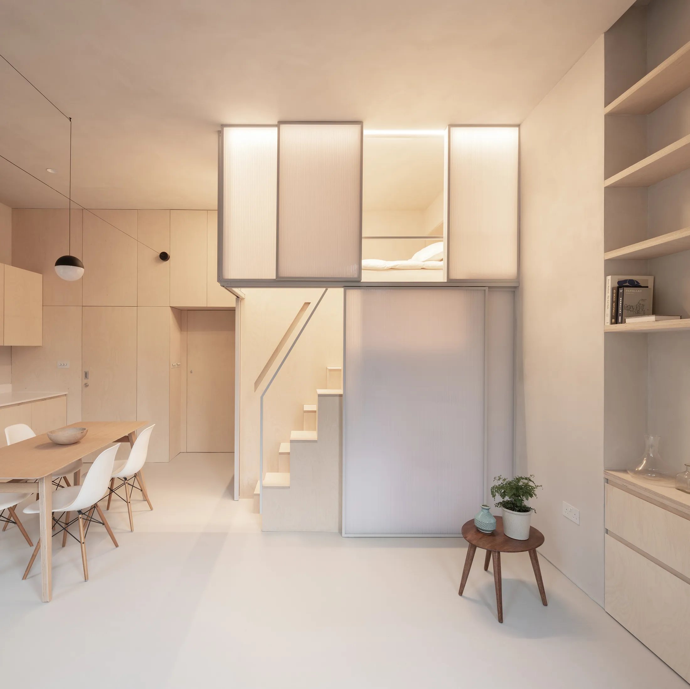
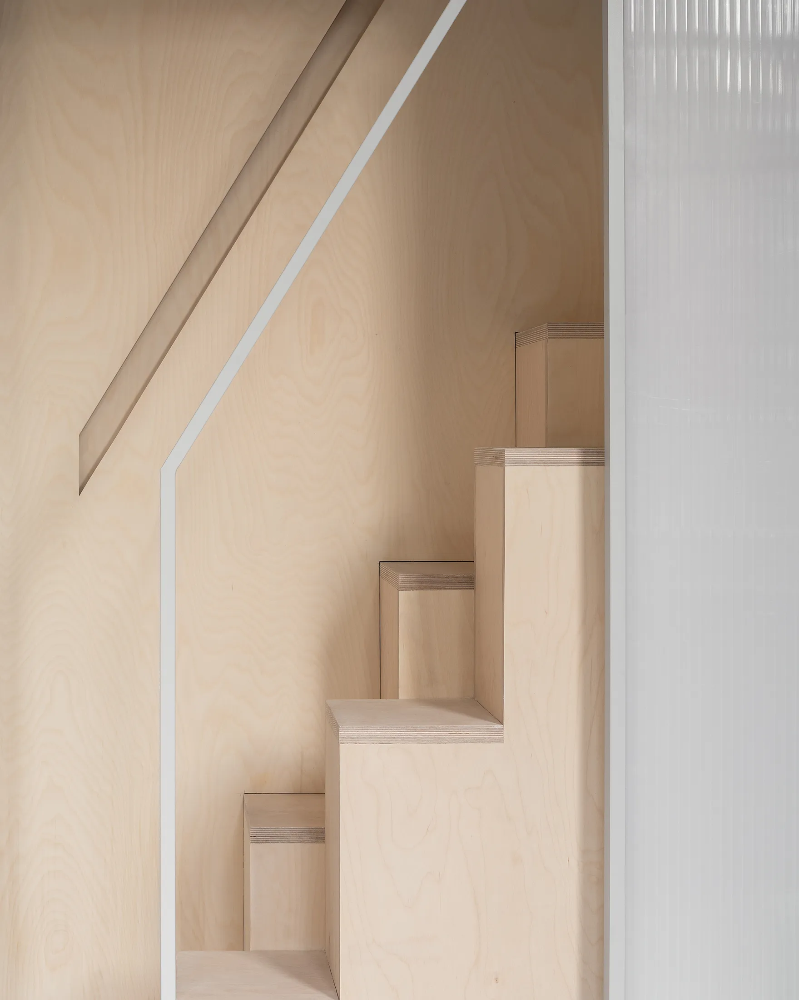
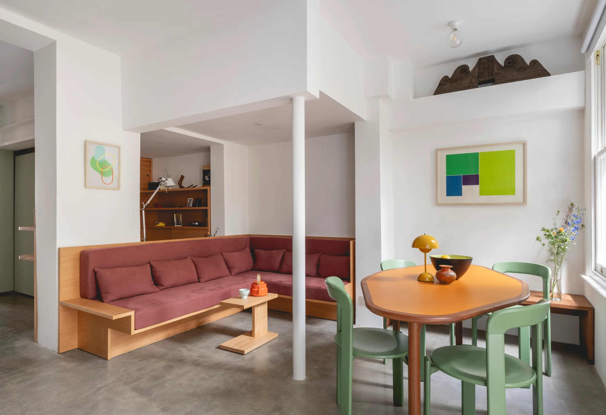
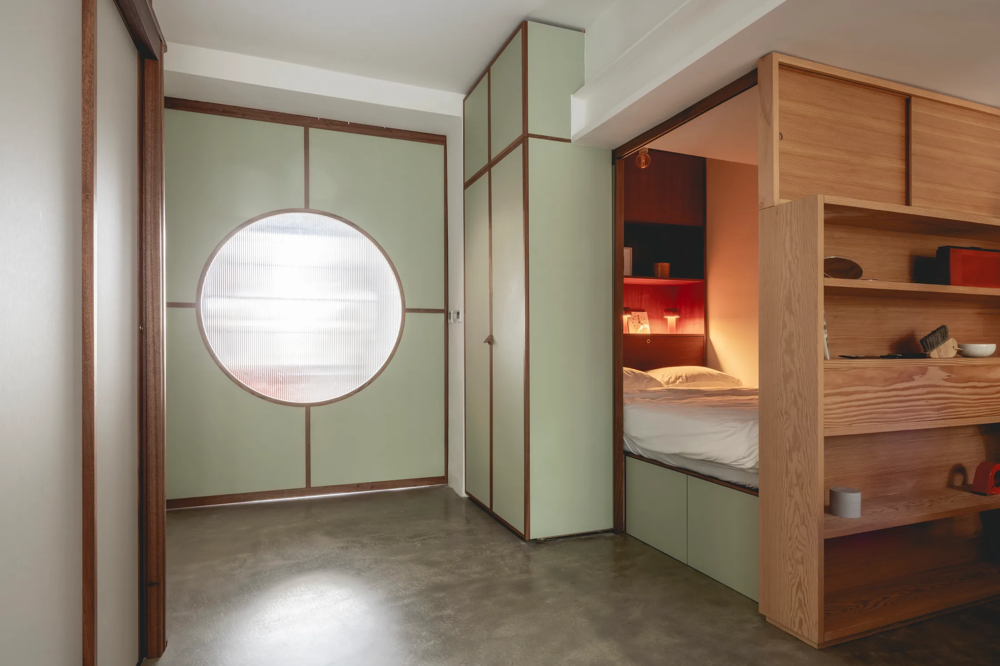
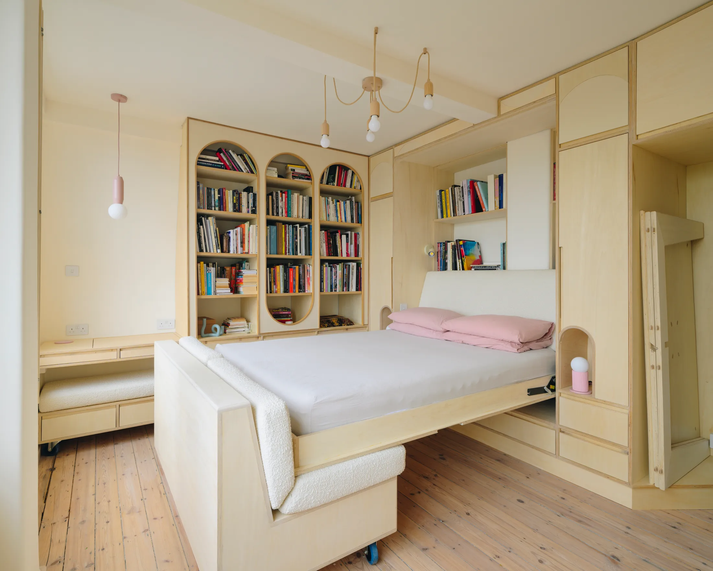
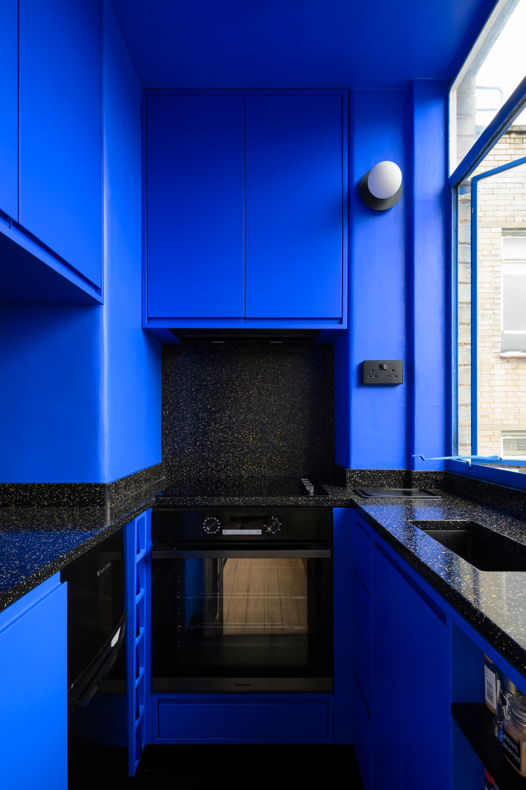
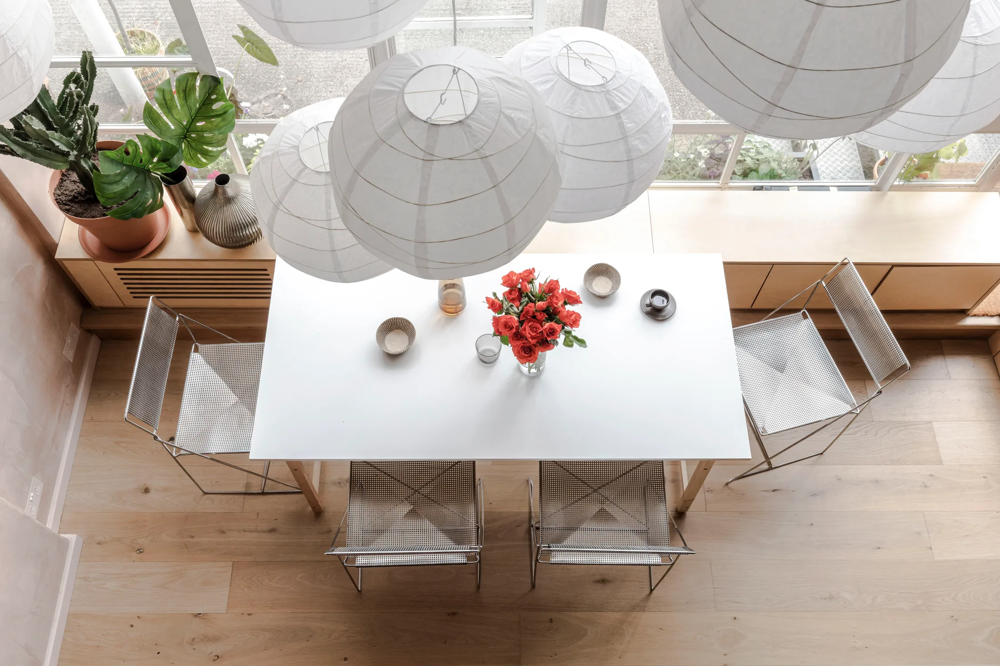
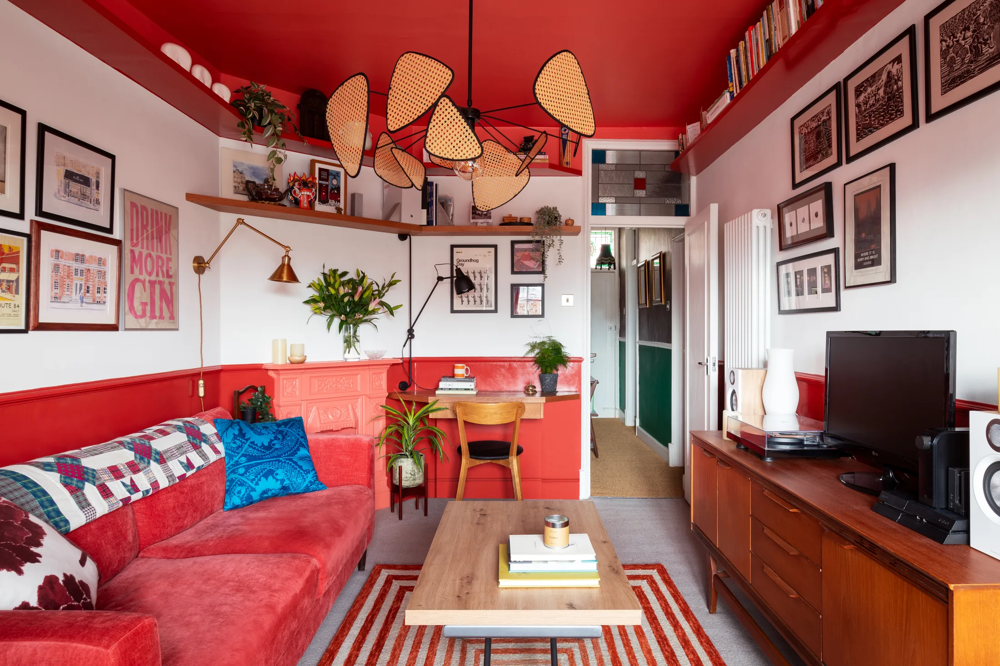

# Пять маленьких квартир Лондона до 60 м²: что взять в московскую студию и евродвушку

Лондон, как и Москва, — город старых домов и маленьких квартир. Те, что собрал Never Too Small, занимают от 24 до 54 м² и находятся в викторианских домах, в здании ар-деко, в бывшем офисе и фабричном корпусе. Московскому читателю эти сюжеты знакомы: дореволюционный доходный дом в Басманном или Хамовниках, сталинка с высоким потолком, лофт во «Флаконе» или на «Арме» и, конечно, типовая студия в новостройке.

Это не сравнение «где лучше», а подборка приёмов. Из каждой квартиры берём то, что работает в России, и честно отмечаем, где нужно оглядываться на московские правила.

## Коротко

- Спальню можно вынести на второй уровень или в «светящуюся капсулу», если высота потолка позволяет.
- Стену, которая блокирует свет, лучше заменить на раздвижные двери: комнаты появляются по требованию.
- Сплошная фанерная столярка скрывает кровать, кухню и хранение — квартира 24 м² выглядит спокойно.
- Антресоль под высоким потолком освобождает площадь на этаже, а ещё становится главным акцентом.
- Цвет заменяет перепланировку: у квартиры 40 м² одна комната сыграна как кабинет, гостиная, столовая и гостевая спальня.

*Shoji Apartment, Лондон, 29 м². Бюро Proctor & Shaw. Фото: Ståle Eriksen / Never Too Small*

## Проект 1. Shoji Apartment, 29 м²: спальня-фонарь

Квартира расположена в викторианском доме XIX века в районе Белсайз-парк. Архитекторы бюро Proctor & Shaw оставили внизу нормальную кухню, столовую и гостиную, а кровать подняли в «капсулу» с лёгкими стенами из полупрозрачного поликарбоната — по образцу японских ширм сёдзи. Днём большие эркерные окна заливают светом нижний уровень. Ночью капсула светится, как фонарь, и освещает остальную квартиру. Материалы — берёзовая фанера, глиняная штукатурка и линолеум на полу.

На капсулу ведёт лестница с чередующимися ступенями: она круче обычной, но ступени остаются достаточно глубокими, чтобы подниматься уверенно.

*Лестница с чередующимися ступенями ведёт к капсуле, не отнимая лишней площади. Фото: Ståle Eriksen / Never Too Small*

**Для Москвы.** Спальной капсуле нужна высота, поэтому вспоминать о ней стоит в сталинках, дореволюционных домах и лофтах. В хрущёвке с низким потолком её не поставить. Зато заимствовать можно материал: матовое стекло или рифлёный поликарбонат вместо глухой перегородки сохраняют свет в зоне входа. В Москве важна и отдельная мелочь: любая лёгкая конструкция не должна перекрывать вентиляционные решётки, ведь [постановление 508-ПП](https://www.mos.ru/news/item/76897073/) запрещает ликвидировать и уменьшать вентиляционные каналы.

## Проект 2. Mia's Apartment, 54 м²: комнаты, которые появляются по требованию

Квартира на первом этаже викторианского дома с садом принадлежит дизайнерам Нине Толструп и Джеку Маме (студия Studiomama). Они убрали стену, которая блокировала свет, и теперь взгляд идёт от входа до сада. Спальные ниши, ванная, кухня и кабинет расположены вдоль боковых стен, а раздвижные двери и перегородки превращают одну большую комнату в несколько приватных — по необходимости.

В гостиной стоит заказной Г-образный диван и ромбовидный обеденный стол. Кабинет обшит дугласовой пихтой и «нависает» над гостиной с видом на сад. Вокруг старого камина построен стеллаж от пола до потолка, а в него вмонтировано круглое зеркало, отражающее свет. Кухня — с открытыми полками и закруглёнными деревянными шкафами.

*Mia's Apartment, Лондон, 54 м². Студия Studiomama. Фото: Billy Bolton / Never Too Small*

*Раздвижные двери по требованию делят спальные ниши на комнаты. Фото: Billy Bolton / Never Too Small*

**Как повторить.** В евродвушке на 45–54 м² раздвижные двери вместо распашных освобождают место, которое занимает открытая створка, и позволяют «держать» комнату то открытой, то закрытой. Если хозяева разрешат, возьмите стеклянную или рифлёную дверь-купе. Заметьте: убрать несущую стену в Москве нельзя, а вот заменить глухую ненесущую перегородку на раздвижную — обычная практика, но её тоже согласуют.

## Проект 3. Poirot's Bijou Apartment, 24 м²: всё спрятано в фанере

Самая маленькая квартира подборки — 24 м² в здании ар-деко. Архитектор Анна Паркер (Anna Parker, Intervention Architecture) работала в рамках охраняемого здания и задала всему пространству один язык: сплошную светлую фанерную столярку, за которой спрятаны хранение, кровать Мёрфи и кухня. Диван передвижной, обеденный стол — разборный, плоский.

Кухня окрашена в синий цвет Yves Klein Blue, столешница — из чёрного Corian с золотыми вкраплениями, а фасады складываются гармошкой, превращая кухню в шкаф. Ванная выложена бледно-розовой плиткой на полу, стенах и фасаде ванны: вдохновение — корабельные каюты 1930-х. Складные фанерные ставни регулируют свет и приватность.

*Poirot's Bijou Apartment, Лондон, 24 м². Архитектор Анна Паркер, Intervention Architecture. Фото: Tom Bird / Never Too Small*

*Кухня синего цвета Yves Klein Blue прячется за складными дверями. Фото: Tom Bird / Never Too Small*

**Для Москвы.** 24 м² — это меньше минимума для новых московских проектов: с 1 августа 2024 года однокомнатная квартира не может быть меньше 28 м² ([постановление № 1672-ПП](https://ppt.ru/obzory/vstupaet-v-silu/postanovlenie-pravitelstva-moskvy-23-07-2024-1672-pp)). Средняя студия в новостройках в июле 2026 года — 27 м² (bnMAP.pro), а доля студий в предложении за год упала на 6 п. п. до 11% ([РБК Недвижимость](https://realty.rbc.ru/news/6a6094b09a7947481c9c3ec4)). Так что приёмы из этого проекта пригодятся владельцам совсем небольших квартир в старом фонде — например, в домах Замоскворечья или Якиманки. Главный совет — один материал на всё: фанера, МДФ в шпоне или крашеный МДФ в тон стен, чтобы столярка читалась как архитектура, а не как набор шкафов.

## Проект 4. Alaska Building, 42 м²: антресоль и бумажные фонари

Квартира на первом этаже в юго-восточном Лондоне — в здании, которое в 1930-е было офисом, а в 1990-е стало жилым домом. Архитектор Луиза Глинн (Louise Glynn, Studio 29 Architects) использовала двойную высоту: спальни вынесены на антресоль. Мебель — из берёзовой фанеры, стены оштукатурены розовой штукатуркой, металл патинирован. Над обеденным столом на четырёхметровом потолке висят десять больших бумажных фонарей. Ванная находится через лестничную площадку и полностью переделана: с ванной, большой раковиной, зеркалами и хранением. Почти каждая ниша превращена в шкаф.

*Alaska Building, Лондон, 42 м². Louise Glynn, Studio 29 Architects. Фото: Tarry + Perry / Never Too Small*

**Как повторить.** Бывшие промышленные здания Москвы — «Флакон», «Арма», Даниловская мануфактура и другие — тоже дают потолки, на которых работают антресоли. Если у вас в лофте потолок около четырёх метров, второй уровень со спальней — классический способ получить «двушку» в студийной площади. Но антресоль — это отдельный проект с расчётом нагрузок на перекрытие, пожарной безопасностью и обязательным согласованием. А вот гирлянда из больших абажуров над столом, которая «опускает» высокий потолок, делается без согласований и стоит недорого.

## Проект 5. King's Cross Apartment, 40 м²: цвет вместо перепланировки

В историческом доме 1912 года студия Sara Leonor Studio не меняла планировку: она сосредоточилась на хранении и цвете. Кухня — в глубоком зелёном с медной столешницей, ванная без окна — жёлтая, спальня — синяя, с рисунком из листвы на потолке и шкафах, будто за окном лес. Гостиная выкрашена в терракотово-красный и работает как лаунж, кабинет, столовая и гостевая спальня. Раскладной журнальный столик рассчитан на шесть человек. Зелёная глазурованная плитка и медь отсылают к деталям викторианской эпохи.

*King's Cross Apartment, Лондон, 40 м². Sara Leonor Studio. Фото: Anna Batchelor / Never Too Small*

**Для Москвы.** Это самый «арендопригодный» проект: цвет не требует согласований. Окрасьте ванную без окна, а не белите её: в московской квартире с коротким зимним днём яркий цвет работает как источник тепла. Многофункциональная гостиная пригодится тем, кто работает из дома: днём в ней кабинет, вечером гостиная.

## Чек-лист: какой приём выбрать

1. Высокий потолок (сталинка, дореволюционный дом, лофт) — подумайте о спальной капсуле или антресоли (после расчёта и согласования).
2. Потолок стандартный, но много ненесущих перегородок — раздвижные двери вместо распашных.
3. Площадь до 30 м² — один материал на столярку, кровать-трансформер, складные фасады.
4. Ничего менять нельзя — цвет: ванная, один акцент в комнате, потолок.
5. Всегда проверяйте: вентиляция, радиаторы и мокрые зоны не трогаем ([508-ПП](https://www.mos.ru/news/item/76897073/)).

Больше историй о маленьких квартирах — в разделе [«Интерьер»](/temy/interer/). Если вы выбираете квартиру под такой ремонт, начните с каталога [новостроек Москвы](/novostroyki/moskva/).

## Вопросы и ответы

**Можно ли сегодня купить в новостройке Москвы студию 24 м², как в Лондоне?**
В новых проектах нет: с 1 августа 2024 года минимальная однокомнатная квартира — 28 м² (постановление № 1672-ПП). Студии меньше этой площади остаются в проектах, согласованных раньше, и на вторичном рынке. Средняя студия в новостройках в июле 2026 года — 27 м² (bnMAP.pro).

**Что сложнее всего перенести из лондонских квартир в московскую?**
Всё, что связано со вскрытием перекрытий, изменением вентиляции и инженерных сетей. Антресоль на 4-метровом потолке возможна только в доме с подходящей высотой, а любые работы с общедомовыми системами в Москве требуют согласования и регулируются постановлением 508-ПП.

**Что можно сделать в съёмной или маленькой квартире без перепланировки?**
Покрасить стены и потолок в насыщенный цвет, поставить раздвижную дверь или штору вместо распашной, заменить мебель на трансформируемую (кровать-шкаф, раздвижной стол) и собрать хранение в одну линию фанерных или МДФ-модулей.

## Источники

1. Never Too Small. Five of London's best small homes under 60sqm/645sqft — https://www.nevertoosmall.com/post/five-of-londons-best-small-homes-under-60sqm-645sqft
2. ppt.ru: постановление Правительства Москвы от 23.07.2024 № 1672-ПП — https://ppt.ru/obzory/vstupaet-v-silu/postanovlenie-pravitelstva-moskvy-23-07-2024-1672-pp
3. РБК Недвижимость: цены и площадь студий в новостройках Москвы, июль 2026 — https://realty.rbc.ru/news/6a688a1e9a7947e0d847331e
4. РБК Недвижимость: доля студий в предложении Москвы, I полугодие 2026 — https://realty.rbc.ru/news/6a6094b09a7947481c9c3ec4
5. Мосжилинспекция: какие перепланировки запрещены (постановление 508-ПП) — https://www.mos.ru/news/item/76897073/
