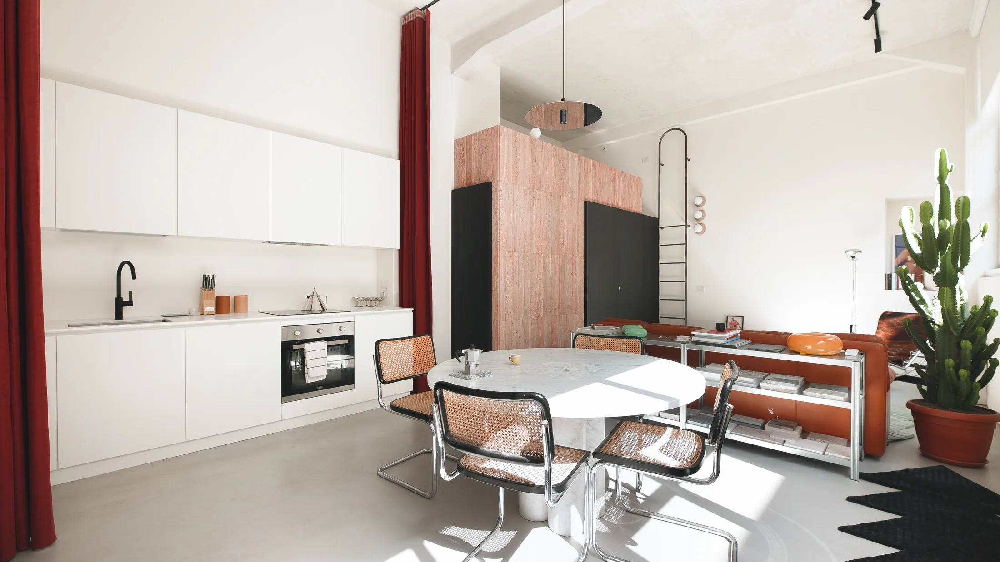
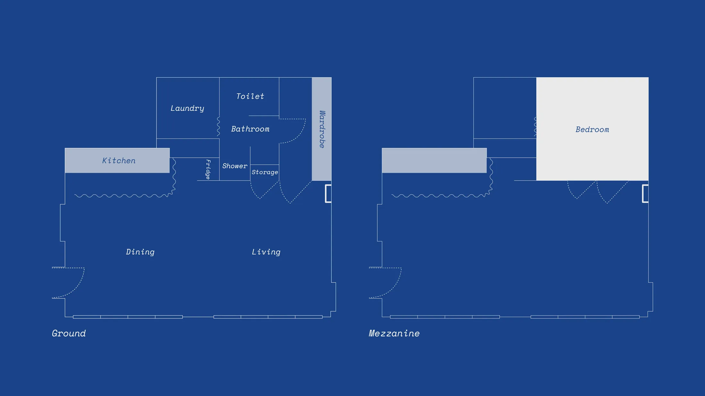
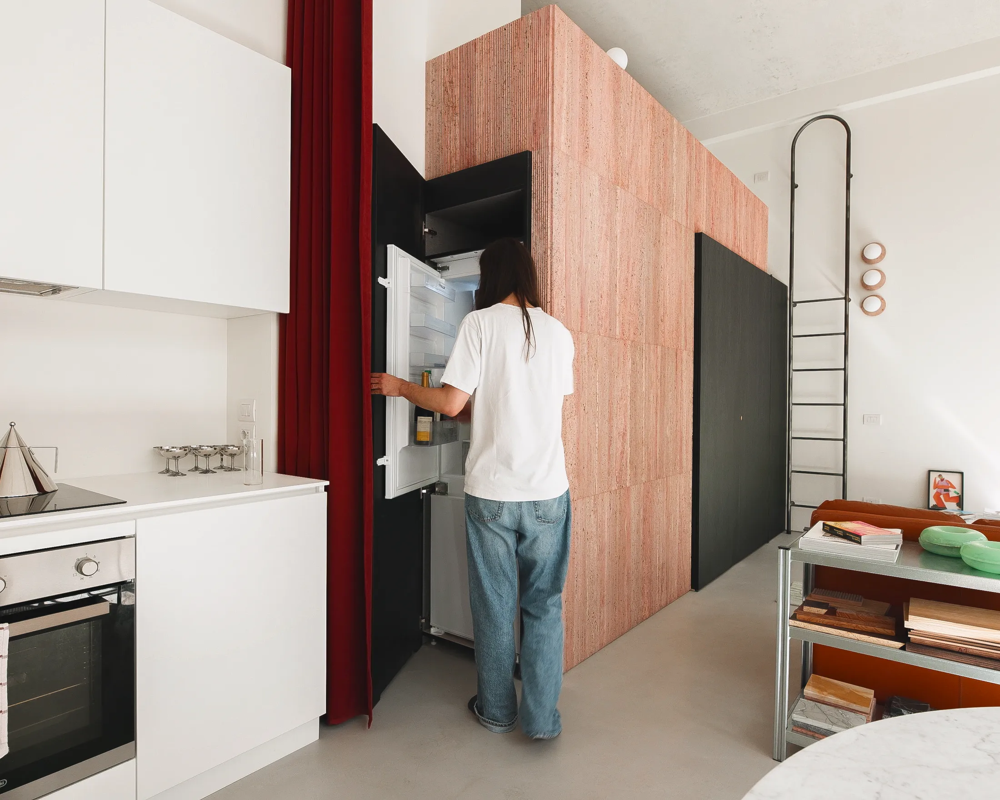
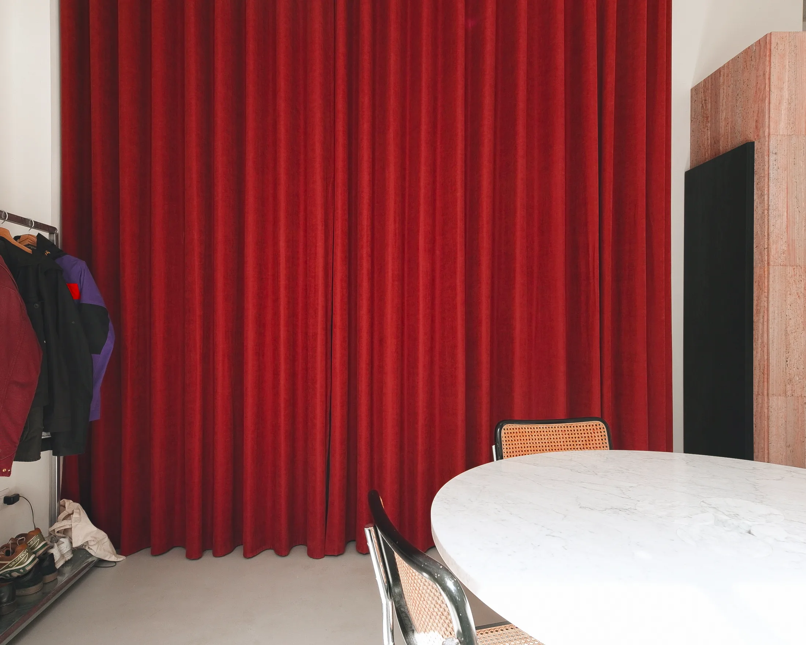
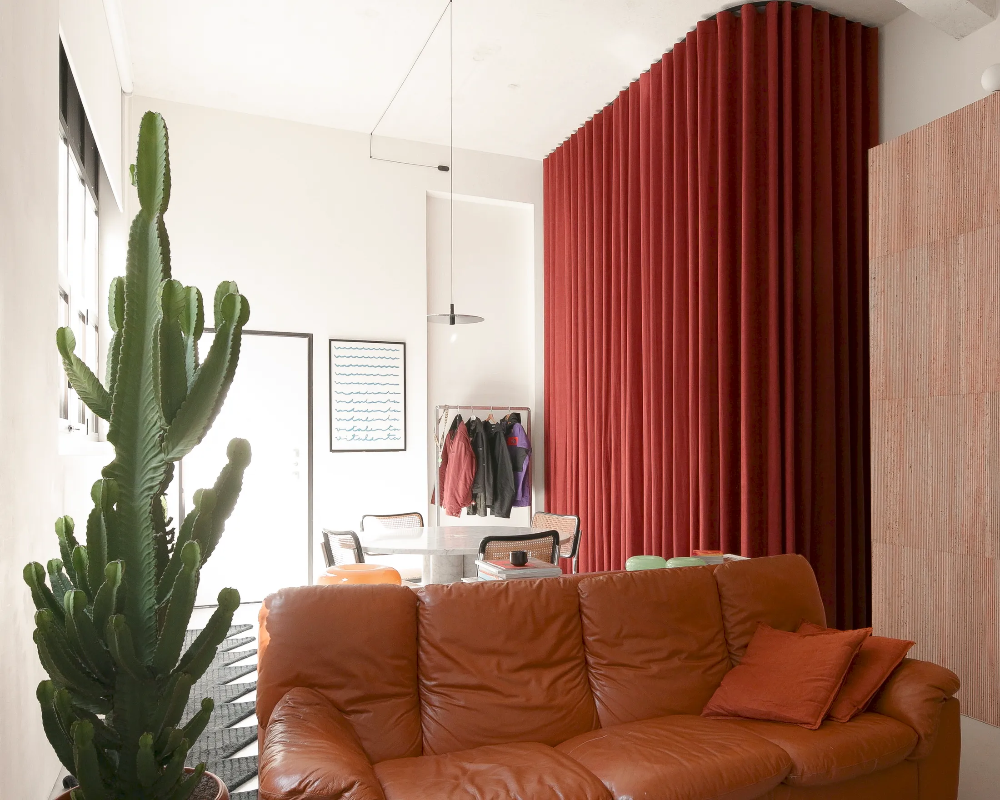
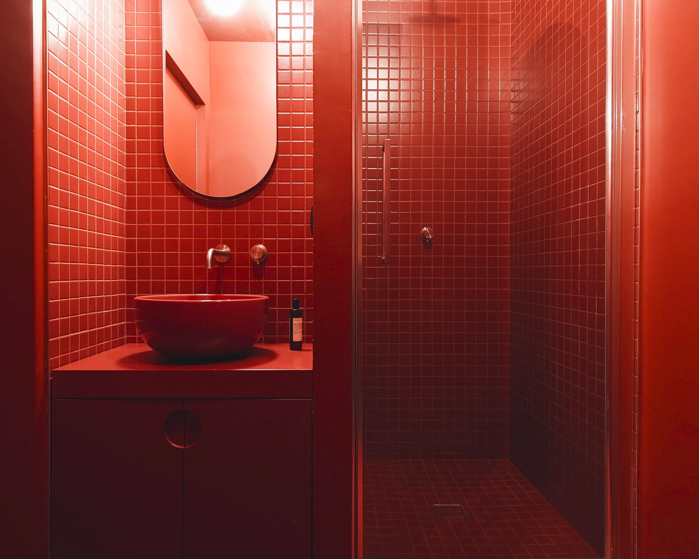
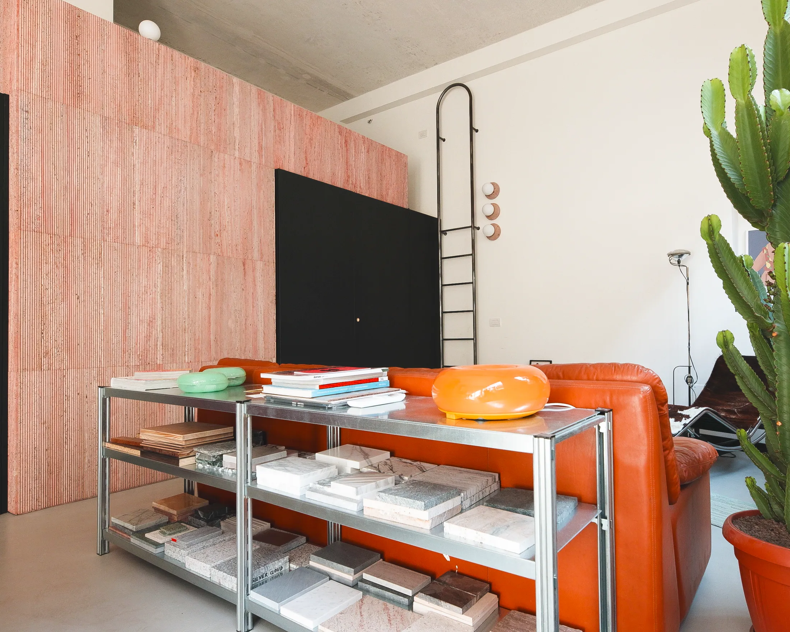

# Лофт 45 м² в бывшем офисе: пять смелых идей из Милана для московской квартиры

Московские лофты в бывших фабриках — «Флакон», «Арма», Даниловская мануфактура — привлекают высотой потолков и огромными окнами, но с трудом вписываются в привычную «комнатную» логику. Миланский Abode67 решает ту же задачу. Бывший офис в районе Ламбрате (45 м² и ещё 10 м² антресоли) архитекторы Пьерматтиа Крибиори (Piermattia Cribiori) и бюро Atelierzero превратили в жильё, которое одновременно служит рабочим местом и небольшим шоу-румом для владельца мраморного бизнеса.

Приёмы там смелые: красный травертин, бархатная штора, ванная в цвете красной комнаты из «Твин Пикс». Разберёмся, что из этого пригодится в Москве, а что упирается в наши нормы.

## Коротко

- В центре квартиры стоит куб из плиссированного красного травертина: он держит антресоль и собирает хранение, холодильник, вход в гардероб и ванную.
- Кухню закрывает бархатная штора в пол — гостиная выглядит как лаунж, а не как кухня-столовая.
- Обеденную зону обозначает не мебель, а светильник: кабель идёт зигзагом по потолку.
- Ванная без окна выкрашена целиком в красный — и превращена из недостатка в атмосферу.
- Гостиную отделяет низкий стеллаж, поставленный почти спинкой к дивану, и высокое растение.

*Abode67, Милан, 45 м² и антресоль 10 м². Piermattia Cribiori и Atelierzero. Фото: Piercarlo Quecchia / Never Too Small*

## С чего начинали: два кабинета, санузел и фальшпотолок

Раньше здесь были два рабочих кабинета, ванная и маленькая кладовая. Подвесной потолок скрывал реальную высоту, а огромные окна в индустриальном стиле почти не давали света из-за перегородок. Архитекторы убрали все внутренние стены и открыли потолок. Это знакомая ситуация для московских «квартир в офисе» и апартаментов в бывших промышленных зданиях: окна есть, света мало, а границы между зонами нужно придумывать.

*План после перестройки: куб в центре, антресоль над ним, окна у зон кухни и гостиной. Чертёж: Never Too Small*

## Идея 1. Красный куб как несущий «шкаф»

Главная вещь — объём в центре, облицованный плиссированными плитами красного травертина. Он поддерживает антресоль со спальней и объединяет всё, что обычно размазано по квартире: шкафы, холодильник, вход в гардеробную, доступ в ванную. Поверхность разработали вместе с заказчиком — мастером по мрамору. Складки камня перекликаются со складками кухонной шторы.

*Куб из плиссированного травертина несёт антресоль и прячет хранение, холодильник и вход в ванную. Фото: Piercarlo Quecchia / Never Too Small*

**Для Москвы.** В лофте с высоким потолком такой «сервисный блок» — лучший способ собрать всё закрытое в одном месте и освободить стены и окна. Камень не обязателен: подойдёт окрашенный МДФ, штукатурка или керамогранит. Но если речь о конструкции под антресоль, потребуется проект и согласование — а в многоквартирном доме любое вмешательство в перекрытия и инженерные системы регулируется правилами, и [запрещённые перепланировки](https://www.mos.ru/news/item/76897073/) по постановлению 508-ПП надо смотреть заранее.

## Идея 2. Кухня за шторой

Линейная кухня закрывается глубокой красной шторой в пол. Закрыта — и гостиная читается как лаунж, открыта — кухня на виду. Штора пригодилась и для работы: квартира служит офисом и неформальным шоу-румом, и во время встреч с клиентами и поставщиками рабочая кухня не отвлекает. Цвет шторы перекликается с тоном травертина.

*Бархатная штора в пол закрывает кухню — остаётся гостиная. Фото: Piercarlo Quecchia / Never Too Small*

**Как повторить.** Приём «штора вместо двери» отлично подходит для студии 25–30 м², где кухонный блок стоит в нише. Но в России учтите газ: если плита газовая, проём между кухней и комнатой без плотной двери делать нельзя, это прямо перечислено в [перечне запрещённых перепланировок](https://www.mos.ru/news/item/76897073/). С электрической плитой штору можно использовать, но выбирайте негорючую плотную ткань и не вешайте её над варочной панелью. Альтернатива — раздвижные фасады-«жалюзи» или складывающиеся двери, которые закрывают кухню целиком.

## Идея 3. Светильник, который чертит зону

Над обеденным столом нет привычной лампы на коротком шнуре. Кабель стартует от стены, пробегает зигзагом по потолку и заканчивается над серединой стола полированным стальным диском. Это светильник бренда DeRerum, который принадлежит самим архитекторам. Линия на потолке работает как зонирование: даже без стен понятно, где столовая.

*Кабель зигзагом по потолку обозначает обеденную зону. Фото: Piercarlo Quecchia / Never Too Small*

**Как повторить.** Для московской студии с натяжным или бетонным потолком схема понятна: подвес на тросе с несколькими точками крепления, и свет «приходит» из одной точки. Это дешевле, чем делать подиум или перегородку, а в зимний день, когда светает поздно, тёплый светильник над столом заметно меняет настроение комнаты.

## Идея 4. Ванная как красная комната

Ванная находится внутри травертинового куба и окна не имеет. Дизайнеры не стали бороться с этим недостатком: стены, пол, сантехника и шкафчики здесь окрашены в глубокий красный, как в Red Room из сериала Дэвида Линча «Твин Пикс». Получилась не «чулан без окна», а полностью продуманная сцена.

*Ванная в цвете Red Room: стены, пол, сантехника и мебель одного тона. Фото: Piercarlo Quecchia / Never Too Small*

**Для Москвы.** Ванная без окна — обычное дело для московских студий, поэтому идея «один цвет на всё» применима повсеместно. Тёмный цвет требует хорошего света: два-три источника на разной высоте. А вот вентиляцию — не трогать: ликвидировать и уменьшать вентиляционные каналы нельзя. Если красный кажется слишком смелым, возьмите глубокий зелёный или терракотовый — принцип тот же.

## Идея 5. Зонирование стеллажом и растением

Гостиную от входа отделяет низкий металлический стеллаж, который стоит почти вплотную к спинке дивана. Рядом — высокое растение и несколько предметов. Взгляд проходит поверх, и пространство остаётся единым, но граница чувствуется.

*Низкий стеллаж, диван и высокое растение отделяют гостиную без стены. Фото: Piercarlo Quecchia / Never Too Small*

**Как повторить.** Это самый доступный приём из пяти. Ставьте диван спинкой к проходу и добавляйте низкий стеллаж или комод; для студии 28 м² (минимальная однушка в новых московских проектах по [постановлению № 1672-ПП](https://ppt.ru/obzory/vstupaet-v-silu/postanovlenie-pravitelstva-moskvy-23-07-2024-1672-pp)) этого достаточно, чтобы отделить «гостиную» от прихожей.

## Квартира, где работают

Abode67 — не просто жильё, а ещё офис владельца. Спрос на такой формат в России есть: по данным hh.ru за июнь 2025 года, 23% опрошенных хотят работать полностью удалённо, 26% — в гибридном формате, а ещё 35% остались бы в офисе, но перешли бы на удалёнку ([«Коммерсантъ»](https://www.kommersant.ru/doc/8336320)). Для владельца студии это значит, что рабочий угол стоит планировать сразу: стол у окна, светильник, стеллаж или штора, которая «закрывает» рабочее место в конце дня.

## Чек-лист: что взять из лофта в Милане

1. Соберите закрытое хранение, санузел и технику в один объём, а окна оставьте для жизни.
2. Хотите скрыть кухню — используйте не штору (если плита газовая), а складные или раздвижные фасады.
3. Зонируйте светом: трос, подвес, линия над столом.
4. Ванную без окна красьте смело, но свет и вентиляцию не трогайте.
5. Отделяйте зоны низкой мебелью и растениями, а не стенами.
6. Любую антресоль и новую «стену» сначала согласуйте.

Больше идей — в разделе [«Интерьер»](/temy/interer/). А если вы присматриваете квартиру с высоким потолком, посмотрите [каталог объектов](/obekty/).

## Вопросы и ответы

**Можно ли в Москве закрывать кухню шторой, как в миланском лофте?**
Если кухня газифицирована, проём между ней и комнатой без плотной двери делать нельзя — это входит в перечень запрещённых перепланировок по постановлению 508-ПП. В квартирах с электроплитой штора возможна, но её лучше выбирать из негорючей ткани и держать вдали от варочной панели.

**Можно ли превратить квартиру в рабочее место и небольшой шоурум?**
Для регулярного приёма клиентов проверьте правила своего дома и статус помещения (квартира или апартаменты). Для личного кабинета достаточно выделить зону светом, мебелью и цветом. Спрос на такой формат есть: по данным hh.ru, 23% опрошенных хотят работать полностью удалённо, 26% — в гибридном формате.

**Как сделать ванную без окна похожей на красную комнату из «Твин Пикс»?**
Выберите один насыщенный цвет для стен, пола и сантехники и добавьте тёплый свет с двух сторон. Вентиляционные каналы закрывать и уменьшать нельзя (508-ПП), поэтому эффект создают краской, плиткой и светильниками, а не изменением конструкции.

## Источники

1. Never Too Small. 5 bold design ideas inside a small Milan loft-style apartment — https://www.nevertoosmall.com/post/5-bold-design-ideas-inside-a-small-milan-loft-style-apartment
2. Мосжилинспекция: какие перепланировки запрещены (постановление 508-ПП) — https://www.mos.ru/news/item/76897073/
3. «Коммерсантъ»: данные hh.ru о предпочтениях в формате работы, июнь 2025 — https://www.kommersant.ru/doc/8336320
4. ppt.ru: постановление Правительства Москвы от 23.07.2024 № 1672-ПП — https://ppt.ru/obzory/vstupaet-v-silu/postanovlenie-pravitelstva-moskvy-23-07-2024-1672-pp
