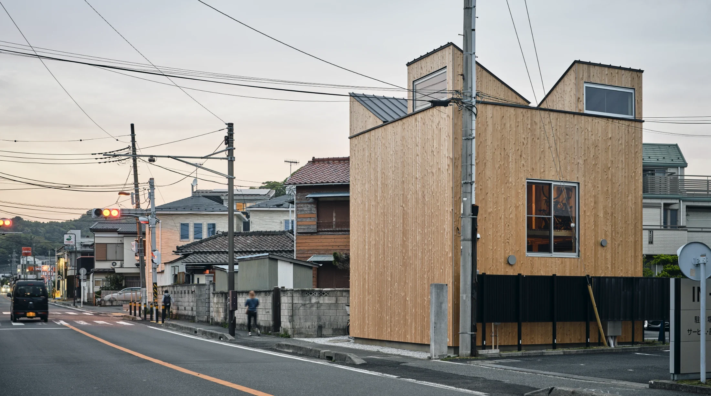
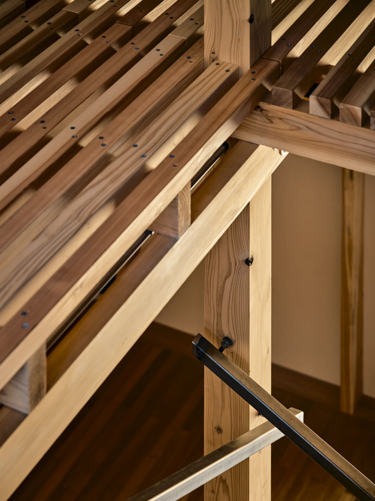
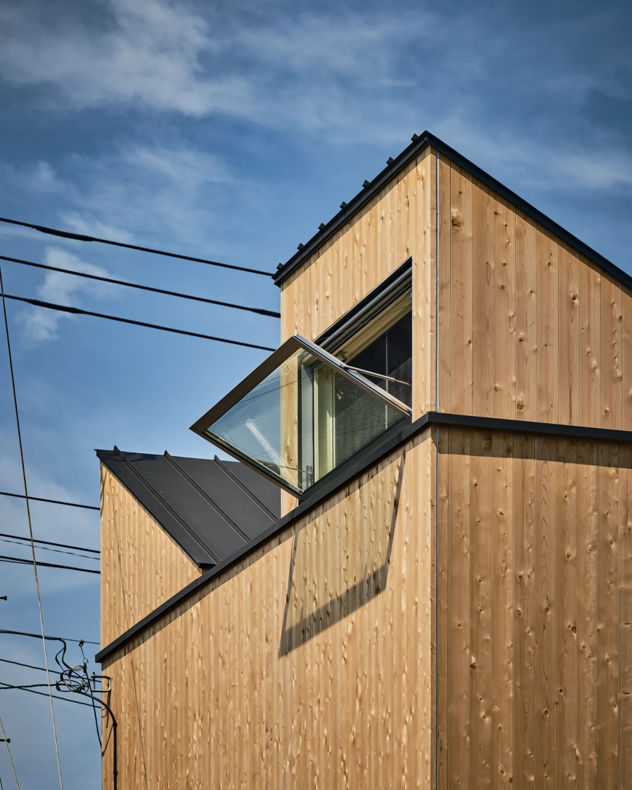
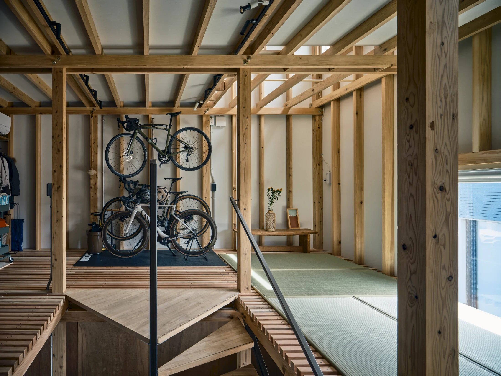
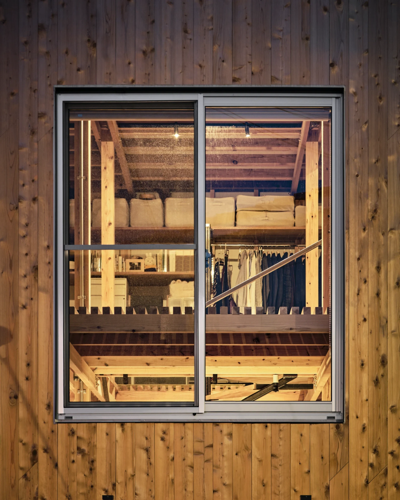
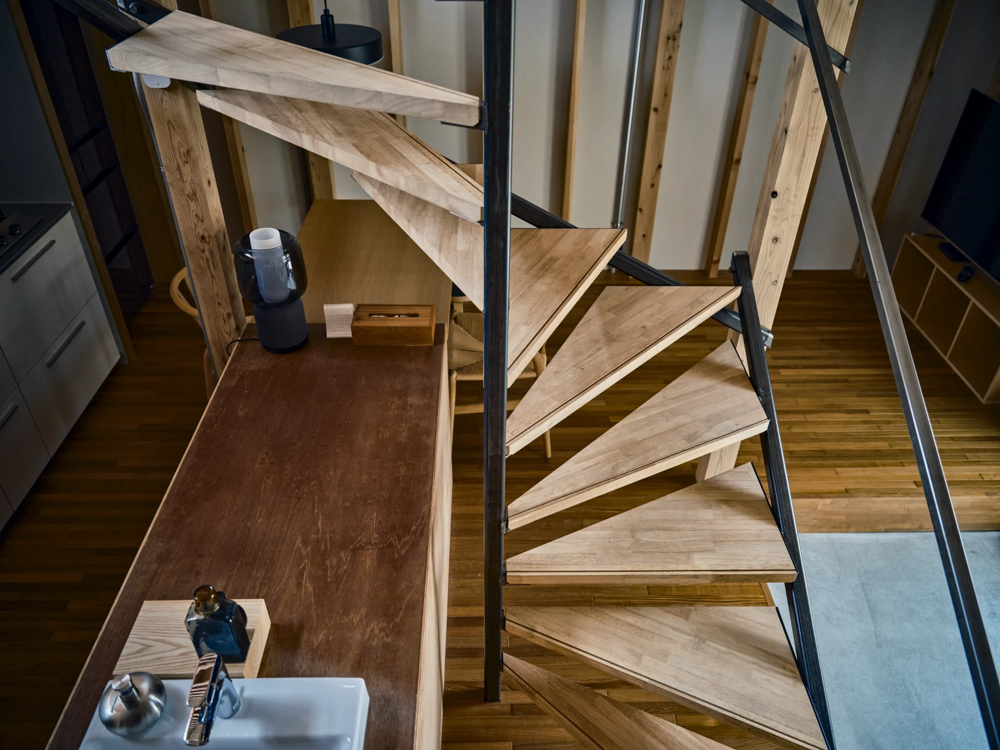
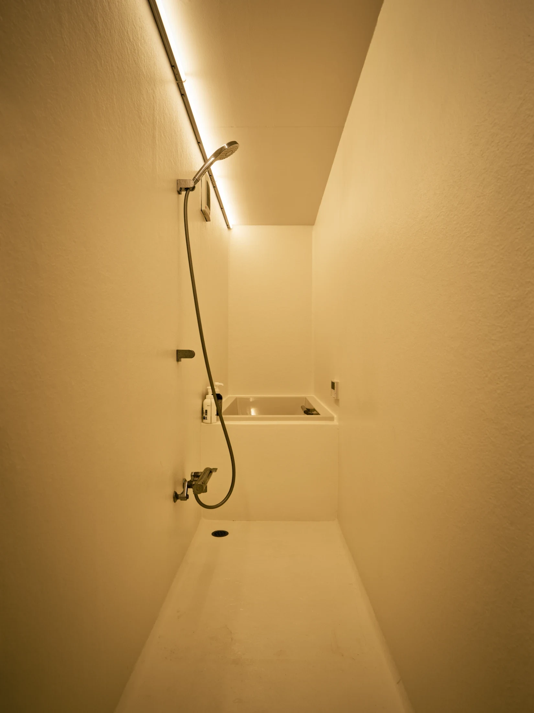

# Дом на 60 м², который можно разобрать и увезти: что взять из Японии в Москву

В первом квартале 2026 года средняя квартира в московских новостройках, по данным bnMAP, выросла с 56,3 до 62 м². Примерно столько же, около 60 м², занимает двухэтажный семейный дом Circularity Cabin в префектуре Канагава (Япония). Его спроектировали бюро tyfa и AREANO, а архитектор Такааки Фудзи (Takaaki Fuji) называет такое жильё «полусобственностью»: дом не привязан намертво к участку и может переехать.

Причина прозаична. Участок, на котором его строили, мог быть урезан из-за планируемого расширения дороги, а брус дорожал. Из этих двух проблем архитекторы сделали проект, где всё заранее продумано до конца жизни здания. Рассказываем, чему из него можно научиться, даже если вы живёте в московской многоэтажке.

## Коротко

- Дом собран из обычного бруса из строительного магазина на болтах и саморезах, без заводских заготовок.
- Сторона к дороге вообще без окон; свет и воздух дают три высоких окна, повёрнутых в разные стороны.
- Второй этаж с реечным полом пропускает свет и воздух вниз; мебель наверху можно двигать, меняя микроклимат.
- Конструкция и крепёж открыты, поэтому жильцы могут чинить дом сами.

*Circularity Cabin, префектура Канагава, около 60 м². Бюро tyfa & AREANO. Фото: Такуя Сэки (Takuya Seki) / Never Too Small*

## Дом, у которого заранее известен конец

Идея началась с вопроса: как дом закончится? Расширение дороги означало, что здание придётся разобрать раньше срока, поэтому его сразу делали такой конструкцией, которую можно развинтить и увезти. Брус хранят и повторно используют, даже если переезжать не придётся.

Строили из доступного: небольших стандартных деталей, продающихся в обычном магазине для самоделкиных. Одновременно решалась и бюджетная задача — материал дорожал. Перекрытие жёсткое без фанеры: достаточно двух саморезов в каждом узле, чтобы балки не проворачивались.

**Для Москвы.** В многоэтажке ничего не развинтишь, но идею «заранее продумать, как это потом разобрать» можно применить к мебели. Корпусная мебель на подрамнике, стеллаж на болтах вместо клея, модули одного размера переедут вместе с вами, а значит, не будут тратой денег на вечную встроенную кухню. Для арендаторов и тех, кто покупает студию как первый шаг, это особенно разумно.

## Сетка, по которой всё сходится

Размеры дома подчинены шагу 1820 мм: он делится на 910, 606 и 455 мм. Это стандартные размеры японских материалов, поэтому отходов почти нет. В основе пропорций — традиционное для Японии «серебряное сечение».

*Конструкция, узлы и крепёж открыты: жильцы могут ремонтировать сами. Фото: Такуя Сэки (Takuya Seki) / Never Too Small*

**Как повторить.** Модульный шаг мебели мы чаще встречаем в «Икее», чем в голове у проектировщика. Если выбирать корпуса одного шага (скажем, 40 или 60 см), то шкафы, стеллаж и кровать можно переставлять между собой, а значит, перепланировать студию без нового ремонта. В квартире, где стены сдвинуть нельзя, перегородки заменяет мебель.

## Глухой фасад и три окна

Сторона к основной дороге повёрнута на юго-запад — там больше всего шума и тепла, поэтому на ней нет ни одного проёма. Вместо привычных окон сделали три высоких окна под потолком, каждое повёрнуто в свою сторону. Участок находится в долине у моря, где днём и вечером дует разный ветер: утром и до раннего дня с северо-востока, вечером и до полуночи с юго-запада. Положение окон архитекторы подбирали по компьютерному моделированию ветров.

*Три высоких окна повёрнуты в разные стороны, чтобы ловить ветер. Фото: Такуя Сэки (Takuya Seki) / Never Too Small*

**Для Москвы.** Принцип «меньше окон на шумную сторону» знаком жильцам квартир у Садового кольца, ТТК или МКАД. Выбирая квартиру в новостройке, смотрите не только на этаж, но и на ориентацию: комнаты и спальня лучше во двор, а кухня или лоджия могут быть к дороге. Высокий проём под потолком (фрамуга) в стене, выходящей на шумную сторону, нужен и вам: проветривать можно, шум почти не входит, а сквозняк идёт верхом.

## Второй этаж как решётка

Верхний этаж сделан реечным: свет и воздух из высоких окон попадают на обе ступени дома, а свет мягкий и не слепит. Окна стоят на уровне перекрытия и обслуживают оба этажа сразу. Наверху сейчас хранение и спальня, но планировка гибкая. Мебель наверху на колёсах или лёгкая: жильцы сами управляют микроклиматом и чувствуют, как идёт воздух от кондиционера.

*Верхний этаж служит складом и спальней и при необходимости меняется. Фото: Такуя Сэки (Takuya Seki) / Never Too Small*

*Окна расположены на уровне перекрытия и обслуживают оба этажа. Фото: Такуя Сэки (Takuya Seki) / Never Too Small*

*Реечный пол и открытая лестница пропускают свет и воздух. Фото: Такуя Сэки (Takuya Seki) / Never Too Small*

**Как повторить.** Реечный пол в квартире, понятно, не нужен, но ощущение сквозного пространства можно получить стеклянной перегородкой, открытыми полками вместо шкафа до потолка и лестницей-стеллажом в квартире с двумя уровнями (двухуровневые планировки бывают, например, в лофтах бывших фабрик). В городских квартирах климат подсказывает другое: в Москве отопительный сезон долгий, и главное — не терять тепло.

## Климат: кондиционер летом, тёплый пол зимой

В доме одна сплит-система наверху для лета и тёплый пол на зиму. На фоне московских условий это стоит сравнить. В московской квартире тёплый пол от общедомовых систем делать нельзя: это запрещено постановлением 508-ПП. Кроме того, нельзя переносить общедомовые радиаторы на лоджии и балконы и уменьшать вентиляционные каналы. Всё остальное — в вашей власти: тёплые шторы, уплотнители в окнах, ковры.

## Закрытая ванная в открытом доме

Дом открытый почти целиком: открытая лестница, реечный пол, общее пространство. Закрыта только ванная. Это знакомое решение для студий: мокрая зона с дверью, остальное одним объёмом.

*Закрытая ванная на фоне открытой планировки. Фото: Такуя Сэки (Takuya Seki) / Never Too Small*

**Для Москвы.** С 1 августа 2024 года в новых московских проектах двухкомнатная квартира должна быть не меньше 44 м², однокомнатная не меньше 28 м² (постановление № 1672-ПП). 60 м² — это уже просторная евротрёшка или большая двушка. Чтобы дом на такой площади чувствовался ещё свободнее, повторите японский приём: закройте только мокрую зону и спальню, а гостиную и кухню оставьте единым объёмом.

## Чек-лист: чему научиться у Circularity Cabin

1. Планируйте мебель на колёсах и с разборным креплением: она переедет вместе с вами.
2. Выбирайте один модульный шаг для шкафов и стеллажей.
3. Откройте окна туда, где тише; на шумную сторону — высокая фрамуга или глухая стена.
4. Проверьте, где в квартире сквозняк, и расставьте мебель так, чтобы он не мешал.
5. Закрывайте дверью только то, что действительно нужно: ванную, иногда спальню.
6. Оставляйте конструкцию и крепёж на виду там, где их придётся ремонтировать.

Больше идей для небольших квартир — в разделе [«Интерьер»](/temy/interer/). А если вы выбираете квартиру на 45–60 м², начните с [новостроек Москвы](/novostroyki/moskva/).

## Вопросы и ответы

**Как устроен разборный дом Circularity Cabin?**
Это двухэтажный каркас из стандартного бруса из строительного магазина, собранный на болтах и саморезах без заводских заготовок. Дом проектировали так, чтобы его можно было разобрать, перевезти и собрать снова, а брус — хранить и использовать повторно.

**Можно ли в московской квартире сделать тёплый пол, как в японском доме?**
Подключать тёплый пол к общедомовым системам нельзя — это запрещено постановлением 508-ПП. Автономные решения (например, электрический пол) в запрет не входят, но уточняйте требования управляющей компании; общедомовые радиаторы на лоджии переносить тоже нельзя.

**Что даёт глухой фасад и высокие окна в маленьком доме?**
Фасад со стороны улицы без окон защищает от шума и нагрева, а три окна на уровне перекрытия дают свет, воздух и приватность. Те же принципы работают в квартире на первом или втором этаже у шумной дороги.

## Источники

1. Never Too Small. Circularity Cabin — https://www.nevertoosmall.com/post/circularity-cabin
2. Мосжилинспекция: какие перепланировки запрещены (постановление 508-ПП) — https://www.mos.ru/news/item/76897073/
3. ppt.ru: постановление Правительства Москвы от 23.07.2024 № 1672-ПП — https://ppt.ru/obzory/vstupaet-v-silu/postanovlenie-pravitelstva-moskvy-23-07-2024-1672-pp
4. РБК Недвижимость: средняя площадь квартир в новостройках, данные «Метриума» и bnMAP, май 2026 — https://realty.rbc.ru/news/6a2688819a7947c4911d7fd8
