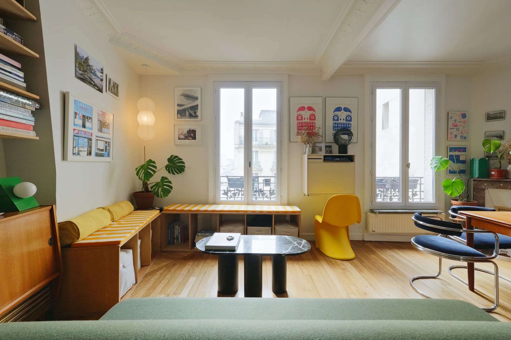
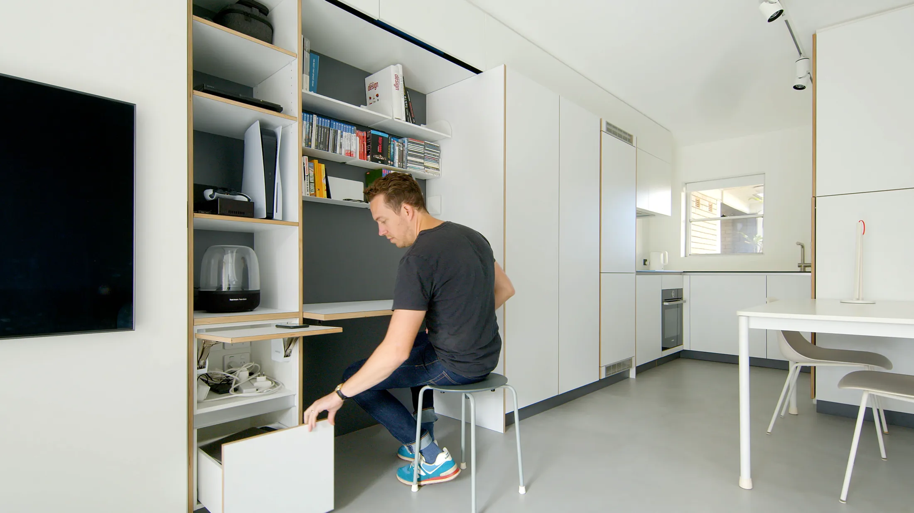
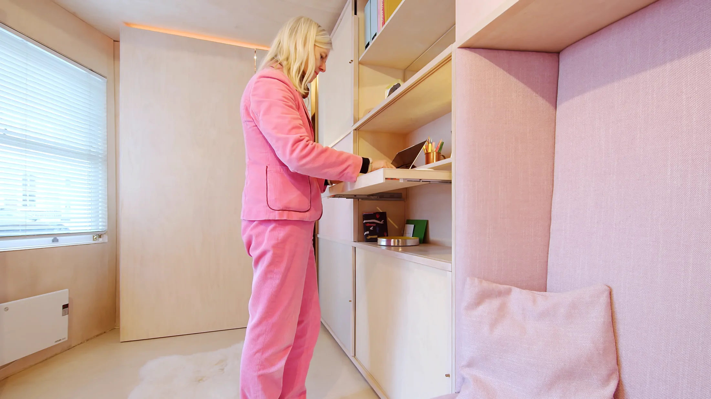
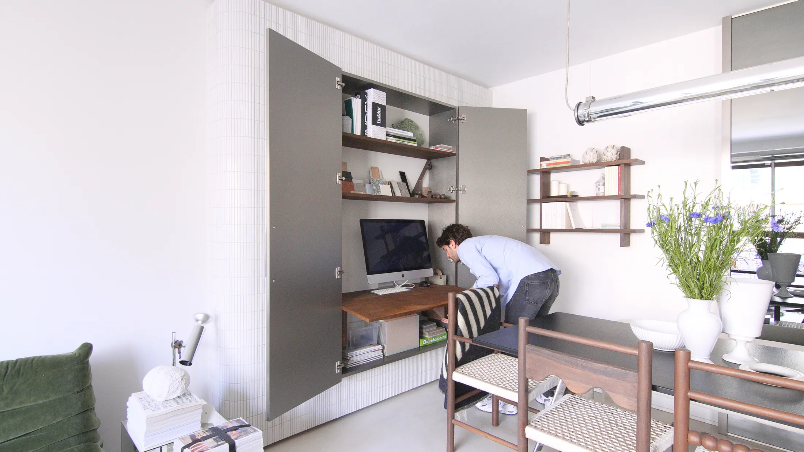
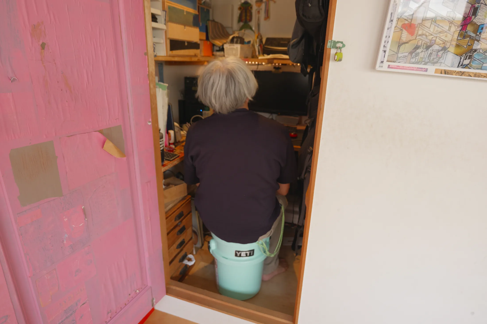
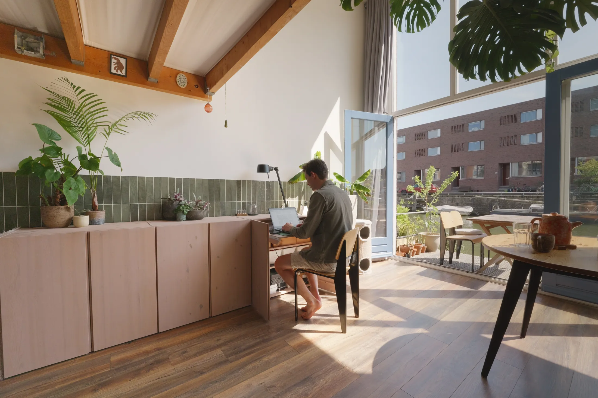
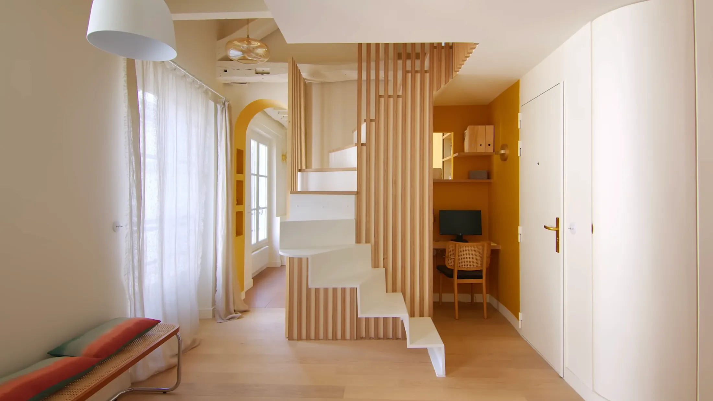
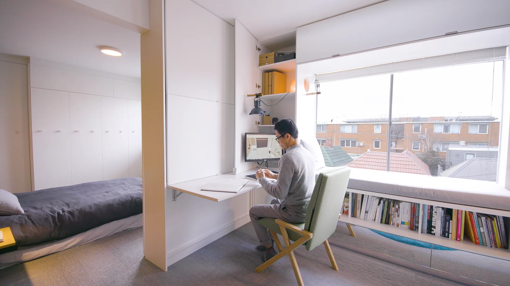

# Кабинет, которого не видно: 9 способов спрятать рабочее место в маленькой квартире

Удалёнка из Москвы никуда не ушла. По опросу hh.ru в июне 2025 года, 23% россиян хотят работать полностью из дома, ещё 26% — в гибридном формате, а 35% сидят в офисе, но перешли бы на удалёнку, будь такая возможность. Только 16% мечтают вернуться в офис насовсем.

Проблема в метрах. Средняя студия в московской новостройке в июле 2026 года — 27 м², по данным bnMAP.pro. Отдельной комнаты под кабинет нет, а стол посреди комнаты превращает квартиру в офис круглые сутки. Мы взяли подборку Never Too Small про скрытые кабинеты и разобрали девять решений — от откидного стола до кабинета размером в 1 м².

## Коротко

- Самый дешёвый вариант — готовый откидной стол на стене: в сложенном виде он выглядит как шкафчик.
- Самый удобный — кабинет в шкафу: закрыл двери, и монитор, бумаги и провода исчезли до утра.
- Кабинету хватает 1 м²: ниши у входа, угла или части стеллажа.
- Лоджию в Москве можно использовать как рабочее место, но объединять её с комнатой и переносить туда батарею запрещено (постановление 508-ПП).

*Квартира Кэролайн Дункан, Париж, 39 м²: откидной стол Montana между окнами — в сложенном виде он выглядит как шкафчик. Фото: Never Too Small*

## 1. Откидной стол между окнами — квартира Кэролайн Дункан, Париж, 39 м²

Архитектор Кэролайн Дункан (Caroline Duncan) живёт в районе Журден в квартире на 39 м². Рабочее место — готовый откидной стол датской марки Montana, повешенный на стену между двумя окнами. Закрытый, он выглядит как обычный навесной шкафчик.

**Для Москвы.** Самое бюджетное решение: не нужна встроенная мебель, а простенок между окнами есть почти в любой однушке или евродвушке. Свет падает сбоку — идеально для работы за ноутбуком.

*Mark II, Сидней, 27 м²: панель сдвигается — и кабинет превращается в спальню с откидной кроватью. Дизайн: Nicholas Gurney. Фото: Never Too Small*

## 2. Кабинет и спальня в одной стене — Mark II, Сидней, 27 м²

Дизайнер Николас Герни (Nicholas Gurney) уместил рабочее место в единый мебельный модуль на главной стене квартиры площадью 27 м² — почти как средняя московская студия. Раздвижная панель закрывает нишу кабинета и одновременно открывает откидную кровать: днём здесь офис, ночью — спальня.

**Для Москвы.** Хороший вариант для студии, где кровать и стол всё равно стоят в одной комнате. Главное — заказывать модуль сразу целиком, а не собирать из разных шкафов.

*13m2, Лондон, 13 м²: выдвижная полка для работы стоя. Studiomama. Фото: Never Too Small*

## 3. Работа стоя в 13 метрах — 13m2, Лондон

Студия Studiomama — дизайнеры Нина Толструп (Nina Tolstrup) и Джек Мама (Jack Mama) — спроектировала квартиру площадью всего 13 м². Рабочее место — выдвижная полка из основного шкафа для работы стоя. Ноутбук хранится над ней, техника и провода — под ней.

**Для Москвы.** Квартир такого размера в новых московских проектах больше нет — с 1 августа 2024 года однокомнатная квартира не может быть меньше 28 м². Но идея работает в любой прихожей или узкой нише: стоячему столу нужна только глубина, а не площадь.

*VM36, Париж: стол, полки и монитор спрятаны в «парящем» шкафу из нержавеющей стали. Фото: Never Too Small*

## 4. Офис в стальном шкафу на кухне — VM36, Париж

Архитектор Жан-Мало Ле Клер (Jean-Malo Le Clerc) вместе с партнёром Виктором повесили на кафельную стену в столовой зоне «парящий» шкаф с дверцами из нержавеющей стали. Внутри — выдвижной стол, полки и монитор. Закрыл двери — и снова кухня-столовая.

**Для Москвы.** Решение для евродвушки, где кухня-гостиная — самая большая комната. Обеденный стол и рабочее место рядом, но рабочий беспорядок не мешает ужину.

## 5. Кабинет за карманными дверями — Pepper Tree Passive House, Вуллонгонг

В пассивном доме архитектора Александра Саймса (Alexander Symes) кабинет спрятан за парой карманных дверей — они уезжают в стену и не занимают места при открывании. Мебель сделана из Paperock — перерабатываемого материала на основе целлюлозы.

**Для Москвы.** Карманные двери требуют толщины стены под пенал, поэтому их проще закладывать на этапе ремонта в новостройке с черновой отделкой, а не в готовой квартире.

*Open Sky House, Токио, 57 м²: кабинет площадью 1 м². Фото: Never Too Small*

## 6. Кабинет в 1 м² — Open Sky House, Токио, 57 м²

Художник и архитектор Нобуфуми Такахаси (бюро Zajirogh) сделал в доме площадью 57 м² сразу три рабочих места: общий стол на втором этаже, откидную секцию для детей и отдельный кабинет площадью 1 м² — размером со стенной шкаф.

**Для Москвы.** В семейной евродвушке или трёшке кладовка в 1–1,5 м² есть почти всегда. С розеткой, светом и вентиляцией она превращается в тихий кабинет, где можно закрыть дверь на время звонка.

*Scheeps, Амстердам, 45 м²: столешница под ноутбук выдвигается из шкафа, собранного из трёх стеллажей IKEA Ivar. Дизайн: Koen Fraijman. Фото: Never Too Small*

## 7. Шкаф из трёх стеллажей — Scheeps, Амстердам, 45 м²

Дизайнер Кун Фрайман (Koen Fraijman) собрал шкаф из трёх стеллажей IKEA Ivar, покрасил его в розовый и встроил выдвижную столешницу размером под ноутбук.

**Для Москвы.** Пример бюджетного «хака»: деревянные стеллажи, краска и направляющие для столешницы. Похожие сосновые стеллажи легко найти и у российских производителей.

*Villa Saint-Michel, Париж: кабинет на месте шкафа для верхней одежды у входа. Архитектор: Nicolas Bossard. Фото: Never Too Small*

## 8. Кабинет вместо гардероба у входа — Villa Saint-Michel, Париж

Архитектор Николя Боссар (Nicolas Bossard) отдал под кабинет место у входной двери, где обычно стоит шкаф для верхней одежды. Нишу выкрасили в горчичный цвет, а над столом прорезали небольшой проём на кухню — свет и связь с домом.

**Для Москвы.** В планировках новостроек у входа часто есть ниша под шкаф-купе. Если верхняя одежда помещается в другом месте, ниша глубиной 60 см — готовый кабинет с розеткой и светом.

*Type Street, Мельбурн, 35 м²: рабочее место в угловом шкафу от пола до потолка. Jack Chen, Tsai Design. Фото: Never Too Small*

## 9. Угловой шкаф с монитором на кронштейне — Type Street, Мельбурн, 35 м²

Джек Чен (Jack Chen) из Tsai Design спрятал рабочее место в угловой шкаф от пола до потолка. Внутри — складная столешница, лампа и монитор на выдвижном кронштейне, а офисное кресло трансформируется в кресло для отдыха.

**Для Москвы.** Углы в студиях — самая «мёртвая» зона. Угловой шкаф с кабинетом внутри использует её полностью, а монитор на кронштейне не занимает столешницу.

## А если лоджия?

В Москве первая мысль — устроить кабинет на лоджии. Это возможно, но с ограничениями. Объединять лоджию или балкон с комнатой, переносить туда радиатор от общедомового отопления и делать тёплый пол от общих систем постановление 508-ПП запрещает — об этом напоминает Мосжилинспекция. Поэтому кабинет на лоджии — это отдельное утеплённое пространство с сохранённым дверным блоком, а не продолжение комнаты.

## Как выбрать решение

| Решение | Подходит | Сколько места |
|---|---|---|
| Откидной стол на стене | студия, редкая работа из дома | простенок от 80 см |
| Стол в шкафу | работа дома каждый день | шкаф глубиной 50–60 см |
| Кабинет в нише или кладовке | евродвушка, семья | от 1 м² |
| Мебельная стена со спальней | студия 25–30 м² | одна стена комнаты |

Ещё идеи для небольших квартир — в разделе [«Интерьер»](/temy/interer/).

## Вопросы и ответы

**Можно ли сделать кабинет на лоджии в Москве?**
Пользоваться лоджией как рабочим местом можно, но объединять её с комнатой, переносить туда общедомовой радиатор и делать тёплый пол от общей системы отопления запрещено постановлением Правительства Москвы № 508-ПП.

**Сколько места нужно для скрытого рабочего места?**
Для ноутбука достаточно столешницы глубиной 40–50 см и шириной от 80 см. В примерах из статьи кабинет помещается в угловой шкаф, в стеллаж или в бывшую нишу для верхней одежды — от 1 м² площади.

**Что лучше для студии: откидной стол или стол в шкафу?**
Откидной стол дешевле и занимает 10–20 см в сложенном виде, но на нём ничего не оставишь. Стол в шкафу позволяет закрыть рабочий беспорядок вместе с монитором и бумагами — удобнее, если вы работаете дома каждый день.

## Источники

1. Never Too Small. Hidden home offices — https://www.nevertoosmall.com/post/hidden-home-offices
2. Коммерсантъ (по данным hh.ru): форматы работы, опрос июня 2025 года — https://www.kommersant.ru/doc/8336320
3. РБК Недвижимость: цены и площадь студий в новостройках Москвы, июль 2026 — https://realty.rbc.ru/news/6a688a1e9a7947e0d847331e
4. Мосжилинспекция: какие перепланировки запрещены (постановление 508-ПП) — https://www.mos.ru/news/item/76897073/

*Материал подготовлен по мотивам публикаций Never Too Small и использует их фото с разрешения правообладателя.*
