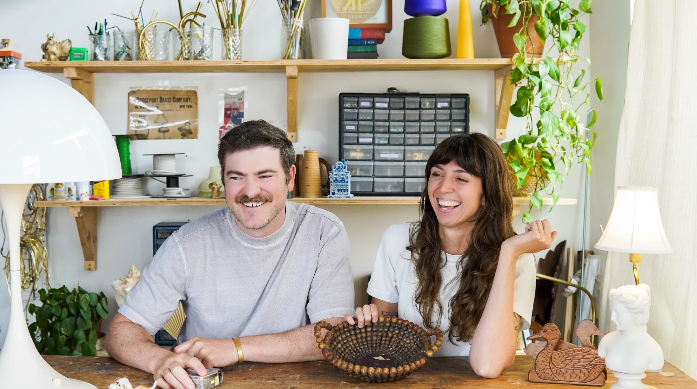
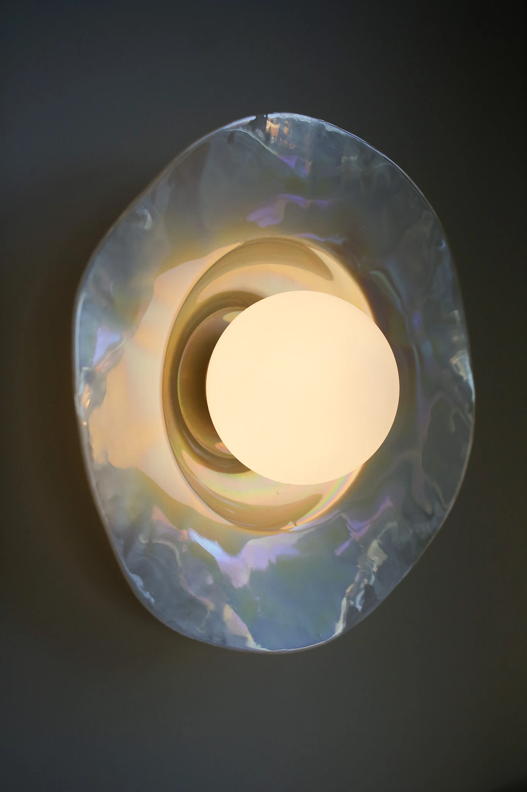
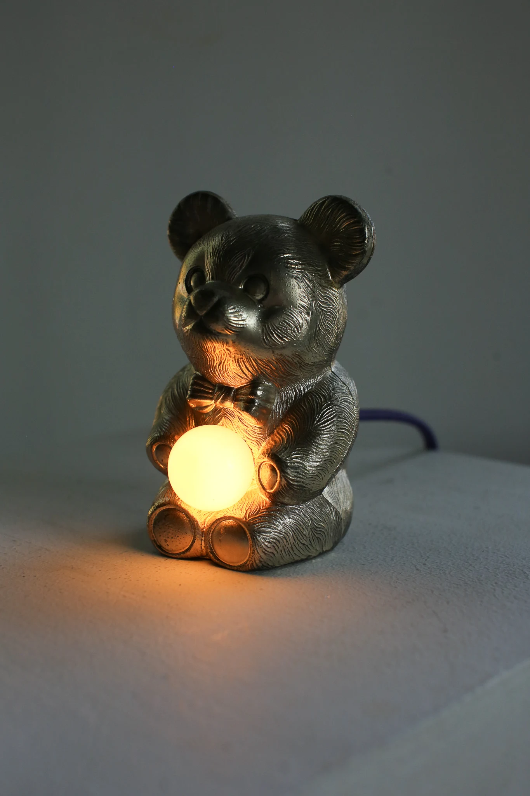
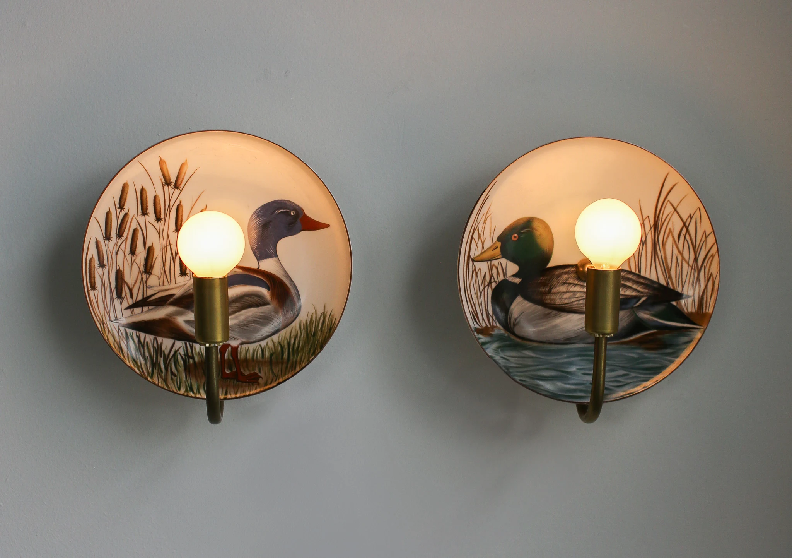
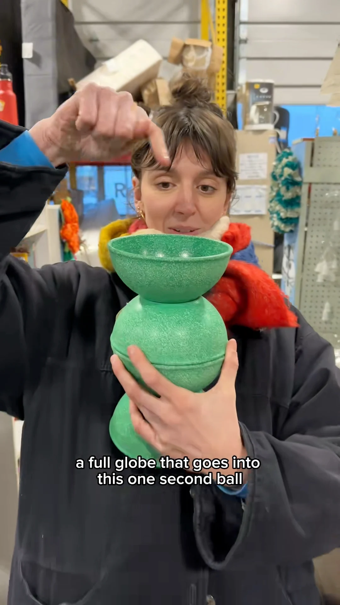
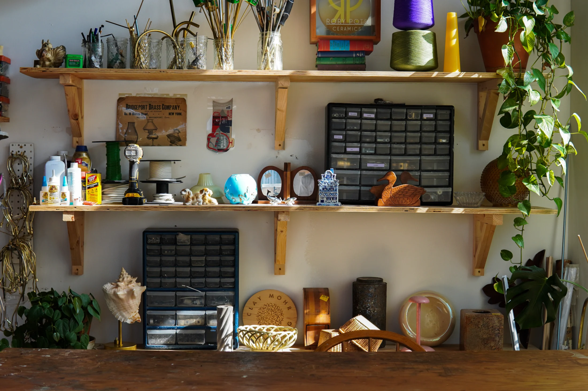

# Свет в маленькой квартире: как пережить московскую зиму с лампой из тарелки

Московская зима — это месяцы, когда светает поздно, темнеет рано, а небо часто закрыто сплошными облаками. В квартире свет приходится включать почти с утра, и от того, какой он, зависит, будет ли дом уютным или похожим на кабинет врача. В студии 25–30 м² всё усложняется: одна комната работает и как спальня, и как кухня, и как рабочее место, а места под торшеры и столики нет. Минимальная однушка в новых московских проектах — 28 м² (с 1 августа 2024 года, постановление № 1672-ПП), и каждый квадратный метр пола дорог.

Об освещении в таких условиях рассказывает интервью Never Too Small с дуэтом Will It Lamp?: Клеем Морменом (Clay Mohrman) и Рори Шемлианом (Rory Shamlian). Клей делает скульптурные светильники из дерева, Рори раньше занималась керамикой, а теперь работает только со светом. Оба заканчивают программу по дизайну освещения в Нью-Йоркской школе дизайна интерьеров. Их фирменный приём — превращать найденные на барахолке тарелки, миски и безделушки в лампы. Сам формат нам не обязательно повторять, но правила, которые они выводят, подходят любой московской квартире.

## Коротко

- Лампы для дома — 2700 K и теплее: холодный белый свет «стерилизует» комнату.
- Почти любой светильник выигрывает от матового плафона: он рассеивает свет и убирает блики.
- В маленькой квартире светильники лучше вешать на стены и полки, а не ставить на пол.
- Маленькие лампы не заменяют рабочий свет, но создают тепло — особенно на книжных полках.
- Лампу можно собрать из старой тарелки или миски, если брать заводскую электрическую часть.

*Клей Мормен (слева) и Рори Шемлиан (справа), дуэт Will It Lamp?. Фото: Will It Lamp? / Never Too Small*

## Приём 1: тёплые 2700 K вместо «белого» света

Первое, что советуют дизайнеры: держать лампы в доме на 2700 K и ниже. Цифра на упаковке лампы — это цветовая температура: чем она больше, тем холоднее и синее свет. Оттенок до 2700 K похож на свет обычной лампы накаливания, а выше уже идёт нейтральный и холодный. По словам дуэта, слишком холодный белый свет делает комнату резкой и «стерильной».

**Для Москвы.** Зимой мы живём при искусственном свете дольше всего в году, поэтому разница между 2700 K и 4000 K ощущается сильнее, чем летом. Практический порядок такой: сначала посмотрите на упаковки ламп во всех светильниках и замените холодные на тёплые, а холодный свет оставьте только там, где нужна чёткая работа глазами — над кухонной столешницей или рабочим столом. Стены и мебель в тёплых тонах при таком свете смотрятся лучше; в панельной «двушке» с серым линолеумом это иногда единственный способ вернуть комнате уют, не затевая ремонт.

## Приём 2: матовый плафон на каждую лампу

Дуэт шутит, что их девиз — «поставь на это шар» (Put a globe on it!). Большинство их ламп закрыто матовым стеклянным шаром, а иногда они даже устраивают эпизоды, где шаров нет. Смысл простой: голая лампочка слепит, а матовое стекло превращает её в мягкое светящееся пятно, которое можно поставить в поле зрения без дискомфорта.

**Как повторить.** Если у вас в студии голая лампочка на потолочном патроне — типичная картина для сданной без отделки новостройки, — самая дешёвая перемена: матовый плафон или шар. Для кухни-ниши и ванной, где светильник близко к глазам, это особенно заметно. Следите за температурой нагрева: закрытый плафон плохо подходит для старых ламп накаливания, лучше брать светодиодные.

*Перламутровое бра, сделанное из радужной тарелки. Фото: Will It Lamp? / Never Too Small*

## Приём 3: свет на стенах освобождает пол

Для маленьких домов дизайнеры дают отдельный совет: монтировать светильники на стены и другие поверхности, чтобы освободить пол и сделать комнату просторнее. Одна из работ дуэта — как раз бра из перламутровой тарелки.

**Для Москвы.** В хрущёвке и в студии после сдачи дома пол — главный дефицит. Торшер у дивана забирает полметра, лампа на тумбочке — всю тумбочку. Бра над изголовьем кровати, поворотный светильник над рабочим столом, подсветка полки над диваном — и стол освобождён. Проводку лучше продумать заранее, до отделки стен: в новостройках с черновой отделкой розетки и выводы под бра дешевле заложить сразу. В монолитных домах с гладкими стенами скрытую проводку легко спрятать в штробу, в панельных — смотрите на несущие стены и требования управляющей компании. Важное ограничение для любых работ: нельзя ликвидировать или уменьшать вентиляционные каналы (постановление 508-ПП), поэтому светильники на стене в ванной и на кухне не должны перекрывать вентиляцию.

## Приём 4: маленькие лампы для тепла, а не для работы

Дизайнеры отдельно оговаривают: крошечные лампы не работают как рабочий свет. Зато они добавляют комнате тепла, особенно если поставить их на книжные полки. Их собственные «малышки» собраны из двух деревянных подсвечников-арок и стеклянных шаров.

*Лампа Baby Bear из серебристого медвежонка с блошиного рынка. Фото: Will It Lamp? / Never Too Small*

**Как повторить.** Зимой после шести вечера тёплые огоньки на полке работают как камин в панельной комнате: общий верхний свет можно выключить, и квартира перестаёт выглядеть офисом. Лучше всего подходят стеллаж у кровати, ниша над диваном и подоконник. Для чтения и для работы за компьютером всё равно нужен отдельный рабочий светильник.

## Приём 5: лампа из того, что есть

Рецепт дуэта на уровне идеи такой: берём предмет, добавляем патрон, шнур и выключатель — и смотрим, как свет взаимодействует с формой. Среди работ — лампа из серебристого медвежонка, светильник из винтажных тарелок с утками, подвес из двух тонких двойных стеклянных мисок, стопка из трёх зелёных пластиковых мисок и даже лампа из манекенной стопы с перевёрнутой формой для бриоши в роли плафона. Для сборки дизайнеры советуют начать с простой настольной лампы: научиться подключать стандартный патрон, закрепить его на предмете и посмотреть, как лампочка меняет вид вещи.

*Duck Plates: светильник из старых тарелок. Фото: Will It Lamp? / Never Too Small*

Где искать предметы: на барахолках и в комиссионках. Хорошие, добротные или старинные вещи лучше новых, а латунные и хромированные детали проще подобрать друг к другу. Ещё один совет дуэта — подружиться с сотрудниками комиссионки: они могут отложить для вас подходящие вещи. Подсвечники и предметы, похожие на детали ламп, — хороший старт.

*Три зелёные пластиковые миски по шагам превращаются в лампу. Фото: Will It Lamp? / Never Too Small*

**Для Москвы.** Блошиные рынки, комиссионные магазины и объявления частных продавцов — везде бывают лампы, тарелки и посуда советского времени: стеклянные плафоны, фарфор, латунные подсвечники. Из такого можно сделать оригинальную настольную лампу, особенно в сталинке или в квартире в старом фонде, где винтажная вещь выглядит естественно. Но электрическую часть берите только заводскую и с маркировкой, а полые стеклянные и керамические предметы не сверлите без опыта: дуэт для прямых отверстий использует небольшой сверлильный станок, а базовый набор — острые инструменты, стрипперы для проводов и ещё четыре-пять простых приспособлений. Если нет желания возиться, идея всё равно полезна: ищите готовые светильники из керамики, стекла и металла.

*Мастерская: будущие лампы пока выглядят как барахолка. Фото: Will It Lamp? / Never Too Small*

## Как это собрать в одной комнате: чек-лист

1. Замените все лампы на тёплые, 2700 K и ниже; холодный оставьте только над рабочей зоной.
2. Закройте голые лампочки матовыми плафонами.
3. Повесьте бра над кроватью и диваном, а торшеры уберите.
4. Поставьте маленькие тёплые лампы на полки и подоконники.
5. Для чтения и работы оставьте один направленный светильник.
6. Не закрывайте светильниками вентиляционные решётки в ванной и на кухне.
7. Если делаете лампу сами, электрическую часть берите заводскую.

Больше идей для небольших квартир — в разделе [«Интерьер»](/temy/interer/). Если ищете квартиру, на которую можно примерить эти советы, загляните в [каталог новостроек Москвы](/novostroyki/moskva/).

## Вопросы и ответы

**Какая температура света лучше всего для квартиры?**
Дизайнеры света Will It Lamp? советуют держать домашние лампы на 2700 K и ниже: такой свет тёплый, а более холодный даёт резкий, «операционный» оттенок. Для вечерней гостиной и спальни это особенно важно.

**Как освободить пол в маленькой комнате, не потеряв свет?**
Переносите светильники с пола и стола на стены: бра, поворотные лампы на кронштейне, подсветка полок. Так торшер не занимает квадратные метры, а комната выглядит просторнее.

**Можно ли сделать лампу самому и безопасно ли это?**
Дизайнеры советуют начать с самого простого: купить готовый патрон со шнуром и выключателем и закрепить его на подходящем предмете. Электрическую часть берите заводскую, а сам предмет подбирайте так, чтобы лампа не грелась и не качалась.

## Источники

1. Never Too Small. Let There Be Lamp: interview with Will It Lamp? — https://www.nevertoosmall.com/post/let-there-be-lamp-interview-will-it-lamp
2. ppt.ru: постановление Правительства Москвы от 23.07.2024 № 1672-ПП — https://ppt.ru/obzory/vstupaet-v-silu/postanovlenie-pravitelstva-moskvy-23-07-2024-1672-pp
3. Мосжилинспекция: какие перепланировки запрещены (постановление 508-ПП) — https://www.mos.ru/news/item/76897073/
