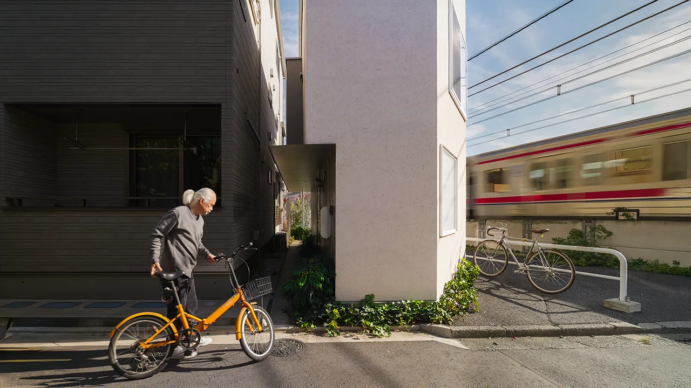
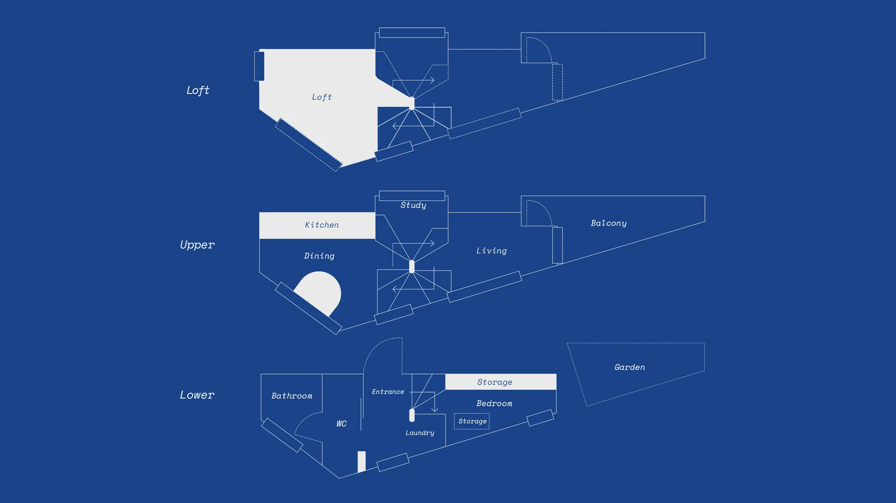
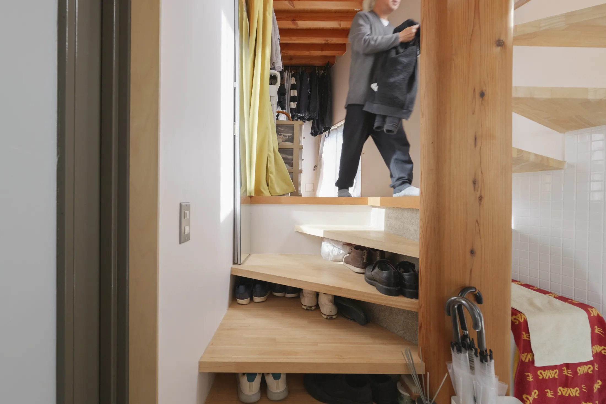
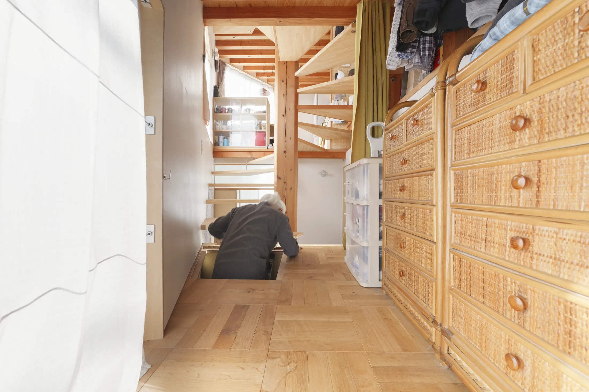
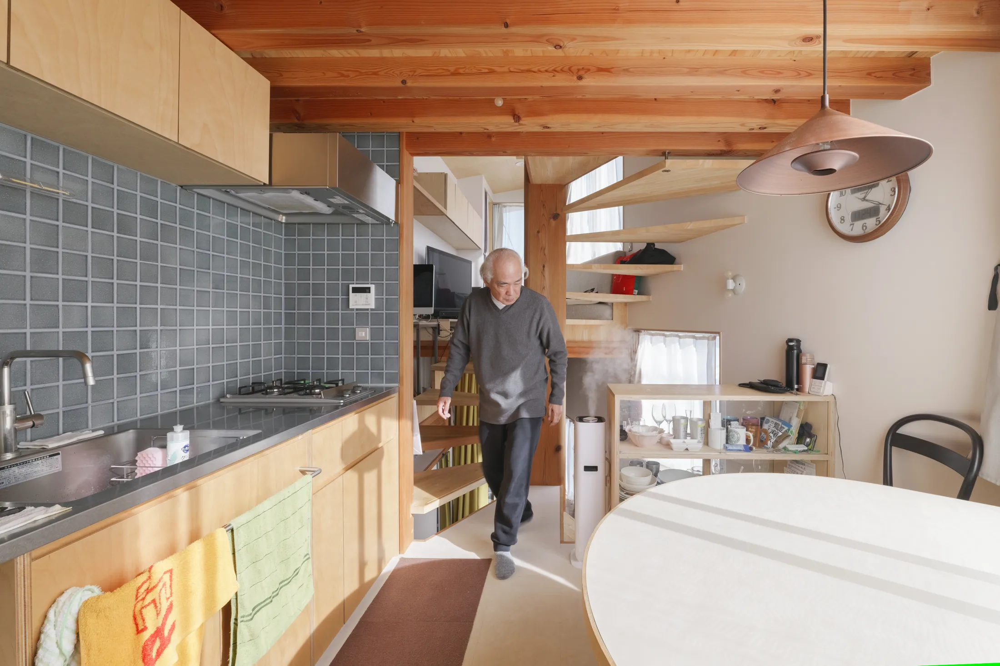
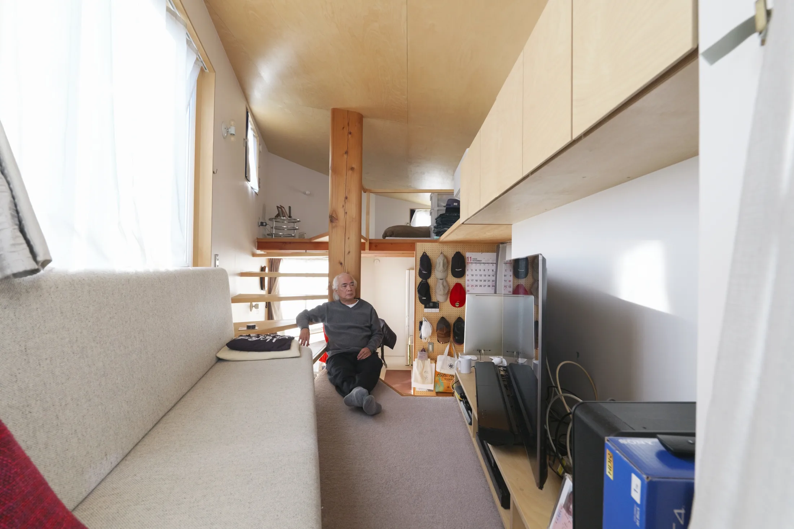
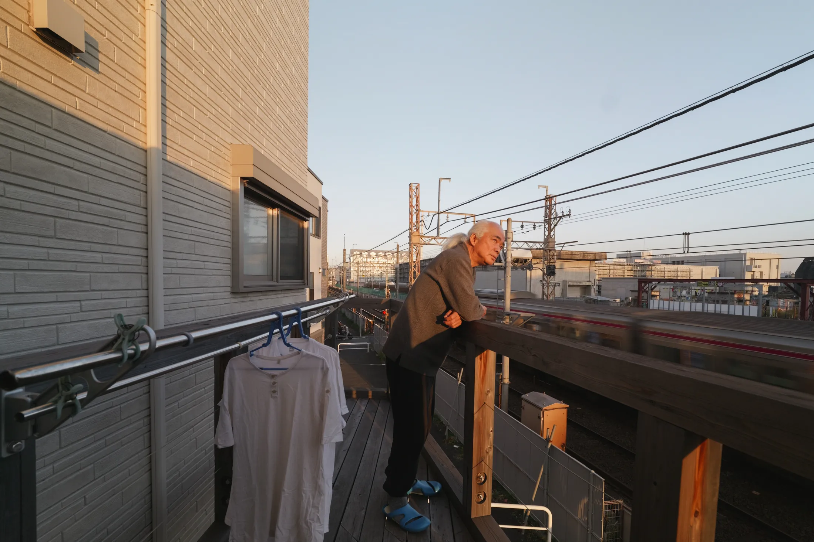
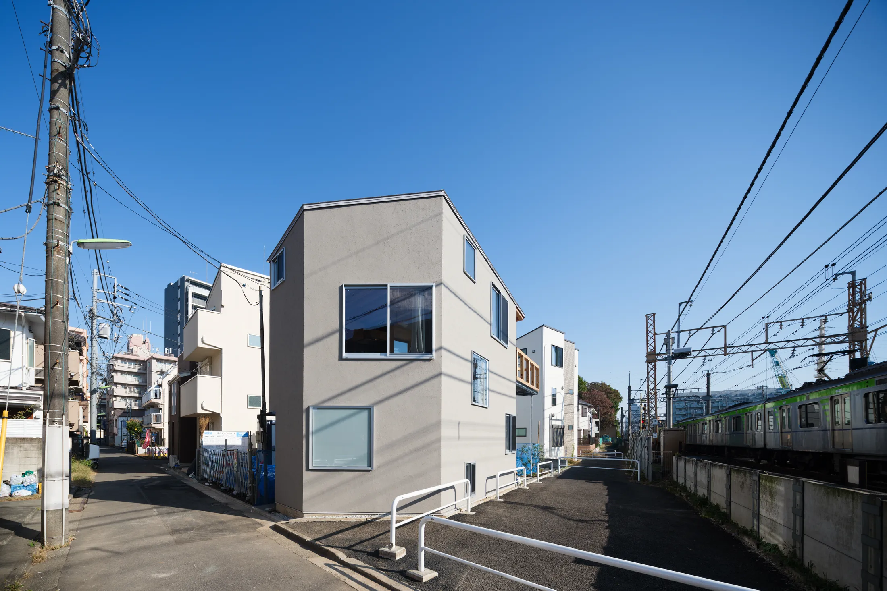

# Дом на участке в 30 м² рядом с железной дорогой: 5 решений из Токио

Токийский район Сэтагая — жилой, спокойный, со множеством низких домов и действующими железнодорожными линиями. Владелец, который десятки лет жил по соседству, оказался на остатке своей земли: часть участка пришлось продать, когда пути решили поднять на эстакаду. Осталось около 30 м². На них бюро Takehiko Suzuki Architects (Такэхико Судзуки) построило дом M (House M).

Москвичу эта ситуация знакома не по участкам, а по ощущениям: квартира у железной дороги или МЦК, мало света, ещё меньше свободных метров, а хранить надо всё. Поэтому смотрим на дом как на учебник компактной жизни: пять решений, из которых можно взять почти любое.

## Коротко

- Дом растёт вверх вокруг центральной колонны и винтовой лестницы — хранение «зашито» в саму конструкцию.
- Первая ступень лестницы выполняет роль скамейки и обувного шкафа.
- Кровать поднята на платформу, а под ней — люки с хранением вместо шкафа.
- Шкаф по пояс открывается с двух сторон и разделяет зоны, не загораживая обзор.
- Встроенный диван заменяет гостевую кровать, а штанга на балконе — сушилку.

*House M, Сэтагая, Токио. Takehiko Suzuki Architects (Такэхико Судзуки). Фото: Never Too Small*

## Как устроен дом

Это многоуровневый компактный дом, слоями поднимающийся вверх. В центре стоит колонна, похожая на дерево, вокруг неё закручена лестница, а остальные помещения «привязаны» к ней на разных уровнях. Для небольшой квартиры это важный урок: когда нет места для коридоров, лестница или центральный блок берёт на себя роль и связи, и хранилища. Мебель — из берёзовой фанеры, балки оставлены открытыми.

*План House M: этажи собраны вокруг центральной колонны и лестницы. Чертёж: Takehiko Suzuki Architects / Never Too Small*

## Приём 1: входные ступени, в которые встроена прихожая

Первые ступени лестницы немного шире остальных и открыты снизу. Внутри — место для обуви, а на самих ступенях можно присесть, чтобы обуться. Так входная зона обходится без отдельной комнаты и мебели.

*Приём 1: первые ступени расширены, под ними хранится обувь. Фото: Never Too Small*

**Для Москвы.** В хрущёвках и многих новостройках прихожая — это пара квадратных метров, на которых нужно поставить обувь, одежду и сумки. Аналог токийской ступени — встроенная скамья с ящиками для обуви и крючками над ней. Слякотная московская зима превращает прихожую в зону мокрой обуви, и скамья с выдвижными корзинами под ней куда практичнее открытой полки.

## Приём 2: кровать на платформе с хранением

Спальная зона в доме приподнята, а под ней устроено хранение. Чтобы добраться до вещей, достаточно поднять панели в полу, никаких шкафов не нужно. Так в дом попадает место для сезонных вещей, одежды и белья, и стены остаются свободными.

*Приём 2: спальная платформа приподнята, под ней — хранение. Фото: Never Too Small*

**Как повторить.** В московской студии платформа с хранением работает в сталинках, лофтах и новостройках с высокими потолками. В хрущёвке с невысоким потолком платформу сделайте невысокой: хватит 30–40 см, чтобы убрать подушки, пледы и зимние вещи. Люки лучше располагать так, чтобы к ним был доступ из прохода, а не из-под изножья кровати.

## Приём 3: шкаф, открывающийся с двух сторон

Между столовой и лестницей стоит шкаф высотой примерно по пояс — открыть его можно с любой стороны. На обоих фасадах стеклянные раздвижные дверцы, поэтому взгляд проходит сквозь шкаф и пространство не распадается на отсеки. Он служит и буфетом, и стеной, которая не отнимает свет.

*Приём 3: шкаф по пояс открывается и со стороны столовой, и со стороны лестницы. Фото: Never Too Small*

**Для Москвы.** Двусторонний шкаф разумно ставить между кухней-гостиной и зоной сна в студии или между столовой и коридором в евродвушке. Но помните про газ: если на кухне газовая плита, проём между ней и комнатой нельзя делать без плотной двери (постановление 508-ПП), а шкаф со стеклянными дверцами плотной дверью не считается. В квартире с электроплитой такая перегородка уместнее.

## Приём 4: встроенный диван для ночёвок

Диван встроен в гостиную и чуть отступает от края лестницы, чтобы не перегораживать проход. Он достаточно длинный, чтобы на нём можно было переночевать или днём подремать.

*Приём 4: встроенный диван достаточно длинный для ночёвки гостя. Фото: Never Too Small*

**Как повторить.** Если в квартире нет второй комнаты, а приезжают родственники, диван по длине около двух метров с ящиком под сиденьем заменяет гостевую спальню. Встроенный вариант делает мебель частью стены, а не отдельным предметом, и комната выглядит спокойнее.

## Приём 5: штанга на балконе

Самое простое решение: металлическая штанга по краю балкона. На ней сушатся полотенца и бельё, и ни один сантиметр пола не потерян.

*Приём 5: штанга по краю балкона для полотенец и белья. Фото: Never Too Small*

**Для Москвы.** Лоджия — наша версия балкона, и летом сушилка за окном освобождает комнату. Зимой всё сложнее: на холоде бельё сохнет долго. Помните и про правила: переносить общедомовые радиаторы на лоджию и объединять лоджию с комнатой нельзя (постановление 508-ПП). Поэтому штанга останется летней сушкой, а на зиму нужна компактная раскладная сушилка.

*Интерьер House M: берёзовая фанера и открытые балки. Фото: Масао Нисикава (Masao Nishikawa)*

## Что объединяет все пять решений

Ни одно из них не добавляет метров, но каждое возвращает место, которое иначе пропало бы: под ступенью, под кроватью, внутри шкафа-перегородки, на краю балкона. Если у вас есть квартира у железной дороги, МЦК или шумной магистрали, этот подход особенно полезен: когда площадь ограничена, а окна не самые приятные, выигрывать приходится за счёт продуманной мебели.

## Чек-лист

1. Встройте скамью с хранением обуви в прихожую.
2. Поднимите кровать на платформу высотой 30–40 см и храните вещи под ней.
3. Поставьте шкаф по пояс между зонами, если позволяет газовая кухня.
4. Закажите диван для гостей по размеру ниши.
5. Повесьте штангу на лоджии для летней сушки.

Больше идей — в разделе [«Интерьер»](/temy/interer/). Если выбираете квартиру, посмотрите [каталог новостроек Москвы](/novostroyki/moskva/).

## Вопросы и ответы

**Можно ли в Москве сушить бельё на лоджии с такой штангой?**
Штанга на ограждении лоджии или балкона — лёгкая конструкция. Но убирать общедомовые радиаторы с лоджии или объединять её с комнатой нельзя (постановление 508-ПП), так что зимой сушку лучше планировать с учётом того, что лоджия остаётся неотапливаемой.

**Как сделать хранение под кроватью в московской квартире?**
Приподнятая платформа с люками в полу, как в House M, даёт объём под кроватью без дополнительных шкафов. Высоту платформы выбирают так, чтобы на ней было удобно сидеть и вставать, а люки не мешали открываться дверям.

**Чем двусторонний шкаф удобнее обычного?**
К нему можно подойти с двух сторон: из столовой и со стороны лестницы или коридора. Шкаф по пояс заодно служит буфетом, и посуду не нужно носить через всю квартиру. В узкой квартире такой шкаф ещё и делит зоны, не перекрывая вид.

## Источники

1. Never Too Small. 5 smart design decisions inside a Tokyo house — https://www.nevertoosmall.com/post/5-smart-design-decisions-inside-a-tokyo-house
2. Мосжилинспекция: какие перепланировки запрещены (постановление 508-ПП) — https://www.mos.ru/news/item/76897073/
