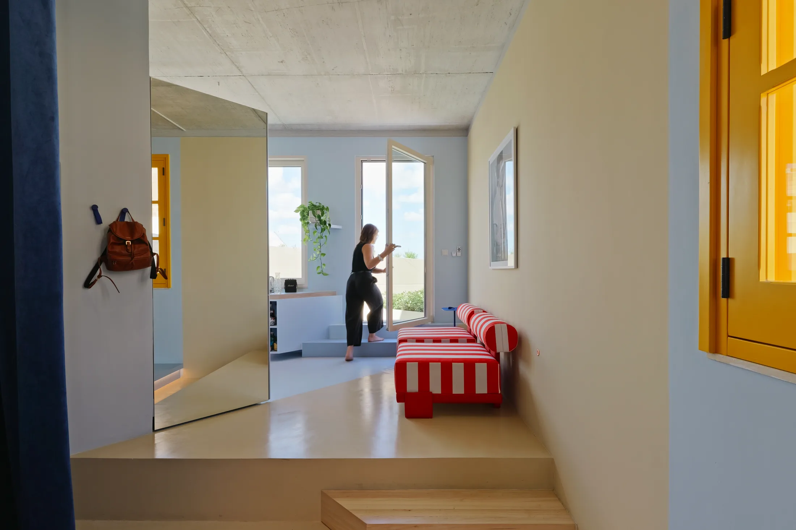
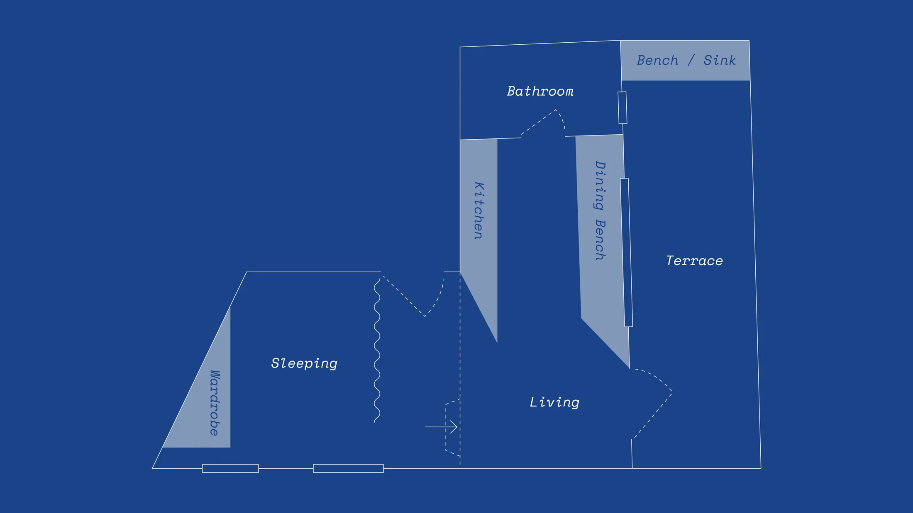
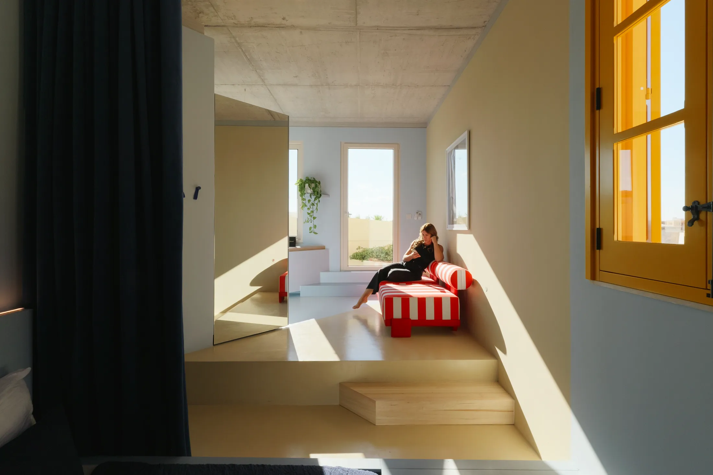
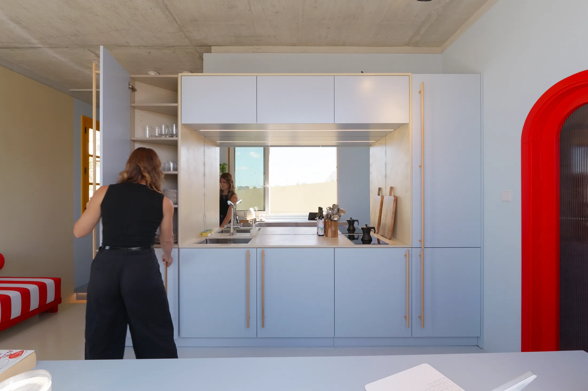
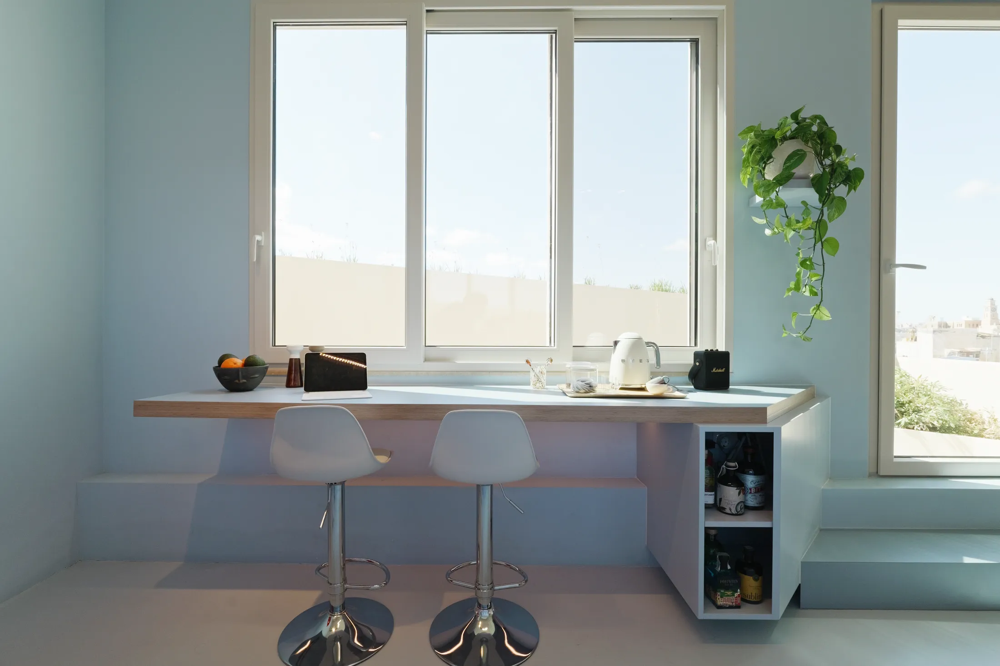
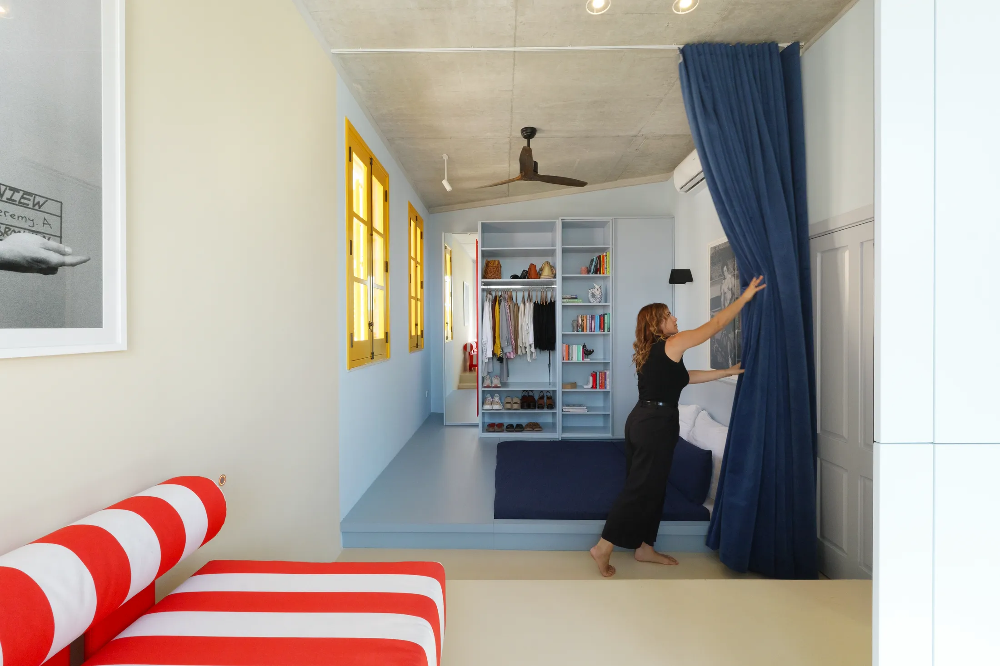
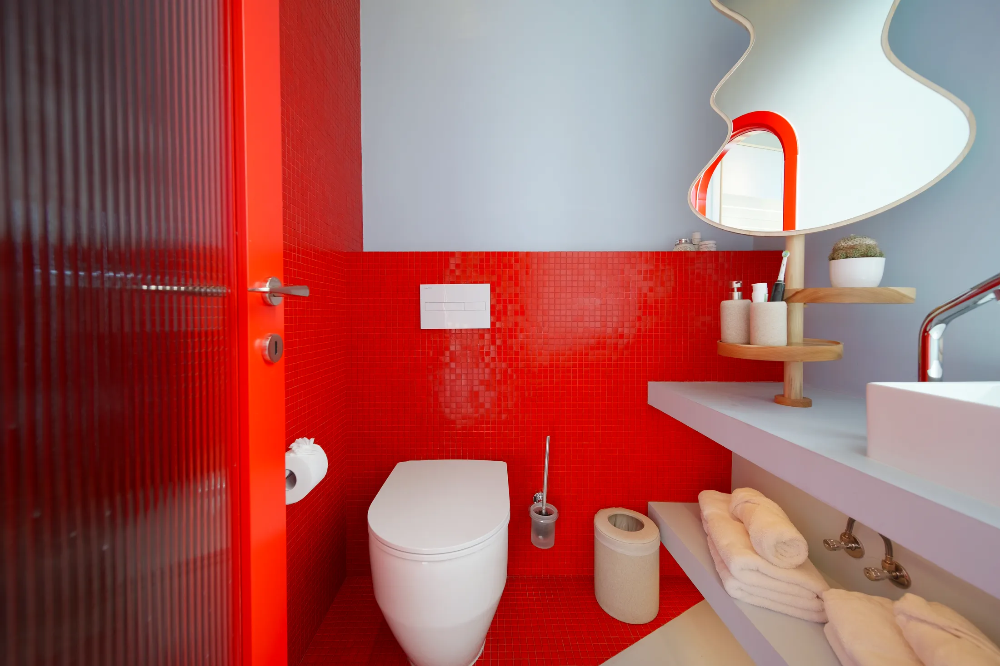

# Цвет и диагональ вместо стен: как зонировать студию 28 м² на примере Мальты

Если вам нужна студия, в которой гостиная, кухня, спальня и ванная не слиплись в одну кашу, стены — не единственный инструмент. На Мальте студия NiCHE. во главе с Мартиной Фенех Адами (Martina Fenech Adami) превратила в квартиру 28 м² бывшую открытую прачечную на крыше дома XVIII века в городке Бормла. Квартира получила название Blue Room, а границы между зонами в ней нарисованы цветом, ступенями пола и наклонными линиями.

28 м² — число, знакомое каждому, кто смотрит московские новостройки. С 1 августа 2024 года в новых проектах Москвы однокомнатная квартира не может быть меньше 28 м² (постановление Правительства Москвы № 1672-ПП). Средняя студия сегодня чуть меньше: по данным bnMAP.pro, в июле 2026 года — 27 м² (в старой Москве 28, в Новой Москве 25). Так что мальтийский проект — почти идеальный масштаб для примерки на себя.

## Коротко

- Зоны разделены не стенами, а цветом, уровнями пола и диагоналями.
- Между гостиной и кухней стоит зеркало во всю высоту: оно делит пространство и «приносит» свет с террасы.
- Кухня — в одном синем тоне; бежевый микроцемент на полу и столешнице повторяет цвет местного известняка.
- Мебель продумана как в корабельной каюте: кровать на деревянном основании с хранением и подсветкой, закрытая шторой.
- Ванная контрастирует со всем остальным: красная мозаика, красная дверь и диагональный двухцветный пол.

*Blue Room, Бормла, Мальта, 28 м². Студия NiCHE. Фото: Ramon Portelli / Never Too Small*

## Что было до: прачечная под открытым небом

Исходное пространство почти ничего не предлагало: открытая хозяйственная площадка на крыше, где сушили бельё, и минимум конструкций. Поэтому дизайнер выстраивала всё с нуля. Палитру она взяла из окружения: мальтийское синее небо и тёплый известняк, из которого сложены соседние дома. Линии в плане идут по диагонали — они направляют движение по квартире и не дают ей казаться коробкой.

В Москве похожие сюжеты — мансарды и переоборудованные чердаки в старых домах центра. Там тоже нет ни ровных стен, ни привычных проёмов. Подход «берём цвет из окружения» помогает и в обычной новостройке: если окна смотрят на Москву-реку или парк, ориентируйтесь на их цвет, а не на каталог красок.

*План квартиры Blue Room после перепланировки. Чертёж: NiCHE. / Never Too Small*

## Приём 1: зеркало как перегородка

Между гостиной и кухней стоит большое зеркало от пола до потолка. Оно выполняет сразу две задачи: отражает свет с террасы вглубь квартиры и ненавязчиво отделяет зону отдыха от кухни. Нет стены — но ощущение двух комнат есть.

*Большое зеркало разделяет гостиную и кухню и отражает свет с террасы. Blue Room, 28 м². Фото: Ramon Portelli / Never Too Small*

**Для Москвы.** Короткий световой день — главная проблема столичных студий с ноября по февраль. Зеркало напротив окна даёт больше естественного света в глубине комнаты, чем пара лишних светильников. Но в студии с окнами на одну сторону ставьте его так, чтобы в нём отражалось окно, а не кухонная вытяжка. И не забывайте: зеркало во всю высоту — это вес. Крепить его нужно по инструкции мастера, а не на двусторонний скотч.

## Приём 2: кухня одного цвета

Кухонные шкафы на заказ — синие, как мальтийское небо, и стены с полом того же оттенка. Бежевый микроцемент идёт по полу и столешнице и повторяет известняк соседних домов. Тонкие бежевые ручки-«тюльпаны» оживляют синий.

Такая монохромная схема стирает границы: глаз не цепляется за стыки, и кухня не выглядит «кусочком» в углу комнаты.

*Кухня в одном тоне: синие шкафы, стены и пол, бежевый микроцемент. Blue Room, 28 м². Фото: Ramon Portelli / Never Too Small*

**Как повторить.** В московской студии кухня обычно стоит вдоль одной стены. Выкрасьте в один тон шкафы и стену над ними, а столешницу и фартук сделайте нейтральными. Если хотите бесшовный пол, как в Бормле, помните про 508-ПП: тёплый пол от общих систем отопления запрещён, так что вариант с подогревом нужно сначала обсудить с проектировщиком.

## Приём 3: шкаф-трапеция

Обеденная стойка заканчивается подвесным шкафом в форме трапеции. Его скошенная сторона продолжает диагонали плана, а глубина делает две вещи: оставляет место для колен тем, кто сидит на высоких стульях, и прячет хранение за собой.

*Трапециевидный подвесной шкаф завершает обеденную стойку. Blue Room, 28 м². Фото: Ramon Portelli / Never Too Small*

**Для Москвы.** В студиях и евродвушках барная стойка часто служит и столом, и разделителем зон. Подвесная тумба под её торцом не загромождает пол и позволяет протереть его без препятствий. Попросите мебельщика сделать торец скошенным: острый угол в проходе — это синяки на бёдрах, а срезанный — нет.

## Приём 4: кровать как каюта

Спальное место стоит на основании из цельного дерева, в котором спрятаны хранение, подсветка и вентиляция. Узкое встроенное изголовье заменяет прикроватные тумбы. Вечером кровать закрывается большой шторой из синего бархата, и спальня становится отдельной комнатой.

*Спальное место на деревянном основании, закрытое синей шторой. Blue Room, 28 м². Фото: Ramon Portelli / Never Too Small*

**Как повторить.** Плотная штора из бархата или шерсти в Москве работает вдвойне: она задерживает тепло зимой и скрывает кровать от гостей. Следите только, чтобы штора не перекрывала радиатор: его нельзя переносить, а закрытая батарея греет хуже. Лоджию в качестве спальни не объявляйте — объединять лоджии и балконы с комнатами запрещено.

## Приём 5: ванная как вспышка

К ванной ведёт красная дверь, сделанная на заказ. Внутри душ и часть стен выложены красной стеклянной мозаикой, а мягкий голубой цвет остальных поверхностей её уравновешивает. Пол идёт по диагонали: синий микроцемент встречается с красной плиткой и делит помещение на унитаз, раковину и душ.

*Ванная: красная мозаика и синий микроцемент. Blue Room, 28 м². Фото: Ramon Portelli / Never Too Small*

**Для Москвы.** Ванная в московской новостройке — самая «замкнутая» часть квартиры без окна, поэтому она подходит для самого смелого цвета. Красный и синий — крайность, но принцип понятен: пол, делящий мокрую зону на три области, можно выложить двумя цветами и без стен.

## Чек-лист: как зонировать студию 28 м²

1. Определите главную диагональ: от входа к окну. Мебель ставьте вдоль неё или под небольшим углом.
2. Одна зона — один цвет. Две соседние зоны — контраст.
3. Зеркало во всю высоту стены вместо перегородки между гостиной и кухней.
4. Кровать — на основание с хранением, закрывается шторой.
5. Торец стойки или стола — скошенный, а не острый.
6. Яркий акцент оставьте для ванной: в ней вы проводите мало времени, а эффект сильный.

Больше идей для небольших квартир — в разделе [«Интерьер»](/temy/interer/). А если вы выбираете между студией и однушкой, посмотрите [каталог новостроек Москвы](/novostroyki/moskva/): доля студий в предложении за год упала на 6 п. п., до 11%.

## Вопросы и ответы

**Как разделить студию на зоны без перегородок?**
Цветом, уровнем пола и формой мебели. В мальтийской квартире Blue Room 28 м² кухня выкрашена в один синий тон, спальное место стоит на основании и закрывается шторой, а между гостиной и кухней стоит зеркало во всю высоту стены.

**Какая минимальная площадь однокомнатной квартиры в новых московских проектах?**
С 1 августа 2024 года — 28 м², двухкомнатной — 44 м² (постановление Правительства Москвы № 1672-ПП от 23 июля 2024 года). Мальтийская квартира Blue Room имеет ровно 28 м².

**Зачем нужен микроцемент на полу и столешнице?**
Это бесшовное покрытие: один материал на полу и поверхностях визуально объединяет зону и не дробит пространство швами. Оно требует аккуратного нанесения и защитного слоя, так что подрядчика стоит выбирать по готовым объектам.

## Источники

1. Never Too Small. Colour and geometry shape a 28sqm/301sqft Maltese rooftop apartment — https://www.nevertoosmall.com/post/olour-and-geometry-shape-28sqm-301sqft-maltese-rooftop-apartment
2. ppt.ru: постановление Правительства Москвы от 23.07.2024 № 1672-ПП — https://ppt.ru/obzory/vstupaet-v-silu/postanovlenie-pravitelstva-moskvy-23-07-2024-1672-pp
3. РБК Недвижимость: цены и площадь студий в новостройках Москвы, июль 2026 — https://realty.rbc.ru/news/6a688a1e9a7947e0d847331e
4. РБК Недвижимость: доля студий в предложении Москвы, I полугодие 2026 — https://realty.rbc.ru/news/6a6094b09a7947481c9c3ec4
5. Мосжилинспекция: какие перепланировки запрещены (постановление 508-ПП) — https://www.mos.ru/news/item/76897073/
