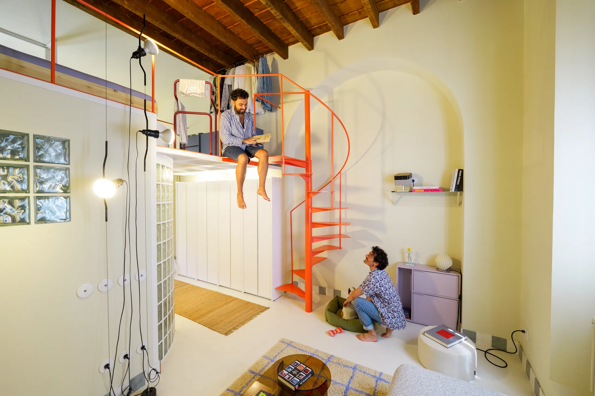
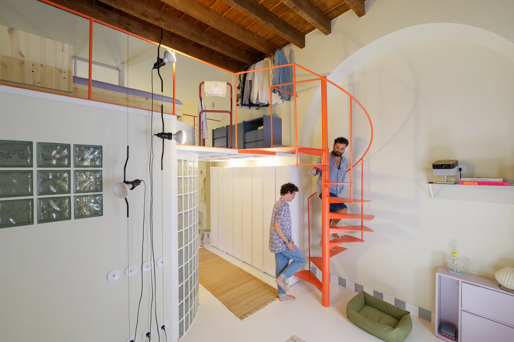
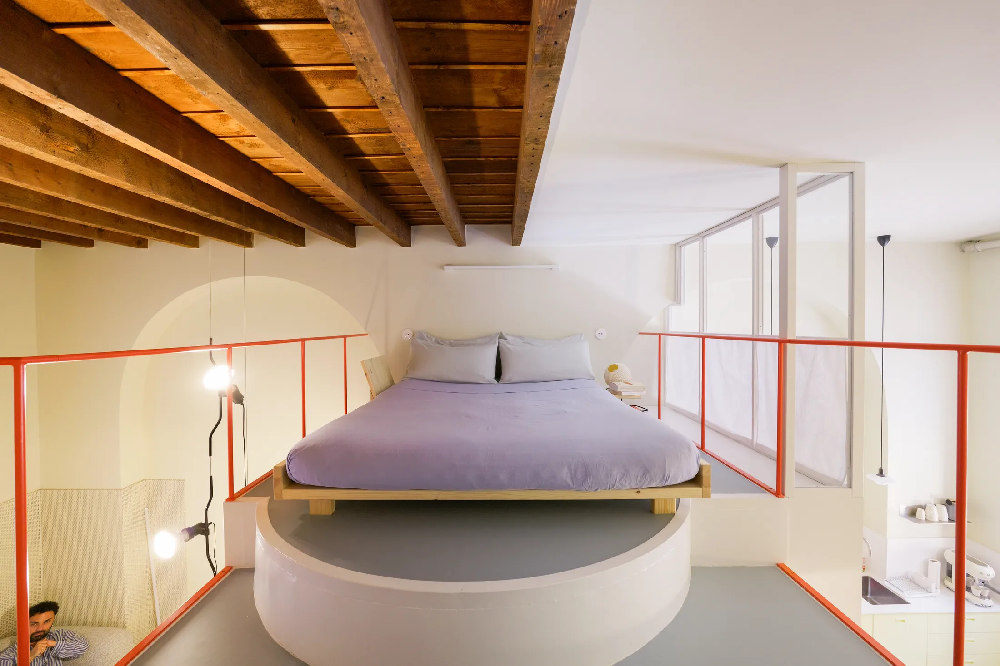
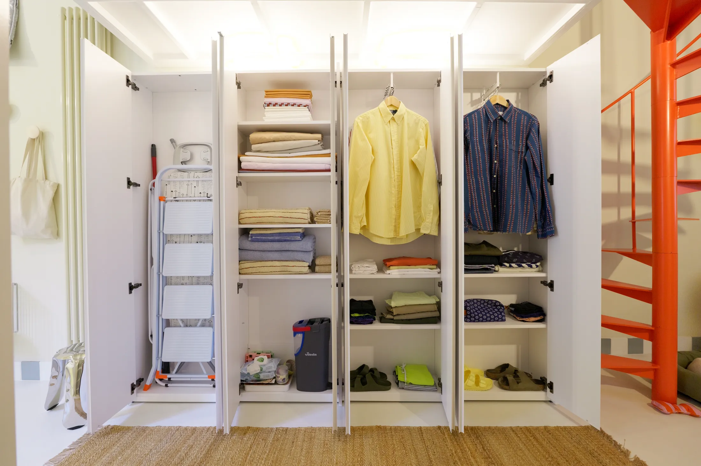
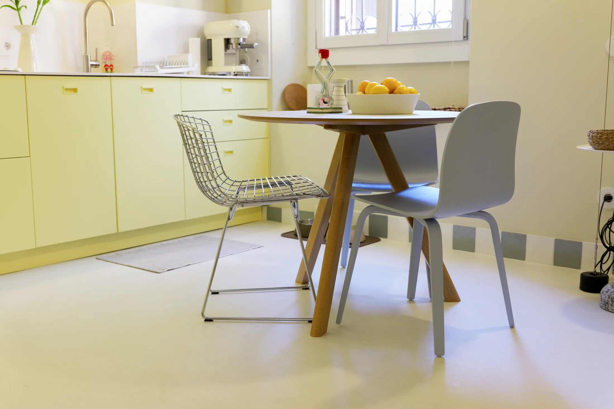
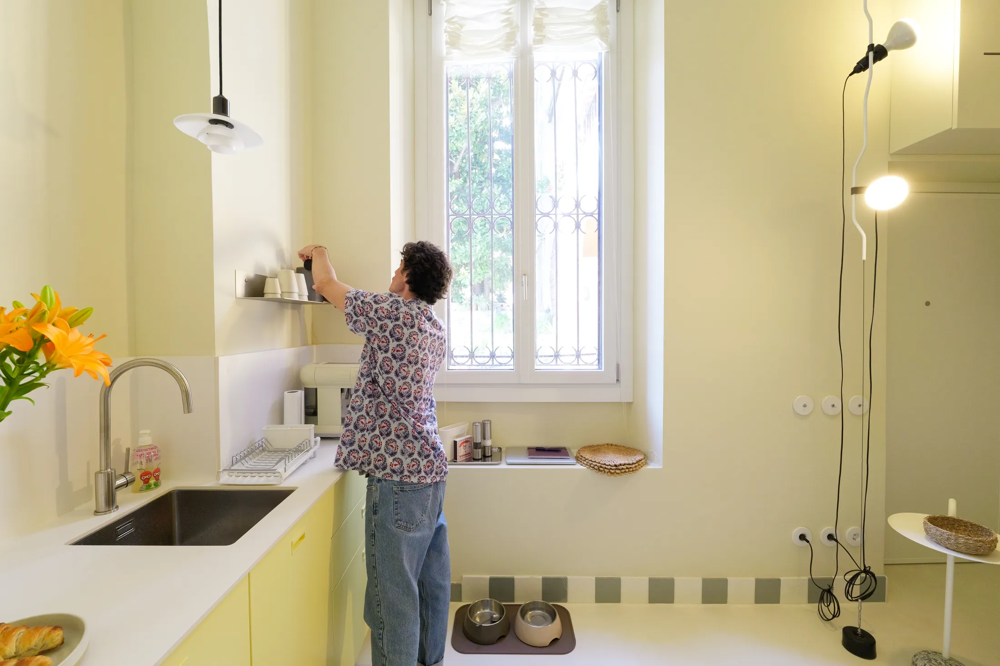
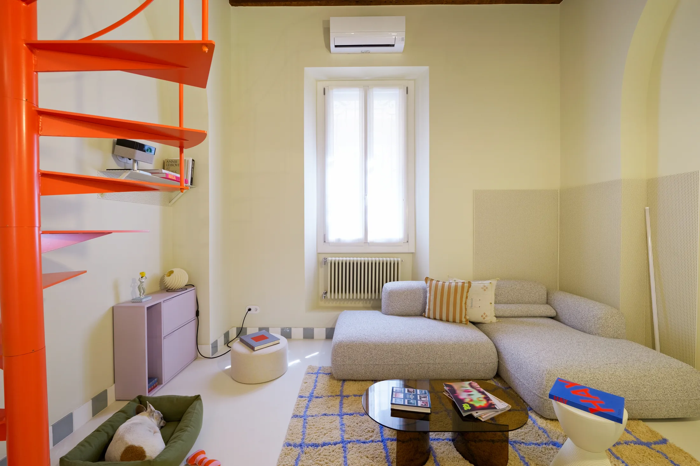
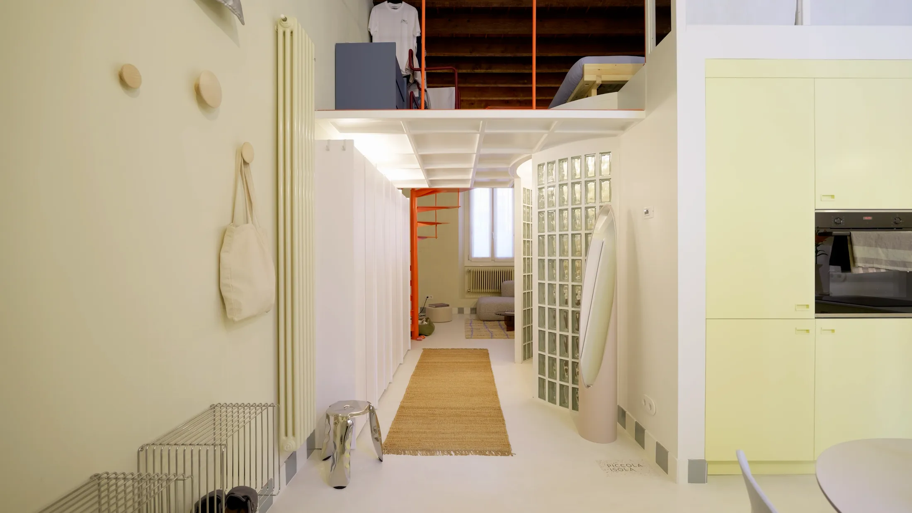

# Цвет вместо метров: как бывшую мастерскую в 45 м² превратили в яркий дом с мезонином

Когда квартира становится вдвое меньше, обычно стараются «выиграть» метры: убрать лишнее, высветлить, сделать нейтральным. Пара миланских фотографов интерьеров, Данило Флореани (Danilo Floreani) и Паоло Америо (Paolo Amerio), поступила наоборот. Они переехали из 90-метровой квартиры в Гейдельберге в бывшую мастерскую ортопедической обуви площадью 45 м², где пять лет никто не жил, — и покрасили её в жёлтый, лиловый, голубой и красный. Проект называется Piccola Isola, «Маленький остров».

Для читателя «Шахматки» это не только про Милан. 45 м² — это московская евродвушка на грани нормы, а бывшая мастерская с кирпичными арками и деревянной кровлей — прямой родственник лофтов на территории старых фабрик. Смотрим, что можно взять.

## Коротко

- Авторы не пытались растянуть пол, а использовали высоту: спальня поднята на мезонин под открытой деревянной кровлей.
- Каждая зона получила свой цвет: масляно-жёлтая кухня, лиловая гостиная, голубая ванная, красная лестница.
- Старые кирпичные арки и деревянные балки не закрывали — они стали главным декором.
- Телевизора нет: фильмы смотрят с проектора на пустой стене.
- Прихожей как отдельной комнаты нет: её заменил шкаф, который не доходит до потолка.

*Piccola Isola («Маленький остров»), Милан, 45 м². Авторы интерьера — Данило Флореани и Паоло Америо. Фото: Данило Флореани и Паоло Америо / Never Too Small*

## Почему именно этот проект интересен Москве

Рынок движется в сторону большей площади. С 1 августа 2024 года в новых московских проектах однокомнатная квартира не может быть меньше 28 м², а двухкомнатная — меньше 44 м² (постановление Правительства Москвы № 1672-ПП). Доля студий в предложении за год упала на 6 процентных пунктов — до 11%, а средняя площадь квартиры в новостройках, по данным bnMAP, выросла с 56,3 до 62 м² (первый квартал 2025 года — первый квартал 2026-го).

Но 45 м² никуда не делись: это и «большая» однушка, и типичная евродвушка у станции метро, и стандартная площадь в старом фонде. Вопрос в том, как в эти метры вместить не набор функций, а характер. Именно про это — Piccola Isola.

## Приём 1. Мезонин вместо новой комнаты

Главное решение — ход вверх. Бывшая мастерская высокая, и авторы не стали бороться за каждый сантиметр пола, а построили на втором уровне спальню прямо под исходной деревянной кровлей. Попасть туда можно по красной винтовой лестнице, она занимает на плане небольшое пятно. С мезонином гостиная связана стеклянной перегородкой, для приватности есть шторы.

*Красная винтовая лестница ведёт на мезонин под деревянной крышей. Фото: Данило Флореани и Паоло Америо / Never Too Small*

Наверху всё подогнано под скат крыши. Между балками установлены вешалки по ходу ската, самая низкая часть отдана под выдвижные ящики нежно-фиолетового цвета, а кровать стоит на приподнятом подиуме прямо под балками. Прикроватные тумбы съёмные: их надевают на каркас кровати. Для одежды на завтра есть напольная вешалка-«мажордом», как называет её Данило.

*Спальня на мезонине: кровать на подиуме под балками кровли. Фото: Данило Флореани и Паоло Америо / Never Too Small*

**Для Москвы.** В обычных московских домах, от хрущёвки до панели и монолита, такой ход невозможен: потолки не те. Другое дело — лофты в бывших промышленных зданиях. «Флакон» на Большой Новодмитровской, «Арма» рядом с Курским вокзалом и Даниловская мануфактура — известные примеры, когда старые цеха с высокими потолками превращены в квартиры и студии. Там мезонин — реальный сценарий. Условие одно: любой второй уровень — это перепланировка с проектом и согласованием, нагрузку на перекрытия считает инженер. И если вы покупаете такой лофт, спросите продавца, что уже согласовано, а что сделано «как было».

## Приём 2. Шкаф вместо прихожей

У входа нет коридора. Его заменяет полноростовой шкаф на заказ, который намеренно не доходит до потолка: дневной свет проходит над ним, и комната не распадается на «до» и «после» шкафа. В шкафу — одежда, обувь, уборочный инвентарь, пылесос и даже бойлер. Рядом — маленький журнальный столик для ключей, стальные кубы на стене для мелочей и вешалки в виде цветных точек. Свет — светильники, часть которых направлена вверх и подчёркивает высоту.

*Шкаф у входа не доходит до потолка, поэтому дневной свет проходит над ним. Фото: Данило Флореани и Паоло Америо / Never Too Small*

**Как повторить.** Приём «шкаф не до потолка» работает там, где потолки хотя бы около трёх метров: сталинки, дореволюционные доходные дома в Замоскворечье или на Покровке, новостройки бизнес-класса. В хрущёвке шкаф до потолка выгоднее — вам нужны все сантиметры хранения. Но и там верхнюю секцию можно сделать из рифлёного стекла: свет пройдёт, а вещи не будут видны. Котёл или бойлер в шкафу в Москве тоже встречаются, но обязательно оставьте доступ для обслуживания и вентиляцию.

## Приём 3. Кухня с одной полкой

Кухня выстроена в длинный ряд под старой кирпичной аркой. Фасады масляно-жёлтые, техника встроена, верхних шкафов нет — вместо них одна открытая полка для чашек и керамики. Всё громоздкое — холодильник, духовка, стиральная машина, кладовая — собрано в высокий шкаф по соседству. Посреди комнаты — круглый стол, за которым завтракают, работают и принимают гостей. Подоконник у окна используют как место для сидения.

*Кухня с масляно-жёлтыми фасадами под старой кирпичной аркой и круглый стол. Фото: Данило Флореани и Паоло Америо / Never Too Small*

*Вместо верхних шкафов — одна открытая полка для чашек и керамики. Фото: Данило Флореани и Паоло Америо / Never Too Small*

Стеклянную перегородку между кухней и лестницей реставрировали, а не заменили на новую.

**Для Москвы.** Кухня без верхних шкафов — смелый ход для квартиры, где на стене каждый сантиметр на счету. Но если вся техника и основные запасы уезжают в один высокий шкаф, верхние ряды действительно можно не строить. Круглый стол в узкой кухне-гостиной экономит место на углах: за него садятся четверо, а в собранном виде он не загораживает проход. Реставрированное стекло в старом доме — идея, которую стоит запомнить: перед тем как менять рамы и перегородки в доме с историей, спросите себя, нельзя ли их восстановить.

## Приём 4. Гостиная без телевизора

В гостиной нет телевизора. Для фильмов используют проектор, и после просмотра он убирается. Диван модульный, на заказ: части можно разъединять, если нужно больше посадочных мест. Рядом — лиловый шкаф, мягкая обивка, яркий графичный ковёр. Повреждённый участок стены закрыли складчатой металлической панелью, и она превратилась в индустриальный акцент.

*Гостиная: лиловый шкаф, модульный диван и графичный ковёр. Телевизора нет — только проектор. Фото: Данило Флореани и Паоло Америо / Never Too Small*

**Как повторить.** Проектор вместо телевизора освобождает стену и зрительно «разгружает» комнату, но ему нужна ровная светлая поверхность и возможность затемнить окна. В московской квартире с короткими зимними днями это не проблема: после шести вечера темно в любой комнате. Гибкий диван из модулей особенно полезен в студии, где одно и то же место служит и для гостей, и для сна.

## Приём 5. Ванная из стеклоблоков

Ванная находится под мезонином, поэтому потолок в ней ниже. Авторы выбрали стеклоблоки: вход оформлен изогнутой стеной из них, и ещё несколько блоков встроено в стены. Блоки смягчают угол и пропускают свет — они «одалживают» его у соседней комнаты. Столярные работы не доходят до потолка, ниши в стене для мелочей, стиральная машина скрыта за фасадом. Зона умывальника жёлтая, стены ванной — пудрово-голубые, на открытых полках лежат полосатые полотенца.

*Вход в ванную из изогнутых стеклоблоков смягчает угол и пропускает свет. Фото: Данило Флореани и Паоло Америо / Never Too Small*

**Для Москвы.** Стеклоблоки вернулись в моду и подходят для квартир с ванной без окна: свет из комнаты попадает внутрь, а силуэты остаются размытыми. Напомним про ограничения. Вентиляционные каналы нельзя ликвидировать или уменьшать, а лоджию нельзя объединять с комнатой (постановление 508-ПП) — так что «вторую» ванную за счёт балкона не сделать. Внутри квартиры вставки из стекла в несущую стену тоже требуют согласования.

## Как работает цвет

Главная идея Piccola Isola — цвет определяет пространство, а не мебель и не перегородки. Контраст с прежней гейдельбергской квартирой, нейтральной и в скандинавском духе, сознательный. Поэтому в мезонине обитает нежно-фиолетовый, в ванной — голубой, в кухне — масляно-жёлтый, а красный соединяет всё вместе в виде лестницы. Нейтральными остаются старые кирпичные арки и деревянные балки — они не конкурируют с цветом, а дают ему рамку.

Для московского интерьера это хороший урок. Новостройка отдаётся чистовой или «белой коробкой», и главное искушение — оставить всё серо-белым. Пробуйте иначе: выберите три цвета, закрепите каждый за зоной и повторите его минимум дважды (стена и аксессуар, фасад и текстиль). Цвет собирает комнату лучше, чем перегородка.

## Чек-лист для яркой квартиры 45 м²

1. Выберите 3 цвета и закрепите каждый за своей зоной.
2. Оставьте нейтральными самые большие поверхности — пол и стены.
3. Если потолки высокие, оцените второй уровень, но сначала узнайте, что разрешено в вашем доме.
4. Шкаф у входа не доводите до потолка, если потолки высокие, или сделайте верх стеклянным.
5. Крупную технику соберите в одном высоком шкафу, чтобы освободить стены под полки и свет.
6. Для фильмов подумайте о проекторе вместо телевизора.
7. Старые кирпичные арки, балки и стёкла берегите.

Больше идей для небольших квартир — в разделе [«Интерьер»](/temy/interer/). Если вам нужен свободный объём и высота, посмотрите [каталог новостроек Москвы](/novostroyki/moskva/).

## Вопросы и ответы

**Можно ли сделать спальню на втором уровне в московской квартире?**
Только при достаточной высоте потолков и после согласования: мезонин меняет нагрузку на перекрытия и требует проекта, поэтому без инженерного расчёта и разрешения такую конструкцию делать нельзя. Чаще всего подходящих условий нет в хрущёвках и панельных домах и они есть в лофтах бывших фабрик и в домах со свободной планировкой.

**Как сделать яркий интерьер в маленькой квартире и не перегрузить его?**
Закрепить за каждой зоной свой цвет, как в миланской квартире: жёлтый для кухни, лиловый для гостиной, голубой для ванной. Нейтральными оставить крупные поверхности: стены и пол. Главное — повторять каждый цвет в двух-трёх местах, чтобы он выглядел решением, а не случайностью.

**Какой должна быть минимальная площадь двухкомнатной квартиры в новостройках Москвы?**
С 1 августа 2024 года в новых московских проектах двухкомнатная квартира не может быть меньше 44 м², однокомнатная — меньше 28 м² (постановление Правительства Москвы № 1672-ПП от 23 июля 2024 года).

## Источники

1. Never Too Small. How a creative couple turned a former Milan workshop into a colourful 45sqm/484sqft home — https://www.nevertoosmall.com/post/how-a-creative-couple-turned-a-former-milan-workshop-into-a-colourful-45sqm-484sqft-home
2. ppt.ru: постановление Правительства Москвы от 23.07.2024 № 1672-ПП — https://ppt.ru/obzory/vstupaet-v-silu/postanovlenie-pravitelstva-moskvy-23-07-2024-1672-pp
3. РБК Недвижимость: средняя площадь квартир в новостройках, данные «Метриума» и bnMAP, 2026 — https://realty.rbc.ru/news/6a2688819a7947c4911d7fd8
4. РБК Недвижимость: доля студий в предложении Москвы, I полугодие 2026 — https://realty.rbc.ru/news/6a6094b09a7947481c9c3ec4
5. Мосжилинспекция: какие перепланировки запрещены (постановление 508-ПП) — https://www.mos.ru/news/item/76897073/

*Материал подготовлен по мотивам публикаций Never Too Small и использует их фото с разрешения правообладателя.*
