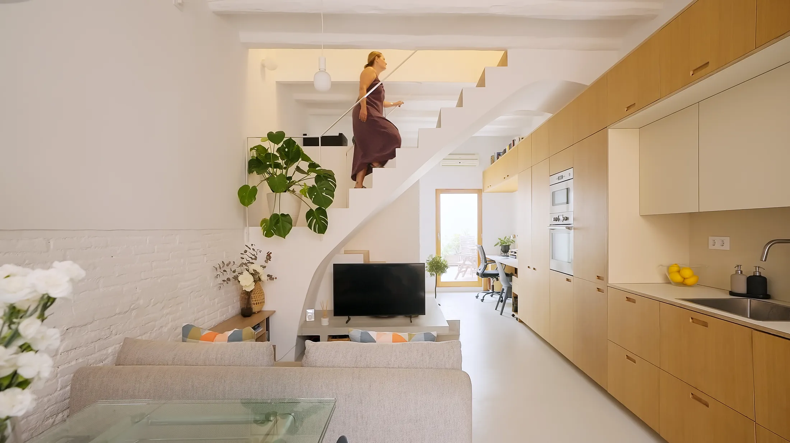
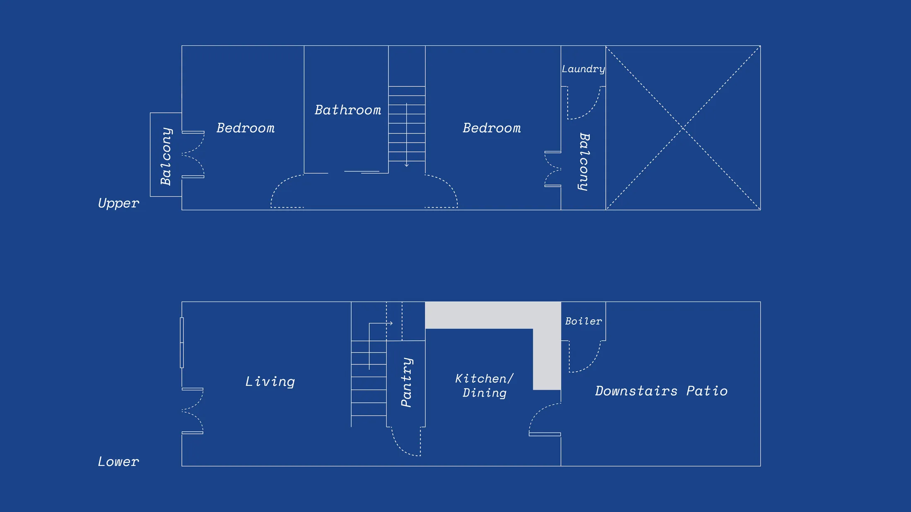
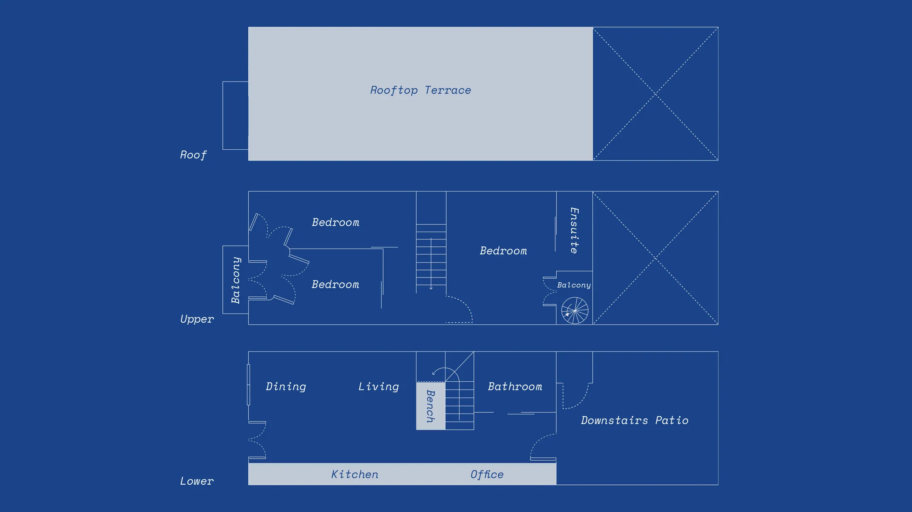
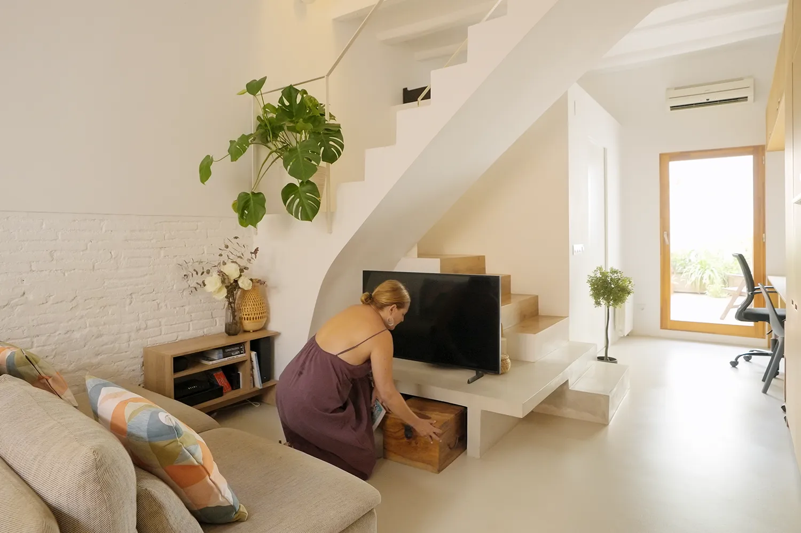
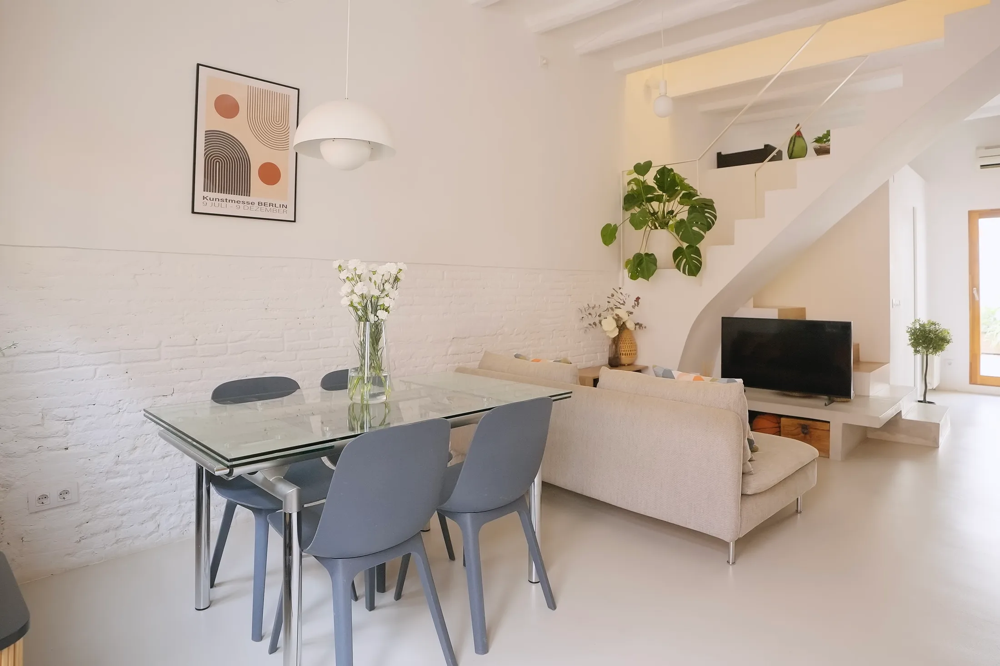
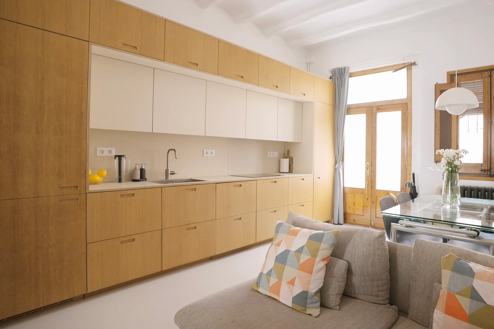
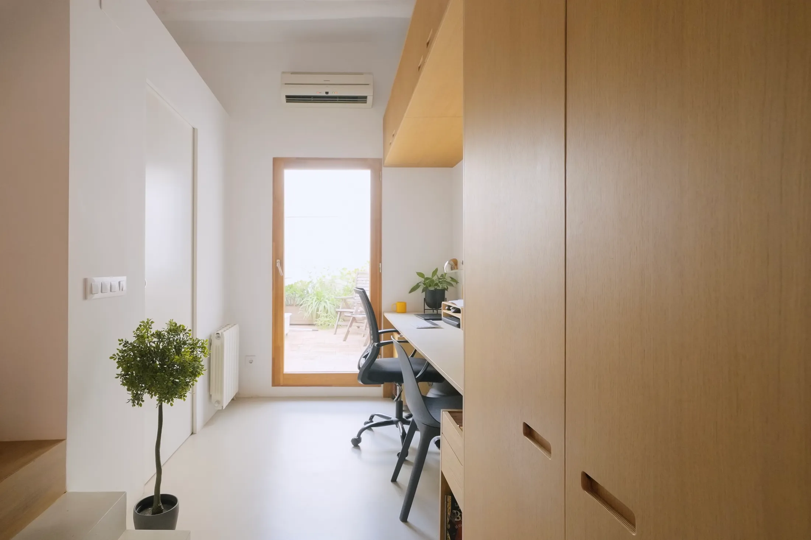
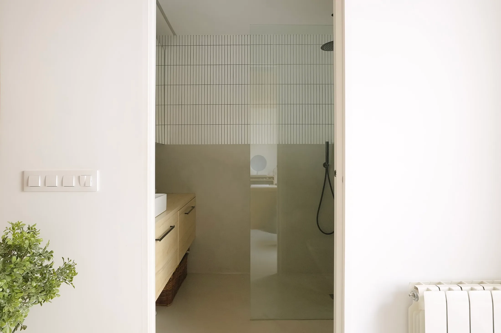

# Узкий дом 60 м²: пять решений, которые добавляют простора длинной планировке

Когда квартира длинная и узкая, главная проблема не в метрах, а в пропорциях: вдоль одной стены тянется коридор, а комнаты оказываются «пеналами». В Москве такие планировки знакомы всем, кто смотрел евродвушки с вытянутой кухней-гостиной или квартиры в старых домах Басманного района и Замоскворечья. Испанские архитекторы Ноэлия де ла Ред (Noelia de la Red, Santa Arquitectura) и Жорди Рибас (Jordi Ribas, LABLANCA) занимались похожим домом: он находится в Оспиталет-де-Льобрегат рядом с Барселоной, построен в начале XX века, находится под охраной и занимает 60 м². Для справки: по данным bnMAP, средняя квартира в московских новостройках в I квартале 2026 года — 62 м², то есть по площади этот дом почти типичная московская новостройка.

## Коротко

- Лестница вместо стены: изгиб, консоль под телевизор и шкафы под ступенями.
- Светлый микроцемент на полу и ключевых поверхностях объединяет всё пространство и отражает свет.
- Кухня — одна длинная стена от входа до задней двери, шкафы не доходят до потолка.
- В кухонный гарнитур встроен двойной стол: двое работают рядом.
- В ванной плитка длинного формата уложена вертикально, а сама ванная собрана на стандартных модулях, что дешевле.

*Xipreret, Оспиталет-де-Льобрегат (рядом с Барселоной), 60 м². Santa Arquitectura и LABLANCA. Фото: Хосе Эвиа (José Hevia) / Never Too Small*

## Что делать с длинной планировкой

Дом длинный и узкий: вход с одной стороны, задняя дверь с другой. Архитекторы не стали бороться с формой, а сделали из неё достоинство: собрали основные функции вдоль стен и оставили центр свободным.

*План до реконструкции. Чертёж: Santa Arquitectura, LABLANCA / Never Too Small*

*План после реконструкции. Чертёж: Santa Arquitectura, LABLANCA / Never Too Small*

## Приём 1. Лестница, которая работает как мебель

Лестница в доме не прямая, а плавно изогнутая. Нижний марш продолжается во встроенную консоль, на которой стоит телевизор, а под ступенями спрятаны шкафы. Там, где объём лестницы меняется, возникает небольшая ниша. Ограждение тонкое, белое стальное, чтобы не перегружать картину.

*Лестница с изгибом: нижний марш превращается в консоль для телевизора. Фото: Хосе Эвиа / Never Too Small*

**Для Москвы.** Лестницы в городских квартирах — редкость: двухуровневые планировки встречаются в монолитных домах, в лофтах бывших фабрик (вроде «Арма» или «Флакона») и в мансардах старых зданий. Если у вас такая лестница или вы собираетесь её заказывать, не оставляйте пространство под ней пустым: выдвижные ящики, шкаф для пылесоса и сезонных вещей, ниша под технику. Это хранение, которое никому не мешает.

## Приём 2. Светлый микроцемент без швов

Пол и ключевые поверхности дома покрыты светлым микроцементом. Он отражает свет вглубь узкого плана и «склеивает» комнаты в одно целое. Остальная палитра сдержанная и нейтральная, поэтому глаз не цепляется за границы, а деревянная столярка добавляет тепла.

*Светлый микроцемент на полу и ключевых поверхностях. Фото: Хосе Эвиа / Never Too Small*

**Как повторить.** Главный смысл приёма не в самом материале, а в непрерывности: один тон пола во всей квартире делает её визуально шире. Это можно получить и дешевле, например, светлым ламинатом, плиткой одного размера или монолитной наливной стяжкой. Если выбираете микроцемент, учитывайте московскую зиму: холодный бесшовный пол нужно обогревать, а тёплый пол от общих систем в Москве делать запрещено (508-ПП). Как обогревать такой пол, обсудите с проектировщиком до начала работ.

## Приём 3. Кухонная стена от двери до двери

Вдоль всей стены идёт непрерывный ряд шкафов: от входной двери до задней. Шкафы поднимаются высоко, но не упираются в потолок, и сверху остаётся просвет, через который проходит свет. Единая линия фасадов делает стену спокойной: взгляд скользит по ней и не задерживается.

*Кухонная стена тянется от входа до задней двери. Фото: Хосе Эвиа / Never Too Small*

**Для Москвы.** Стена хранения вдоль длинной стороны — естественное решение для вытянутой кухни-гостиной в евродвушке. Прикиньте: что в вашей квартире лежит у входа и на кухне, и можно ли убрать это в единый ряд шкафов? Зазор над шкафами не обязателен, но он подсказывает полезный приём для хрущёвки и панельки: если не хватает высоты, лучше оставить свет над шкафами, чем делать «глухую» стену до потолка.

## Приём 4. Стол на двоих внутри гарнитура

В кухонную мебель встроен двойной рабочий стол: оба родителя работают рядом, а верхние шкафы обрамляют это место. Кабинет не занимает отдельной комнаты, он «растворён» в линии хранения.

*Двойной стол, встроенный в кухонный гарнитур. Фото: Хосе Эвиа / Never Too Small*

**Как повторить.** По данным hh.ru за июнь 2025 года, 23% опрошенных хотят работать полностью удалённо, 26% — в гибридном формате, а ещё 35% сейчас в офисе, но перешли бы на удалёнку. Для пар это значит два рабочих места в одной маленькой квартире. Подход испанцев: не искать отдельную комнату, а выделить участок стены и вмонтировать в неё стол с полками. Две розетки и общий кабель-канал закладывайте сразу.

## Приём 5. Ванная из стандартных модулей

В ванной длинные плитки уложены вертикально: потолок кажется выше. Планировку, как пишет оригинал, рассчитали на стандартные модули ИКЕА, чтобы сэкономить: меньше нестандартной столярки — ниже цена. Размеры плитки и модулей издание не называет.

*Ванная: плитка длинного формата уложена вертикально. Фото: Хосе Эвиа / Never Too Small*

**Для Москвы.** ИКЕА в России сегодня не работает, но принцип остаётся: проектируйте сантехнику и мебель под размеры серийных модулей, которые есть в продаже, а не под произвольные размеры. Нестандартный шкаф можно сделать на заказ, а на стандартной тумбе и раковине, как правило, получится сэкономить. Вентиляцию в ванной не трогайте: ликвидировать и уменьшать вентканалы запрещено (508-ПП).

## Чек-лист: длинная планировка

1. Определите «стену жизни» — самую длинную: пусть кухня, хранение и стол будут на ней.
2. Оставьте центр свободным, чтобы линия от входа до окна не прерывалась.
3. Сделайте один тон пола во всей квартире.
4. Оставьте просвет над верхними шкафами, если потолок невысокий.
5. Не оставляйте пустым пространство под лестницей, антресолью и подоконником.
6. Заранее продумайте розетки и свет для второго рабочего места.
7. Любую перепланировку и «тёплые» решения проверяйте по правилам 508-ПП.

Больше идей для небольших квартир — в разделе [«Интерьер»](/temy/interer/). Если выбираете планировку, посмотрите [каталог новостроек Москвы](/novostroyki/moskva/).

## Вопросы и ответы

**Как обставить узкую и вытянутую квартиру?**
Опыт испанского дома на 60 м²: собрать функции вдоль одной стены (кухня, хранение, стол), оставить светлую сквозную поверхность пола и не загромождать центр. Лестницу, если она есть, превратить в мебель — со шкафами под ступенями и консолью для ТВ.

**Что такое микроцемент и подойдёт ли он для квартиры?**
Микроцемент — тонкое бесшовное покрытие на основе цемента, которое наносят на пол и стены. В испанском доме его выбрали светлым, чтобы пол отражал свет и связывал комнаты. Для квартиры нужен ровный, прочный и сухой слой основания; тёплый пол от общих систем в Москве запрещён (508-ПП).

**Как сделать рабочее место для двоих в маленькой квартире?**
В испанском доме двойной стол встроили в кухонный гарнитур: двое работают рядом, верхние шкафы обрамляют рабочую зону. По данным hh.ru за июнь 2025 года, 23% опрошенных хотят работать полностью удалённо, 26% — в гибридном формате, поэтому два рабочих места — всё чаще необходимость.

## Источники

1. Never Too Small. 5 clever design decisions that make this slim Spanish house more spacious — https://www.nevertoosmall.com/post/5-clever-design-decisions-that-make-slim-spanish-house-more-spacious
2. РБК Недвижимость: площадь квартир в новостройках, данные «Метриума» и bnMAP, май 2026 — https://realty.rbc.ru/news/6a2688819a7947c4911d7fd8
3. Коммерсантъ: данные hh.ru о формате работы, июнь 2025 — https://www.kommersant.ru/doc/8336320
4. Мосжилинспекция: какие перепланировки запрещены (постановление 508-ПП) — https://www.mos.ru/news/item/76897073/
