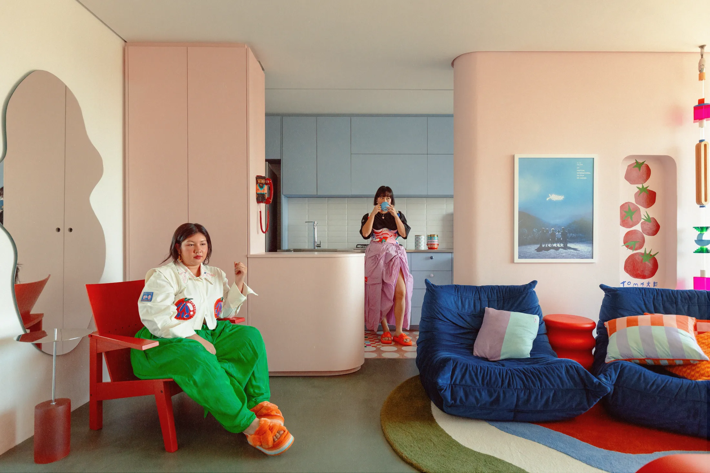
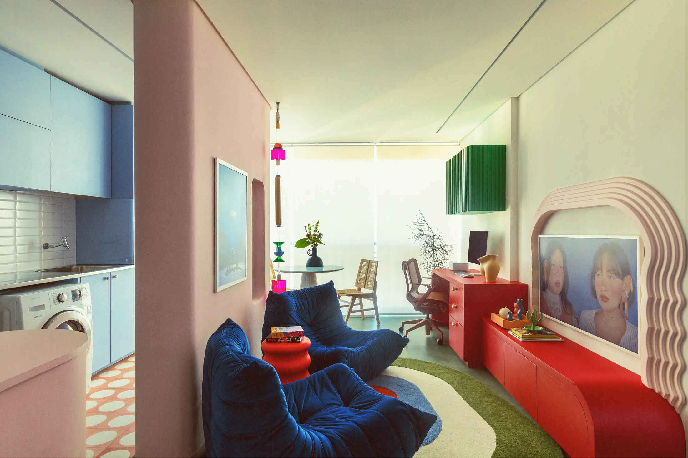
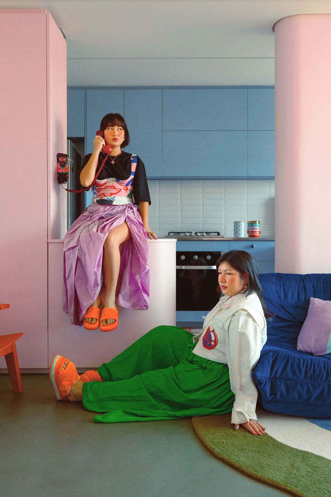
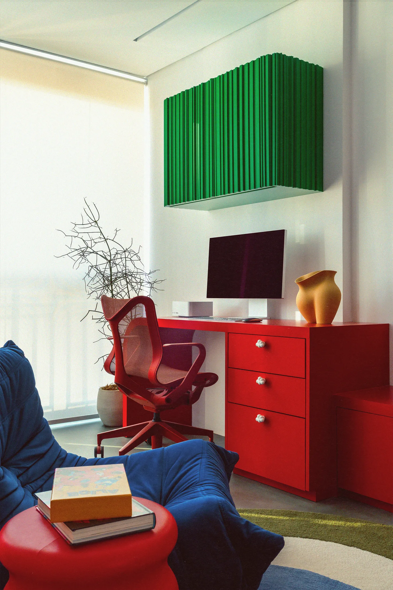
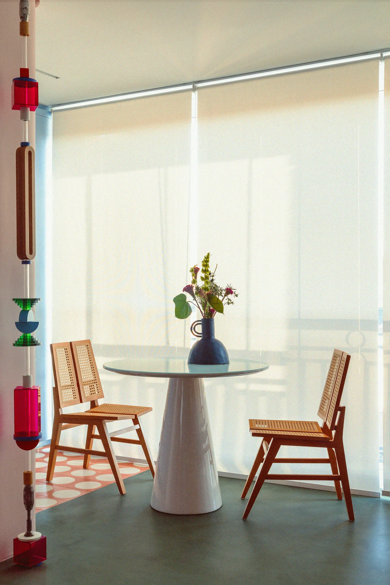

# Яркий цвет в маленькой квартире: как не устать от красного и зелёного

Яркая стена в маленькой комнате обычно вызывает один вопрос: не надоест ли через месяц? Дуэт Two Lost Kids (Габи и Тали) жил с красным, зелёным и синим каждый день и при этом снимал в этой же квартире. Бразильское бюро Moca Arquitetura нашло способ: цвет в акцентах, а все большие поверхности спокойные. Для Москвы это актуально: по данным bnMAP.pro, средняя студия в новостройках в июле 2026 года — 27 м², и именно в таких квартирах цвет либо спасает, либо давит.

Город и площадь в публикации не называются: сказано лишь, что квартира очень небольшая. Зато дизайнерские решения описаны подробно, и многие из них можно перенести в московскую студию или однушку.

## Коротко

- Квартира была одновременно домом и съёмочной площадкой, причём в период карантина, когда выйти было нельзя.
- Цвет собран в акцентах (красный, зелёный, синий), поверхности пастельные и кремовые.
- Мягкие формы: кривые стены и столярка, зеркало с волнистой кромкой, ручки в форме облаков.
- Техника и приборы спрятаны, а места для хранения заложены под вещи, которые присылают бренды.

*Квартира Two Lost Kids, проект Moca Arquitetura. Фото: Эдуардо Макариос (Eduardo Macarios) / Never Too Small*

## Зачем квартире быть и домом, и сценой

Тали вспоминает пандемийные месяцы: они были дома круглые сутки в тесном помещении без запаса места, а снимать нужно было прямо тут, вдвоём и без студии. Заказ архитекторам звучал примерно так: пусть квартира выглядит как «Two Lost Kids», но остаётся местом, где можно просто жить. Позже Габи переехала в собственное жильё, а Тали осталась. Именно поэтому, по её словам, всё безумие пришлось сдерживать: ей предстояло жить здесь и после съёмок.

Эта история понятна московскому читателю. Студия в новостройке часто становится всем сразу: жильём, офисом и, у блогеров и ремесленников, мастерской. По данным «Метриума» и bnMAP, средняя квартира в новостройках Москвы выросла с 56,3 до 62 м² за год (I квартал 2025 к I кварталу 2026), а вот студии остаются самым компактным вариантом.

**Для Москвы.** Прежде чем выбирать цвет, решите, сколько функций у вашего пространства. Если в студии вы ещё и работаете, цвет и свет должны выдерживать восемь часов в день, а не только красиво смотреться при покупке.

## Цвет с границами

Габи признаёт, что подобрать палитру было непросто: хотелось смелости, но каждый день жить с очень насыщенным цветом тяжело. Архитекторы нашли баланс через пропорцию. Красный, зелёный и синий появляются в акцентах и мебели, а вокруг — гладкие пастельные и кремовые поверхности. Получилось одновременно современно и ретро, функционально и театрально, уютно и по-домашнему.

*Подбор палитры оказался самым сложным: она должна быть смелой, но удобной для жизни. Фото: Эдуардо Макариос (Eduardo Macarios) / Never Too Small*

**Как повторить.** Практическое правило для маленькой квартиры: не более 10–15% поверхностей насыщенного цвета, остальное нейтральное. В Москве, где зимой световой день в декабре совсем короткий, а за окном серый двор, нейтральный фон поможет не потерять свет, а красная ниша или зелёное кресло оживят комнату. Если боитесь ошибиться, начните с тех вещей, которые легко заменить: ткани, лампа, ручки.

## Мелочи, которые делают квартиру «своей»

Сказать, что это квартира творческих людей, можно по деталям. В нише перегородки нарисованы острые помидоры, на розовой формайке висит красный лаковый телефон со спиральным шнуром. С потолка свисает лампа из цветных бусин, а у зеркала волнистые края. Кресла Togo в мягком бархате стоят на ковре с густым ворсом, а на ящиках ручки в форме пушистых облаков.

*Цвет в квартире сосредоточен в акцентах, а поверхности остаются спокойными. Фото: Эдуардо Макариос (Eduardo Macarios) / Never Too Small*

Работает здесь не набор модных предметов, а их количество: каждая вещь с характером, но их немного, и между ними остаётся спокойный фон. Кривые стены и мебель без острых углов тоже смягчают тесное пространство: глаз скользит по плавным линиям и не упирается в углы.

**Для Москвы.** Дешёвые аналоги найти легко: нестандартные ручки, лампа-абажур из бусин или ткани, зеркало неправильной формы. А вот кривые стены и столярку в панельном или монолитном доме придётся делать из гипсокартона или фанеры: несущие стены трогать нельзя, а любая перепланировка требует согласования.

## Хранение: подарки брендов и техника

Тали отдельно говорит, что хранение было обязательным пунктом: у них копилась продукция, которую присылают бренды, и места становилось всё меньше. Одновременно хотели избежать слишком громких решений. Поэтому приборы и электроника спрятаны или замаскированы, а видимыми остаются только красивые вещи.

*В период карантина именно здесь снимали большую часть работ Two Lost Kids. Фото: Эдуардо Макариос (Eduardo Macarios) / Never Too Small*

**Как повторить.** В московской студии, где метр ценится особенно высоко (средняя цена студии в июле 2026 года, по bnMAP.pro, — 17,9 млн ₽), «скрыть» нужно всё, что не используется ежедневно: роутер, зарядки, телевизор, коробки с вещами. Закрытый фасад, ящик или рифлёная дверца дают больше спокойствия, чем любой цвет на стене.

*Квартира сочетает современное и ретро, театральность и домашний уют. Фото: Эдуардо Макариос (Eduardo Macarios) / Never Too Small*

## Чек-лист: цвет в студии 25–30 м²

1. Определите 2–3 акцентных цвета, не больше. Остальное нейтральное.
2. Поверхности (стены, пол, потолок) держите спокойными: пастель, кремовый, светлое дерево.
3. Яркое выносите в вещи, которые легко заменить: кресло, лампа, ручки, ткани.
4. Скруглите хотя бы одну вещь: зеркало, стол, нишу.
5. Скрывайте технику и провода, не выставляйте их на виду.
6. Заложите в проект место для вещей, которые «приходят» в дом: подарков, реквизита, образцов.
7. Если студия служит ещё и рабочим местом, поставьте её цвета на проверку днём и вечером.

Больше идей для небольших квартир — в разделе [«Интерьер»](/temy/interer/). Если вы выбираете студию, посмотрите [новостройки Москвы](/novostroyki/moskva/), где такие квартиры продаются.

## Вопросы и ответы

**Как использовать яркий цвет в маленькой квартире и не перегрузить её?**
Оставить крупные поверхности пастельными или кремовыми, а яркие красный, зелёный и синий вынести в акценты: мебель, лампы, ниши, ручки. Именно так сделали авторы проекта Two Lost Kids.

**Как совместить в студии жильё и рабочее место для съёмок?**
Прятать технику и приборы за фасадами, держать место для хранения реквизита и подарочных образцов и делать декор, который хорошо выглядит в кадре и при этом остаётся уютным. Так сделано в квартире Two Lost Kids.

**Какая студия в Москве считается обычной по площади?**
По данным bnMAP.pro, средняя студия в новостройках Москвы в июле 2026 года — 27 м²: в старой Москве 28 м², в Новой Москве 25 м². Доля студий в предложении за год упала до 11%.

## Источники

1. Never Too Small. The Two Lost Kids Apartment — https://www.nevertoosmall.com/post/the-two-lost-kids-apartment
2. РБК Недвижимость: цены и площадь студий в новостройках Москвы, июль 2026 — https://realty.rbc.ru/news/6a688a1e9a7947e0d847331e
3. РБК Недвижимость: студии в предложении, данные «Метриума», май 2026 — https://realty.rbc.ru/news/6a2688819a7947c4911d7fd8
4. РБК Недвижимость: доля студий в предложении Москвы, I полугодие 2026 — https://realty.rbc.ru/news/6a6094b09a7947481c9c3ec4

*Материал подготовлен по мотивам публикаций Never Too Small и использует их фото с разрешения правообладателя.*
