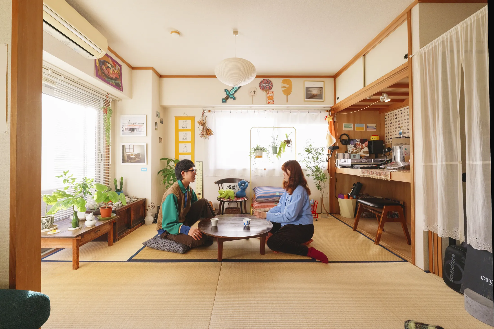
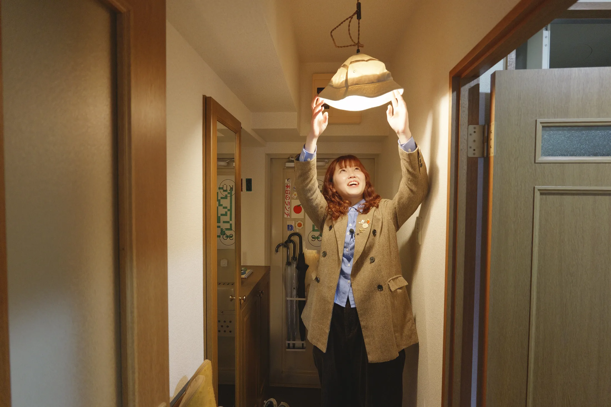
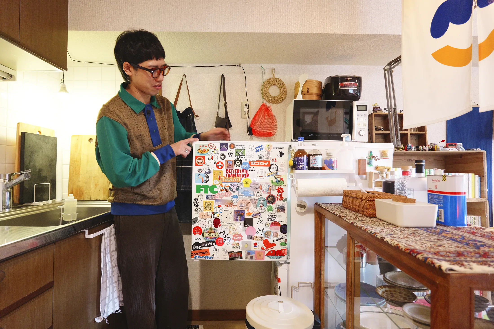
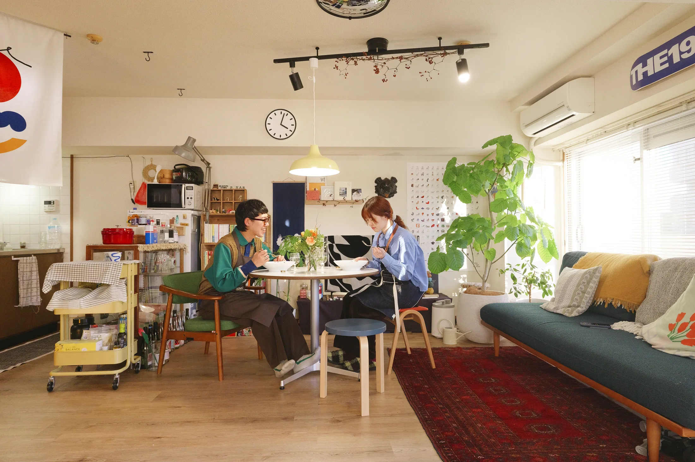
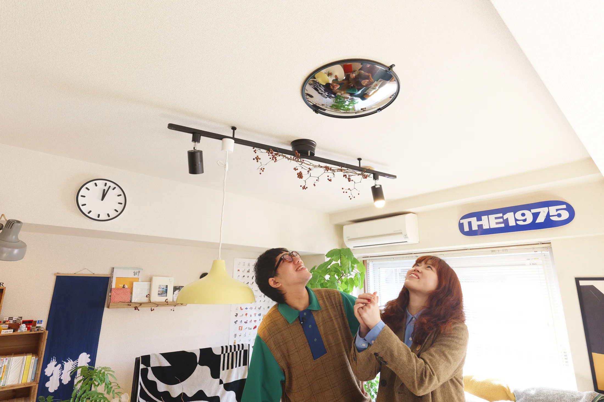
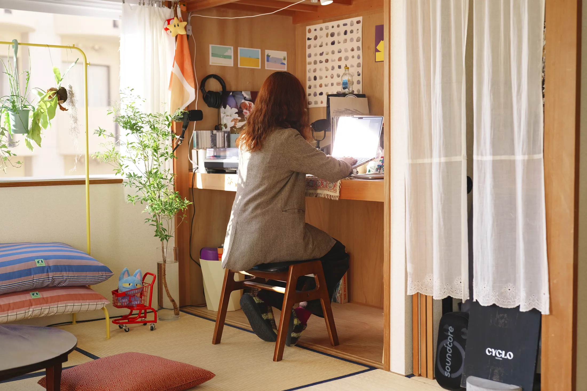
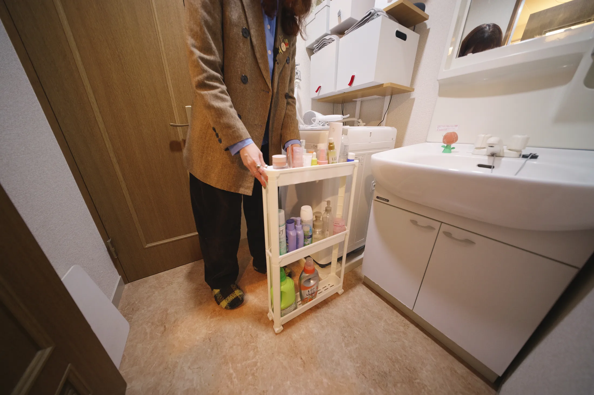

# Съёмная квартира как дом: что москвичам взять у японской пары из Yoshinani House

Не каждая небольшая квартира проходит через ремонт. Многие москвичи снимают жильё, другие только что купили вторичку и не готовы сразу тратить миллионы. Пара из Японии показывает, как сделать квартиру своей, почти не трогая стены.

Видеопродюсер Рю (Takashi «Ryu» Harada) и графический дизайнер Камадо (Nodoka «Kamado» Miyamoto) живут в районе Мусаси-Косуги, между Токио и Йокогамой. У них однокомнатная квартира в старом доме, которую они называют Yoshinani House — Камадо сама нарисовала логотип дома. Дизайнера или бюро здесь нет: всё придумали сами жильцы. Площадь в публикации не указана, но по описанию это скромная «однушка» с кухней, гостиной, комнатой с татами и спальней без окна.

## Коротко

- Входная дверь работает как стеллаж: магниты и держатель для зонтов.
- Мебель перемещается: стол меняет размер, светильник едет вместе с ним, диван превращается в кровать.
- Вместо перегородки между кухней и гостиной — небольшой холодильник со стеллажом.
- Бывший шкаф без дверей стал рабочей нишей, а гардероб спрятан за съёмной шторой.
- В ванной даже зазор в 5 см занят: туда встала узкая тележка.

*Yoshinani House, Мусаси-Косуги, Япония. Квартира Рю и Камадо. Фото: Never Too Small*

## Прихожая: зонты, ключи и панама вместо плафона

В доме запрещено оставлять зонты снаружи, поэтому пара прикрепила держатель на магнитах к обратной стороне входной двери. Рядом узкий обувной шкаф, а сверху на нём лежат ключи, украшения и духи. Для гостей — стопка тапочек на отдельной стойке. Вместо плафона над входом повесили старую панаму. В стенах старого дома просверлены отверстия — на них висят картины и вещи, которые нужны каждый день. В коридоре висит стеклянная доска, на которой друзья рисуют портреты.

*Абажур в прихожей — старая панама. Фото: Never Too Small*

**Для Москвы.** Хрущёвская прихожая нередко шириной в метр и без единого шкафа, а зимой в ней ещё и нужно разместить пуховик и мокрые ботинки. Дверь, на которую можно навесить на магнитах держатели для зонта, ключей и сумки, — это сорок сантиметров хранения, которые не нужно ни согласовывать, ни сверлить. Если это стальная дверь, магниты держатся без проблем. Проверьте только, что вес не превышает допустимого для петель.

## Кухня: порядок «по задачам», а не по размеру

На кухне стоит обычная газовая плита на три конфорки: так можно пользоваться той посудой, что уже есть. Внутри шкафов — светильники с датчиком движения, на фартуке — держатель для телефона, чтобы читать рецепт. Ящики организованы не по размеру предметов, а по тому, для чего они нужны. В верхнем ящике лежат бумажные подставки — разные, собранные из кафе и поездок. Между кухней и гостиной стоит небольшой холодильник и стеллаж: они же и перегородка. А над кухней висит тканевая норэн с логотипом дома.

*Маленький холодильник и стеллаж отделяют кухню от гостиной. Фото: Never Too Small*

**Как повторить.** В московской однушке-хрущёвке кухня обычно 5–6 м², и стена между кухней и комнатой нередко несущая или капитальная, то есть снос исключён. Зато можно выставить границу мебелью: невысокий стеллаж или узкий холодильник вдоль проёма разделяют зоны без перепланировки. Светильники с датчиком движения и держатель телефона стоят недорого и меняют привычки больше, чем кажется.

## Гостиная: стол, который подстраивается

Обеденный стол двигается и меняет размер в зависимости от числа гостей. Стулья разные: гость выбирает, на каком сидеть. Подвесной светильник включён в трековую систему, поэтому он перемещается вместе со столом. На потолке над столом закреплено выпуклое зеркало IKEA — через него удобно делать групповые фото. Модульный диван служит и сиденьем за столом, а в разложенном виде превращается в односпальную кровать. Полки собраны из деревянных ящиков из-под яблок, а телевизор, когда не включён, накрыт тканью с рисунком.

*Стол меняет размер в зависимости от числа гостей. Фото: Never Too Small*

*Светильник на треке и выпуклое зеркало на потолке для групповых фото. Фото: Never Too Small*

**Для Москвы.** В небольшой квартире, где гости собираются на кухне или в единственной комнате, самое сложное — один стол на разные случаи. Стол-трансформер или два небольших столика, которые сдвигаются, решают задачу лучше, чем один громоздкий. А светильник, перемещающийся по треку, удобнее, чем люстра над фиксированной точкой: стол можно передвинуть, свет пойдёт за ним. Монтаж трека в съёмной квартире обычно требует согласия хозяина, поэтому на старте можно взять напольный или настольный вариант на длинном шнуре.

## Комната с татами: кабинет там, где был шкаф

Комната с татами — вторая гостиная, мастерская, читальный зал и рабочее место в одном. Бывший шкаф, у которого сняли двери, превратился в рабочую нишу, а под столом стоит маленькая тележка на колёсах с красками и инструментами для глины. Сами вещи из шкафа переехали в соседнюю зону и спрятаны за съёмной шторой.

*Бывший шкаф без дверей стал рабочей нишей. Фото: Never Too Small*

**Как повторить.** Для москвичей это едва ли не самая применимая идея. По данным hh.ru за июнь 2025 года, 23% россиян хотят работать полностью удалённо, ещё 26% — в гибридном режиме. В небольшой квартире под кабинет проще всего приспособить то, что уже есть: встроенный шкаф, остеклённую лоджию (без переноса батареи и объединения с комнатой), нишу у входа в «сталинке» или в доме типовой серии. Достаточно снять двери, поставить столешницу и подвесить полку.

## Спальня без окна и ванная на 5 см

Окон в спальне нет, поэтому свет дают настенным бумажным светильником японского бренда Sakae Mark. В комнате — большой открытый стальной стеллаж и вешалка для сезонной одежды.

В ванной стены неровные, присоски и магниты не держатся, поэтому всё подвешено. Рядом с стиральной машиной остался зазор в 5 см — в него встала узкая тележка для хранения. Трёхъярусные полки закреплены распорной штангой, на них лежат полотенца и туалетные принадлежности.

*В зазор рядом со стиральной машиной вошла узкая тележка. Фото: Never Too Small*

**Для Москвы.** Неровные стены — привычное дело в старых домах и в хрущёвках. Распорная штанга и подвесные системы не требуют сверления кафеля, а значит, не страшны при съёмке квартиры. Тележку на колёсах можно ставить в любой зазор между стиральной машиной и стеной.

## Чек-лист для съёмной или первой квартиры

1. Дверь — тоже хранение: магниты, крючки, держатель для зонта.
2. Один стол для любого числа гостей: трансформер или два столика.
3. Свет, который передвигается: трек, длинный шнур, напольная лампа.
4. Перегородка из мебели: стеллаж или холодильник вместо стены.
5. Рабочее место в бывшем шкафу или нише.
6. Ванная без сверления: распорная штанга, подвесные полки, тележка в зазор.
7. Всё новое сверление — после разговора с арендодателем.

Больше идей для небольших квартир — в разделе [«Интерьер»](/temy/interer/). Если вы выбираете квартиру на покупку, загляните в [каталог новостроек Москвы](/novostroyki/moskva/).

## Вопросы и ответы

**Как обустроить съёмную квартиру, не затрагивая стены и коммуникации?**
Рю и Камадо обошлись мебелью и мелочами: стол, который меняет размер, модульный диван, холодильник и стеллаж вместо перегородки, лампа на треке, магниты на двери. Отверстия для картин они сверлили в стенах старого дома, поэтому в Москве такое решение нужно согласовать с арендодателем.

**Как принять гостей, если у вас маленькая комната?**
В Yoshinani House стол двигается и меняет размер, стулья разные, и гость выбирает любой, модульный диван раскладывается в односпальную кровать. Лампа подвешена к треку и перемещается вместе со столом.

**Можно ли дома работать без отдельного кабинета?**
Да. По данным hh.ru за июнь 2025 года, 23% россиян хотят работать полностью удалённо, ещё 26% — в гибридном формате. В Yoshinani House рабочим местом стал бывший шкаф без дверей, а материалы хранятся на тележке под столом.

## Источники

1. Never Too Small. How a creative couple live small in their Yoshinani House apartment — https://www.nevertoosmall.com/post/how-a-creative-couple-live-small-in-their-yoshinani-house-apartment
2. «Коммерсантъ»: опрос hh.ru о формате работы, июнь 2025 — https://www.kommersant.ru/doc/8336320
